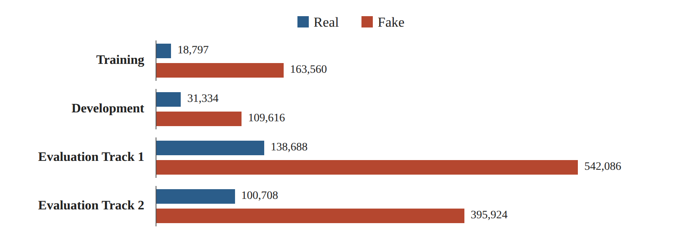
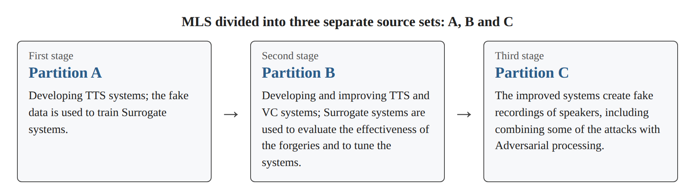
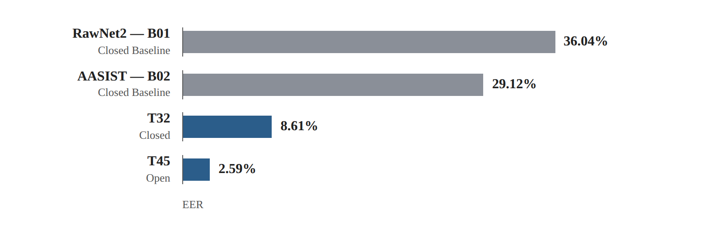

# Research Card 01 — ASVspoof 5

## 1. Bibliographic Details

**Paper title:** ASVspoof 5: Crowdsourced Speech Data, Deepfakes, and Adversarial Attacks at Scale

**Authors:** Xin Wang, Héctor Delgado, Hemlata Tak, Jee-weon Jung, Hye-jin Shim, Massimiliano Todisco, Ivan Kukanov, Xuechen Liu, Md Sahidullah, Tomi Kinnunen, Nicholas Evans, Kong Aik Lee, Junichi Yamagishi.

**Research body:** ASVspoof Consortium

**Year:** 2024

**Version read:** arXiv:2408.08739v1, dated August 16, 2024.

**Link:** https://arxiv.org/abs/2408.08739

**Field:** Audio Deepfake Detection, Speech Anti-Spoofing, Speaker Verification, Generalization.

**Relevance to the project:** Very high — the paper describes one of the datasets on which the course project is based, and presents evaluation methods, Baseline models and results relevant to the detection of synthetic speech.

---

## 2. Comprehensive Summary of the Paper

The paper presents ASVspoof 5, the fifth edition of an international research challenge dealing with the detection of voice forgeries and the development of systems that are robust to attacks on speaker recognition.

The goal of the study is to advance the ability of systems to detect fake speech under conditions more challenging than those examined in previous challenges. The researchers focus on three main changes: a move to speech data that is more diverse in terms of speakers and recording conditions, the inclusion of advanced methods for generating synthetic speech and voice conversion, and the incorporation of Adversarial attacks intended to mislead detection systems.

The dataset is based on the English portion of Multilingual LibriSpeech (MLS), which originates in recordings of thousands of speakers under diverse conditions. To create the attacks, the researchers used Text-to-Speech systems and Voice Conversion systems. Some of the attacks were improved through testing against alternative detection systems (Surrogate Models), and some underwent additional Adversarial processing.

The challenge includes two tracks. Track 1 deals with stand-alone detection of real versus fake speech. Track 2 deals with a combined system of speaker verification and spoofing-attack detection (Spoofing-Aware Speaker Verification).

The researchers present a set of evaluation metrics that includes EER, minDCF, actDCF and Cllr for Track 1, and additional metrics for Track 2. The central metric of Track 1 is minDCF, which makes it possible to weigh the costs of errors and the prior probabilities of the classes.

The two central Baseline models of Track 1 are RawNet2 and AASIST. Despite previous successes of these architectures, they show relatively weak performance under ASVspoof 5 conditions. In contrast, advanced systems submitted to the competition achieve a significant improvement, especially under Open conditions, which allow the use of external data and pre-trained models.

The paper emphasizes the difficulty of generalizing to new forgery methods and recording conditions, the potential of speech representations learned through Self-Supervised Learning, and the importance of calibrating detection scores.

**The central conclusion:** High detection ability under familiar research conditions does not guarantee similar performance when the speakers, the recording conditions and the methods of creating the forgeries change.

**Source:** Abstract, Sections 1–7.

---

## 3. The Research Problem and Motivation

### 3.1 The Problem

Progress in TTS and Voice Conversion systems makes it possible to create synthetic speech of high quality and to imitate specific speakers.

Forgery detection systems that were trained under limited conditions may struggle when exposed to new attacks, to the voices of unfamiliar speakers, or to changes in recording quality.

### 3.2 Limitations of Previous Research

The researchers identify a need for a more challenging evaluation, arising among other things from the following characteristics:

- Use of source datasets that were recorded under relatively controlled conditions.
- A more limited number of speakers in some of the previous source datasets.
- The development of advanced systems for generating synthetic speech.
- Attacks that are deliberately adapted to harm the performance of detection systems.
- The need to evaluate not only the ability to separate between classes but also decisions made while taking into account the prevalence of the attacks and the cost of errors.

### 3.3 The Implied Research Question

To what extent are systems for forgery detection and speaker verification able to cope with diverse synthetic speech attacks, including new attacks and Adversarial attacks, under challenging acoustic conditions?

The paper does not present this question as a single formal formulation; it reflects the goals of the challenge described in it.

**Source:** Abstract, Section 1.

---

## 4. The Main Contributions

1. **A more diverse dataset:** Use of source data from MLS English, which includes a large variety of speakers and acoustic conditions.

2. **Broader variety of attacks:** Inclusion of 32 attack IDs based on TTS, Voice Conversion, and combinations with Adversarial processing.

3. **Use of Surrogate Models:** Evaluating the effectiveness of forgeries and improving the systems that create them by means of alternative ASV and CM models.

4. **Inclusion of compression and codec conditions:** Examination of real and fake recordings that underwent various kinds of processing, including neural codecs.

5. **Definition of two evaluation tracks:** A distinction between stand-alone forgery detection and forgery-robust speaker verification.

6. **Broader evaluation metrics:** Use of cost metrics and calibration metrics alongside traditional metrics such as EER.

7. **System comparison:** Presentation of the results of Baseline models and of systems submitted to the competition under Closed and Open conditions.

**Source:** Sections 1–3.

---

## 5. Dataset Structure

### 5.1 Source of the Data

The dataset is based on the English Partition of Multilingual LibriSpeech, which includes recordings from a variety of devices and recording conditions and originates in more than 4,000 speakers.

The researchers compare this to the VCTK source that was used in previous challenges, which includes about 100 speakers recorded under controlled acoustic conditions.

The purpose of the change was to create evaluation conditions that reflect broader acoustic variability.

### 5.2 Data Split

| Set | Speakers | Real | Fake | Forgery systems |
|---|---:|---:|---:|---|
| Training | 400 | 18,797 | 163,560 | A01–A08 |
| Development | 785 | 31,334 | 109,616 | A09–A16 |
| Evaluation Track 1 | 737 | 138,688 | 542,086 | A17–A32 |
| Evaluation Track 2 | 737 | 100,708 | 395,924 | A17–A32 |

The evaluation sets of Track 1 and Track 2 are not fully independent, and therefore they should not be summed as if they were two separate datasets.

*Figure 1. Illustration of the Table 1 data (Section 5.2): the number of real and fake recordings in each set.*

### 5.3 Data Imbalance

In the original training set there are 163,560 fake recordings versus 18,797 real recordings.

That is, about 89.7% of the training recordings are fake.

This may create a bias in favor of the common class during training. For example, a classifier that always predicted "fake" would obtain high Accuracy on the training set, even though it would not have learned to distinguish between types of speech.

Later in the paper it is stated that the Track 1 Baseline models were trained using Weighted Cross-Entropy.

### 5.4 Separation of Speakers and Attacks

The researchers took care to separate speakers across the Training, Development and Evaluation sets, and also to separate the attack IDs.

This has two research implications:

- **Speaker Generalization:** Testing the model's performance on speakers that were not included in training.
- **Attack Generalization:** Testing the model's performance against forgery methods that did not appear in training.

This separation reduces the risk of an overly optimistic evaluation, but by itself does not guarantee the absence of every possible source of bias.

**Source:** Section 2, Table 1.

---

## 6. Types of Attacks and the Creation of the Forgeries

### 6.1 Text-to-Speech — TTS

Systems that produce synthetic speech from text.

Examples in the dataset include GlowTTS, GradTTS, FastPitch, VITS, ToucanTTS and Tacotron2.

### 6.2 Voice Conversion — VC

Systems that change the speaker characteristics in existing speech in order to produce a voice that sounds like another speaker.

Examples include StarGANv2-VC, VAE-GAN and DiffVC.

### 6.3 Adversarial Attacks

Unlike the creation of ordinary synthetic speech, an Adversarial attack is intended to deliberately harm the performance of a machine learning system.

Two methods appear in the paper:

- **Malafide:** An attack aimed at harming forgery detectors (CM).
- **Malacopula:** An attack whose purpose is to increase the threat to speaker verification systems (ASV).

Some of the attacks were created by combining forgery methods with additional Adversarial processing.

### 6.4 The Data Creation Process

The researchers divided MLS into three separate source sets: A, B and C.

**First stage:** Developing TTS systems using Partition A and using the fake data to train Surrogate systems.

**Second stage:** Developing and improving TTS and VC systems using Partition B. The contributors used Surrogate systems to evaluate the effectiveness of the forgeries and to tune the systems.

**Third stage:** Using the improved systems to create fake recordings of speakers in Partition C, including combining some of the attacks with Adversarial processing.

*Figure 2. Illustration of the data creation process described in Section 6.4.*

### 6.5 Codecs and Compression Conditions

The paper describes encoding and compression conditions that include, among others, MP3, Opus, Speex, AMR, M4A and Encodec.

Some of the recordings were processed at an 8kHz bandwidth and uploaded back to 16kHz.

The purpose of the experiment is to evaluate detection systems also when the signal undergoes changes resulting from compression or from a communication channel.

It should not be concluded from this that Encodec was necessarily used to create every forgery; in this part it is described as a processing and compression condition.

**Source:** Section 2, Tables 2–3.

---

## 7. The Two Evaluation Tasks

### Track 1 — Stand-alone Spoofing and Deepfake Detection

The system is required to determine whether the speech recording is real or fake, without needing to verify the speaker's identity.

This is the track most relevant to our project.

### Track 2 — Spoofing-Aware Speaker Verification

The system is required to distinguish between three situations:

- Target — real speech of the authorized speaker.
- Non-target — real speech of a person who is not the authorized speaker.
- Spoof — a forgery attack.

To do so, it must cope with both identity verification and forgery detection.

**Conclusion:** A system that recognizes real speech cannot conclude from this that the speaker is authorized. At the same time, a system that verifies a speaker may be vulnerable to a synthetic voice that imitates them.

**Source:** Sections 1, 3.

---

## 8. Evaluation Metrics

### 8.1 EER — Equal Error Rate

EER is the error rate at the point where the rate of accepting forgeries as real and the rate of rejecting real speech become equal.

The lower the EER, the better the separability according to this metric.

The metric does not explicitly include error costs or the prior probabilities of the classes.

### 8.2 DCF — Detection Cost Function

The paper defines:

DCF(τ) = β · Pmiss(τ) + Pfa(τ)

where:

- τ is the decision threshold.
- Pmiss is the rate of real speech that was wrongly rejected.
- Pfa is the rate of forgeries that were wrongly accepted as real.
- β weighs the costs and the prior probabilities.

### 8.3 Calculating β

The paper defines:

β = (Cmiss / Cfa) × ((1 − πspf) / πspf)

with the values:

- Cmiss = 1
- Cfa = 10
- πspf = 0.05

Therefore:

β = 1.9

That is:

DCF(τ) = 1.9 · Pmiss(τ) + Pfa(τ)

It is important to distinguish between the prior probability that the researchers chose for the purpose of the evaluation scenario and the actual distribution of the classes in the dataset.

### 8.4 minDCF

The minimal cost that can be achieved across the possible decision thresholds.

minDCF = minτ DCF(τ)

This is the central metric of Track 1 in the paper.

### 8.5 actDCF

The decision cost at the Bayes threshold that is defined according to the assumptions of cost and prevalence, when the scores are interpreted as calibrated Log-Likelihood Ratios.

The metric reflects the importance of score calibration, and not only the ability to separate between the classes.

### 8.6 Cllr

A metric used to evaluate the quality of Log-Likelihood Ratio scores, including aspects of calibration and discrimination ability.

### 8.7 Track 2 Metrics

The paper also presents:

- a-DCF
- t-DCF
- t-EER

These metrics are suited to evaluating forgery-robust speaker verification systems, but they are not the central metrics in our binary classification task.

**Source:** Section 3, Equations 1–5.

---

## 9. The Architectures and Models

### 9.1 RawNet2 — Baseline B01

RawNet2 is an End-to-End model that receives raw audio.

Its main components:

1. A Raw Waveform input four seconds long — 64,000 samples at 16kHz.
2. A layer of 20 Sinc filters.
3. Six Residual Blocks.
4. GRU units for processing sequential information and converting it to a recording-level representation.
5. Fully Connected Layers to produce a detection score.

**A possible advantage:** Learning features directly from the signal, without the need to define a fixed acoustic representation in advance.

**A possible limitation:** In a deep network trained on limited or biased data there is a risk of overfitting and of learning features that do not generalize.

The last limitation is a research consideration of ours, and not the result of an isolation experiment carried out in the paper.

### 9.2 AASIST — Baseline B02

AASIST uses an Encoder based on RawNet2 in order to extract initial features from the signal.

Subsequently the model uses Heterogeneous Graph Attention and Graph Pooling operations in order to combine temporal and spectral representations.

The central idea is to allow the model to learn relations between different features of the signal, and not to rely only on processing them separately.

### 9.3 Training the Baselines

Both models were trained using Weighted Cross-Entropy for binary classification.

### 9.4 Surrogate Models

The researchers used alternative models in order to evaluate the attacks and tune them.

The models included:

- ECAPA-TDNN with PLDA for ASV.
- AASIST for CM.
- RawNet2 for CM.
- LCNN with LFCC for CM.

The alternative CM systems were not exposed during training to the attacks of the Development and Evaluation sets.

### 9.5 Track 2 Models

The paper additionally presents Fusion-type Baselines and a combined model based on MFA-Conformer.

These models are used for SASV, and are therefore relevant to us mainly as a theoretical extension.

**Source:** Section 4.

---

## 10. The Evaluation Platform

The challenge was conducted through CodaLab.

**Progress Phase:** Up to four submissions per day and feedback on a subset of the evaluation data.

**Evaluation Phase:** One final submission, which was tested against the full evaluation set.

The paper also mentions a Post-Evaluation phase that is not discussed in it.

### Methodological Significance

Repeated feedback on an evaluation set may create an indirect adaptation of development decisions to that set.

This is a possible limitation of the system selection process, and not a finding that the researchers proved regarding the participants.

**Source:** Section 5.

---

## 11. Research Results

### 11.1 Track 1

| System | Condition | minDCF | EER |
|---|---|---:|---:|
| RawNet2 — B01 | Closed Baseline | 0.8266 | 36.04% |
| AASIST — B02 | Closed Baseline | 0.7106 | 29.12% |
| T32 | Closed | 0.2436 | 8.61% |
| T45 | Open | 0.0750 | 2.59% |

T32 and T45 are the leading systems in the minDCF ranking under their conditions.

*Figure 3. Illustration of the EER data from the table in Section 11.1.*

### 11.2 Analysis of the Results

**A. AASIST versus RawNet2**

AASIST achieved an EER lower by 6.92 percentage points compared with RawNet2.

This indicates an advantage for the specific model and evaluation protocol that were examined, but does not prove that AASIST is better on every Dataset or task.

**B. Improvement over the Baselines**

The leading systems in the competition achieved significantly better performance than the Baselines. This fact shows that the detection ability under the challenge conditions is not limited to the results of the basic models.

**C. Open versus Closed**

The leading system under Open conditions showed better performance than the leading system under Closed conditions.

However, it should not be concluded that the only cause of this is the use of external data. Open conditions also allow the use of pre-trained models, and the systems may differ from one another in architecture and in training methods.

**D. Self-Supervised Learning**

The researchers note that many of the systems with the best performance under Open conditions used representations produced from pre-trained SSL models, such as wav2vec 2.0.

This is a significant observational link, but not an experiment that isolates the effect of SSL alone.

**E. Ensembles**

The researchers note that systems that combined several sub-models tended to show better performance.

However, this is not proof that every Ensemble is better than every single model.

### 11.3 The Score Calibration Problem

For system T45 under the Open Condition the following were obtained:

- minDCF = 0.0750
- EER = 2.59%
- actDCF = 1.0000

The gap indicates that a system can show high separability, yet produce scores that are not calibrated to the appropriate decision threshold.

The researchers explain that some of the systems returned scores in the range 0–1, instead of calibrated Log-Likelihood Ratio scores.

### 11.4 Track 2

The leading system under Closed conditions achieved a min a-DCF of 0.2814, compared with 0.0756 for the leading system under Open conditions.

Here too many systems achieved an improvement relative to the Baselines, and the use of SSL representations was common among the leading systems.

**Source:** Section 6, Tables 4–5.

---

## 12. The Researchers' Conclusions

The researchers conclude that ASVspoof 5 created a harder challenge for forgery detection and speaker verification systems.

The difficulty stems from a combination of more diverse speech data, advanced attacks and Adversarial attacks.

The performance of the Baselines was relatively weak despite the success of the architectures in previous challenges, while many systems submitted to the competition achieved a significant improvement.

In addition, the researchers emphasize a problem that has been relatively neglected in forgery detection research: the calibration of detection scores, which is required when a system is supposed to operate under practical decision conditions.

The paper notes that additional detailed analyses of the participants' methods will be presented in follow-up studies.

**Source:** Section 7.

---

## 13. Critical Analysis

### 13.1 Strengths of the Study

**A. A wide variety of data and attacks**

The dataset makes it possible to examine models on diverse speakers, recording conditions and forgery methods.

**B. A challenging evaluation protocol**

The separation between speakers and attacks makes it possible to examine different aspects of generalization ability.

**C. Incorporation of Adversarial attacks**

The dataset examines systems also against attacks whose purpose is to deliberately mislead them.

**D. Examination of compression conditions**

The researchers incorporate acoustic conditions and various kinds of processing, which are closer to the complexity of practical usage environments.

**E. A variety of evaluation metrics**

The paper is not content with EER, but also addresses error costs and score calibration.

### 13.2 Limitations of the Study

**A. Difficulty isolating the factors behind improvement**

The comparison between systems under Open and Closed conditions is not a controlled single-variable experiment. The systems may differ in several factors simultaneously.

**B. Limited detail on the leading systems**

The paper does not present a full description of all the architectures and engineering decisions that led to the best results.

**C. Source of the data**

Despite the diversity, the data is still based on particular sources, mainly MLS English, and does not guarantee representation of all the languages and recording environments in the world.

**D. Generalization limitations**

Separation between speakers and attacks makes it possible to measure generalization under the experimental conditions, but does not prove that the system will detect every future forgery method.

**E. Different attack methods together**

The dataset includes many creation and processing methods. Without additional controlled experiments, it is hard to determine what the independent contribution of each factor is to the difficulty of detection.

**F. Score calibration**

The gaps between minDCF and actDCF demonstrate that systems with good separability are not necessarily suited to operation at a fixed decision threshold without calibration.

### 13.3 What Cannot Be Concluded

It should not be concluded from the paper that:

- AASIST is always better than RawNet2.
- Every SSL model is better than a model trained from scratch.
- External data always improves performance.
- An Ensemble is always better than a single model.
- The results of ASVspoof 5 will also hold on the course Dataset.
- High performance against attacks that were not seen in training guarantees robustness against every future forgery.

---

## 14. Personal Insights We Drew from the Active Reading

This part is based on our answers and discussions during the reading, and is not intended to attribute all the distinctions directly to the researchers.

### 14.1 Generalization Is More Important than Point Success

One of the central insights is that a model can show a high result on a particular dataset, yet fail when the types of forgery, the speakers or the recording conditions change.

Therefore a model should not be evaluated only by a single number, but also by the conditions under which the result was obtained.

### 14.2 The Importance of Separation between Data Sets

We understood that separation between speakers and between forgery methods examines two different types of generalization.

In addition, overlap between speakers is not necessarily leakage in every task, but it may create an overly optimistic evaluation when one wishes to test generalization to new speakers.

### 14.3 Imbalanced Data

We learned that an imbalance between classes may cause a model to prefer the common class and create a misleading Accuracy.

Hence the importance of metrics suited to the task and of addressing the balance during training.

### 14.4 Adversarial Attacks

We understood the difference between creating synthetic speech and deliberate processing that tries to mislead a detection system.

A model that detects ordinary forgeries will not necessarily be robust to Adversarial attacks.

### 14.5 Raw Waveform and Feature Learning

RawNet2 demonstrates that it is possible to learn features directly from the raw signal.

However, the very use of the raw signal does not guarantee the absence of Overfitting or good generalization.

### 14.6 Graph Attention

AASIST demonstrates how temporal and spectral representations can be combined by means of a Graph Attention mechanism.

The central understanding is that the possible benefit stems not only from extracting the features, but also from learning the relations between them.

### 14.7 Surrogate Models

Alternative systems are not used only for evaluating attacks. In ASVspoof 5 they were also used for tuning the systems that create the forgeries.

### 14.8 Separability versus Calibration

A low EER does not guarantee a low actDCF.

A model can correctly rank real and fake recordings, yet return scores that are not suited to a particular decision threshold.

### 14.9 Caution in Drawing Conclusions

When a model achieves weak performance, it should not be immediately concluded that the architecture is not good or that the metric is not valid.

One should examine the training conditions, the dataset, the evaluation protocol and other factors that may explain the result.

---

## 15. The Significance of the Paper for Our Project

### 15.1 The Direct Connection to the Course Data

The course project includes 1,520 recordings four seconds long, taken from three sources:

| Source | Real | Fake |
|---|---:|---:|
| ASVspoof 5 | 300 | 300 |
| CodecFake | 300 | 300 |
| M-AILABS | 320 | 0 |
| Total | 920 | 600 |

According to the guidelines, the fake recordings from ASVspoof 5 belong to systems A09–A16.

Important: The data splits of the course project are not necessarily identical to the original splits of ASVspoof 5. Therefore we will need to build and justify an evaluation protocol of our own.

### 15.2 Problems We Must Check in the EDA

- The distribution of the examples by data source.
- The distribution of the examples by label.
- The number of speakers and of recordings per speaker.
- The distribution of the forgery systems.
- Possible differences in loudness, noise, frequencies and recording characteristics.
- Duplicates or segments that share a source recording.
- Possible overlaps with external data.
- The possibility that the model will learn to identify the dataset instead of the forgery.

### 15.3 Models Worth Examining Later

**Classical Baseline:** MFCC or CQCC with a simple classifier.

**Deep Learning model:** A CNN or a dedicated architecture such as AASIST.

**Transfer Learning-based approach:** wav2vec 2.0 or WavLM as a pre-trained Encoder, combined with a Classifier.

**A possible extension:** Combining scores from several models (Ensemble).

These are candidates for experiments, and not final choices.

---

## 16. Possible Research Hypotheses

### H1 — Self-Supervised Representations

Using pre-trained speech representations may improve the EER relative to a Baseline based on classical acoustic features.

**Proposed experiment:** MFCC + Logistic Regression versus wav2vec 2.0 + Classifier, on the same data split.

### H2 — External Data Augmentation

Adding diverse external training data may improve the ability to generalize to new forgery methods.

**Proposed experiment:** The same model with and without external data, while maintaining training and evaluation conditions that are as consistent as possible.

### H3 — Attack Generalization

A model may succeed on familiar forgery methods and struggle on methods that did not appear in training.

**Proposed experiment:** Holding certain forgery methods out of training and testing the EER on them.

### H4 — Ensemble Learning

Combining models with different representations may improve detection performance relative to each model separately.

**Proposed experiment:** Comparing the single models to the combination of their scores, where the weights are chosen on Validation only.

### H5 — Robustness to Audio Processing

Changes such as compression or channel changes may affect detection performance.

**Proposed experiment:** A controlled examination of the effect of audio processing on the EER of a fixed model.

---

## 17. Open Questions for the Continuation of the Project

1. Is it possible to split the course data by speakers without significantly harming the size of the training sets?
2. Are there enough examples for each forgery system to carry out a reliable Attack-disjoint evaluation?
3. Which external datasets will add real diversity without creating overlap?
4. Does an SSL model improve generalization or mainly performance on data similar to the training data?
5. Is it possible to achieve competitive performance by means of a Linear Probe on frozen representations, without full Fine-Tuning?
6. Do differences in the data source allow the model to learn a Shortcut?
7. Do AASIST or another dedicated model add value beyond SSL representations?
8. Does combining models improve performance also on attacks that did not appear in training?
9. Are the model's results stable across several splits and Seeds?
10. What is the relation between the model's performance on the course data and its performance on an independent external dataset?

---

## 18. Summarizing Conclusion of the Research Card

ASVspoof 5 demonstrates the complexity of detecting voice forgeries when systems are tested on diverse data and on advanced attacks that did not necessarily appear in training.

The results of the competition teach that although Baseline models are based on familiar architectures, they may struggle when the evaluation conditions change. However, advanced systems, and in particular many systems that used SSL representations and model combinations, managed to achieve a significant improvement.

For our project, the central contribution of the paper is not an unequivocal choice of a particular architecture, but the understanding that the model's success depends also on the quality of the data, on the evaluation protocol, on the diversity of the attacks and on the ability to generalize.

**The research principle we will adopt:** We will try to develop a model that identifies features related to the forgery itself, and we will examine its ability to cope with speakers and forgery methods that were not seen in training, instead of being content with a high result on a random split of the data.

---

## 19. Reference Map to the Paper

| Topic | Location |
|---|---|
| Research goal and novelties | Abstract, Section 1, p. 1 |
| Data source and dataset structure | Section 2, pp. 1–2 |
| Data distribution | Table 1, p. 2 |
| Attack types | Table 2, p. 2 |
| Codec conditions | Table 3, p. 2 |
| EER, DCF and minDCF | Section 3.1, p. 3 |
| SASV metrics | Section 3.2, p. 3 |
| ASV system and Baseline models | Section 4, p. 4 |
| Speaker verification results under attacks | Figure 1, p. 4 |
| Competition platform | Section 5, p. 4 |
| Track 1 results | Table 4, p. 5 |
| Track 2 results | Table 5, p. 6 |
| The researchers' conclusions | Section 7, p. 6 |

**Note:** The numbers and metrics refer to the 2024 version of the paper and to the challenge protocol described in it. They should not be projected directly onto the results of the course project without an independent experiment.
