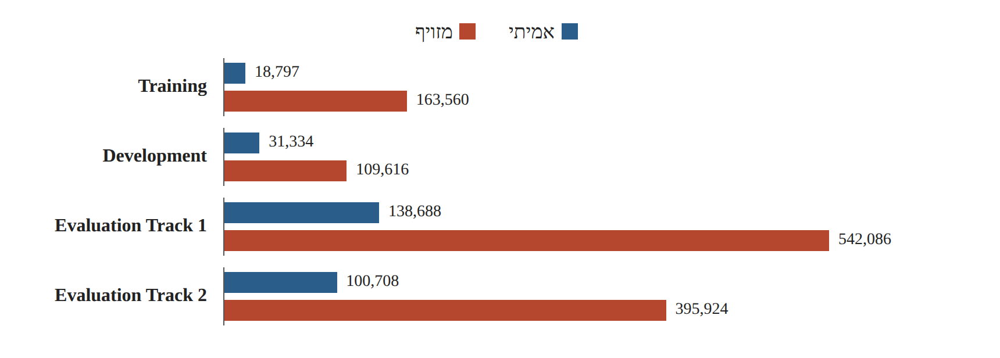
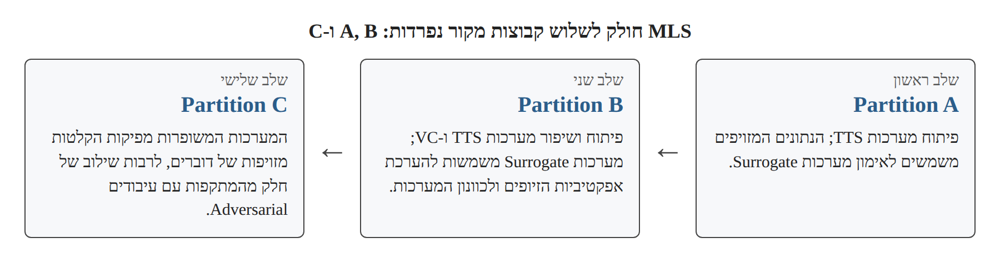
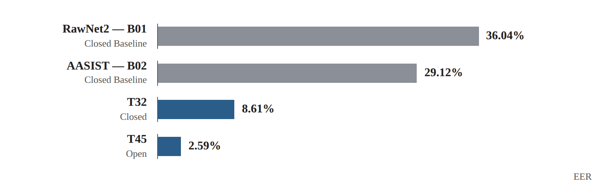

# Research Card 01 — ASVspoof 5

## 1. פרטים ביבליוגרפיים

**שם המאמר:** ASVspoof 5: Crowdsourced Speech Data, Deepfakes, and Adversarial Attacks at Scale

**מחברים:** Xin Wang, Héctor Delgado, Hemlata Tak, Jee-weon Jung, Hye-jin Shim, Massimiliano Todisco, Ivan Kukanov, Xuechen Liu, Md Sahidullah, Tomi Kinnunen, Nicholas Evans, Kong Aik Lee, Junichi Yamagishi.

**גוף מחקרי:** ASVspoof Consortium

**שנה:** 2024

**גרסה שנקראה:** arXiv:2408.08739v1, מ-16 באוגוסט 2024.

**קישור:** https://arxiv.org/abs/2408.08739

**תחום:** Audio Deepfake Detection, Speech Anti-Spoofing, Speaker Verification, Generalization.

**רלוונטיות לפרויקט:** גבוהה מאוד — המאמר מתאר את אחד ממאגרי הנתונים שעליהם מבוסס פרויקט הקורס, ומציג שיטות הערכה, מודלי Baseline ותוצאות רלוונטיות לזיהוי דיבור סינתטי.

---

## 2. תקציר מקיף של המאמר

המאמר מציג את ASVspoof 5, המהדורה החמישית של אתגר מחקרי בינלאומי העוסק בזיהוי זיופים קוליים ובפיתוח מערכות עמידות למתקפות על זיהוי דוברים.

מטרת המחקר היא לקדם את יכולתן של מערכות לזהות דיבור מזויף בתנאים מאתגרים יותר מאלו שנבחנו באתגרים קודמים. החוקרים מתמקדים בשלושה שינויים מרכזיים: מעבר לנתוני דיבור מגוונים יותר מבחינת דוברים ותנאי הקלטה, הכללת שיטות מתקדמות ליצירת דיבור סינתטי והמרת קול, ושילוב התקפות Adversarial שנועדו להטעות מערכות זיהוי.

המאגר מבוסס על החלק האנגלי של Multilingual LibriSpeech (MLS), שמקורו בהקלטות של אלפי דוברים בתנאים מגוונים. לצורך יצירת המתקפות השתמשו החוקרים במערכות Text-to-Speech ובמערכות Voice Conversion. חלק מהמתקפות שופרו באמצעות בדיקות מול מערכות זיהוי חלופיות (Surrogate Models), וחלקן עברו עיבודים Adversarial נוספים.

האתגר כולל שני מסלולים. Track 1 עוסק בזיהוי עצמאי של דיבור אמיתי לעומת מזויף. Track 2 עוסק במערכת משולבת של אימות דוברים וזיהוי מתקפות זיוף (Spoofing-Aware Speaker Verification).

החוקרים מציגים מערך מדדי הערכה הכולל EER, minDCF, actDCF ו-Cllr עבור Track 1, ומדדים נוספים עבור Track 2. המדד המרכזי של Track 1 הוא minDCF, המאפשר לשקלל את מחירי השגיאות ואת ההסתברויות המוקדמות של המחלקות.

שני מודלי ה-Baseline המרכזיים של Track 1 הם RawNet2 ו-AASIST. למרות הצלחות קודמות של הארכיטקטורות, הן מציגות ביצועים חלשים יחסית בתנאי ASVspoof 5. לעומת זאת, מערכות מתקדמות שהוגשו לתחרות משיגות שיפור משמעותי, במיוחד בתנאי Open המאפשרים שימוש בנתונים חיצוניים ובמודלים מאומנים מראש.

המאמר מדגיש את הקושי בהכללה לשיטות זיוף ולתנאי הקלטה חדשים, את הפוטנציאל של ייצוגי דיבור הנלמדים באמצעות Self-Supervised Learning ואת חשיבות כיול ציוני הזיהוי.

**המסקנה המרכזית:** יכולת זיהוי גבוהה בתנאי מחקר מוכרים אינה מבטיחה ביצועים דומים כאשר משתנים הדוברים, תנאי ההקלטה ושיטות יצירת הזיופים.

**מקור:** Abstract, Sections 1–7.

---

## 3. בעיית המחקר והמוטיבציה

### 3.1 הבעיה

התקדמות מערכות TTS ו-Voice Conversion מאפשרת ליצור דיבור סינתטי באיכות גבוהה ולחקות דוברים מסוימים.

מערכות זיהוי זיופים שהתאמנו בתנאים מוגבלים עלולות להתקשות כאשר הן נחשפות למתקפות חדשות, לקולות של דוברים לא מוכרים או לשינויים באיכות ההקלטה.

### 3.2 מגבלות המחקר הקודם

החוקרים מזהים צורך בהערכה מאתגרת יותר, הנובעת בין היתר מהמאפיינים הבאים:

- שימוש במאגרי מקור שהוקלטו בתנאים מבוקרים יחסית.
- מספר דוברים מוגבל יותר בחלק מהמאגרי המקור הקודמים.
- התפתחות מערכות מתקדמות ליצירת דיבור סינתטי.
- מתקפות שמותאמות במכוון לפגיעה בביצועי מערכות הזיהוי.
- הצורך להעריך לא רק יכולת הפרדה בין מחלקות אלא גם החלטות המתקבלות בהתחשב בשכיחות המתקפות ובעלות השגיאות.

### 3.3 שאלת המחקר המשתמעת

באיזו מידה מערכות לזיהוי זיופים ולאימות דוברים מסוגלות להתמודד עם מתקפות דיבור סינתטי מגוונות, לרבות מתקפות חדשות ומתקפות Adversarial, בתנאים אקוסטיים מאתגרים?

המאמר אינו מציג שאלה זו כניסוח פורמלי יחיד; היא משקפת את מטרות האתגר המתוארות בו.

**מקור:** Abstract, Section 1.

---

## 4. התרומות המרכזיות

1. **מאגר נתונים מגוון יותר:** שימוש בנתוני מקור מ-MLS English, הכוללים מגוון גדול של דוברים ותנאים אקוסטיים.

2. **הרחבת מגוון המתקפות:** הכללת 32 מזהי מתקפות המבוססות על TTS, Voice Conversion ושילובים עם עיבודים Adversarial.

3. **שימוש ב-Surrogate Models:** הערכת אפקטיביות של זיופים ושיפור מערכות יצירתם באמצעות מודלים חלופיים של ASV ו-CM.

4. **הכללת תנאי דחיסה וקודקים:** בחינת הקלטות אמיתיות ומזויפות שעברו עיבודים שונים, לרבות קודקים נוירוניים.

5. **הגדרת שני מסלולי הערכה:** הבחנה בין גילוי זיופים עצמאי לבין אימות דוברים עמיד לזיופים.

6. **הרחבת מדדי ההערכה:** שימוש במדדי עלות ובמדדי כיול לצד מדדים מסורתיים כמו EER.

7. **השוואת מערכות:** הצגת תוצאות מודלי Baseline ומערכות שהוגשו לתחרות במסגרת תנאי Closed ו-Open.

**מקור:** Sections 1–3.

---

## 5. מבנה מאגר הנתונים

### 5.1 מקור הנתונים

המאגר מבוסס על English Partition של Multilingual LibriSpeech, הכולל הקלטות ממגוון מכשירים ותנאי הקלטה ומקורו ביותר מ-4,000 דוברים.

החוקרים משווים זאת למקור VCTK ששימש באתגרים קודמים, הכולל כ-100 דוברים שהוקלטו בתנאים אקוסטיים מבוקרים.

מטרת השינוי הייתה ליצור תנאי הערכה המשקפים שונות אקוסטית רחבה יותר.

### 5.2 חלוקת הנתונים

| קבוצה | דוברים | אמיתי | מזויף | מערכות זיוף |
|---|---:|---:|---:|---|
| Training | 400 | 18,797 | 163,560 | A01–A08 |
| Development | 785 | 31,334 | 109,616 | A09–A16 |
| Evaluation Track 1 | 737 | 138,688 | 542,086 | A17–A32 |
| Evaluation Track 2 | 737 | 100,708 | 395,924 | A17–A32 |

קבוצות ההערכה של Track 1 ו-Track 2 אינן עצמאיות לחלוטין, ולכן אין לסכום אותן כאילו מדובר בשני מאגרים נפרדים.

*איור 1. המחשה לנתוני Table 1 (סעיף 5.2): מספר ההקלטות האמיתיות והמזויפות בכל קבוצה.*

### 5.3 חוסר איזון בנתונים

בקבוצת האימון המקורית יש 163,560 הקלטות מזויפות לעומת 18,797 הקלטות אמיתיות.

כלומר, כ-89.7% מהקלטות האימון מזויפות.

הדבר עלול ליצור הטיה לטובת המחלקה הנפוצה במהלך האימון. למשל, מסווג שהיה חוזה תמיד "מזויף" היה מקבל Accuracy גבוה בקבוצת האימון, אף שלא היה לומד להבחין בין סוגי דיבור.

בהמשך המאמר מצוין שמודלי ה-Baseline של Track 1 אומנו באמצעות Weighted Cross-Entropy.

### 5.4 הפרדת דוברים ומתקפות

החוקרים הקפידו על הפרדה בין דוברים בקבוצות Training, Development ו-Evaluation וכן על הפרדה בין מזהי המתקפות.

לכך יש שתי משמעויות מחקריות:

- **Speaker Generalization:** בדיקת ביצועי המודל על דוברים שלא נכללו באימון.
- **Attack Generalization:** בדיקת ביצועי המודל מול שיטות זיוף שלא הופיעו באימון.

הפרדה זו מצמצמת את הסיכון להערכה אופטימית מדי, אך אינה מבטיחה כשלעצמה היעדר מוחלט של כל מקור אפשרי להטיה.

**מקור:** Section 2, Table 1.

---

## 6. סוגי המתקפות ויצירת הזיופים

### 6.1 Text-to-Speech — TTS

מערכות המפיקות דיבור סינתטי מתוך טקסט.

דוגמאות במאגר כוללות GlowTTS, GradTTS, FastPitch, VITS, ToucanTTS ו-Tacotron2.

### 6.2 Voice Conversion — VC

מערכות המשנות את מאפייני הדובר בדיבור קיים כדי להפיק קול שנשמע כדובר אחר.

דוגמאות כוללות StarGANv2-VC, VAE-GAN ו-DiffVC.

### 6.3 Adversarial Attacks

בניגוד ליצירת דיבור סינתטי רגיל, התקפה Adversarial נועדה לפגוע באופן מכוון בביצועי מערכת למידת מכונה.

במאמר מופיעות שתי שיטות:

- **Malafide:** התקפה המכוונת לפגיעה בגלאי זיופים (CM).
- **Malacopula:** התקפה שמטרתה להגביר את האיום על מערכות אימות דוברים (ASV).

חלק מהמתקפות נוצרו באמצעות שילוב שיטות זיוף עם עיבודים Adversarial נוספים.

### 6.4 תהליך יצירת הנתונים

החוקרים חילקו את MLS לשלוש קבוצות מקור נפרדות: A, B ו-C.

**שלב ראשון:** פיתוח מערכות TTS באמצעות Partition A ושימוש בנתונים המזויפים לאימון מערכות Surrogate.

**שלב שני:** פיתוח ושיפור מערכות TTS ו-VC באמצעות Partition B. התורמים נעזרו במערכות Surrogate כדי להעריך את אפקטיביות הזיופים ולכוונן את המערכות.

**שלב שלישי:** שימוש במערכות המשופרות ליצירת הקלטות מזויפות של דוברים ב-Partition C, לרבות שילוב של חלק מהמתקפות עם עיבודים Adversarial.

*איור 2. המחשה לתהליך יצירת הנתונים המתואר בסעיף 6.4.*

### 6.5 Codecs ותנאי דחיסה

המאמר מתאר תנאי קידוד ודחיסה הכוללים בין היתר MP3, Opus, Speex, AMR, M4A ו-Encodec.

חלק מההקלטות עובדו ברוחב פס של 8kHz והועלו בחזרה ל-16kHz.

מטרת הניסוי היא להעריך מערכות זיהוי גם כאשר האות עובר שינויים הנובעים מדחיסה או מערוץ תקשורת.

אין להסיק מכך ש-Encodec שימש בהכרח ליצירת כל זיוף; בחלק זה הוא מתואר כתנאי עיבוד ודחיסה.

**מקור:** Section 2, Tables 2–3.

---

## 7. שתי משימות ההערכה

### Track 1 — Stand-alone Spoofing and Deepfake Detection

המערכת נדרשת לקבוע האם הקלטת הדיבור אמיתית או מזויפת, ללא צורך לאמת את זהות הדובר.

זהו המסלול הרלוונטי ביותר לפרויקט שלנו.

### Track 2 — Spoofing-Aware Speaker Verification

המערכת נדרשת להבחין בין שלושה מצבים:

- Target — דיבור אמיתי של הדובר המורשה.
- Non-target — דיבור אמיתי של אדם שאינו הדובר המורשה.
- Spoof — מתקפת זיוף.

לשם כך יש להתמודד גם עם אימות זהות וגם עם זיהוי זיופים.

**מסקנה:** מערכת שמזהה דיבור אמיתי אינה יכולה להסיק מכך שהדובר מורשה. במקביל, מערכת שמאמתת דובר עלולה להיות פגיעה לקול סינתטי שמחקה אותו.

**מקור:** Sections 1, 3.

---

## 8. מדדי הערכה

### 8.1 EER — Equal Error Rate

EER הוא שיעור השגיאה בנקודה שבה שיעור קבלת הזיופים כאמיתיים ושיעור דחיית הדיבור האמיתי משתווים.

ככל שה-EER נמוך יותר, כך יכולת ההפרדה טובה יותר לפי מדד זה.

המדד אינו כולל במפורש עלויות שגיאה או הסתברויות מוקדמות של המחלקות.

### 8.2 DCF — Detection Cost Function

המאמר מגדיר:

DCF(τ) = β · Pmiss(τ) + Pfa(τ)

כאשר:

- τ הוא סף ההחלטה.
- Pmiss הוא שיעור הדיבור האמיתי שנדחה בטעות.
- Pfa הוא שיעור הזיופים שהתקבלו בטעות כאמיתיים.
- β משקלל את העלויות וההסתברויות המוקדמות.

### 8.3 חישוב β

המאמר מגדיר:

β = (Cmiss / Cfa) × ((1 − πspf) / πspf)

עם הערכים:

- Cmiss = 1
- Cfa = 10
- πspf = 0.05

לכן:

β = 1.9

כלומר:

DCF(τ) = 1.9 · Pmiss(τ) + Pfa(τ)

חשוב להבחין בין ההסתברות המוקדמת שהחוקרים בחרו לצורך תרחיש ההערכה לבין התפלגות המחלקות בפועל במאגר הנתונים.

### 8.4 minDCF

העלות המינימלית שניתן להשיג על פני ספי ההחלטה האפשריים.

minDCF = minτ DCF(τ)

זהו המדד המרכזי של Track 1 במאמר.

### 8.5 actDCF

עלות ההחלטה בסף Bayes שמוגדר על פי הנחות העלות והשכיחות, כאשר הציונים מפורשים כ-Log-Likelihood Ratios מכוילים.

המדד משקף את חשיבות כיול הציונים, ולא רק את יכולת ההפרדה בין המחלקות.

### 8.6 Cllr

מדד המשמש להערכת איכות ציוני Log-Likelihood Ratio, כולל היבטים של כיול ויכולת הבחנה.

### 8.7 מדדי Track 2

המאמר מציג גם:

- a-DCF
- t-DCF
- t-EER

מדדים אלו מתאימים להערכת מערכות אימות דוברים עמידות לזיופים, אך אינם המדדים המרכזיים במשימת הסיווג הבינארית שלנו.

**מקור:** Section 3, Equations 1–5.

---

## 9. הארכיטקטורות והמודלים

### 9.1 RawNet2 — Baseline B01

RawNet2 הוא מודל End-to-End המקבל אודיו גולמי.

מרכיביו העיקריים:

1. קלט Raw Waveform באורך ארבע שניות — 64,000 דגימות בתדר 16kHz.
2. שכבת 20 מסנני Sinc.
3. שישה Residual Blocks.
4. יחידות GRU לעיבוד מידע רציף והמרה לייצוג ברמת ההקלטה.
5. Fully Connected Layers להפקת ציון זיהוי.

**יתרון אפשרי:** למידת מאפיינים ישירות מהאות, ללא צורך להגדיר מראש ייצוג אקוסטי קבוע.

**מגבלה אפשרית:** ברשת עמוקה המאומנת על נתונים מוגבלים או מוטים קיים סיכון להתאמת יתר וללמידת מאפיינים שאינם מכלילים.

המגבלה האחרונה היא שיקול מחקרי שלנו, ולא תוצאה של ניסוי בידוד שבוצע במאמר.

### 9.2 AASIST — Baseline B02

AASIST משתמש ב-Encoder המבוסס על RawNet2 כדי לחלץ מאפיינים ראשוניים מהאות.

בהמשך המודל משתמש ב-Heterogeneous Graph Attention ובפעולות Graph Pooling כדי לשלב ייצוגים זמניים וספקטרליים.

הרעיון המרכזי הוא לאפשר למודל ללמוד קשרים בין מאפיינים שונים של האות, ולא להסתמך רק על עיבודם בנפרד.

### 9.3 אימון ה-Baselines

שני המודלים אומנו באמצעות Weighted Cross-Entropy עבור סיווג בינארי.

### 9.4 Surrogate Models

החוקרים השתמשו במודלים חלופיים כדי להעריך את המתקפות ולכוונן אותן.

המודלים כללו:

- ECAPA-TDNN עם PLDA עבור ASV.
- AASIST עבור CM.
- RawNet2 עבור CM.
- LCNN עם LFCC עבור CM.

מערכות ה-CM החלופיות לא נחשפו בזמן האימון למתקפות של קבוצות Development ו-Evaluation.

### 9.5 מודלים של Track 2

המאמר מציג בנוסף Baselines מסוג Fusion ומודל משולב המבוסס על MFA-Conformer.

מודלים אלו משמשים ל-SASV, ולכן רלוונטיים לנו בעיקר כהרחבה תיאורטית.

**מקור:** Section 4.

---

## 10. פלטפורמת ההערכה

האתגר התנהל באמצעות CodaLab.

**Progress Phase:** עד ארבע הגשות ביום ומשוב על תת-קבוצה של נתוני ההערכה.

**Evaluation Phase:** הגשה סופית אחת, שנבדקה מול קבוצת ההערכה המלאה.

המאמר מציין גם שלב Post-Evaluation שאינו נידון בו.

### משמעות מתודולוגית

משוב חוזר על קבוצת הערכה עלול ליצור התאמה עקיפה של החלטות הפיתוח לאותה קבוצה.

זו מגבלה אפשרית של תהליך בחירת מערכות, ולא ממצא שהחוקרים הוכיחו לגבי המשתתפים.

**מקור:** Section 5.

---

## 11. תוצאות המחקר

### 11.1 Track 1

| מערכת | תנאי | minDCF | EER |
|---|---|---:|---:|
| RawNet2 — B01 | Closed Baseline | 0.8266 | 36.04% |
| AASIST — B02 | Closed Baseline | 0.7106 | 29.12% |
| T32 | Closed | 0.2436 | 8.61% |
| T45 | Open | 0.0750 | 2.59% |

T32 ו-T45 הן המערכות המובילות בדירוג minDCF בתנאים שלהן.

*איור 3. המחשה לנתוני EER מהטבלה בסעיף 11.1.*

### 11.2 ניתוח התוצאות

**א. AASIST לעומת RawNet2**

AASIST השיג EER נמוך ב-6.92 נקודות אחוז בהשוואה ל-RawNet2.

הדבר מעיד על יתרון עבור המודל המסוים ופרוטוקול ההערכה שנבדקו, אך אינו מוכיח ש-AASIST עדיף בכל Dataset או משימה.

**ב. שיפור לעומת Baselines**

המערכות המובילות בתחרות השיגו ביצועים טובים משמעותית מה-Baselines. עובדה זו מראה שיכולת הזיהוי בתנאי האתגר אינה מוגבלת לתוצאות המודלים הבסיסיים.

**ג. Open לעומת Closed**

המערכת המובילה בתנאי Open הציגה ביצועים טובים יותר מהמערכת המובילה בתנאי Closed.

עם זאת, אין להסיק שהגורם היחיד לכך הוא שימוש בנתונים חיצוניים. תנאי Open מאפשרים גם שימוש במודלים מאומנים מראש, והמערכות עשויות להיבדל זו מזו בארכיטקטורה ובשיטות האימון.

**ד. Self-Supervised Learning**

החוקרים מציינים שרבות מהמערכות בעלות הביצועים הטובים בתנאי Open השתמשו בייצוגים שהופקו ממודלים מאומנים מראש מסוג SSL, כגון wav2vec 2.0.

זהו קשר תצפיתי משמעותי, אך לא ניסוי שמבודד את השפעת SSL בלבד.

**ה. Ensembles**

החוקרים מציינים כי מערכות המשלבות מספר תתי-מודלים נטו להציג ביצועים טובים יותר.

עם זאת, אין בכך הוכחה שכל Ensemble עדיף על כל מודל יחיד.

### 11.3 בעיית Score Calibration

למערכת T45 ב-Open Condition התקבלו:

- minDCF = 0.0750
- EER = 2.59%
- actDCF = 1.0000

הפער מצביע על כך שמערכת יכולה להציג יכולת הפרדה גבוהה, אך להפיק ציונים שאינם מכוילים לסף ההחלטה המתאים.

החוקרים מסבירים שחלק מהמערכות החזירו ציונים בטווח 0–1, במקום ציוני Log-Likelihood Ratio מכוילים.

### 11.4 Track 2

המערכת המובילה בתנאי Closed השיגה min a-DCF של 0.2814, לעומת 0.0756 למערכת המובילה בתנאי Open.

גם כאן מערכות רבות השיגו שיפור ביחס ל-Baselines, ושימוש בייצוגי SSL היה נפוץ בקרב המערכות המובילות.

**מקור:** Section 6, Tables 4–5.

---

## 12. מסקנות החוקרים

החוקרים מסיקים כי ASVspoof 5 יצר אתגר קשה יותר למערכות זיהוי זיופים ולאימות דוברים.

הקושי נובע משילוב של נתוני דיבור מגוונים יותר, מתקפות מתקדמות ומתקפות Adversarial.

ביצועי ה-Baselines היו חלשים יחסית למרות הצלחת הארכיטקטורות באתגרים קודמים, בעוד שמערכות רבות שהוגשו לתחרות השיגו שיפור משמעותי.

בנוסף, החוקרים מדגישים בעיה שנזנחה יחסית במחקרי זיהוי זיופים: כיול ציוני הזיהוי, הנדרש כאשר מערכת אמורה לפעול בתנאי החלטה מעשיים.

המאמר מציין שניתוחים מפורטים נוספים של שיטות המשתתפים יוצגו במחקרי המשך.

**מקור:** Section 7.

---

## 13. ניתוח ביקורתי

### 13.1 יתרונות המחקר

**א. מגוון רחב של נתונים ומתקפות**

המאגר מאפשר לבחון מודלים על דוברים, תנאי הקלטה ושיטות זיוף מגוונים.

**ב. פרוטוקול הערכה מאתגר**

ההפרדה בין דוברים ומתקפות מאפשרת לבחון היבטים שונים של יכולת ההכללה.

**ג. שילוב מתקפות Adversarial**

המאגר בוחן מערכות גם מול מתקפות שמטרתן להטעות אותן במכוון.

**ד. בחינת תנאי דחיסה**

החוקרים משלבים תנאים אקוסטיים ועיבודים שונים, הקרובים יותר למורכבות של סביבות שימוש מעשיות.

**ה. מגוון מדדי הערכה**

המאמר אינו מסתפק ב-EER, אלא מתייחס גם לעלויות השגיאה ולכיול הציונים.

### 13.2 מגבלות המחקר

**א. קושי לבודד גורמים לשיפור**

ההשוואה בין מערכות בתנאי Open ו-Closed אינה ניסוי מבוקר של משתנה אחד. המערכות עשויות להיבדל בכמה גורמים בו-זמנית.

**ב. פירוט מוגבל של המערכות המובילות**

המאמר אינו מציג תיאור מלא של כל הארכיטקטורות וההחלטות ההנדסיות שהובילו לתוצאות הטובות ביותר.

**ג. מקור הנתונים**

למרות הגיוון, הנתונים עדיין מבוססים על מקורות מסוימים, בעיקר MLS English, ואינם מבטיחים ייצוג של כל השפות וסביבות ההקלטה בעולם.

**ד. מגבלות הכללה**

הפרדה בין דוברים ומתקפות מאפשרת מדידת הכללה בתנאי הניסוי, אך אינה מוכיחה שהמערכת תזהה כל שיטת זיוף עתידית.

**ה. שיטות התקפה שונות יחד**

המאגר כולל שיטות יצירה ועיבוד רבות. ללא ניסויים מבוקרים נוספים, קשה לקבוע מהי התרומה העצמאית של כל גורם לקושי בזיהוי.

**ו. כיול ציונים**

הפערים בין minDCF ל-actDCF מדגימים שמערכות בעלות יכולת הפרדה טובה אינן בהכרח מתאימות להפעלה בסף החלטה קבוע ללא כיול.

### 13.3 מה לא ניתן להסיק

אין להסיק מהמאמר ש:

- AASIST תמיד עדיף על RawNet2.
- כל מודל SSL עדיף על מודל שאומן מאפס.
- נתונים חיצוניים תמיד משפרים ביצועים.
- Ensemble תמיד עדיף על מודל יחיד.
- תוצאות ASVspoof 5 יתקבלו גם על Dataset הקורס.
- ביצועים גבוהים מול מתקפות שלא נראו באימון מבטיחים עמידות בפני כל זיוף עתידי.

---

## 14. ההבנות האישיות שהפקנו מהקריאה האקטיבית

חלק זה מבוסס על התשובות והדיונים שלנו במהלך הקריאה, ולא נועד לייחס את כל ההבחנות ישירות לחוקרים.

### 14.1 הכללה חשובה יותר מהצלחה נקודתית

אחת ההבנות המרכזיות היא שמודל יכול להציג תוצאה גבוהה על מאגר מסוים, אך להיכשל כאשר משתנים סוגי הזיוף, הדוברים או תנאי ההקלטה.

לכן אין להעריך מודל רק לפי מספר אחד, אלא גם לפי התנאים שבהם התקבלה התוצאה.

### 14.2 חשיבות ההפרדה בין קבוצות הנתונים

הבנו שהפרדה בין דוברים לבין שיטות זיוף בוחנת שני סוגים שונים של הכללה.

בנוסף, חפיפה בין דוברים אינה בהכרח דליפה בכל משימה, אך היא עלולה ליצור הערכה אופטימית מדי כאשר מבקשים לבדוק הכללה לדוברים חדשים.

### 14.3 Imbalanced Data

למדנו שחוסר איזון בין מחלקות עלול לגרום למודל להעדיף את המחלקה הנפוצה וליצור Accuracy מטעה.

מכאן נובעת החשיבות של מדדים המתאימים למשימה ושל התייחסות לאיזון במהלך האימון.

### 14.4 Adversarial Attacks

הבנו את ההבדל בין יצירת דיבור סינתטי לבין עיבוד מכוון שמנסה להטעות מערכת זיהוי.

מודל שמזהה זיופים רגילים לא בהכרח יהיה עמיד למתקפות Adversarial.

### 14.5 Raw Waveform ולמידת מאפיינים

RawNet2 מדגים שאפשר ללמוד מאפיינים ישירות מהאות הגולמי.

עם זאת, עצם השימוש באות הגולמי אינו מבטיח היעדר Overfitting או הכללה טובה.

### 14.6 Graph Attention

AASIST מדגים כיצד ניתן לשלב ייצוגים זמניים וספקטרליים באמצעות מנגנון Graph Attention.

ההבנה המרכזית היא שהתועלת האפשרית נובעת לא רק מחילוץ המאפיינים, אלא גם מלמידת הקשרים ביניהם.

### 14.7 Surrogate Models

מערכות חלופיות אינן משמשות רק להערכת מתקפות. ב-ASVspoof 5 הן שימשו גם לצורך כוונון מערכות יצירת הזיופים.

### 14.8 יכולת הפרדה לעומת כיול

EER נמוך אינו מבטיח actDCF נמוך.

מודל יכול לדרג נכון הקלטות אמיתיות ומזויפות, אך להחזיר ציונים שאינם מתאימים לסף החלטה מסוים.

### 14.9 זהירות בהסקת מסקנות

כאשר מודל משיג ביצועים חלשים, אין להסיק מיד שהארכיטקטורה אינה טובה או שהמדד אינו תקין.

צריך לבחון את תנאי האימון, מאגר הנתונים, פרוטוקול ההערכה וגורמים נוספים שעשויים להסביר את התוצאה.

---

## 15. משמעות המאמר לפרויקט שלנו

### 15.1 הקשר הישיר לנתוני הקורס

פרויקט הקורס כולל 1,520 הקלטות באורך ארבע שניות, שנלקחו משלושה מקורות:

| מקור | אמיתי | מזויף |
|---|---:|---:|
| ASVspoof 5 | 300 | 300 |
| CodecFake | 300 | 300 |
| M-AILABS | 320 | 0 |
| סה"כ | 920 | 600 |

לפי ההנחיות, ההקלטות המזויפות מ-ASVspoof 5 משתייכות למערכות A09–A16.

חשוב: פיצולי הנתונים של פרויקט הקורס אינם בהכרח זהים לפיצולים המקוריים של ASVspoof 5. לכן נצטרך לבנות ולהצדיק פרוטוקול הערכה משלנו.

### 15.2 בעיות שעלינו לבדוק ב-EDA

- התפלגות הדוגמאות לפי מקור הנתונים.
- התפלגות הדוגמאות לפי תווית.
- מספר הדוברים והקלטות לכל דובר.
- התפלגות מערכות הזיוף.
- הבדלים אפשריים בעוצמה, ברעש, בתדרים ובמאפייני הקלטה.
- כפילויות או קטעים החולקים הקלטת מקור.
- חפיפות אפשריות עם נתונים חיצוניים.
- האפשרות שהמודל ילמד לזהות את המאגר במקום את הזיוף.

### 15.3 מודלים שכדאי לבדוק בהמשך

**Baseline קלאסי:** MFCC או CQCC עם מסווג פשוט.

**מודל Deep Learning:** CNN או ארכיטקטורה ייעודית כגון AASIST.

**גישה מבוססת Transfer Learning:** wav2vec 2.0 או WavLM כ-Encoder מאומן מראש, בשילוב Classifier.

**הרחבה אפשרית:** שילוב ציונים ממספר מודלים (Ensemble).

אלו מועמדים לניסויים, ולא בחירות סופיות.

---

## 16. השערות מחקר אפשריות

### H1 — Self-Supervised Representations

שימוש בייצוגי דיבור מאומנים מראש עשוי לשפר את ה-EER ביחס ל-Baseline המבוסס על פיצ'רים אקוסטיים קלאסיים.

**ניסוי מוצע:** MFCC + Logistic Regression לעומת wav2vec 2.0 + Classifier, על אותו פיצול נתונים.

### H2 — External Data Augmentation

הוספת נתוני אימון חיצוניים מגוונים עשויה לשפר את יכולת ההכללה לשיטות זיוף חדשות.

**ניסוי מוצע:** אותו מודל עם ובלי נתונים חיצוניים, תוך שמירה על תנאי אימון והערכה עקביים ככל האפשר.

### H3 — Attack Generalization

מודל עשוי להצליח על שיטות זיוף מוכרות ולהתקשות על שיטות שלא הופיעו באימון.

**ניסוי מוצע:** החזקת שיטות זיוף מסוימות מחוץ לאימון ובדיקת ה-EER עליהן.

### H4 — Ensemble Learning

שילוב מודלים בעלי ייצוגים שונים עשוי לשפר את ביצועי הזיהוי ביחס לכל מודל בנפרד.

**ניסוי מוצע:** השוואת המודלים היחידים לשילוב ציוניהם, כאשר המשקלים נבחרים על Validation בלבד.

### H5 — Robustness to Audio Processing

שינויים כגון דחיסה או שינויי ערוץ עלולים להשפיע על ביצועי הזיהוי.

**ניסוי מוצע:** בדיקה מבוקרת של השפעת עיבודי אודיו על EER של מודל קבוע.

---

## 17. שאלות פתוחות להמשך הפרויקט

1. האם ניתן להפריד את נתוני הקורס לפי דוברים ללא פגיעה משמעותית בגודל קבוצות האימון?
2. האם קיימות מספיק דוגמאות לכל מערכת זיוף כדי לבצע הערכת Attack-disjoint אמינה?
3. אילו מאגרי נתונים חיצוניים יוסיפו גיוון אמיתי בלי ליצור חפיפה?
4. האם מודל SSL משפר את ההכללה או בעיקר את הביצועים על נתונים דומים לאימון?
5. האם ניתן להשיג ביצועים תחרותיים באמצעות Linear Probe על ייצוגים קפואים, ללא Fine-Tuning מלא?
6. האם הבדלים במקור הנתונים מאפשרים למודל ללמוד Shortcut?
7. האם AASIST או מודל ייעודי אחר מוסיפים ערך מעבר לייצוגי SSL?
8. האם שילוב מודלים משפר ביצועים גם על מתקפות שלא הופיעו באימון?
9. האם תוצאות המודל יציבות על פני מספר פיצולים ו-Seeds?
10. מהו היחס בין ביצועי המודל על נתוני הקורס לבין ביצועיו על מאגר חיצוני עצמאי?

---

## 18. מסקנה מסכמת של כרטיס המחקר

ASVspoof 5 מדגים את המורכבות של זיהוי זיופים קוליים כאשר מערכות נבחנות על נתונים מגוונים ועל מתקפות מתקדמות שלא בהכרח הופיעו באימון.

תוצאות התחרות מלמדות שאף שמודלי Baseline מבוססים על ארכיטקטורות מוכרות, הם עלולים להתקשות כאשר משתנים תנאי ההערכה. עם זאת, מערכות מתקדמות, ובפרט מערכות רבות שהשתמשו בייצוגי SSL ובשילובי מודלים, הצליחו להשיג שיפור משמעותי.

מבחינת הפרויקט שלנו, התרומה המרכזית של המאמר אינה בחירה חד-משמעית בארכיטקטורה מסוימת, אלא ההבנה שהצלחת המודל תלויה גם באיכות הנתונים, בפרוטוקול ההערכה, בגיוון המתקפות וביכולת ההכללה.

**העיקרון המחקרי שנאמץ:** ננסה לפתח מודל שמזהה מאפיינים הקשורים לזיוף עצמו, ונבחן את יכולתו להתמודד עם דוברים ושיטות זיוף שלא נראו באימון, במקום להסתפק בתוצאה גבוהה על חלוקה אקראית של נתונים.

---

## 19. מפת הפניות למאמר

| נושא | מיקום |
|---|---|
| מטרת המחקר וחידושים | Abstract, Section 1, עמ' 1 |
| מקור הנתונים ומבנה המאגר | Section 2, עמ' 1–2 |
| התפלגות הנתונים | Table 1, עמ' 2 |
| סוגי מתקפות | Table 2, עמ' 2 |
| תנאי Codecs | Table 3, עמ' 2 |
| EER, DCF ו-minDCF | Section 3.1, עמ' 3 |
| מדדי SASV | Section 3.2, עמ' 3 |
| מערכת ASV ומודלי Baseline | Section 4, עמ' 4 |
| תוצאות אימות דוברים תחת מתקפות | Figure 1, עמ' 4 |
| פלטפורמת התחרות | Section 5, עמ' 4 |
| תוצאות Track 1 | Table 4, עמ' 5 |
| תוצאות Track 2 | Table 5, עמ' 6 |
| מסקנות החוקרים | Section 7, עמ' 6 |

**הערה:** המספרים והמדדים מתייחסים לגרסת 2024 של המאמר ולפרוטוקול האתגר המתואר בה. אין להשליך אותם ישירות על תוצאות פרויקט הקורס ללא ניסוי עצמאי.
