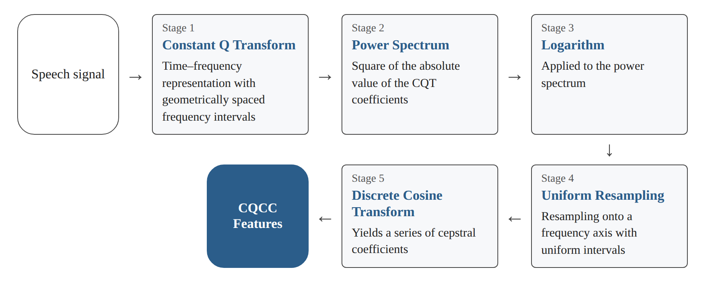
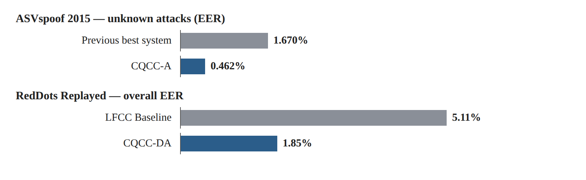
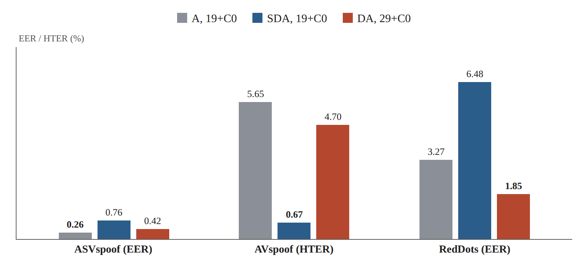

# Research Card 02 — CQCC

## Constant Q Cepstral Coefficients: A Spoofing Countermeasure for Automatic Speaker Verification

## 1. Bibliographic Details

**Paper title:** Constant Q Cepstral Coefficients: A Spoofing Countermeasure for Automatic Speaker Verification

**Authors:** Massimiliano Todisco, Héctor Delgado, Nicholas Evans.

**Research institution:** EURECOM, Sophia Antipolis, France.

**Year:** 2017.

**Version read:** Preprint dated May 12, 2017.

**Research field:** Audio Spoofing Detection, Speech Signal Processing, Acoustic Feature Extraction, Speaker Verification, Generalization.

**Keywords:** Constant Q Transform (CQT), Constant Q Cepstral Coefficients (CQCC), MFCC, Cepstral Analysis, Gaussian Mixture Model (GMM), Replay Attacks, Speech Synthesis, Voice Conversion.

**Relevance to the project:** Very high. The paper presents a classical method for extracting acoustic features, which provides an alternative to MFCC and to traditional spectral representations. The method is relevant to building Baseline models and to comparing audio representations in our voice forgery detection project.

**Identification note:** The current paper is an extension of earlier work by the same researchers from 2016. It does not present CQCC for the first time, but extends the evaluation of the method to three datasets and to additional attack scenarios.

---

## 2. Comprehensive Summary of the Paper

The paper presents an extended evaluation of the Constant Q Cepstral Coefficients (CQCC) method for extracting acoustic features intended for the detection of voice forgeries.

The method combines spectral analysis by means of the Constant Q Transform (CQT) with traditional cepstral processing. Unlike the Short-Time Fourier Transform (STFT), in which the frequency separation is uniform, CQT uses geometrically spaced frequency intervals and analysis windows of varying lengths. This yields a higher frequency resolution at low frequencies and a higher time resolution at high frequencies.

The research motivation stems from the possibility that systems for generating synthetic speech and for voice conversion use spectral representations similar to those of speaker verification systems. The researchers hypothesize that using a different acoustic representation may reveal artifacts indicating voice manipulation, which are not prominent in the common representations.

To produce CQCC, the researchers apply CQT to the speech signal, compute the power spectrum and its logarithm, resample the spectrum onto a uniform frequency axis, and apply a Discrete Cosine Transform (DCT). The result is a series of cepstral coefficients that serves as a numerical representation of the speech signal.

The method is examined by means of a Gaussian Mixture Model (GMM) classifier on three datasets: ASVspoof 2015, AVspoof and RedDots Replayed. These datasets include Speech Synthesis, Voice Conversion and Replay attacks, in various Logical Access and Physical Access scenarios.

The results demonstrate a significant improvement over previous systems on all three datasets. However, the cross-evaluation shows that the optimal CQCC configuration varies according to the dataset and the type of attack. In particular, the contribution of static and dynamic coefficients is not uniform across the attack scenarios.

**The central conclusion:** The choice of a suitable acoustic representation significantly affects forgery detection performance, but there is no evidence that a single CQCC configuration is optimally suited to all types of attacks and environments.

**Source in the paper:** Abstract, Sections 1, 3–7.

---

## 3. The Research Problem and Motivation

### 3.1 The Research Problem

Automatic Speaker Verification (ASV) systems are exposed to attacks in which an attacker tries to make the system accept fake speech as if it had been produced by an authorized speaker.

The attacks include:

- Speech Synthesis — creating synthetic speech.
- Voice Conversion — changing the speaker characteristics in existing speech.
- Replay — playing back a recording of real speech.

A common approach to detecting these attacks is to search for acoustic artifacts that were created in the process of producing, converting or playing back the audio.

### 3.2 Limitations of Conventional Representations

Many speech processing systems rely on short-term spectral features, sometimes based on STFT and on the Mel scale.

The researchers raise the possibility that forgery systems manage to imitate features of this kind well, and therefore a forgery detector that uses a similar representation may fail to extract all the information required to detect the manipulation.

In addition, in STFT there is a trade-off between time resolution and frequency resolution, which stems from the choice of the analysis window length.

### 3.3 The Research Hypothesis

An acoustic representation that differs from the representations common in ASV systems and in speech generation systems may reveal features indicating forgery, and improve robustness against known and unknown attacks.

### 3.4 The Implied Research Question

Does a combination of the Constant Q Transform with cepstral analysis provide a more effective acoustic representation for detecting voice forgeries, and is its effectiveness preserved across datasets, attack types and different usage scenarios?

This question is a summarizing formulation of the researchers' goals, and not a quotation of a single formal research question.

**Source:** Section 1, pp. 2–4.

---

## 4. The Main Contributions of the Paper

1. **Extended evaluation of CQCC:** Extending the previous work from 2016 to three datasets with different characteristics.

2. **Combining CQT and cepstral analysis:** Using the variable time–frequency resolution of CQT in order to create features suited to detecting voice manipulations.

3. **Linearization of the frequency axis:** Using Uniform Resampling in order to make it possible to apply the DCT after the transform that has geometrically spaced frequency intervals.

4. **Comparison of configurations:** Examining a different number of coefficients and different combinations of static features, Delta and Acceleration.

5. **Evaluation on diverse attack types:** Testing the method against Speech Synthesis, Voice Conversion and Replay.

6. **Cross-Database Evaluation:** Examining the method's sensitivity to the choice of the feature configuration when moving between datasets.

7. **Discussion of generalization:** Presenting the possibility that there is no single acoustic Front-end that is optimally suited to all forgery scenarios, and proposing a future direction of several classifiers specializing in different attack types.

**Source:** Sections 1, 4, 6–7.

---

## 5. The Theoretical Background — STFT versus CQT

### 5.1 Time-Frequency Representation

Audio analysis requires attention to two dimensions:

- The time at which features appear in the signal.
- The frequencies that make up the signal at that time.

There is a trade-off between time resolution and frequency resolution: improving the ability to distinguish between close frequencies usually requires a longer analysis window, which reduces the ability to precisely locate rapid changes in time.

### 5.2 Short-Time Fourier Transform

STFT divides the signal into time windows and computes the spectral content in each window.

The frequency separation is uniform, and therefore the same window length is used to analyze different frequency regions.

Its advantage is the simplicity of the method and its wide use in signal processing.

Its limitation in the context under discussion is that the resolution that was chosen is not necessarily equally suited to features appearing at low frequencies and at high frequencies.

### 5.3 Constant Q Transform

CQT uses frequency centers that are geometrically spaced. The ratio of frequencies between adjacent bins is constant, and in the basic version the quality factor Q is also constant.

The result:

- At low frequencies, a better distinction between close frequencies is obtained.
- At high frequencies, a better distinction of changes occurring over time is obtained.

Unlike STFT, the time–frequency resolution is not uniform across the entire frequency range.

### 5.4 The Demonstration in the Paper

In Section 3.4 and in Figure 2 a speech example is presented in which the fundamental frequency varies between 80Hz and 90Hz.

In an STFT based on 512 samples at a rate of 16kHz, the distance between adjacent spectral bins is 31.25Hz.

In contrast, CQT makes it possible to present the change in more detail thanks to the improved frequency resolution at low frequencies.

It should be emphasized that the example illustrates the advantage of the representation, but does not by itself prove that the improvement in forgery detection performance is caused specifically by detecting Pitch disruptions.

### 5.5 Research Significance

CQT is not necessarily better than STFT in every task. It provides a different division of the time and frequency resolution, which may be particularly suited to detecting certain artifacts.

**Source:** Section 3, Figure 1 p. 15 and Figure 2 p. 17.

---

## 6. The CQCC Extraction Process

### 6.1 The Stages of Feature Extraction

According to Figure 3, page 19:

**Stage 1 — Constant Q Transform**

Converting the speech signal from a representation in time to a time–frequency representation with geometrically spaced frequency intervals.

**Stage 2 — Power Spectrum**

Computing the square of the absolute value of the CQT coefficients.

**Stage 3 — Logarithm**

Applying a logarithm to the power spectrum.

**Stage 4 — Uniform Resampling**

Resampling the spectral representation onto a frequency axis with uniform intervals.

**Stage 5 — Discrete Cosine Transform**

Applying the DCT to obtain a series of cepstral coefficients.

The result is CQCC Features, which can be fed to a classifier.

*Figure 1. Illustration of the feature extraction stages described in Section 6.1.*

### 6.2 Why Is Uniform Resampling Required?

The frequency centers obtained from CQT are arranged geometrically.

The cepstral processing that the researchers wish to perform is based on a DCT that operates on a uniform series of samples along the frequency axis.

Therefore a stage of conversion from a geometric frequency axis to a linear axis is required.

The researchers use resampling and interpolation in order to obtain the representation suited to the computation.

This is a central part of the technical novelty of the method.

### 6.3 Static, Delta and Acceleration

After extracting the coefficients, three types of features can be used:

| Notation | Name | Meaning |
|---|---|---|
| S | Static | The values of the coefficients in each time frame |
| D | Delta | The change of the coefficients over time |
| A | Acceleration / Delta-Delta | A further change of the dynamics over time |

The combinations examined were:

S, D, A, SD, SA, DA, SDA.

### 6.4 Why Are the Dynamic Features Interesting?

Systems for generating synthetic speech and for voice conversion may succeed in reproducing the spectral features well at each moment, but struggle to reproduce naturally the changes over time.

Therefore the Delta and Acceleration features may contain information that helps detection.

However, the results of the study show that not all types of forgeries respond in the same way to the dynamic features.

**Source:** Section 4, Figure 3.

---

## 7. The Datasets

### 7.1 ASVspoof 2015

The dataset focuses mainly on Logical Access attacks of the Speech Synthesis and Voice Conversion types.

It includes 106 speakers divided into Training, Development and Evaluation sets.

The dataset contains ten algorithms for creating forgeries:

- S1–S5 — known attacks, which are also included in the training and development stages.
- S6–S10 — unknown attacks, which appear only in the evaluation.

The central metric is EER.

The dataset makes it possible to examine differences between detecting known attacks and the ability to generalize to new attacks.

### 7.2 AVspoof

The dataset includes 44 speakers and attacks of the Speech Synthesis, Voice Conversion and Replay types.

It includes Logical Access and Physical Access scenarios, with recordings produced using various devices.

In the protocol described, EER is used on the development set and HTER on the evaluation set.

HTER is computed using a threshold that was set on the development set, and therefore it should not be interpreted as a metric identical to EER.

### 7.3 RedDots Replayed

A dataset focusing on Replay attacks.

It includes speech data collected under different acoustic conditions and by means of diverse playback and recording devices.

The experiment includes a separation between controlled recording conditions and varying conditions.

The evaluation metric is EER.

### 7.4 The Importance of Choosing Three Datasets

The paper examines not only three different data sets, but also attack scenarios that differ in essence.

In Speech Synthesis and in Voice Conversion the artifacts are created as a result of processes of creating or processing the speech.

In Replay the artifacts may stem from playback systems, recording systems and characteristics of the acoustic channel.

Therefore it is reasonable that the features useful for detection will differ between the scenarios.

**Source:** Section 2, Tables 1, 3 and 5.

---

## 8. The Experimental Design and the Classifier

### 8.1 Central Parameters

| Parameter | Value |
|---|---|
| Sampling rate | 16kHz |
| Minimum frequency | about 15Hz |
| Maximum frequency | 8kHz |
| Number of Octaves | 9 |
| Bins per octave | 96 |
| Hop | 8ms |
| Number of CQCC coefficients | 19 or 29, plus C0 |
| Dynamic features | Delta and Acceleration |
| Classifier | GMM |
| Number of GMM components | 512 per class |
| Training method | Expectation-Maximization |

The feature extraction parameters were tuned empirically on the development data.

### 8.2 The Structure of the Classifier

The researchers use two separate Gaussian Mixture Models:

- A GMM for real speech.
- A GMM for fake speech.

Each model estimates the likelihood of the CQCC representations given its class.

The decision score is computed by means of a log-likelihood ratio:

Λ(X) = log L(X | θnatural) − log L(X | θspoof)

where X is the sequence of feature vectors of the recording.

According to this definition, a higher score supports the real speech class.

### 8.3 Why Use GMM?

The central goal of the paper is to examine the feature extraction process.

Using the same type of classifier throughout the experiments reduces the variance stemming from the choice of different architectures, and makes it possible to focus on the influence of the CQCC configuration.

However, in comparisons to previous systems not all factors are held constant, and therefore not every improvement should necessarily be attributed to the representation alone.

**Source:** Section 5, pp. 20–21.

---

## 9. Research Results

### 9.1 ASVspoof 2015 Results

The researchers examined different configurations of CQCC, including 19 or 29 coefficients plus C0 and combinations of S, D and A.

In the development results it was found that dynamic features, and in particular Acceleration features, are especially useful.

Table 9 presents the results of the CQCC-A system, which includes 19 coefficients plus C0 and Acceleration features only.

| Attack type | EER |
|---|---:|
| Known | 0.048% |
| Unknown | 0.462% |
| Overall average | 0.255% |

The previous system with the best performance on unknown attacks achieved an EER of 1.670%.

Therefore the relative improvement on unknown attacks is about 72%.

**Key precision:** The 72% improvement refers to unknown attacks, whereas 0.255% is the average over all attacks.

### 9.2 AVspoof Results

On the AVspoof dataset the best configuration was CQCC-SDA with 19 coefficients plus C0.

The result obtained was:

**HTER = 0.67%**

This result represents a relative improvement of about 47% compared with the best previous result in the comparison that the researchers present.

Unlike ASVspoof 2015, here static features were important for achieving high performance.

However, the paper also presents a significant weakness in an unknown Replay attack named A10, in which an HTER of 23.92% was obtained.

The gap between the good overall result and the high error on a particular attack emphasizes the risk of relying on an average metric alone.

### 9.3 RedDots Replayed Results

The best configuration was CQCC-DA with 29 coefficients plus C0.

| Method | Overall EER |
|---|---:|
| LFCC Baseline | 5.11% |
| CQCC-DA | 1.85% |

The result represents a relative improvement of about 64% compared with the Baseline.

In addition:

- Under controlled conditions an EER of 1.80% was obtained.
- Under varying conditions an EER of 1.92% was obtained.

The relatively small gap between the results indicates fairly stable performance under these experimental conditions.

*Figure 3. Illustration of the comparisons in Sections 9.1 and 9.3: unknown attacks in ASVspoof 2015 and the overall EER in RedDots Replayed.*

### 9.4 Summary of Central Results

| Dataset | Best CQCC configuration | Metric | Result |
|---|---|---|---:|
| ASVspoof 2015 | A, 19+C0 | EER | 0.255% |
| AVspoof | SDA, 19+C0 | HTER | 0.67% |
| RedDots Replayed | DA, 29+C0 | EER | 1.85% |

The table presents results from datasets and from evaluation protocols that differ. It should not be concluded from it that one dataset is necessarily easier merely on the basis of comparing the numbers.

**Source:** Section 6.1–6.3, Tables 7–15.

---

## 10. Cross-Database Evaluation — The Central Finding

### 10.1 The Goal of the Experiment

The researchers wanted to examine how CQCC configurations that were chosen as optimal for one dataset perform on other datasets as well.

It is important to be precise: this is mainly a comparison of Front-end configurations that were chosen on the basis of a particular dataset and applied in evaluations of other datasets. This should not be confused with an experiment in which the entire classifier is trained on one dataset and transferred without training to another dataset.

### 10.2 Table 16 Results

| CQCC configuration | ASVspoof EER | AVspoof HTER | RedDots EER |
|---|---:|---:|---:|
| A, 19+C0 | **0.26%** | 5.65% | 3.27% |
| SDA, 19+C0 | 0.76% | **0.67%** | 6.48% |
| DA, 29+C0 | 0.42% | 4.70% | **1.85%** |

*Figure 2. Illustration of the Table 16 data (Section 10.2): the result of each CQCC configuration on each dataset.*

### 10.3 Analysis of the Results

**First finding:** Each dataset has a different optimal configuration.

**Second finding:** Dynamic features contribute in all three leading configurations, but combining them with static features is not equally useful in every dataset.

**Third finding:** Choosing the configuration that suits one dataset may lead to a significant degradation in performance on another dataset.

For example, in AVspoof:

- CQCC-SDA achieves an HTER of 0.67%.
- CQCC-A achieves an HTER of 5.65%.

This is a degradation of more than eightfold in the value of the metric.

### 10.4 The Significance

There is no basis for determining that a single CQCC configuration is superior across all attack types.

The researchers suggest considering an approach that combines several Front-ends or classifiers specializing in different attack types.

This is a suggestion for future research, and not a solution whose effectiveness the current paper proves.

**Source:** Section 6.4, Table 16, pp. 32–33.

---

## 11. The Researchers' Conclusions

The researchers conclude that combining CQT with cepstral processing makes it possible to extract features that are effective for detecting voice manipulations.

CQCC achieved results superior to previous comparison methods on the three datasets that were examined.

However, the performance proved to be sensitive to the choice of coefficients and to the type of attack scenario.

The researchers emphasize that success in detecting attacks of one type does not guarantee success against attacks of another type.

Therefore they raise doubt regarding the possibility of finding a single acoustic Front-end that provides an optimal solution for all forgery scenarios, and suggest investigating a combination of several Front-ends or classifiers specializing in different attacks.

In addition, they note the need to be careful about an increase in the false alarm rate when combining detection systems.

**Source:** Section 7, pp. 33–34.

---

## 12. Critical Analysis

### 12.1 Strengths of the Study

**A. A contribution at the level of data representation**

The paper demonstrates that progress in forgery detection need not stem only from increasing the complexity of the classifier. The choice of a suitable acoustic representation may also improve performance.

**B. A combination of signal processing and experimental design**

The paper presents a theoretical motivation for CQT, a defined feature extraction process, and experiments that make it possible to examine different configurations.

**C. Use of a uniform classifier**

Choosing GMM throughout the experiments makes it possible to focus on a significant part of the variance stemming from the representation of the features.

**D. Testing on three datasets**

The evaluation includes different forgery methods, different acoustic conditions and different usage scenarios.

**E. Generalization analysis**

The paper is not content with presenting good results, but also demonstrates the method's sensitivity to the choice of the feature configuration.

### 12.2 Limitations of the Study

**A. Dependence on parameters**

Performance is affected by the choice of the number of coefficients, by the use of S/D/A, and by additional feature extraction parameters.

**B. The absence of a universal configuration**

The optimal configuration varies between the datasets. This makes it difficult to choose a single representation for use in an environment where the attack type is not known in advance.

**C. Limitations of the comparison to previous systems**

Some of the previous systems used different classifiers and features, and therefore it is not possible to attribute the entire improvement to a single factor.

**D. Limitations of the cross-evaluation**

The central experiment in Section 6.4 examines the transfer of the Front-end configuration between datasets, and not necessarily the transfer of a trained classifier from a source dataset to a target dataset without additional training.

**E. An average result may hide weaknesses**

Despite an overall HTER of 0.67% in AVspoof, the A10 attack showed an HTER of 23.92%. This illustrates the importance of examining performance by attack type.

**F. The age of the paper and the scope of the attacks**

The paper was written in 2017 and does not examine the new generations of synthetic speech models and the family of attacks based on Neural Audio Codecs that is studied in CodecFake.

**G. The lack of a direct comparison to modern models**

The study does not include a comparison to modern SSL representations such as wav2vec 2.0 or WavLM.

### 12.3 What Cannot Be Concluded

The paper does not prove that:

- CQCC is always better than MFCC.
- Delta and Acceleration features are always better than static features.
- The same combination of coefficients will also be optimal on our course data.
- CQCC will necessarily cope with forgeries created by means of Neural Audio Codecs.
- The improvement over previous systems stems only from the acoustic representation.
- Combining several classifiers will necessarily improve performance under all evaluation conditions.

---

## 13. Our Understandings and Insights from the Paper

### 13.1 Audio Representation Is a Research Decision in Its Own Right

We learned that it is not enough to choose a strong classifier. The information that we provide to the classifier may significantly affect its ability to detect forgeries.

Therefore it is worth examining also the quality of the audio representation, and not only the complexity of the architecture.

### 13.2 A Different Representation May Reveal Information That Was Not Prominent Before

The use of CQT is based on the hypothesis that changing the way the signal is analyzed may reveal artifacts that were not emphasized in classical representations.

However, it should not be concluded that every new representation is necessarily better.

### 13.3 Dynamic Features May Be Important

The paper shows that changes over time in the acoustic features can provide information useful for detecting forgeries.

Their contribution depends on the dataset and the type of attack.

### 13.4 Good Performance on One Dataset Does Not Guarantee Generalization

This is the most important insight for our project.

CQCC showed very good results on each of the datasets in certain configurations, but no single configuration was found that shows the best performance on all of them.

Hence arises the need to evaluate models against different data sources and forgery methods.

### 13.5 One Must Distinguish between a Finding and a Hypothesis

The paper demonstrates that CQCC succeeds under the experimental conditions that were examined.

It does not prove that CQCC will be more suitable than other models for our course conditions.

Therefore we will use the finding as a basis for designing an experiment, and not as an assumption that its outcome is known in advance.

---

## 14. The Significance of the Paper for Our Project

### 14.1 Relevance to the Course Data

Our course project focuses on distinguishing real from fake speech, on a dataset that includes examples from ASVspoof 5, CodecFake and M-AILABS.

The current paper is relevant because it describes a method for extracting features that can be applied to speech signals and fed to a binary classifier.

However, there is a significant difference between the attacks examined in the 2017 paper and the modern attacks in the course.

Therefore we will need to validate the method's effectiveness anew on our data.

### 14.2 An Advanced Baseline

According to the course plan, we will start with a classical Baseline based on MFCC and a simple classifier, for example Logistic Regression.

CQCC is a suitable candidate for a follow-up experiment, which will examine the effect of replacing the audio representation.

### 14.3 The Importance of Evaluation by Data Source

Since the course data comes from several datasets, one must check whether the model learns real markers of forgery or differences that are not directly related to forgery, such as recording characteristics, compression and the data source.

Performance should also be examined by recording source and by forgery method, to the extent that the information is available and the number of examples allows it.

### 14.4 Separation of Experiments

In order to examine the contribution of CQCC we will try to keep the same training and evaluation conditions for every representation:

- The same data split.
- The same classifier.
- The same method of choosing Hyperparameters.
- The same evaluation metric.
- The same rules for preventing information leakage.

This way we will be able to better attribute the differences to the acoustic representation.

---

## 15. Possible Research Hypotheses

### H1 — CQCC versus MFCC

**Hypothesis:** Using CQCC may improve the ability to detect forgeries relative to MFCC, when the same classifier is used.

**Proposed experiment:** A comparison between MFCC + Logistic Regression and CQCC + Logistic Regression, on the same data and under the same protocol.

**Central metric:** EER.

**Note:** This is a hypothesis to be examined, and not a result that the paper proved for the course Dataset.

### H2 — The Importance of Dynamic Features

**Hypothesis:** The Delta and Acceleration features may have a different contribution in detecting forgeries from different sources.

**Proposed experiment:** A comparison between CQCC-S, CQCC-D, CQCC-A, CQCC-DA and CQCC-SDA.

**Central metric:** Overall EER, and where possible also EER by data source or attack type.

### H3 — Generalization Across Sources

**Hypothesis:** A feature configuration that achieves good performance on one data source will not necessarily show similar performance on another source.

**Proposed experiment:** Comparing the performance of the same configurations on different subsets of the course data, while preventing overlap and choosing a protocol that allows a valid comparison.

**Methodological note:** Since for M-AILABS we have only real recordings, it is not possible to compute an independent EER for this source without a suitable definition of a set of fake examples for comparison. One should avoid presenting an EER for each source if the protocol does not allow it.

### H4 — Complementary Representations

**Hypothesis:** Combining CQCC with another representation, such as MFCC or an SSL representation, may improve performance when the methods capture complementary information.

**Proposed experiment:** Examining separate models and combining their scores, with the combination weights chosen on a Validation set only.

---

## 16. Open Questions for the Continuation

1. Will CQCC improve the EER on the course data compared to MFCC?
2. Are Acceleration features useful also against advanced ASVspoof 5 attacks?
3. How does CQCC perform against forgeries created by means of Neural Audio Codecs?
4. Does the optimal number of coefficients differ between data sources?
5. Does the combination of static and dynamic features affect the generalization ability?
6. Does a CQCC-based model learn forgery artifacts, or also characteristics of the data source?
7. Does combining CQCC with SSL-based models improve performance?
8. What is the computational cost of CQCC extraction relative to the alternatives, in our implementation and working environment?

---

## 17. Summarizing Conclusion

The paper demonstrates that the choice of an acoustic representation is a central component in the design of systems for detecting voice forgeries.

The CQCC method combines variable time–frequency resolution with cepstral processing, and makes it possible to extract features that showed high performance against Speech Synthesis, Voice Conversion and Replay attacks.

However, the results of the cross-evaluation indicate significant sensitivity to the feature configuration, to the attack type and to the dataset.

For our project, the central contribution of the paper is the possibility of examining, in a controlled manner, the effect of the audio representation on the ability to detect forgeries, without needing to immediately start from complex Deep Learning architectures.

**The research principle we will adopt:** We will not assume that there exists a single acoustic representation suited to all types of forgeries. We will compare different representations and configurations, and evaluate them according to their generalization ability and their performance on the course data.

---

## 18. Reference Map to the Paper

| Topic | Location in the paper |
|---|---|
| Motivation and research hypothesis | Section 1, pp. 2–4 |
| The datasets | Section 2, pp. 4–12 |
| ASVspoof 2015 | Section 2.1, Tables 1–2 |
| AVspoof | Section 2.2, Tables 3–4 |
| RedDots Replayed | Section 2.3, Tables 5–6 |
| STFT versus CQT | Section 3, pp. 12–17 |
| Illustration of time–frequency resolution | Figure 1, p. 15 |
| Spectrogram comparison | Figure 2, p. 17 |
| The CQCC extraction process | Section 4, Figure 3, pp. 18–20 |
| Feature extraction parameters | Section 5.1, pp. 20–21 |
| The GMM model | Section 5.2, p. 21 |
| ASVspoof 2015 results | Section 6.1, Tables 7–9 |
| AVspoof results | Section 6.2, Tables 10–12 |
| RedDots Replayed results | Section 6.3, Tables 13–15 |
| Cross-Database Evaluation | Section 6.4, Table 16, pp. 31–33 |
| The researchers' conclusions | Section 7, pp. 33–34 |

**Note:** The results of the study refer to the datasets and forgery methods that were examined in 2017. The reported error rates should not be projected directly onto our course data, or compared directly to the ASVspoof 5 results from 2024.
