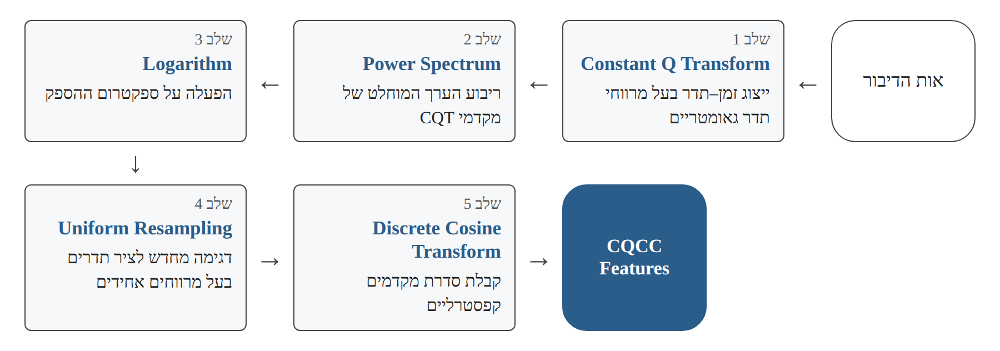
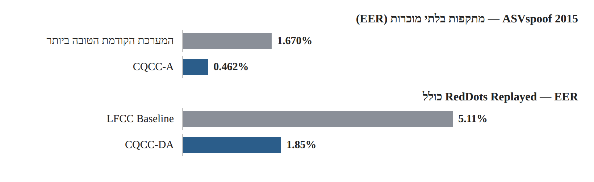
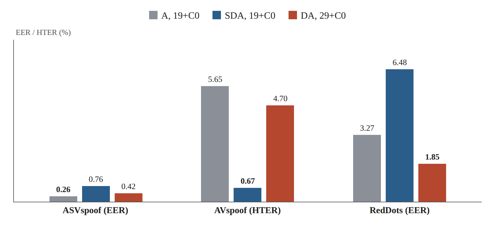

# Research Card 02 — CQCC

## Constant Q Cepstral Coefficients: A Spoofing Countermeasure for Automatic Speaker Verification

## 1. פרטים ביבליוגרפיים

**שם המאמר:** Constant Q Cepstral Coefficients: A Spoofing Countermeasure for Automatic Speaker Verification

**מחברים:** Massimiliano Todisco, Héctor Delgado, Nicholas Evans.

**מוסד מחקרי:** EURECOM, Sophia Antipolis, France.

**שנה:** 2017.

**גרסה שנקראה:** Preprint מתאריך 12 במאי 2017.

**תחום מחקר:** Audio Spoofing Detection, Speech Signal Processing, Acoustic Feature Extraction, Speaker Verification, Generalization.

**מילות מפתח:** Constant Q Transform (CQT), Constant Q Cepstral Coefficients (CQCC), MFCC, Cepstral Analysis, Gaussian Mixture Model (GMM), Replay Attacks, Speech Synthesis, Voice Conversion.

**רלוונטיות לפרויקט:** גבוהה מאוד. המאמר מציג שיטה קלאסית לחילוץ מאפיינים אקוסטיים, המספקת חלופה ל-MFCC ולייצוגים ספקטרליים מסורתיים. השיטה רלוונטית לבניית מודלי Baseline ולהשוואת ייצוגי אודיו בפרויקט זיהוי הזיופים הקוליים שלנו.

**הערת זיהוי:** המאמר הנוכחי הוא הרחבה של עבודה קודמת של אותם חוקרים משנת 2016. הוא אינו מציג את CQCC לראשונה, אלא מרחיב את הערכת השיטה לשלושה מאגרי נתונים ולתרחישי תקיפה נוספים.

---

## 2. תקציר מקיף של המאמר

המאמר מציג הערכה מורחבת של שיטת Constant Q Cepstral Coefficients (CQCC) לחילוץ מאפיינים אקוסטיים המיועדים לזיהוי זיופים קוליים.

השיטה משלבת ניתוח ספקטרלי באמצעות Constant Q Transform (CQT) עם עיבוד קפסטרלי מסורתי. בניגוד ל-Short-Time Fourier Transform (STFT), שבו הפרדת התדרים אחידה, CQT משתמש במרווחי תדר גאומטריים ובחלונות ניתוח באורכים משתנים. כך מתקבלת רזולוציית תדר גבוהה יותר בתדרים נמוכים ורזולוציית זמן גבוהה יותר בתדרים גבוהים.

המוטיבציה המחקרית נובעת מהאפשרות שמערכות ליצירת דיבור סינתטי ולהמרת קול משתמשות בייצוגים ספקטרליים דומים לאלו של מערכות אימות דוברים. החוקרים משערים כי שימוש בייצוג אקוסטי שונה עשוי לחשוף ארטיפקטים המעידים על מניפולציה קולית, שאינם בולטים בייצוגים המקובלים.

לשם הפקת CQCC, החוקרים מפעילים CQT על אות הדיבור, מחשבים את ספקטרום ההספק ואת הלוגריתם שלו, מבצעים דגימה מחדש של הספקטרום לציר תדרים אחיד ומפעילים Discrete Cosine Transform (DCT). התוצאה היא סדרת מקדמים קפסטרליים המשמשת כייצוג מספרי של אות הדיבור.

השיטה נבחנת באמצעות מסווג Gaussian Mixture Model (GMM) על שלושה מאגרי נתונים: ASVspoof 2015, AVspoof ו-RedDots Replayed. מאגרים אלו כוללים מתקפות Speech Synthesis, Voice Conversion ו-Replay, בתרחישי Logical Access ו-Physical Access שונים.

התוצאות מדגימות שיפור משמעותי לעומת מערכות קודמות בכל שלושת המאגרים. עם זאת, ההערכה הרוחבית מראה כי הקונפיגורציה האופטימלית של CQCC משתנה בהתאם למאגר ולסוג המתקפה. בפרט, תרומתם של מקדמים סטטיים ודינמיים אינה אחידה בין תרחישי התקיפה.

**המסקנה המרכזית:** בחירת ייצוג אקוסטי מתאים משפיעה באופן משמעותי על ביצועי זיהוי זיופים, אך אין ראיה שקונפיגורציה יחידה של CQCC מתאימה באופן מיטבי לכל סוגי המתקפות והסביבות.

**מקור במאמר:** Abstract, Sections 1, 3–7.

---

## 3. בעיית המחקר והמוטיבציה

### 3.1 בעיית המחקר

מערכות Automatic Speaker Verification (ASV) חשופות למתקפות שבהן תוקף מנסה לגרום למערכת לקבל דיבור מזויף כאילו הופק על ידי דובר מורשה.

המתקפות כוללות:

- Speech Synthesis — יצירת דיבור סינתטי.
- Voice Conversion — שינוי מאפייני הדובר בדיבור קיים.
- Replay — השמעה חוזרת של הקלטת דיבור אמיתי.

גישה מקובלת לזיהוי מתקפות אלה היא חיפוש אחר ארטיפקטים אקוסטיים שנוצרו בתהליך ההפקה, ההמרה או ההשמעה של האודיו.

### 3.2 מגבלות של ייצוגים קונבנציונליים

מערכות רבות לעיבוד דיבור מסתמכות על מאפיינים ספקטרליים לטווח קצר, לעיתים המבוססים על STFT ועל סולם Mel.

החוקרים מעלים אפשרות שמערכות הזיוף מצליחות לחקות היטב מאפיינים מסוג זה, ולכן גלאי זיופים המשתמש בייצוג דומה עלול שלא להפיק את מלוא המידע הדרוש לזיהוי המניפולציה.

בנוסף, ב-STFT קיימת פשרה בין רזולוציית הזמן לרזולוציית התדר, הנובעת מבחירת אורך חלון הניתוח.

### 3.3 השערת המחקר

ייצוג אקוסטי השונה מהייצוגים הנפוצים במערכות ASV ובמערכות יצירת דיבור עשוי לחשוף מאפיינים המעידים על זיוף, ולשפר את העמידות מול מתקפות מוכרות ובלתי מוכרות.

### 3.4 שאלת המחקר המשתמעת

האם שילוב של Constant Q Transform עם ניתוח קפסטרלי מספק ייצוג אקוסטי יעיל יותר לזיהוי זיופים קוליים, והאם יעילותו נשמרת בין מאגרי נתונים, סוגי מתקפות ותרחישי שימוש שונים?

שאלה זו היא ניסוח מסכם של מטרות החוקרים, ולא ציטוט של שאלת מחקר פורמלית יחידה.

**מקור:** Section 1, עמ' 2–4.

---

## 4. התרומות המרכזיות של המאמר

1. **הערכה מורחבת של CQCC:** הרחבת העבודה הקודמת משנת 2016 לשלושה מאגרי נתונים בעלי מאפיינים שונים.

2. **שילוב CQT וניתוח קפסטרלי:** שימוש ברזולוציית הזמן–תדר המשתנה של CQT לצורך יצירת מאפיינים המותאמים לזיהוי מניפולציות קוליות.

3. **ליניאריזציה של ציר התדרים:** שימוש ב-Uniform Resampling כדי לאפשר הפעלת DCT לאחר ההתמרה בעלת מרווחי התדר הגאומטריים.

4. **השוואת קונפיגורציות:** בחינת מספר מקדמים שונה ושילובים שונים של מאפיינים סטטיים, Delta ו-Acceleration.

5. **הערכה על סוגי מתקפות מגוונים:** בדיקת השיטה מול Speech Synthesis, Voice Conversion ו-Replay.

6. **Cross-Database Evaluation:** בחינת רגישות השיטה לבחירת קונפיגורציית המאפיינים כאשר עוברים בין מאגרי נתונים.

7. **דיון בהכללה:** הצגת האפשרות שלא קיים Front-end אקוסטי יחיד המתאים באופן מיטבי לכל תרחישי הזיוף, והצעת כיוון עתידי של מספר מסווגים המתמחים בסוגי מתקפות שונים.

**מקור:** Sections 1, 4, 6–7.

---

## 5. הרקע התיאורטי — STFT לעומת CQT

### 5.1 Time-Frequency Representation

ניתוח אודיו מחייב התייחסות לשני ממדים:

- הזמן שבו מופיעים מאפיינים באות.
- התדרים המרכיבים את האות באותו זמן.

קיימת פשרה בין רזולוציית הזמן לרזולוציית התדר: שיפור היכולת להבחין בין תדרים קרובים מחייב בדרך כלל חלון ניתוח ארוך יותר, המפחית את היכולת למקם במדויק שינויים מהירים בזמן.

### 5.2 Short-Time Fourier Transform

STFT מחלק את האות לחלונות זמן ומחשב את התוכן הספקטרלי בכל חלון.

הפרדת התדרים אחידה, ולכן אותו אורך חלון משמש לניתוח אזורי תדר שונים.

יתרונו הוא פשטות השיטה והשימוש הנרחב בה בעיבוד אותות.

מגבלתו בהקשר הנדון היא שהרזולוציה שנבחרה אינה בהכרח מתאימה באותה מידה למאפיינים המופיעים בתדרים נמוכים ובתדרים גבוהים.

### 5.3 Constant Q Transform

CQT משתמש במרכזי תדרים המרווחים גאומטרית. יחס התדרים בין תאים סמוכים קבוע, ובגרסה הבסיסית גם גורם האיכות Q קבוע.

התוצאה:

- בתדרים נמוכים מתקבלת הבחנה טובה יותר בין תדרים קרובים.
- בתדרים גבוהים מתקבלת הבחנה טובה יותר בשינויים המתרחשים לאורך זמן.

בניגוד ל-STFT, רזולוציית הזמן–תדר אינה אחידה על פני כל תחום התדרים.

### 5.4 ההדגמה במאמר

ב-Section 3.4 וב-Figure 2 מוצגת דוגמת דיבור שבה תדר היסוד משתנה בין 80Hz ל-90Hz.

ב-STFT המבוסס על 512 דגימות בקצב 16kHz, המרחק בין תאים ספקטרליים סמוכים הוא 31.25Hz.

לעומת זאת, CQT מאפשר להציג את השינוי בצורה מפורטת יותר בזכות רזולוציית התדר המשופרת בתדרים נמוכים.

יש להדגיש שהדוגמה ממחישה את היתרון של הייצוג, אך אינה מוכיחה לבדה שהשיפור בביצועי זיהוי הזיופים נגרם דווקא מזיהוי שיבושי Pitch.

### 5.5 משמעות מחקרית

CQT אינו בהכרח עדיף על STFT בכל משימה. הוא מספק חלוקה אחרת של רזולוציית הזמן והתדר, שעשויה להתאים במיוחד לזיהוי ארטיפקטים מסוימים.

**מקור:** Section 3, Figure 1 עמ' 15 ו-Figure 2 עמ' 17.

---

## 6. תהליך חילוץ CQCC

### 6.1 שלבי חילוץ המאפיינים

לפי Figure 3, עמוד 19:

**שלב 1 — Constant Q Transform**

המרת אות הדיבור מייצוג בזמן לייצוג זמן–תדר בעל מרווחי תדר גאומטריים.

**שלב 2 — Power Spectrum**

חישוב ריבוע הערך המוחלט של מקדמי CQT.

**שלב 3 — Logarithm**

הפעלת לוגריתם על ספקטרום ההספק.

**שלב 4 — Uniform Resampling**

דגימה מחדש של הייצוג הספקטרלי לציר תדרים בעל מרווחים אחידים.

**שלב 5 — Discrete Cosine Transform**

הפעלת DCT לקבלת סדרת מקדמים קפסטרליים.

התוצאה היא CQCC Features, שאותם ניתן להזין למסווג.

*איור 1. המחשה לשלבי חילוץ המאפיינים המתוארים בסעיף 6.1.*

### 6.2 מדוע נדרש Uniform Resampling?

מרכזי התדרים המתקבלים מ-CQT מסודרים גאומטרית.

העיבוד הקפסטרלי שהחוקרים מעוניינים לבצע מבוסס על DCT הפועל על סדרת דגימות אחידה בציר התדרים.

לכן נדרש שלב של המרה מציר תדרים גאומטרי לציר ליניארי.

החוקרים משתמשים בדגימה מחדש ובאינטרפולציה כדי לקבל את הייצוג המתאים לחישוב.

זהו חלק מרכזי מהחידוש הטכני של השיטה.

### 6.3 Static, Delta ו-Acceleration

לאחר חילוץ המקדמים ניתן להשתמש בשלושה סוגים של מאפיינים:

| סימון | שם | משמעות |
|---|---|---|
| S | Static | ערכי המקדמים בכל מסגרת זמן |
| D | Delta | שינוי המקדמים לאורך זמן |
| A | Acceleration / Delta-Delta | שינוי נוסף של הדינמיקה לאורך זמן |

נבחנו השילובים:

S, D, A, SD, SA, DA, SDA.

### 6.4 למה המאפיינים הדינמיים מעניינים?

מערכות ליצירת דיבור סינתטי ולהמרת קול עשויות להצליח לשחזר היטב את המאפיינים הספקטרליים בכל רגע, אך להתקשות בשחזור טבעי של השינויים לאורך זמן.

לכן מאפייני Delta ו-Acceleration עשויים להכיל מידע שמסייע לזיהוי.

עם זאת, תוצאות המחקר מראות שלא כל סוגי הזיופים מגיבים באותה צורה למאפיינים הדינמיים.

**מקור:** Section 4, Figure 3.

---

## 7. מאגרי הנתונים

### 7.1 ASVspoof 2015

המאגר מתמקד בעיקר במתקפות Logical Access מסוג Speech Synthesis ו-Voice Conversion.

הוא כולל 106 דוברים בחלוקה לקבוצות Training, Development ו-Evaluation.

המאגר מכיל עשרה אלגוריתמים ליצירת זיופים:

- S1–S5 — מתקפות מוכרות, שנכללות גם בשלבי האימון והפיתוח.
- S6–S10 — מתקפות בלתי מוכרות, שמופיעות רק בהערכה.

המדד המרכזי הוא EER.

המאגר מאפשר לבחון הבדלים בין זיהוי מתקפות מוכרות לבין יכולת הכללה למתקפות חדשות.

### 7.2 AVspoof

המאגר כולל 44 דוברים ומתקפות מסוג Speech Synthesis, Voice Conversion ו-Replay.

הוא כולל תרחישי Logical Access ו-Physical Access, עם הקלטות שהופקו באמצעות מכשירים שונים.

בפרוטוקול המתואר נעשה שימוש ב-EER בקבוצת הפיתוח וב-HTER בקבוצת ההערכה.

HTER מחושב באמצעות סף שנקבע על קבוצת הפיתוח, ולכן אין לפרש אותו כמדד הזהה ל-EER.

### 7.3 RedDots Replayed

מאגר המתמקד במתקפות Replay.

הוא כולל נתוני דיבור שנאספו בתנאים אקוסטיים שונים ובאמצעות מכשירי השמעה והקלטה מגוונים.

הניסוי כולל הפרדה בין תנאי הקלטה מבוקרים לבין תנאים משתנים.

מדד ההערכה הוא EER.

### 7.4 חשיבות הבחירה בשלושה מאגרים

המאמר אינו בוחן רק שלוש קבוצות נתונים שונות, אלא גם תרחישי תקיפה שונים מבחינה מהותית.

ב-Speech Synthesis וב-Voice Conversion הארטיפקטים נוצרים כתוצאה מתהליכי יצירה או עיבוד של הדיבור.

ב-Replay הארטיפקטים עשויים לנבוע ממערכות השמעה, הקלטה ומאפייני הערוץ האקוסטי.

לכן סביר שהמאפיינים המועילים לזיהוי יהיו שונים בין התרחישים.

**מקור:** Section 2, Tables 1, 3 ו-5.

---

## 8. תכנון הניסוי והמסווג

### 8.1 פרמטרים מרכזיים

| פרמטר | ערך |
|---|---|
| קצב דגימה | 16kHz |
| תדר מינימלי | כ-15Hz |
| תדר מקסימלי | 8kHz |
| מספר Octaves | 9 |
| Bins per octave | 96 |
| Hop | 8ms |
| מספר מקדמי CQCC | 19 או 29, בתוספת C0 |
| מאפיינים דינמיים | Delta ו-Acceleration |
| מסווג | GMM |
| מספר רכיבי GMM | 512 לכל מחלקה |
| שיטת אימון | Expectation-Maximization |

הפרמטרים של חילוץ המאפיינים כווננו באופן אמפירי על נתוני הפיתוח.

### 8.2 מבנה המסווג

החוקרים משתמשים בשני Gaussian Mixture Models נפרדים:

- GMM עבור דיבור אמיתי.
- GMM עבור דיבור מזויף.

כל מודל מעריך את הנראות של ייצוגי CQCC בהינתן המחלקה שלו.

ציון ההחלטה מחושב באמצעות יחס נראות לוגריתמי:

Λ(X) = log L(X | θnatural) − log L(X | θspoof)

כאשר X הוא רצף וקטורי המאפיינים של ההקלטה.

לפי ההגדרה הזאת, ציון גבוה יותר תומך במחלקת הדיבור האמיתי.

### 8.3 מדוע להשתמש ב-GMM?

המטרה המרכזית של המאמר היא לבחון את תהליך חילוץ המאפיינים.

שימוש באותו סוג מסווג לאורך הניסויים מפחית את השונות הנובעת מבחירת ארכיטקטורות שונות, ומאפשר להתמקד בהשפעה של קונפיגורציית CQCC.

עם זאת, בהשוואות למערכות קודמות לא כל הגורמים נשמרים קבועים, ולכן אין לייחס כל שיפור בהכרח לייצוג בלבד.

**מקור:** Section 5, עמ' 20–21.

---

## 9. תוצאות המחקר

### 9.1 תוצאות ASVspoof 2015

החוקרים בדקו קונפיגורציות שונות של CQCC, כולל 19 או 29 מקדמים בתוספת C0 ושילובים של S, D ו-A.

בתוצאות הפיתוח נמצא שמאפיינים דינמיים, ובפרט מאפייני Acceleration, מועילים במיוחד.

ב-Table 9 מוצגות תוצאות המערכת CQCC-A, הכוללת 19 מקדמים בתוספת C0 ומאפייני Acceleration בלבד.

| סוג המתקפות | EER |
|---|---:|
| Known | 0.048% |
| Unknown | 0.462% |
| ממוצע כולל | 0.255% |

המערכת הקודמת בעלת הביצועים הטובים ביותר עבור מתקפות בלתי מוכרות השיגה EER של 1.670%.

לכן השיפור היחסי על מתקפות בלתי מוכרות הוא כ-72%.

**דיוק מרכזי:** השיפור של 72% מתייחס למתקפות בלתי מוכרות, ואילו 0.255% הוא הממוצע על כלל המתקפות.

### 9.2 תוצאות AVspoof

במאגר AVspoof התצורה הטובה ביותר הייתה CQCC-SDA עם 19 מקדמים בתוספת C0.

התקבל:

**HTER = 0.67%**

תוצאה זו מייצגת שיפור יחסי של כ-47% לעומת התוצאה הקודמת הטובה ביותר בהשוואה שהחוקרים מציגים.

בניגוד ל-ASVspoof 2015, כאן מאפיינים סטטיים היו חשובים להשגת ביצועים גבוהים.

עם זאת, המאמר מציג גם חולשה משמעותית במתקפת Replay בלתי מוכרת בשם A10, שבה התקבל HTER של 23.92%.

הפער בין התוצאה הכוללת הטובה לבין השגיאה הגבוהה במתקפה מסוימת מדגיש את הסיכון בהסתמכות על מדד ממוצע בלבד.

### 9.3 תוצאות RedDots Replayed

התצורה הטובה ביותר הייתה CQCC-DA עם 29 מקדמים בתוספת C0.

| שיטה | EER כולל |
|---|---:|
| LFCC Baseline | 5.11% |
| CQCC-DA | 1.85% |

התוצאה מייצגת שיפור יחסי של כ-64% לעומת ה-Baseline.

בנוסף:

- בתנאים מבוקרים התקבל EER של 1.80%.
- בתנאים משתנים התקבל EER של 1.92%.

הפער הקטן יחסית בין התוצאות מצביע על ביצועים יציבים למדי בתנאי הניסוי האלה.

*איור 3. המחשה להשוואות בסעיפים 9.1 ו-9.3: מתקפות בלתי מוכרות ב-ASVspoof 2015 ו-EER כולל ב-RedDots Replayed.*

### 9.4 סיכום תוצאות מרכזיות

| מאגר | תצורת CQCC הטובה | מדד | תוצאה |
|---|---|---|---:|
| ASVspoof 2015 | A, 19+C0 | EER | 0.255% |
| AVspoof | SDA, 19+C0 | HTER | 0.67% |
| RedDots Replayed | DA, 29+C0 | EER | 1.85% |

הטבלה מציגה תוצאות ממאגרים ומפרוטוקולי הערכה שונים. אין להסיק ממנה שמאגר אחד בהכרח קל יותר רק על סמך השוואת המספרים.

**מקור:** Section 6.1–6.3, Tables 7–15.

---

## 10. Cross-Database Evaluation — הממצא המרכזי

### 10.1 מטרת הניסוי

החוקרים רצו לבדוק כיצד קונפיגורציות CQCC שנבחרו כמיטביות עבור מאגר אחד מתפקדות גם על מאגרים אחרים.

חשוב לדייק: זוהי בעיקר השוואה של קונפיגורציות Front-end שנבחרו על סמך מאגר מסוים ומיושמות בהערכות של מאגרים אחרים. אין לבלבל זאת עם ניסוי שבו מאמנים את כל המסווג על מאגר אחד ומעבירים אותו ללא אימון למאגר אחר.

### 10.2 תוצאות Table 16

| תצורת CQCC | ASVspoof EER | AVspoof HTER | RedDots EER |
|---|---:|---:|---:|
| A, 19+C0 | **0.26%** | 5.65% | 3.27% |
| SDA, 19+C0 | 0.76% | **0.67%** | 6.48% |
| DA, 29+C0 | 0.42% | 4.70% | **1.85%** |

*איור 2. המחשה לנתוני Table 16 (סעיף 10.2): התוצאה של כל תצורת CQCC בכל מאגר.*

### 10.3 ניתוח התוצאות

**ממצא ראשון:** לכל מאגר קונפיגורציה אופטימלית שונה.

**ממצא שני:** מאפיינים דינמיים תורמים בכל שלוש הקונפיגורציות המובילות, אך שילובם עם מאפיינים סטטיים אינו מועיל באותה מידה בכל מאגר.

**ממצא שלישי:** בחירה בקונפיגורציה שמתאימה למאגר אחד עלולה להוביל להידרדרות משמעותית בביצועים על מאגר אחר.

לדוגמה, ב-AVspoof:

- CQCC-SDA משיג HTER של 0.67%.
- CQCC-A משיג HTER של 5.65%.

זו הידרדרות של יותר מפי שמונה בערך המדד.

### 10.4 המשמעות

אין בסיס לקבוע שקונפיגורציית CQCC אחת עדיפה בכל סוגי ההתקפות.

החוקרים מציעים לשקול גישה המשלבת מספר Front-ends או מסווגים המתמחים בסוגי מתקפות שונים.

זו הצעה למחקר עתידי, ולא פתרון שהמאמר הנוכחי מוכיח את יעילותו.

**מקור:** Section 6.4, Table 16, עמ' 32–33.

---

## 11. מסקנות החוקרים

החוקרים מסיקים ששילוב CQT עם עיבוד קפסטרלי מאפשר לחלץ מאפיינים יעילים לזיהוי מניפולציות קוליות.

CQCC השיג תוצאות עדיפות על שיטות השוואה קודמות בשלושת מאגרי הנתונים שנבדקו.

עם זאת, הביצועים התגלו כרגישים לבחירת המקדמים ולסוג תרחיש התקיפה.

החוקרים מדגישים כי הצלחה בזיהוי מתקפות מסוג אחד אינה מבטיחה הצלחה מול מתקפות מסוג אחר.

לכן הם מעלים ספק לגבי האפשרות למצוא Front-end אקוסטי יחיד שמספק פתרון מיטבי לכל תרחישי הזיוף, ומציעים לחקור שילוב של מספר Front-ends או מסווגים המתמחים במתקפות שונות.

בנוסף, הם מציינים את הצורך להיזהר מעלייה בשיעור אזעקות השווא כאשר משלבים מערכות זיהוי.

**מקור:** Section 7, עמ' 33–34.

---

## 12. ניתוח ביקורתי

### 12.1 יתרונות המחקר

**א. תרומה ברמת ייצוג הנתונים**

המאמר מדגים שהתקדמות בזיהוי זיופים אינה חייבת לנבוע רק מהגדלת מורכבות המסווג. גם בחירת ייצוג אקוסטי מתאים עשויה לשפר את הביצועים.

**ב. שילוב של עיבוד אותות ותכנון ניסויי**

המאמר מציג מוטיבציה תיאורטית ל-CQT, תהליך חילוץ מאפיינים מוגדר וניסויים המאפשרים לבחון קונפיגורציות שונות.

**ג. שימוש במסווג אחיד**

בחירה ב-GMM לאורך הניסויים מאפשרת להתמקד בחלק משמעותי מהשונות הנובעת מייצוג המאפיינים.

**ד. בדיקה על שלושה מאגרים**

ההערכה כוללת שיטות זיוף שונות, תנאים אקוסטיים שונים ותרחישי שימוש שונים.

**ה. ניתוח הכללה**

המאמר אינו מסתפק בהצגת תוצאות טובות, אלא מדגים גם את הרגישות של השיטה לבחירת קונפיגורציית המאפיינים.

### 12.2 מגבלות המחקר

**א. תלות בפרמטרים**

הביצועים מושפעים מבחירת מספר המקדמים, מהשימוש ב-S/D/A ומפרמטרים נוספים של חילוץ המאפיינים.

**ב. היעדר קונפיגורציה אוניברסלית**

הקונפיגורציה האופטימלית משתנה בין המאגרים. הדבר מקשה על בחירת ייצוג יחיד לשימוש בסביבה שבה סוג המתקפה אינו ידוע מראש.

**ג. מגבלות ההשוואה למערכות קודמות**

חלק מהמערכות הקודמות השתמשו במסווגים ובמאפיינים שונים, ולכן לא ניתן לייחס את כל השיפור לגורם אחד.

**ד. מגבלות ההערכה הרוחבית**

הניסוי המרכזי ב-Section 6.4 בוחן את העברת קונפיגורציית ה-Front-end בין מאגרים, ולא בהכרח העברת מסווג מאומן ממאגר מקור למאגר יעד ללא אימון נוסף.

**ה. תוצאה ממוצעת עלולה להסתיר חולשות**

למרות HTER כולל של 0.67% ב-AVspoof, מתקפת A10 הציגה HTER של 23.92%. הדבר ממחיש את החשיבות של בדיקת ביצועים לפי סוג התקפה.

**ו. גיל המאמר והיקף המתקפות**

המאמר נכתב בשנת 2017 ואינו בוחן את הדורות החדשים של מודלי הדיבור הסינתטי ואת משפחת המתקפות המבוססת על Neural Audio Codecs שנחקרת ב-CodecFake.

**ז. חוסר בהשוואה ישירה למודלים מודרניים**

המחקר אינו כולל השוואה לייצוגי SSL מודרניים כגון wav2vec 2.0 או WavLM.

### 12.3 מה לא ניתן להסיק

המאמר אינו מוכיח ש:

- CQCC תמיד עדיף על MFCC.
- מאפייני Delta ו-Acceleration תמיד טובים יותר ממאפיינים סטטיים.
- אותו שילוב מקדמים יהיה אופטימלי גם על נתוני הקורס שלנו.
- CQCC יתמודד בהכרח עם זיופים שנוצרו באמצעות Neural Audio Codecs.
- השיפור מול מערכות קודמות נובע רק מהייצוג האקוסטי.
- שילוב מספר מסווגים בהכרח ישפר ביצועים בכל תנאי ההערכה.

---

## 13. ההבנות והתובנות שלנו מהמאמר

### 13.1 ייצוג האודיו הוא החלטה מחקרית בפני עצמה

למדנו שלא מספיק לבחור מסווג חזק. המידע שאנחנו מספקים למסווג עשוי להשפיע משמעותית על יכולתו לזהות זיופים.

לכן כדאי לבדוק גם את איכות ייצוג האודיו, ולא רק את מורכבות הארכיטקטורה.

### 13.2 ייצוג שונה עשוי לחשוף מידע שלא היה בולט קודם

השימוש ב-CQT מבוסס על ההשערה ששינוי אופן הניתוח של האות עשוי לחשוף ארטיפקטים שלא הודגשו בייצוגים קלאסיים.

עם זאת, אין להסיק שכל ייצוג חדש הוא בהכרח טוב יותר.

### 13.3 מאפיינים דינמיים עשויים להיות חשובים

המאמר מראה ששינויים בזמן של המאפיינים האקוסטיים יכולים לספק מידע מועיל לזיהוי זיופים.

התרומה שלהם תלויה במאגר ובסוג ההתקפה.

### 13.4 ביצועים טובים על מאגר אחד אינם מבטיחים הכללה

זו התובנה החשובה ביותר עבור הפרויקט שלנו.

CQCC הציג תוצאות טובות מאוד בכל אחד מהמאגרים בתצורות מסוימות, אך לא נמצאה תצורה אחת שמציגה את הביצועים הטובים ביותר בכולם.

מכאן עולה הצורך להעריך מודלים מול מקורות נתונים ושיטות זיוף שונים.

### 13.5 יש להבחין בין ממצא לבין השערה

המאמר מדגים ש-CQCC מצליח בתנאי הניסוי שנבדקו.

הוא אינו מוכיח ש-CQCC יתאים יותר ממודלים אחרים לתנאי הקורס שלנו.

לכן נשתמש בממצא כבסיס לתכנון ניסוי, ולא כהנחה שתוצאתו ידועה מראש.

---

## 14. משמעות המאמר לפרויקט שלנו

### 14.1 הרלוונטיות לנתוני הקורס

פרויקט הקורס שלנו מתמקד בזיהוי דיבור אמיתי לעומת מזויף, על מאגר הכולל דוגמאות מ-ASVspoof 5, CodecFake ו-M-AILABS.

המאמר הנוכחי רלוונטי מכיוון שהוא מתאר שיטה לחילוץ מאפיינים שניתן להפעיל על אותות דיבור ולהזין למסווג בינארי.

עם זאת, קיים הבדל משמעותי בין המתקפות שנבחנו במאמר מ-2017 לבין המתקפות המודרניות בקורס.

לכן נצטרך לאמת את יעילות השיטה מחדש על הנתונים שלנו.

### 14.2 Baseline מתקדם

לפי תוכנית הקורס, נתחיל ב-Baseline קלאסי המבוסס על MFCC ומסווג פשוט, לדוגמה Logistic Regression.

CQCC הוא מועמד מתאים לניסוי המשך, שיבחן את השפעת החלפת ייצוג האודיו.

### 14.3 חשיבות ההערכה לפי מקור הנתונים

מאחר שנתוני הקורס מגיעים ממספר מאגרים, יש לבדוק אם המודל לומד סממנים אמיתיים של זיוף או הבדלים שאינם קשורים ישירות לזיוף, כגון מאפייני הקלטה, דחיסה ומקור הנתונים.

יש לבחון את הביצועים גם לפי מקור ההקלטה ולפי שיטת הזיוף, ככל שהמידע זמין ומספר הדוגמאות מאפשר זאת.

### 14.4 הפרדת ניסויים

כדי לבחון את תרומת CQCC נשתדל לשמור על אותם תנאי אימון והערכה עבור כל ייצוג:

- אותו פיצול נתונים.
- אותו מסווג.
- אותה שיטת בחירת Hyperparameters.
- אותו מדד הערכה.
- אותם כללים למניעת דליפת מידע.

כך נוכל לייחס את ההבדלים בצורה טובה יותר לייצוג האקוסטי.

---

## 15. השערות מחקר אפשריות

### H1 — CQCC לעומת MFCC

**השערה:** שימוש ב-CQCC עשוי לשפר את יכולת זיהוי הזיופים ביחס ל-MFCC, כאשר משתמשים באותו מסווג.

**ניסוי מוצע:** השוואה בין MFCC + Logistic Regression לבין CQCC + Logistic Regression, על אותם נתונים ובאותו פרוטוקול.

**מדד מרכזי:** EER.

**הערה:** זו השערה לבחינה, ולא תוצאה שהמאמר הוכיח עבור Dataset הקורס.

### H2 — חשיבות המאפיינים הדינמיים

**השערה:** למאפייני Delta ו-Acceleration עשויה להיות תרומה שונה בזיהוי זיופים ממקורות שונים.

**ניסוי מוצע:** השוואה בין CQCC-S, CQCC-D, CQCC-A, CQCC-DA ו-CQCC-SDA.

**מדד מרכזי:** EER כללי, ובמידת האפשר גם EER לפי מקור נתונים או סוג התקפה.

### H3 — Generalization Across Sources

**השערה:** קונפיגורציית מאפיינים שתשיג ביצועים טובים על מקור נתונים אחד לא בהכרח תציג ביצועים דומים על מקור אחר.

**ניסוי מוצע:** השוואת ביצועי אותן קונפיגורציות על תתי-קבוצות שונות של נתוני הקורס, תוך מניעת חפיפה ובחירת פרוטוקול שמאפשר השוואה תקפה.

**הערה מתודולוגית:** מאחר שב-M-AILABS קיימות אצלנו רק הקלטות אמיתיות, לא ניתן לחשב EER עצמאי למקור זה ללא הגדרה מתאימה של קבוצת דוגמאות מזויפות להשוואה. יש להימנע מהצגת EER לכל מקור אם הפרוטוקול אינו מאפשר זאת.

### H4 — ייצוגים משלימים

**השערה:** שילוב CQCC עם ייצוג אחר, כגון MFCC או ייצוג SSL, עשוי לשפר ביצועים כאשר השיטות לוכדות מידע משלים.

**ניסוי מוצע:** בחינת מודלים נפרדים ושילוב ציוניהם, עם בחירת משקלי השילוב על קבוצת Validation בלבד.

---

## 16. שאלות פתוחות להמשך

1. האם CQCC ישפר את ה-EER על נתוני הקורס בהשוואה ל-MFCC?
2. האם מאפייני Acceleration שימושיים גם מול מתקפות ASVspoof 5 המתקדמות?
3. כיצד מתפקד CQCC מול זיופים שנוצרו באמצעות Neural Audio Codecs?
4. האם מספר המקדמים המיטבי שונה בין מקורות הנתונים?
5. האם השילוב בין מאפיינים סטטיים לדינמיים משפיע על יכולת ההכללה?
6. האם מודל המבוסס על CQCC לומד ארטיפקטים של זיוף או גם מאפיינים של מקור הנתונים?
7. האם שילוב CQCC עם מודלים מבוססי SSL משפר את הביצועים?
8. מהי עלות החישוב של חילוץ CQCC ביחס לחלופות, במימוש ובסביבת העבודה שלנו?

---

## 17. מסקנה מסכמת

המאמר מדגים כי בחירת ייצוג אקוסטי היא רכיב מרכזי בתכנון מערכות לזיהוי זיופים קוליים.

שיטת CQCC משלבת רזולוציית זמן–תדר משתנה עם עיבוד קפסטרלי, ומאפשרת לחלץ מאפיינים שהציגו ביצועים גבוהים מול מתקפות Speech Synthesis, Voice Conversion ו-Replay.

עם זאת, תוצאות ההערכה הרוחבית מצביעות על רגישות משמעותית לקונפיגורציית המאפיינים, לסוג המתקפה ולמאגר הנתונים.

מבחינת הפרויקט שלנו, התרומה המרכזית של המאמר היא האפשרות לבחון באופן מבוקר את השפעת ייצוג האודיו על יכולת זיהוי הזיופים, ללא צורך להתחיל מיד מארכיטקטורות Deep Learning מורכבות.

**העיקרון המחקרי שנאמץ:** לא נניח שקיים ייצוג אקוסטי אחד המתאים לכל סוגי הזיופים. נשווה ייצוגים וקונפיגורציות שונות, ונעריך אותם לפי יכולת ההכללה וביצועיהם על נתוני הקורס.

---

## 18. מפת הפניות למאמר

| נושא | מיקום במאמר |
|---|---|
| מוטיבציה והשערת המחקר | Section 1, עמ' 2–4 |
| מאגרי הנתונים | Section 2, עמ' 4–12 |
| ASVspoof 2015 | Section 2.1, Tables 1–2 |
| AVspoof | Section 2.2, Tables 3–4 |
| RedDots Replayed | Section 2.3, Tables 5–6 |
| STFT לעומת CQT | Section 3, עמ' 12–17 |
| המחשת רזולוציית זמן–תדר | Figure 1, עמ' 15 |
| השוואת ספקטרוגרמות | Figure 2, עמ' 17 |
| תהליך חילוץ CQCC | Section 4, Figure 3, עמ' 18–20 |
| פרמטרי חילוץ המאפיינים | Section 5.1, עמ' 20–21 |
| מודל GMM | Section 5.2, עמ' 21 |
| תוצאות ASVspoof 2015 | Section 6.1, Tables 7–9 |
| תוצאות AVspoof | Section 6.2, Tables 10–12 |
| תוצאות RedDots Replayed | Section 6.3, Tables 13–15 |
| Cross-Database Evaluation | Section 6.4, Table 16, עמ' 31–33 |
| מסקנות החוקרים | Section 7, עמ' 33–34 |

**הערה:** תוצאות המחקר מתייחסות למאגרים ולשיטות הזיוף שנבחנו בשנת 2017. אין להשליך את שיעורי השגיאה המדווחים ישירות על נתוני הקורס שלנו או להשוות אותם ישירות לתוצאות ASVspoof 5 משנת 2024.
