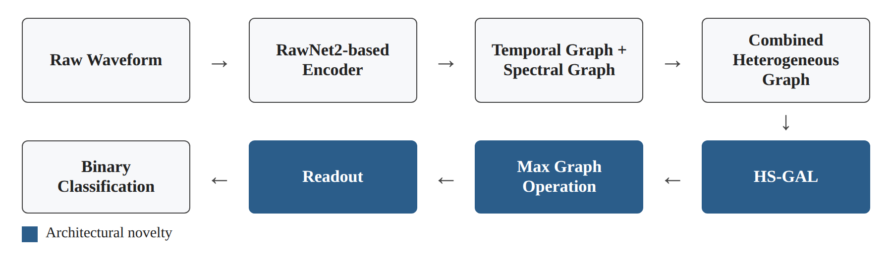
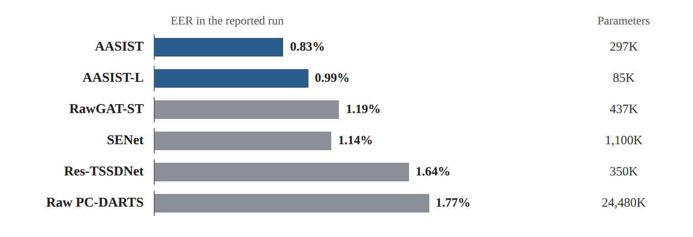
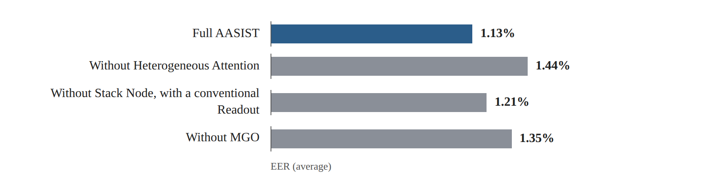

# Research Card 03 — AASIST

## AASIST: Audio Anti-Spoofing Using Integrated Spectro-Temporal Graph Attention Networks

## 1. Bibliographic Details

**Paper title:** AASIST: Audio Anti-Spoofing Using Integrated Spectro-Temporal Graph Attention Networks

**Authors:** Jee-weon Jung, Hee-Soo Heo, Hemlata Tak, Hye-jin Shim, Joon Son Chung, Bong-Jin Lee, Ha-Jin Yu, Nicholas Evans.

**Research institutions:** Naver Corporation, EURECOM, University of Seoul, Korea Advanced Institute of Science and Technology (KAIST).

**Year of publication:** 2022.

**Publication venue:** IEEE International Conference on Acoustics, Speech and Signal Processing (ICASSP 2022), pages 6367–6371.

**DOI:** 10.1109/ICASSP43922.2022.9747766

**Link:** https://doi.org/10.1109/ICASSP43922.2022.9747766

**Code and models:** https://github.com/clovaai/aasist

**Research field:** Audio Deepfake Detection, Speech Anti-Spoofing, Graph Neural Networks, Graph Attention, End-to-End Learning, Spectro-Temporal Modeling.

**Keywords:** AASIST, RawNet2, RawGAT-ST, HS-GAL, MGO, Stack Node, Heterogeneous Attention, AASIST-L, ASVspoof 2019.

**Relevance to the project:** Very high. The paper presents a dedicated Deep Learning architecture for detecting voice forgeries, which receives a raw audio signal and combines temporal and spectral representations. It provides a candidate for an advanced model, alongside a research basis for examining the effectiveness of deep architectures, generalization performance, computational efficiency and Ablation experiments.

---

## 2. Comprehensive Summary of the Paper

The paper presents AASIST, an End-to-End system for detecting voice forgeries, based on Graph Attention Networks and combining temporal and spectral information in order to detect artifacts indicating fake speech.

The research motivation stems from the fact that forgery cues may appear in certain time segments or in certain frequency ranges, depending on the method of creating the forgery. Previous systems sometimes used a combination of several sub-models (Ensemble), each of which focused on particular features. This approach may increase the computational complexity of the detection system.

The researchers propose a single model that combines information from both dimensions, while learning relations between temporal and spectral features. The model is based on an Encoder based on RawNet2, which produces representations from a raw audio signal. After the features are extracted, two graphs are built, one along the time axis and one along the frequency axis, and they are combined into a joint heterogeneous graph.

The paper presents three central architectural novelties:

1. **Heterogeneous Stacking Graph Attention Layer (HS-GAL):** A layer that makes it possible to learn relations between nodes of different types, using a Heterogeneous Attention mechanism and a Stack Node that accumulates combined information.
2. **Max Graph Operation (MGO):** A mechanism that includes two parallel branches and a Maximum operation between their outputs, with the aim of encouraging the learning of complementary features.
3. **A new Readout:** A combination of maximum and average over the graph nodes, together with the information accumulated in the Stack Node, in order to produce a summary representation for classification.

In addition, the researchers present a lightweight version called AASIST-L, which includes about 85 thousand parameters.

The experiments were carried out on the ASVspoof 2019 dataset in the Logical Access track, using the EER and min t-DCF metrics. AASIST achieved an average EER of 1.13% compared with 1.39% for RawGAT-ST, and an average min t-DCF of 0.0347 compared with 0.0443. The relative improvement in the min t-DCF metric is about 21.7%.

In the best run, an EER of 0.83% and a min t-DCF of 0.0275 were achieved. Ablation experiments showed that removing each of the three central components harms performance, with the removal of Heterogeneous Attention having the greatest effect.

**The central conclusion:** Explicitly combining relations between temporal and spectral representations by means of Graph Attention makes it possible to improve forgery detection performance under the experimental conditions that were examined, while using a single and relatively compact model.

**Source:** Abstract, Sections 1–5.

---

## 3. The Research Problem and Motivation

### 3.1 The Problem

Systems for detecting voice forgeries are required to distinguish between real speech (Bona fide) and fake speech (Spoofed), even when the attacks are created by means of different algorithms.

The artifacts that distinguish between the two classes may depend on the forgery method and appear:

- In a particular frequency range.
- In a particular time segment.
- In the relations between temporal and spectral patterns.

Therefore a system that relies on a limited representation may struggle to detect artifacts of different types.

### 3.2 Limitations of Previous Research

The researchers point to two central limitations.

**A. The complexity of Ensemble systems**

Systems that combine several models may detect a wide variety of artifacts, but at the cost of computational and operational complexity.

**B. Limited combination between time and frequency representations**

In a previous work called RawGAT-ST, two separate graphs were presented for temporal and spectral information. They were combined by means of relatively simple operations, such as element-wise multiplication, without a dedicated Attention mechanism for the relations between the two types of nodes.

### 3.3 The Goal of the Study

To develop a single and effective forgery detection system, capable of explicitly combining temporal and spectral information and of detecting a variety of artifacts without the need for a Score-Level Ensemble.

### 3.4 The Implied Research Question

Can a heterogeneous combination of time and frequency representations by means of Graph Attention, together with a competition mechanism between branches, improve forgery detection performance relative to existing models while maintaining relatively low computational complexity?

This question summarizes the researchers' goal and is not a quotation of a single formal question.

**Source:** Abstract, Section 1.

---

## 4. The Main Contributions of the Paper

**1. Heterogeneous Stacking Graph Attention Layer — HS-GAL**

Developing a layer that makes it possible to perform Attention on a graph that combines temporal and spectral nodes, even when the original graphs have a different number of nodes and dimensions.

**2. Heterogeneous Attention**

Using Attention mechanisms that distinguish between three types of relations: relations within the temporal graph, relations within the spectral graph, and relations between the two graphs.

**3. Stack Node**

Adding a special node that accumulates information about both types of representations and about the relations between them across the layers of the graph.

**4. Max Graph Operation — MGO**

Two parallel branches that pass through HS-GAL and Graph Pooling layers, and are then combined by means of an element-wise Maximum.

**5. A customized Readout**

Combining average and maximum information from the graph nodes together with the Stack Node to obtain a final representation.

**6. AASIST-L**

Developing a lightweight version of the model, which includes only about 85,000 parameters.

**7. Ablation Study**

Examining the independent contribution of the central components of the model by removing them and comparing performance.

**Source:** Sections 1, 3–4.

---

## 5. Architectural Background — RawNet2 and RawGAT-ST

### 5.1 RawNet2-based Encoder

AASIST begins with an Encoder based on RawNet2.

The Encoder receives a raw audio signal and extracts from it Feature Maps that reflect features learned from the signal.

Unlike manual extraction of features such as MFCC or CQCC, the Encoder layers learn the representation during training.

The implementation described in the paper uses a Sinc-Convolution layer and six Residual Blocks based on two-dimensional convolution operations.

### 5.2 RawGAT-ST

RawGAT-ST is an earlier model on which AASIST is based.

It combines:

- A temporal graph — Temporal Graph.
- A spectral graph — Spectral Graph.
- Graph Attention within each graph.

In the previous model the information from the graphs was combined by means of element-wise operations.

### 5.3 What Does AASIST Add?

AASIST is not content with combining the outputs.

It creates a joint heterogeneous graph, so that relations between temporal and spectral nodes can be learned explicitly.

This is the central difference between it and RawGAT-ST.

**Source:** Sections 1–3.

---

## 6. The Structure of the AASIST Architecture

### 6.1 The Flow of Information

The central process is:

Raw Waveform

→ RawNet2-based Encoder

→ Temporal Graph + Spectral Graph

→ Combined Heterogeneous Graph

→ HS-GAL

→ Max Graph Operation

→ Readout

→ Binary Classification

*Figure 1. Illustration of the information flow described in Section 6.1.*

### 6.2 Encoder

The audio signal is processed by means of a Sinc-Convolution layer followed by Residual Blocks.

The output is a Feature Map:

F ∈ R^(C×S×T)

where:

- C — the number of feature channels.
- S — the spectral dimension.
- T — the temporal dimension.

### 6.3 Creating the Graphs

The model produces two representations:

**Temporal Graph — Gt**

Built by reducing the frequency dimension, so that relations between features along the time axis can be learned.

**Spectral Graph — Gs**

Built by reducing the time dimension, so that relations between features along the frequency axis can be learned.

Both graphs pass through Graph Attention and Graph Pooling.

### 6.4 Combining the Graphs

After the temporal and spectral graphs are created, a joint graph Gst is built.

The graph contains nodes of both types, and relations are added between temporal and spectral nodes.

Since the origin of the nodes and their features differ, this is a heterogeneous graph.

### 6.5 HS-GAL

The layer makes it possible to process the combined graph by means of Attention adapted to the different types of relations.

Before computing the relations, the nodes of both graphs are transferred to a representation with a shared dimension.

Subsequently, Attention weights are computed according to the type of relation.

### 6.6 Heterogeneous Attention

The mechanism uses three separate Projection vectors for:

1. Temporal → Temporal.
2. Spectral → Spectral.
3. Temporal ↔ Spectral.

The use of dedicated weights makes it possible for the model to distinguish between relations within the same type of information and relations between different types of information.

### 6.7 Stack Node

The Stack Node is an additional node connected to the temporal and spectral nodes.

Its role is to accumulate shared information from both domains across the HS-GAL layers.

The connections to the Stack Node are unidirectional: the node receives information from other nodes, but does not pass information to them by means of those same connections.

The researchers conceptually compare its role to the Classification Tokens familiar from other architectures, but emphasize the difference in the direction of the information flow.

### 6.8 Max Graph Operation — MGO

After the graphs are combined, the information passes through two parallel branches.

Each branch includes:

- Two HS-GAL layers.
- Two Graph Pooling layers.

The outputs are combined by means of an element-wise Maximum.

The purpose of the mechanism is to encourage the branches to learn complementary patterns, so that prominent features from each branch can be preserved in the output.

**Research distinction:** The researchers demonstrate that MGO improves performance, but do not prove that each branch learned a particular family of attacks.

### 6.9 Readout

The Readout mechanism combines:

- Maximum over temporal and spectral nodes.
- Average over temporal and spectral nodes.
- The information from the Stack Node.

The combined representation is passed to the output layer for binary classification.

**Source:** Section 3, Figure 1, pp. 2–3.

---

## 7. AASIST-L — The Lightweight Version

The researchers propose a more compact version of the model, with the same basic architecture but with a significantly smaller number of parameters.

| Property | AASIST | AASIST-L |
|---|---:|---:|
| Number of parameters | 297K | 85K |
| EER in the best run | 0.83% | 0.99% |
| min t-DCF in the best run | 0.0275 | 0.0309 |

The researchers note that the size of the AASIST-L model is about 332KB, and that additional techniques for reducing resource requirements can be considered.

### Research Significance

AASIST-L presents the possibility of achieving high performance even by means of a model with a relatively small number of parameters.

However, the number of parameters does not by itself measure the running time, the actual memory consumption or the computation requirements.

The paper does not present a full Benchmark of deployment on real devices.

Therefore AASIST-L should be seen as a promising candidate for resource-limited systems, and not as a system that has been proven suitable for every production environment.

**Source:** Section 3.4, Table 2.

---

## 8. The Dataset and the Evaluation Task

### 8.1 Dataset

All the experiments were carried out using:

**ASVspoof 2019 — Logical Access (LA)**

The dataset includes the sets:

- Training.
- Development.
- Evaluation.

### 8.2 Division of the Attacks

| Set | Attack IDs |
|---|---|
| Training | A01–A06 |
| Development | A01–A06 |
| Evaluation | A07–A19 |

In the Evaluation set there are 13 forgery methods that did not appear as attack algorithms in the training and development sets.

This separation helps to evaluate generalization ability to new attacks within the same Benchmark.

However, it does not prove generalization ability to external datasets or to forgery technologies that were not included in the protocol.

### 8.3 The Classification Task

The model classifies an audio recording into one of two classes:

- Bona fide — real speech.
- Spoofed — fake speech.

There is no need to identify the speaker's identity.

### 8.4 Evaluation Metrics

**EER — Equal Error Rate**

A metric for stand-alone forgery detection performance. The lower the value, the better the performance.

**min t-DCF — Minimum Tandem Detection Cost Function**

A metric that refers to the effect of the forgery detection system on a combined Automatic Speaker Verification system, under certain assumptions of costs and prevalence.

The two metrics complement each other, but they do not measure exactly the same task.

**Source:** Section 4.1.

---

## 9. Implementation and Training Details

| Component | Setting in the paper |
|---|---|
| Framework | PyTorch |
| Input | 64,600 audio samples, about 4 seconds |
| Encoder | RawNet2-based |
| Initial Sinc filters | 70 |
| Residual Blocks | 6 |
| Residual Filters | 32 in the first two blocks, 64 in the remaining four |
| Initial Graph Attention | 64 Filters |
| Later Graph Attention | 32 Filters |
| Optimizer | Adam |
| Learning Rate | 0.0001 |
| Scheduler | Cosine Annealing |
| Seeds for evaluating the central model | 3 |
| Lightweight version | Tuned by means of Population-Based Training |

### The Importance of the Number of Seeds

The researchers identified that changing the Random Seed may significantly affect the model's performance.

In RawGAT-ST, a variance in the EER between 1.19% and 2.06% was observed in different runs.

Therefore the researchers report average results alongside the best run.

**Methodological conclusion:** A single result is not necessarily sufficient for evaluating the stability of a Deep Learning model. It is advisable to report performance across several runs when computational resources allow.

**Source:** Sections 4.1–4.2.

---

## 10. Research Results

### 10.1 AASIST versus RawGAT-ST

Table 1 presents results on ASVspoof 2019 LA.

| Model | Average min t-DCF | Best | Average EER | Best |
|---|---:|---:|---:|---:|
| RawGAT-ST | 0.0443 | 0.0333 | 1.39% | 1.19% |
| AASIST | **0.0347** | **0.0275** | **1.13%** | **0.83%** |

### 10.2 Relative Improvement

The improvement in the average min t-DCF:

(0.0443 − 0.0347) / 0.0443 ≈ 21.7%

Therefore the researchers report a relative improvement of more than 20% in this metric.

The improvement does not necessarily refer to each attack separately.

### 10.3 Performance by Attack

AASIST showed similar or better performance than RawGAT-ST on nine out of the thirteen attacks.

On the other four attacks, RawGAT-ST showed slightly better performance.

For example, on attack A15 the EER dropped from 1.03% to 0.65%.

However, the paper demonstrates that a model with better overall performance is not necessarily the best model on every single attack.

### 10.4 Comparison to Competing Systems

According to Table 2:

| Model | Parameters | EER in the reported run |
|---|---:|---:|
| AASIST | 297K | **0.83%** |
| AASIST-L | 85K | 0.99% |
| RawGAT-ST | 437K | 1.19% |
| SENet | 1,100K | 1.14% |
| Res-TSSDNet | 350K | 1.64% |
| Raw PC-DARTS | 24,480K | 1.77% |

*Figure 2. Illustration of the Table 2 data (Section 10.4): the EER in the reported run and the number of parameters of each system.*

The comparison table includes additional systems. All the systems in the comparison presented are single models, without Score-Level Fusion.

### 10.5 Conclusion from the Comparison

AASIST showed the best performance among the systems included in the comparison.

AASIST-L showed better results than all the other systems in the table, except for the full AASIST.

However, a comparison to systems from different studies is not a controlled experiment in which all the training conditions and parameters are necessarily identical.

**Source:** Section 4.3, Tables 1–2.

---

## 11. Ablation Experiments

### 11.1 The Goal of the Experiment

Ablation experiments were intended to examine whether the new components of the model indeed contribute to performance.

The researchers remove a particular component and compare the result to the full model.

### 11.2 Table 3 Results

| Configuration | Average min t-DCF | Average EER |
|---|---:|---:|
| Full AASIST | **0.0347** | **1.13%** |
| Without Heterogeneous Attention | 0.0415 | 1.44% |
| Without Stack Node, with a conventional Readout | 0.0380 | 1.21% |
| Without MGO | 0.0410 | 1.35% |

*Figure 3. Illustration of the Table 3 data (Section 11.2): the average EER of each configuration.*

### 11.3 Analysis of the Results

**Heterogeneous Attention**

Its removal caused the largest increase in the average EER, from 1.13% to 1.44%.

Hence the ability to learn relations between nodes of different types is a significant component in AASIST's performance under the experimental conditions.

**MGO**

Removing the mechanism increased the average EER to 1.35%.

The result supports the contribution of using parallel branches and a Maximum operation.

However, the experiment does not prove which specific artifacts were learned in each branch.

**Stack Node**

Removing the node, while switching to a conventional Readout, increased the average EER to 1.21%.

This supports the usefulness of the design of the Stack Node and of the suitable Readout mechanism.

However, in this experiment the manner of the Readout also changes, and therefore one should be careful about attributing the entire improvement to the Stack Node alone.

### 11.4 Research Conclusion

The Ablation experiments provide evidence that each of the three novelties contributes to performance in the system that was examined.

They do not prove that the components will maintain the same contribution on every Dataset or under other training conditions.

**Source:** Section 4.3, Table 3.

---

## 12. The Researchers' Conclusions

The researchers conclude that combining temporal and spectral information by means of heterogeneous Graph Attention makes it possible to improve the detection of voice forgeries.

The central contributions are:

- HS-GAL, which enables joint processing of two types of graphs.
- Stack Node, which accumulates combined information.
- MGO, which makes it possible to combine information from two parallel branches.
- A Readout adapted to the structure of the heterogeneous graph.

The full model achieved an improvement of more than 20% in the min t-DCF metric relative to RawGAT-ST, and the lightweight version AASIST-L showed competitive performance with a significantly smaller number of parameters.

The paper presents the system as an effective alternative to detection systems based on combining scores from several models.

**Source:** Section 5.

---

## 13. Critical Analysis

### 13.1 Strengths of the Study

**A. A clear architectural novelty**

The paper defines three new components and explains how they improve the combination of temporal and spectral information.

**B. End-to-End processing of the Raw Waveform**

The model learns features from the audio without the need for manual extraction of MFCC or CQCC.

**C. Explicit combination of heterogeneous information**

HS-GAL makes it possible to learn relations between temporal and spectral features, and not only to process them separately.

**D. Relative efficiency**

AASIST and AASIST-L include a relatively small number of parameters compared with some of the competing systems.

**E. Ablation experiments**

The researchers are not content with an overall result, but examine the contribution of the central components.

**F. Addressing random variance**

The reporting of several Seeds and of average performance strengthens the interpretation of the results of the central comparison.

**G. Availability of code and models**

The researchers mention a GitHub repository that makes it possible to study the implementation and to examine the possibility of reproduction or adaptation.

### 13.2 Limitations of the Study

**A. Evaluation on a single dataset**

The experiments were carried out on ASVspoof 2019 LA only.

Therefore there is no direct evidence in the paper that the model will achieve similar results on ASVspoof 5, CodecFake or other external datasets.

**B. The absence of cross-dataset evaluation**

The paper does not present a Cross-Dataset Evaluation, in which one trains on a particular dataset and tests on another dataset.

**C. The absence of an examination of modern forgeries based on Neural Audio Codecs**

The study does not directly examine the later attack types that appear in CodecFake.

**D. Limited explainability**

Although the mechanisms are intended to learn complementary relations, the paper does not present an analysis that explicitly identifies which families of artifacts are learned in each branch.

**E. Computational efficiency that was not fully examined**

A low number of parameters does not necessarily guarantee low Latency or small memory consumption at run time. The paper contains no comprehensive measurement on edge devices.

**F. Variance between runs**

The difference between the average results and the best runs indicates a certain sensitivity to the Random Seed.

**G. Limitations of the Ablation experiments**

The experiments present the effect of removing the components, but do not examine all the possible interactions between them. In the case of the Stack Node, the Readout mechanism also changes.

**H. Comparison of systems from different studies**

The results of Table 2 are useful for a general comparison, but do not guarantee that all the systems were trained under a completely identical protocol.

### 13.3 What Cannot Be Concluded

The paper does not prove that:

- AASIST is always better than RawNet2, CQCC or SSL-based models.
- AASIST will achieve a similarly low EER on ASVspoof 5 as well.
- MGO in practice divides the attacks into defined families between the branches.
- The Stack Node alone is the cause of the overall improvement.
- AASIST-L is automatically suitable for every production environment or edge device.
- A good result on unknown attacks in ASVspoof 2019 guarantees generalization to new forgery technologies.
- Using the Raw Waveform is always better than extracted acoustic features.

---

## 14. Our Understandings and Insights from the Paper

### 14.1 Forgery Artifacts May Appear in Different Dimensions

The paper reinforces the understanding that a voice forgery does not necessarily leave a single, clear mark throughout the entire recording.

There is importance to features at certain frequencies, along certain time segments, and to the relations between them.

### 14.2 Feature Extraction Is Not the Only Way to Represent Audio

In the CQCC paper we learned how to design an acoustic representation manually and based on signal processing.

AASIST presents a different approach: learning the representation from the audio as part of the training.

The two approaches offer different ways of searching for forgery cues, and their effectiveness should be examined empirically.

### 14.3 Combining Information Can Be Done within a Single Model

Instead of combining only final scores from several models, one can combine different internal representations within the same architecture.

AASIST demonstrates this approach by means of Heterogeneous Graph Attention.

### 14.4 Ablation Is a Central Tool in Proving a Contribution

The paper teaches that it is not enough to present improved performance.

In order to claim that a particular component contributes to the improvement, it is advisable to examine what happens when it is removed or changed in a controlled manner.

### 14.5 The Number of Parameters Is Not the Only Measure of Complexity

AASIST-L demonstrates that a relatively small model can achieve high performance, but the number of parameters alone is not sufficient to determine practical efficiency.

### 14.6 Stability between Runs Is Important

Gaps between Seeds may change the impression of a particular model.

Therefore it is worth avoiding exclusive reliance on the Best Run.

### 14.7 Generalization Is Not Guaranteed

Although the model was examined on attacks that did not appear in training, it was evaluated within a defined Benchmark.

It should not be automatically concluded that the results will recur against other data and forgery technologies.

---

## 15. The Significance of the Paper for Our Project

### 15.1 The Connection to the Course Data

Our course project deals with distinguishing real from fake speech, using data from ASVspoof 5, CodecFake and M-AILABS.

AASIST is relevant as an advanced model that combines temporal and spectral information and can return a binary score.

However, our data differs from the ASVspoof 2019 data on which the original model was examined.

Therefore one cannot assume that the performance reported in the paper will be reproduced on the course data.

### 15.2 The Possibility of Using AASIST-L

The lightweight version may be a suitable candidate for an experiment when computational resources are limited.

However, the course's labeled training dataset is relatively small, and therefore we will need to examine whether stable performance can be achieved by means of training from scratch, Fine-Tuning, using pre-trained weights, or data augmentation.

The choice of approach will be made according to the availability of the models, their suitability to the data and the project rules.

### 15.3 Comparison to the Baseline

An MFCC + Logistic Regression model or CQCC + a simple classifier will provide a reference point.

AASIST or AASIST-L can serve as a deep model for comparison.

It is important that the comparison use the same data splits and the EER metric, while maintaining prevention of leakage.

### 15.4 Examining Generalization

We would like to examine whether a model that learned to detect forgeries from a particular source is able to detect forgeries from another source.

However, moving between ASVspoof 5 and CodecFake changes additional characteristics besides the type of forgery algorithm, and therefore the experiment should be treated as a test of generalization between sources and not as proof of the effect of the codec alone.

### 15.5 A Single Model versus Combining Models

AASIST demonstrates that it is possible to combine internal features within a single model.

Later it will be possible to compare it to approaches that combine scores from several models, but one should not assume in advance that one approach is better under all conditions.

---

## 16. Possible Research Hypotheses and Experiments

### H1 — Deep Learning versus Classical Features

**Hypothesis:** An AASIST-based or AASIST-L-based model may achieve a lower EER than a classical model based on MFCC or CQCC.

**Proposed experiment:** Comparing a classical model and an AASIST model on the same data split.

**Metric:** EER, alongside examining stability and computation requirements.

**Note:** The differences between the models include both the architecture and the manner of representing the audio, and therefore the experiment does not isolate the effect of one of the factors.

### H2 — Generalization to CodecFake

**Hypothesis:** A model trained on TTS/VC forgeries from the ASVspoof 5 source may show a decline in performance on forgeries from the CodecFake source.

**Proposed experiment:** Training on one source and evaluating on another source, while maintaining separation and preventing leakage.

**Limitation:** The experiment examines generalization between data sources and forgery technologies, and does not isolate the effect of Neural Audio Codecs alone.

### H3 — The Contribution of Heterogeneous Attention

**Hypothesis:** Combining temporal and spectral information by means of Heterogeneous Attention may improve performance relative to a simpler combination of the representations.

**Proposed experiment:** If computational resources and time allow, a comparison between the full AASIST and a variant without Heterogeneous Attention.

**Goal:** To check whether the contribution observed in the paper is preserved also under the course conditions.

### H4 — Stability between Random Seeds

**Hypothesis:** AASIST's performance may vary between runs with different random initialization.

**Proposed experiment:** Several runs with different Seeds and reporting the average, the standard deviation and the best run.

**Metric:** EER.

### H5 — A Lightweight Model versus the Full Model

**Hypothesis:** AASIST-L may provide an attractive performance–complexity ratio compared with the full AASIST.

**Proposed experiment:** Comparing EER, number of parameters, training time and inference time on the same hardware environment.

**Goal:** To check the worthwhileness of using a lightweight model, beyond a comparison of the number of parameters alone.

---

## 17. Open Questions for the Continuation of the Project

1. Will AASIST-L perform well on the relatively small course dataset?
2. Is it worth training from scratch or using pre-trained weights?
3. Will AASIST's performance improve by means of expanding the training data?
4. Are Graph Attention representations effective against forgeries based on Neural Audio Codecs?
5. Will the model learn features of forgery or differences between the data sources?
6. Is it possible to identify which frequencies and time segments contribute most to the decisions?
7. Will combining AASIST with an SSL model improve the EER?
8. How stable are the model's results between Seeds?
9. Does AASIST-L justify its complexity advantage against alternative architectures?
10. How can the model be evaluated on new attacks without using information from the secret test set during development?

---

## 18. Summarizing Conclusion of the Research Card

AASIST presents an advanced approach to detecting voice forgeries, based on learning directly from the audio signal and on an explicit combination of relations between temporal and spectral representations.

The central novelties — Heterogeneous Attention, Stack Node and MGO — contribute to performance under ASVspoof 2019 LA conditions, as the Ablation experiments show.

The paper also demonstrates that competitive performance can be reached by means of a relatively compact model, but does not prove its effectiveness against all types of forgeries or in different usage environments.

For our project, AASIST constitutes a significant candidate for comparison against classical approaches based on MFCC and CQCC, and later also against models based on SSL representations.

**The research principle we will adopt:** An advanced model is not evaluated only by its architecture or by a successful result on a particular Benchmark, but also by stability, generalization ability, computational efficiency and the validity of the evaluation protocol.

---

## 19. Reference Map to the Paper

| Topic | Location |
|---|---|
| Research goal and novelties | Abstract, Section 1, p. 1 |
| RawNet2 and RawGAT-ST background | Section 2, pp. 1–2 |
| The architecture diagram | Figure 1, p. 2 |
| Combining the graphs | Section 3.1, pp. 2–3 |
| HS-GAL and Stack Node | Section 3.2, p. 3 |
| MGO and Readout | Section 3.3, p. 3 |
| AASIST-L | Section 3.4, p. 3 |
| Dataset and evaluation metrics | Section 4.1, p. 3 |
| Implementation and training details | Section 4.2, pp. 3–4 |
| Results by attack | Table 1, p. 3 |
| System comparison | Table 2, p. 4 |
| Ablation experiments | Table 3, p. 4 |
| Discussion of the results | Section 4.3, p. 4 |
| The researchers' conclusions | Section 5, p. 4 |

**Note:** The results refer to ASVspoof 2019 LA and to the training and evaluation protocol described in the paper. They should not be compared directly to the ASVspoof 5 results or assumed to be obtained also on the course data.
