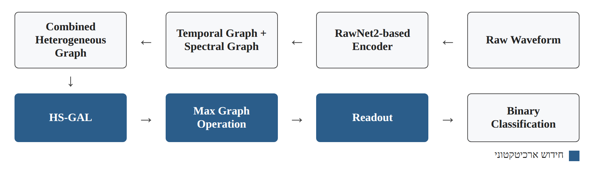
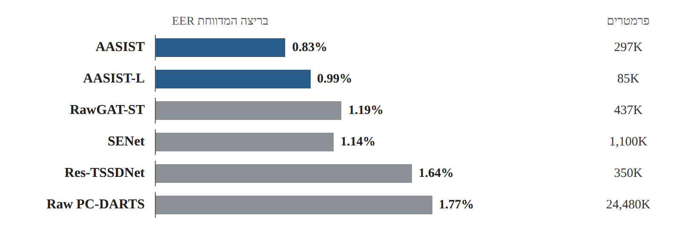
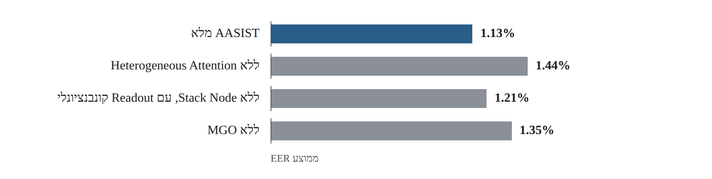

# Research Card 03 — AASIST

## AASIST: Audio Anti-Spoofing Using Integrated Spectro-Temporal Graph Attention Networks

## 1. פרטים ביבליוגרפיים

**שם המאמר:** AASIST: Audio Anti-Spoofing Using Integrated Spectro-Temporal Graph Attention Networks

**מחברים:** Jee-weon Jung, Hee-Soo Heo, Hemlata Tak, Hye-jin Shim, Joon Son Chung, Bong-Jin Lee, Ha-Jin Yu, Nicholas Evans.

**מוסדות מחקר:** Naver Corporation, EURECOM, University of Seoul, Korea Advanced Institute of Science and Technology (KAIST).

**שנת פרסום:** 2022.

**מסגרת פרסום:** IEEE International Conference on Acoustics, Speech and Signal Processing (ICASSP 2022), עמודים 6367–6371.

**DOI:** 10.1109/ICASSP43922.2022.9747766

**קישור:** https://doi.org/10.1109/ICASSP43922.2022.9747766

**קוד ומודלים:** https://github.com/clovaai/aasist

**תחום מחקר:** Audio Deepfake Detection, Speech Anti-Spoofing, Graph Neural Networks, Graph Attention, End-to-End Learning, Spectro-Temporal Modeling.

**מילות מפתח:** AASIST, RawNet2, RawGAT-ST, HS-GAL, MGO, Stack Node, Heterogeneous Attention, AASIST-L, ASVspoof 2019.

**רלוונטיות לפרויקט:** גבוהה מאוד. המאמר מציג ארכיטקטורת Deep Learning ייעודית לזיהוי זיופים קוליים, שמקבלת אות אודיו גולמי ומשלבת ייצוגים זמניים וספקטרליים. הוא מספק מועמד למודל מתקדם, לצד בסיס מחקרי לבחינת יעילות ארכיטקטורות עמוקות, ביצועי הכללה, יעילות חישובית וניסויי Ablation.

---

## 2. תקציר מקיף של המאמר

המאמר מציג את AASIST, מערכת End-to-End לזיהוי זיופים קוליים, המבוססת על Graph Attention Networks ומשלבת מידע זמני וספקטרלי לצורך זיהוי ארטיפקטים המעידים על דיבור מזויף.

המוטיבציה המחקרית נובעת מכך שסממני זיוף עשויים להופיע במקטעי זמן מסוימים או בתחומי תדר מסוימים, בהתאם לשיטת יצירת הזיוף. מערכות קודמות השתמשו לעיתים בשילוב מספר תתי-מודלים (Ensemble), שכל אחד מהם התמקד במאפיינים מסוימים. גישה זו עשויה להגדיל את המורכבות החישובית של מערכת הזיהוי.

החוקרים מציעים מודל יחיד המשלב מידע משני הממדים, תוך למידת קשרים בין מאפיינים זמניים וספקטרליים. המודל מתבסס על Encoder המבוסס על RawNet2, המפיק ייצוגים מתוך אות אודיו גולמי. לאחר חילוץ המאפיינים נבנים שני גרפים, אחד לאורך ציר הזמן ואחד לאורך ציר התדר, והם משולבים לגרף הטרוגני משותף.

המאמר מציג שלושה חידושים ארכיטקטוניים מרכזיים:

1. **Heterogeneous Stacking Graph Attention Layer (HS-GAL):** שכבה המאפשרת ללמוד קשרים בין צמתים מסוגים שונים, תוך שימוש במנגנון Heterogeneous Attention וב-Stack Node הצובר מידע משולב.
2. **Max Graph Operation (MGO):** מנגנון הכולל שני ענפים מקבילים ופעולת Maximum בין הפלטים שלהם, במטרה לעודד למידת מאפיינים משלימים.
3. **Readout חדש:** שילוב של מקסימום וממוצע על צומתי הגרף, יחד עם המידע המצטבר ב-Stack Node, לצורך הפקת ייצוג מסכם לסיווג.

בנוסף, החוקרים מציגים גרסה קלת-משקל בשם AASIST-L, הכוללת כ-85 אלף פרמטרים.

הניסויים בוצעו על מאגר ASVspoof 2019 במסלול Logical Access, באמצעות מדדי EER ו-min t-DCF. AASIST השיג EER ממוצע של 1.13% לעומת 1.39% ב-RawGAT-ST, ו-min t-DCF ממוצע של 0.0347 לעומת 0.0443. השיפור היחסי במדד min t-DCF הוא כ-21.7%.

בריצה הטובה ביותר הושגו EER של 0.83% ו-min t-DCF של 0.0275. ניסויי Ablation הראו כי הסרת כל אחד משלושת הרכיבים המרכזיים פוגעת בביצועים, כאשר להסרת Heterogeneous Attention הייתה ההשפעה הגדולה ביותר.

**המסקנה המרכזית:** שילוב מפורש של קשרים בין ייצוגים זמניים וספקטרליים באמצעות Graph Attention מאפשר לשפר את ביצועי זיהוי הזיופים בתנאי הניסוי שנבדקו, תוך שימוש במודל יחיד וקומפקטי יחסית.

**מקור:** Abstract, Sections 1–5.

---

## 3. בעיית המחקר והמוטיבציה

### 3.1 הבעיה

מערכות לזיהוי זיופים קוליים נדרשות להבחין בין דיבור אמיתי (Bona fide) לבין דיבור מזויף (Spoofed), גם כאשר המתקפות נוצרות באמצעות אלגוריתמים שונים.

ארטיפקטים המבדילים בין שתי המחלקות עשויים להיות תלויים בשיטת הזיוף ולהופיע:

- בתחום תדר מסוים.
- במקטע זמן מסוים.
- בקשרים שבין דפוסים זמניים וספקטרליים.

לכן מערכת המסתמכת על ייצוג מוגבל עלולה להתקשות לזהות ארטיפקטים מסוגים שונים.

### 3.2 מגבלות המחקר הקודם

החוקרים מצביעים על שתי מגבלות מרכזיות.

**א. מורכבות של מערכות Ensemble**

מערכות המשלבות מספר מודלים עשויות לזהות מגוון רחב של ארטיפקטים, אך במחיר של מורכבות חישובית ותפעולית.

**ב. שילוב מוגבל בין ייצוגי זמן ותדר**

בעבודה קודמת בשם RawGAT-ST הוצגו שני גרפים נפרדים עבור מידע זמני וספקטרלי. שילובם התבצע באמצעות פעולות פשוטות יחסית, כגון כפל איבר-באיבר, ללא מנגנון Attention ייעודי לקשרים בין שני סוגי הצמתים.

### 3.3 מטרת המחקר

לפתח מערכת זיהוי זיופים יחידה ויעילה, המסוגלת לשלב מידע זמני וספקטרלי באופן מפורש ולזהות מגוון ארטיפקטים ללא צורך ב-Score-Level Ensemble.

### 3.4 שאלת המחקר המשתמעת

האם שילוב הטרוגני של ייצוגי זמן ותדר באמצעות Graph Attention, יחד עם מנגנון תחרות בין ענפים, יכול לשפר את ביצועי זיהוי הזיופים ביחס למודלים קיימים תוך שמירה על מורכבות חישובית נמוכה יחסית?

שאלה זו מסכמת את מטרת החוקרים ואינה ציטוט של שאלה פורמלית יחידה.

**מקור:** Abstract, Section 1.

---

## 4. התרומות המרכזיות של המאמר

**1. Heterogeneous Stacking Graph Attention Layer — HS-GAL**

פיתוח שכבה המאפשרת לבצע Attention על גרף המשלב צמתים זמניים וספקטרליים, גם כאשר הגרפים המקוריים בעלי מספר צמתים וממדים שונים.

**2. Heterogeneous Attention**

שימוש במנגנוני Attention המבחינים בין שלושה סוגי קשרים: קשרים בתוך הגרף הזמני, קשרים בתוך הגרף הספקטרלי וקשרים בין שני הגרפים.

**3. Stack Node**

הוספת צומת מיוחד הצובר מידע על שני סוגי הייצוגים ועל הקשרים ביניהם לאורך שכבות הגרף.

**4. Max Graph Operation — MGO**

שני ענפים מקבילים העוברים שכבות HS-GAL ו-Graph Pooling, ולאחר מכן משולבים באמצעות Maximum איבר-באיבר.

**5. Readout מותאם**

שילוב מידע ממוצע ומקסימלי מצומתי הגרף יחד עם Stack Node לקבלת ייצוג סופי.

**6. AASIST-L**

פיתוח גרסה קלת-משקל של המודל, הכוללת כ-85,000 פרמטרים בלבד.

**7. Ablation Study**

בחינת התרומה העצמאית של רכיבי המודל המרכזיים באמצעות הסרתם והשוואת ביצועים.

**מקור:** Sections 1, 3–4.

---

## 5. רקע ארכיטקטוני — RawNet2 ו-RawGAT-ST

### 5.1 RawNet2-based Encoder

AASIST מתחיל ב-Encoder המבוסס על RawNet2.

ה-Encoder מקבל אות אודיו גולמי ומחלץ ממנו Feature Maps המשקפות מאפיינים שנלמדו מתוך האות.

בניגוד לחילוץ ידני של מאפיינים כגון MFCC או CQCC, שכבות ה-Encoder לומדות את הייצוג במהלך האימון.

המימוש המתואר במאמר משתמש בשכבת Sinc-Convolution ובשישה Residual Blocks המבוססים על פעולות קונבולוציה דו-ממדיות.

### 5.2 RawGAT-ST

RawGAT-ST הוא מודל מוקדם יותר שעליו מתבסס AASIST.

הוא משלב:

- גרף זמני — Temporal Graph.
- גרף ספקטרלי — Spectral Graph.
- Graph Attention בתוך כל גרף.

במודל הקודם המידע מהגרפים שולב באמצעות פעולות איבר-באיבר.

### 5.3 מה AASIST מוסיף?

AASIST אינו מסתפק בשילוב הפלטים.

הוא יוצר גרף הטרוגני משותף, כך שניתן ללמוד קשרים בין צמתים זמניים וספקטרליים באופן מפורש.

זהו ההבדל המרכזי בינו לבין RawGAT-ST.

**מקור:** Sections 1–3.

---

## 6. מבנה ארכיטקטורת AASIST

### 6.1 זרימת המידע

התהליך המרכזי הוא:

Raw Waveform

→ RawNet2-based Encoder

→ Temporal Graph + Spectral Graph

→ Combined Heterogeneous Graph

→ HS-GAL

→ Max Graph Operation

→ Readout

→ Binary Classification

*איור 1. המחשה לזרימת המידע המתוארת בסעיף 6.1.*

### 6.2 Encoder

אות האודיו מעובד באמצעות שכבת Sinc-Convolution ולאחריה Residual Blocks.

הפלט הוא Feature Map:

F ∈ R^(C×S×T)

כאשר:

- C — מספר ערוצי המאפיינים.
- S — ממד ספקטרלי.
- T — ממד זמני.

### 6.3 יצירת הגרפים

המודל מפיק שני ייצוגים:

**Temporal Graph — Gt**

נבנה באמצעות צמצום ממד התדר, כך שניתן ללמוד קשרים בין מאפיינים לאורך ציר הזמן.

**Spectral Graph — Gs**

נבנה באמצעות צמצום ממד הזמן, כך שניתן ללמוד קשרים בין מאפיינים לאורך ציר התדר.

שני הגרפים עוברים Graph Attention ו-Graph Pooling.

### 6.4 שילוב הגרפים

לאחר יצירת הגרפים הזמני והספקטרלי נבנה גרף משותף Gst.

הגרף מכיל צמתים משני הסוגים, ונוספים קשרים בין צמתים זמניים לספקטרליים.

מכיוון שמקור הצמתים ומאפייניהם שונים, מדובר בגרף הטרוגני.

### 6.5 HS-GAL

השכבה מאפשרת לעבד את הגרף המשולב באמצעות Attention המותאם לסוגי הקשרים השונים.

לפני חישוב הקשרים, צומתי שני הגרפים מועברים לייצוג בעל ממד משותף.

לאחר מכן מחושבים משקלי Attention בהתאם לסוג הקשר.

### 6.6 Heterogeneous Attention

המנגנון משתמש בשלושה וקטורי Projection נפרדים עבור:

1. Temporal → Temporal.
2. Spectral → Spectral.
3. Temporal ↔ Spectral.

השימוש במשקלים ייעודיים מאפשר למודל להבחין בין קשרים בתוך אותו סוג מידע לבין קשרים בין סוגי מידע שונים.

### 6.7 Stack Node

ה-Stack Node הוא צומת נוסף המחובר לצמתים הזמניים והספקטרליים.

תפקידו לצבור מידע משותף משני התחומים לאורך שכבות HS-GAL.

הקשרים אל ה-Stack Node הם חד-כיווניים: הצומת מקבל מידע מצמתים אחרים, אך אינו מעביר אליהם מידע באמצעות אותם קשרים.

החוקרים משווים את תפקידו באופן רעיוני ל-Classification Tokens המוכרים מארכיטקטורות אחרות, אך מדגישים את ההבדל בכיוון זרימת המידע.

### 6.8 Max Graph Operation — MGO

לאחר שילוב הגרפים, המידע עובר בשני ענפים מקבילים.

כל ענף כולל:

- שתי שכבות HS-GAL.
- שתי שכבות Graph Pooling.

הפלטים משולבים באמצעות Maximum איבר-באיבר.

מטרת המנגנון היא לעודד את הענפים ללמוד דפוסים משלימים, כך שמאפיינים בולטים מכל ענף יוכלו להישמר בפלט.

**הבחנה מחקרית:** החוקרים מדגימים ש-MGO משפר ביצועים, אך אינם מוכיחים שכל ענף למד משפחת מתקפות מסוימת.

### 6.9 Readout

מנגנון ה-Readout משלב:

- Maximum על צמתים זמניים וספקטרליים.
- Average על צמתים זמניים וספקטרליים.
- המידע מה-Stack Node.

הייצוג המשולב מועבר לשכבת הפלט לצורך סיווג בינארי.

**מקור:** Section 3, Figure 1, עמ' 2–3.

---

## 7. AASIST-L — הגרסה קלת-המשקל

החוקרים מציעים גרסה קומפקטית יותר של המודל, בעלת אותה ארכיטקטורה עקרונית אך עם מספר פרמטרים קטן משמעותית.

| מאפיין | AASIST | AASIST-L |
|---|---:|---:|
| מספר פרמטרים | 297K | 85K |
| EER בריצה הטובה ביותר | 0.83% | 0.99% |
| min t-DCF בריצה הטובה ביותר | 0.0275 | 0.0309 |

החוקרים מציינים שגודל המודל AASIST-L הוא כ-332KB, וכי ניתן לשקול טכניקות נוספות להקטנת דרישות המשאבים.

### משמעות מחקרית

AASIST-L מציגה אפשרות להשיג ביצועים גבוהים גם באמצעות מודל בעל מספר קטן יחסית של פרמטרים.

עם זאת, מספר הפרמטרים אינו מודד לבדו את זמן ההרצה, את צריכת הזיכרון בפועל או את דרישות החישוב.

המאמר אינו מציג Benchmark מלא של פריסה על מכשירים אמיתיים.

לכן יש לראות ב-AASIST-L מועמדת מבטיחה למערכות מוגבלות משאבים, ולא מערכת שהוכחה כמתאימה לכל סביבת ייצור.

**מקור:** Section 3.4, Table 2.

---

## 8. מאגר הנתונים ומשימת ההערכה

### 8.1 Dataset

כל הניסויים בוצעו באמצעות:

**ASVspoof 2019 — Logical Access (LA)**

המאגר כולל קבוצות:

- Training.
- Development.
- Evaluation.

### 8.2 חלוקת המתקפות

| קבוצה | מזהי מתקפות |
|---|---|
| Training | A01–A06 |
| Development | A01–A06 |
| Evaluation | A07–A19 |

בקבוצת Evaluation יש 13 שיטות זיוף שלא הופיעו כאלגוריתמי התקפה בקבוצות האימון והפיתוח.

הפרדה זו מסייעת להעריך יכולת הכללה למתקפות חדשות באותו Benchmark.

עם זאת, היא אינה מוכיחה יכולת הכללה למאגרים חיצוניים או לטכנולוגיות זיוף שלא נכללו בפרוטוקול.

### 8.3 משימת הסיווג

המודל מסווג הקלטת אודיו לאחת משתי מחלקות:

- Bona fide — דיבור אמיתי.
- Spoofed — דיבור מזויף.

אין צורך לזהות את זהותו של הדובר.

### 8.4 מדדי הערכה

**EER — Equal Error Rate**

מדד לביצועי זיהוי זיופים עצמאי. ככל שהערך נמוך יותר, כך הביצועים טובים יותר.

**min t-DCF — Minimum Tandem Detection Cost Function**

מדד המתייחס להשפעת מערכת זיהוי הזיופים על מערכת Automatic Speaker Verification משולבת, תחת הנחות עלויות ושכיחויות מסוימות.

שני המדדים משלימים זה את זה, אך אינם מודדים בדיוק את אותה משימה.

**מקור:** Section 4.1.

---

## 9. פרטי מימוש ואימון

| רכיב | הגדרה במאמר |
|---|---|
| Framework | PyTorch |
| קלט | 64,600 דגימות אודיו, כ-4 שניות |
| Encoder | RawNet2-based |
| מסנני Sinc ראשוניים | 70 |
| Residual Blocks | 6 |
| Residual Filters | 32 בשני הבלוקים הראשונים, 64 בארבעה הנותרים |
| Graph Attention ראשוני | 64 Filters |
| Graph Attention בהמשך | 32 Filters |
| Optimizer | Adam |
| Learning Rate | 0.0001 |
| Scheduler | Cosine Annealing |
| Seeds להערכת המודל המרכזי | 3 |
| גרסת Lightweight | כוונון באמצעות Population-Based Training |

### חשיבות מספר ה-Seeds

החוקרים זיהו ששינוי Random Seed עשוי להשפיע משמעותית על ביצועי המודל.

ב-RawGAT-ST נצפתה שונות ב-EER בין 1.19% ל-2.06% בריצות שונות.

לכן החוקרים מדווחים תוצאות ממוצעות לצד הריצה הטובה ביותר.

**מסקנה מתודולוגית:** תוצאה בודדת אינה מספיקה בהכרח להערכת יציבות של מודל Deep Learning. רצוי לדווח ביצועים על פני מספר ריצות כאשר משאבי החישוב מאפשרים זאת.

**מקור:** Sections 4.1–4.2.

---

## 10. תוצאות המחקר

### 10.1 AASIST לעומת RawGAT-ST

Table 1 מציגה תוצאות על ASVspoof 2019 LA.

| מודל | min t-DCF ממוצע | הטוב ביותר | EER ממוצע | הטוב ביותר |
|---|---:|---:|---:|---:|
| RawGAT-ST | 0.0443 | 0.0333 | 1.39% | 1.19% |
| AASIST | **0.0347** | **0.0275** | **1.13%** | **0.83%** |

### 10.2 שיפור יחסי

השיפור ב-min t-DCF הממוצע:

(0.0443 − 0.0347) / 0.0443 ≈ 21.7%

לכן החוקרים מדווחים על שיפור יחסי של יותר מ-20% במדד זה.

השיפור אינו מתייחס בהכרח לכל מתקפה בנפרד.

### 10.3 ביצועים לפי מתקפה

AASIST הציג ביצועים דומים או טובים יותר מ-RawGAT-ST בתשע מתוך שלוש-עשרה המתקפות.

בארבע המתקפות האחרות, RawGAT-ST הציג ביצועים מעט טובים יותר.

לדוגמה, במתקפה A15 ה-EER ירד מ-1.03% ל-0.65%.

עם זאת, המאמר מדגים שמודל בעל ביצועים כוללים טובים יותר אינו בהכרח המודל הטוב ביותר בכל מתקפה בודדת.

### 10.4 השוואה למערכות מתחרות

לפי Table 2:

| מודל | פרמטרים | EER בריצה המדווחת |
|---|---:|---:|
| AASIST | 297K | **0.83%** |
| AASIST-L | 85K | 0.99% |
| RawGAT-ST | 437K | 1.19% |
| SENet | 1,100K | 1.14% |
| Res-TSSDNet | 350K | 1.64% |
| Raw PC-DARTS | 24,480K | 1.77% |

*איור 2. המחשה לנתוני Table 2 (סעיף 10.4): EER בריצה המדווחת ומספר הפרמטרים של כל מערכת.*

טבלת ההשוואה כוללת מערכות נוספות. כל המערכות בהשוואה המוצגת הן מודלים יחידים, ללא Score-Level Fusion.

### 10.5 מסקנה מההשוואה

AASIST הציג את הביצועים הטובים ביותר בין המערכות שנכללו בהשוואה.

AASIST-L הציג תוצאות טובות יותר מכל המערכות האחרות בטבלה, למעט AASIST המלא.

עם זאת, ההשוואה למערכות ממחקרים שונים אינה ניסוי מבוקר שבו כל תנאי האימון והפרמטרים בהכרח זהים.

**מקור:** Section 4.3, Tables 1–2.

---

## 11. ניסויי Ablation

### 11.1 מטרת הניסוי

ניסויי Ablation נועדו לבחון האם רכיבי המודל החדשים אכן תורמים לביצועים.

החוקרים מסירים רכיב מסוים ומשווים את התוצאה למודל המלא.

### 11.2 תוצאות Table 3

| תצורה | min t-DCF ממוצע | EER ממוצע |
|---|---:|---:|
| AASIST מלא | **0.0347** | **1.13%** |
| ללא Heterogeneous Attention | 0.0415 | 1.44% |
| ללא Stack Node, עם Readout קונבנציונלי | 0.0380 | 1.21% |
| ללא MGO | 0.0410 | 1.35% |

*איור 3. המחשה לנתוני Table 3 (סעיף 11.2): EER ממוצע לכל תצורה.*

### 11.3 ניתוח התוצאות

**Heterogeneous Attention**

הסרתו גרמה לעלייה הגדולה ביותר ב-EER הממוצע, מ-1.13% ל-1.44%.

מכאן שהיכולת ללמוד קשרים בין צמתים מסוגים שונים היא רכיב משמעותי בביצועי AASIST בתנאי הניסוי.

**MGO**

הסרת המנגנון הגדילה את ה-EER הממוצע ל-1.35%.

התוצאה תומכת בתרומת השימוש בענפים מקבילים ובפעולת Maximum.

עם זאת, הניסוי אינו מוכיח אילו ארטיפקטים ספציפיים נלמדו בכל ענף.

**Stack Node**

הסרת הצומת, תוך מעבר ל-Readout קונבנציונלי, הגדילה את ה-EER הממוצע ל-1.21%.

הדבר תומך בתועלת של תכנון ה-Stack Node ומנגנון ה-Readout המתאים.

עם זאת, בניסוי הזה משתנה גם אופן ה-Readout, ולכן יש להיזהר מייחוס כל השיפור ל-Stack Node בלבד.

### 11.4 מסקנה מחקרית

ניסויי ה-Ablation מספקים ראיה לכך שכל אחד משלושת החידושים תורם לביצועים במערכת שנבדקה.

הם אינם מוכיחים שהרכיבים ישמרו על אותה תרומה בכל Dataset או בתנאי אימון אחרים.

**מקור:** Section 4.3, Table 3.

---

## 12. מסקנות החוקרים

החוקרים מסיקים כי שילוב מידע זמני וספקטרלי באמצעות Graph Attention הטרוגני מאפשר שיפור בזיהוי זיופים קוליים.

התרומות המרכזיות הן:

- HS-GAL, המאפשר עיבוד משותף של שני סוגי גרפים.
- Stack Node, הצובר מידע משולב.
- MGO, המאפשר לשלב מידע משני ענפים מקבילים.
- Readout המותאם למבנה הגרף ההטרוגני.

המודל המלא השיג שיפור של יותר מ-20% במדד min t-DCF ביחס ל-RawGAT-ST, והגרסה הקלה AASIST-L הציגה ביצועים תחרותיים עם מספר קטן משמעותית של פרמטרים.

המאמר מציג את המערכת כחלופה יעילה למערכות זיהוי המבוססות על שילוב ציונים של מספר מודלים.

**מקור:** Section 5.

---

## 13. ניתוח ביקורתי

### 13.1 יתרונות המחקר

**א. חידוש ארכיטקטוני ברור**

המאמר מגדיר שלושה רכיבים חדשים ומסביר כיצד הם משפרים את שילוב המידע הזמני והספקטרלי.

**ב. עיבוד End-to-End של Raw Waveform**

המודל לומד מאפיינים מתוך האודיו ללא צורך בחילוץ ידני של MFCC או CQCC.

**ג. שילוב מפורש של מידע הטרוגני**

HS-GAL מאפשר ללמוד קשרים בין מאפיינים זמניים וספקטרליים, ולא רק לעבד אותם בנפרד.

**ד. יעילות יחסית**

AASIST ו-AASIST-L כוללים מספר קטן יחסית של פרמטרים בהשוואה לחלק מהמערכות המתחרות.

**ה. ניסויי Ablation**

החוקרים אינם מסתפקים בתוצאה כוללת, אלא בוחנים את התרומה של הרכיבים המרכזיים.

**ו. התייחסות לשונות אקראית**

הדיווח על מספר Seeds ועל ממוצעי ביצועים מחזק את הפרשנות של תוצאות ההשוואה המרכזית.

**ז. זמינות קוד ומודלים**

החוקרים מציינים מאגר GitHub המאפשר ללמוד את המימוש ולבחון אפשרות לשחזור או התאמה.

### 13.2 מגבלות המחקר

**א. הערכה על מאגר יחיד**

הניסויים בוצעו על ASVspoof 2019 LA בלבד.

לכן אין במאמר ראיה ישירה לכך שהמודל ישיג תוצאות דומות על ASVspoof 5, CodecFake או מאגרים חיצוניים אחרים.

**ב. חוסר בהערכה בין מאגרים**

המאמר אינו מציג Cross-Dataset Evaluation, שבו מאמנים על מאגר מסוים ובודקים על מאגר אחר.

**ג. היעדר בחינה של זיופים מודרניים המבוססים על Neural Audio Codecs**

המחקר אינו בוחן ישירות את סוגי המתקפות המאוחרים שמופיעים ב-CodecFake.

**ד. הסבריות מוגבלת**

אף שהמנגנונים נועדו ללמוד קשרים משלימים, המאמר אינו מציג ניתוח שמזהה באופן מפורש אילו משפחות ארטיפקטים נלמדות בכל ענף.

**ה. יעילות חישובית שלא נבחנה במלואה**

מספר פרמטרים נמוך אינו מבטיח בהכרח Latency נמוך או צריכת זיכרון קטנה בהרצה. אין במאמר מדידה מקיפה על התקני קצה.

**ו. שונות בין ריצות**

ההבדל בין התוצאות הממוצעות לריצות הטובות ביותר מצביע על רגישות מסוימת ל-Random Seed.

**ז. מגבלות ניסויי Ablation**

הניסויים מציגים את השפעת הסרת הרכיבים, אך אינם בוחנים את כל האינטראקציות האפשריות ביניהם. במקרה של Stack Node, גם מנגנון ה-Readout משתנה.

**ח. השוואת מערכות ממחקרים שונים**

תוצאות Table 2 שימושיות להשוואה כללית, אך אינן מבטיחות שכל המערכות אומנו תחת פרוטוקול זהה לחלוטין.

### 13.3 מה לא ניתן להסיק

המאמר אינו מוכיח ש:

- AASIST תמיד עדיף על RawNet2, CQCC או מודלים מבוססי SSL.
- AASIST ישיג EER נמוך דומה גם ב-ASVspoof 5.
- MGO מחלק בפועל את המתקפות למשפחות מוגדרות בין הענפים.
- Stack Node הוא לבדו הגורם לשיפור הכולל.
- AASIST-L מתאים אוטומטית לכל סביבת ייצור או התקן קצה.
- תוצאה טובה על מתקפות בלתי מוכרות ב-ASVspoof 2019 מבטיחה הכללה לטכנולוגיות זיוף חדשות.
- שימוש ב-Raw Waveform תמיד עדיף על מאפיינים אקוסטיים מחולצים.

---

## 14. ההבנות והתובנות שלנו מהמאמר

### 14.1 ארטיפקטים של זיוף עשויים להופיע בממדים שונים

המאמר מחזק את ההבנה שזיוף קולי אינו בהכרח משאיר סימן יחיד וברור לאורך כל ההקלטה.

יש חשיבות למאפיינים בתדרים מסוימים, לאורך מקטעי זמן מסוימים ולקשרים ביניהם.

### 14.2 חילוץ מאפיינים אינו הדרך היחידה לייצוג האודיו

במאמר CQCC למדנו כיצד לעצב ייצוג אקוסטי באופן ידני ומבוסס עיבוד אותות.

AASIST מציג גישה אחרת: למידת הייצוג מתוך האודיו כחלק מהאימון.

שתי הגישות מציעות דרכים שונות לחיפוש אחר סממני זיוף, ויש לבחון את יעילותן אמפירית.

### 14.3 שילוב מידע יכול להתבצע בתוך מודל יחיד

במקום לשלב רק ציונים סופיים ממספר מודלים, ניתן לשלב ייצוגים פנימיים שונים בתוך אותה ארכיטקטורה.

AASIST מדגים גישה זו באמצעות Heterogeneous Graph Attention.

### 14.4 Ablation הוא כלי מרכזי בהוכחת תרומה

המאמר מלמד שלא מספיק להציג ביצועים משופרים.

כדי לטעון שרכיב מסוים תורם לשיפור, רצוי לבחון מה קורה כאשר מסירים אותו או משנים אותו בצורה מבוקרת.

### 14.5 מספר פרמטרים אינו המדד היחיד למורכבות

AASIST-L מדגים שמודל קטן יחסית יכול להשיג ביצועים גבוהים, אך מספר הפרמטרים לבדו אינו מספיק לקביעת יעילות מעשית.

### 14.6 יציבות בין ריצות חשובה

פערים בין Seeds עשויים לשנות את ההתרשמות ממודל מסוים.

לכן כדאי להימנע מהסתמכות בלעדית על Best Run.

### 14.7 הכללה אינה מובטחת

אף שהמודל נבחן על מתקפות שלא הופיעו באימון, הוא הוערך בתוך Benchmark מוגדר.

אין להסיק אוטומטית שהתוצאות יחזרו גם מול נתונים וטכנולוגיות זיוף אחרים.

---

## 15. משמעות המאמר לפרויקט שלנו

### 15.1 הקשר לנתוני הקורס

פרויקט הקורס שלנו עוסק בזיהוי דיבור אמיתי לעומת מזויף, באמצעות נתונים מ-ASVspoof 5, CodecFake ו-M-AILABS.

AASIST רלוונטי כמודל מתקדם המשלב מידע זמני וספקטרלי ויכול להחזיר ציון בינארי.

עם זאת, הנתונים שלנו שונים מנתוני ASVspoof 2019 שעליהם נבחן המודל המקורי.

לכן לא ניתן להניח שהביצועים שדווחו במאמר ישוחזרו על נתוני הקורס.

### 15.2 אפשרות לשימוש ב-AASIST-L

הגרסה הקלה עשויה להיות מועמדת מתאימה לניסוי כאשר משאבי החישוב מוגבלים.

עם זאת, מאגר האימון המסומן של הקורס קטן יחסית, ולכן נצטרך לבחון האם אפשר להשיג ביצועים יציבים באמצעות אימון מאפס, Fine-Tuning, שימוש במשקלים מאומנים מראש או הרחבת נתונים.

בחירת הגישה תיעשה בהתאם לזמינות המודלים, התאמתם לנתונים ולכללי הפרויקט.

### 15.3 השוואה ל-Baseline

מודל MFCC + Logistic Regression או CQCC + מסווג פשוט יספק נקודת ייחוס.

AASIST או AASIST-L יכולים לשמש כמודל עמוק להשוואה.

חשוב שההשוואה תשתמש באותם פיצולי נתונים ובמדד EER, תוך שמירה על מניעת דליפה.

### 15.4 בדיקת הכללה

נרצה לבחון האם מודל שלמד לזהות זיופים ממקור מסוים מסוגל לזהות זיופים ממקור אחר.

עם זאת, מעבר בין ASVspoof 5 ל-CodecFake משנה גם מאפיינים נוספים מלבד סוג אלגוריתם הזיוף, ולכן יש להתייחס לניסוי כאל בדיקת הכללה בין מקורות ולא כהוכחה להשפעת הקודק בלבד.

### 15.5 מודל יחיד לעומת שילוב מודלים

AASIST מדגים שאפשר לשלב מאפיינים פנימיים בתוך מודל יחיד.

בהמשך ניתן יהיה להשוות אותו לגישות המשלבות ציונים ממספר מודלים, אך אין להניח מראש שגישה אחת עדיפה בכל תנאים.

---

## 16. השערות מחקר וניסויים אפשריים

### H1 — Deep Learning לעומת Features קלאסיים

**השערה:** מודל מבוסס AASIST או AASIST-L עשוי להשיג EER נמוך יותר ממודל קלאסי המבוסס על MFCC או CQCC.

**ניסוי מוצע:** השוואת מודל קלאסי ומודל AASIST על אותו פיצול נתונים.

**מדד:** EER, לצד בחינת יציבות ודרישות חישוב.

**הערה:** ההבדלים בין המודלים כוללים גם ארכיטקטורה וגם אופן ייצוג האודיו, ולכן הניסוי אינו מבודד את השפעת אחד הגורמים.

### H2 — הכללה ל-CodecFake

**השערה:** מודל שאומן על זיופי TTS/VC ממקור ASVspoof 5 עלול להציג ירידה בביצועים על זיופים ממקור CodecFake.

**ניסוי מוצע:** אימון על מקור אחד והערכה על מקור אחר, תוך שמירה על הפרדה ומניעת דליפה.

**מגבלה:** הניסוי בוחן הכללה בין מקורות נתונים וטכנולוגיות זיוף, ואינו מבודד את השפעת Neural Audio Codecs בלבד.

### H3 — תרומת Heterogeneous Attention

**השערה:** שילוב מידע זמני וספקטרלי באמצעות Heterogeneous Attention עשוי לשפר ביצועים ביחס לשילוב פשוט יותר של הייצוגים.

**ניסוי מוצע:** אם משאבי החישוב והזמן יאפשרו, השוואה בין AASIST מלא לבין וריאנט ללא Heterogeneous Attention.

**מטרה:** לבדוק האם התרומה שנצפתה במאמר נשמרת גם בתנאי הקורס.

### H4 — יציבות בין Random Seeds

**השערה:** ביצועי AASIST עשויים להשתנות בין ריצות בעלות אתחול אקראי שונה.

**ניסוי מוצע:** מספר ריצות עם Seeds שונים ודיווח ממוצע, סטיית תקן והריצה הטובה ביותר.

**מדד:** EER.

### H5 — מודל קל לעומת מודל מלא

**השערה:** AASIST-L עשוי לספק יחס ביצועים–מורכבות אטרקטיבי בהשוואה ל-AASIST המלא.

**ניסוי מוצע:** השוואת EER, מספר פרמטרים, זמן אימון וזמן הסקה באותה סביבת חומרה.

**מטרה:** לבדוק את כדאיות השימוש במודל קל, מעבר להשוואה של מספר הפרמטרים בלבד.

---

## 17. שאלות פתוחות להמשך הפרויקט

1. האם AASIST-L יתפקד היטב על מאגר הקורס הקטן יחסית?
2. האם כדאי לאמן מאפס או להשתמש במשקלים מאומנים מראש?
3. האם ביצועי AASIST ישתפרו באמצעות הרחבת נתוני האימון?
4. האם ייצוגי Graph Attention יעילים מול זיופים מבוססי Neural Audio Codecs?
5. האם המודל ילמד מאפיינים של זיוף או הבדלים בין מקורות הנתונים?
6. האם אפשר לזהות אילו תדרים ומקטעי זמן תורמים ביותר להחלטות?
7. האם שילוב AASIST עם מודל SSL ישפר את ה-EER?
8. עד כמה תוצאות המודל יציבות בין Seeds?
9. האם AASIST-L מצדיק את יתרון המורכבות שלו מול ארכיטקטורות חלופיות?
10. כיצד ניתן להעריך את המודל על מתקפות חדשות בלי להשתמש במידע מקבוצת המבחן הסודית במהלך הפיתוח?

---

## 18. מסקנה מסכמת של כרטיס המחקר

AASIST מציג גישה מתקדמת לזיהוי זיופים קוליים, המבוססת על למידה ישירה מאות האודיו ועל שילוב מפורש של קשרים בין ייצוגים זמניים וספקטרליים.

החידושים המרכזיים — Heterogeneous Attention, Stack Node ו-MGO — תורמים לביצועים בתנאי ASVspoof 2019 LA, כפי שמראים ניסויי ה-Ablation.

המאמר גם מדגים שניתן להגיע לביצועים תחרותיים באמצעות מודל קומפקטי יחסית, אך אינו מוכיח את יעילותו מול כל סוגי הזיופים או בסביבות שימוש שונות.

מבחינת הפרויקט שלנו, AASIST מהווה מועמד משמעותי להשוואה מול גישות קלאסיות המבוססות על MFCC ו-CQCC, ובהמשך גם מול מודלים המבוססים על ייצוגי SSL.

**העיקרון המחקרי שנאמץ:** מודל מתקדם אינו נבחן רק לפי הארכיטקטורה שלו או לפי תוצאה מוצלחת ב-Benchmark מסוים, אלא גם לפי יציבות, יכולת הכללה, יעילות חישובית ותקפות פרוטוקול ההערכה.

---

## 19. מפת הפניות למאמר

| נושא | מיקום |
|---|---|
| מטרת המחקר והחידושים | Abstract, Section 1, עמ' 1 |
| רקע RawNet2 ו-RawGAT-ST | Section 2, עמ' 1–2 |
| תרשים הארכיטקטורה | Figure 1, עמ' 2 |
| שילוב הגרפים | Section 3.1, עמ' 2–3 |
| HS-GAL ו-Stack Node | Section 3.2, עמ' 3 |
| MGO ו-Readout | Section 3.3, עמ' 3 |
| AASIST-L | Section 3.4, עמ' 3 |
| Dataset ומדדי הערכה | Section 4.1, עמ' 3 |
| פרטי מימוש ואימון | Section 4.2, עמ' 3–4 |
| תוצאות לפי מתקפה | Table 1, עמ' 3 |
| השוואת מערכות | Table 2, עמ' 4 |
| ניסויי Ablation | Table 3, עמ' 4 |
| דיון בתוצאות | Section 4.3, עמ' 4 |
| מסקנות החוקרים | Section 5, עמ' 4 |

**הערה:** התוצאות מתייחסות ל-ASVspoof 2019 LA ולפרוטוקול האימון וההערכה שתואר במאמר. אין להשוות אותן ישירות לתוצאות ASVspoof 5 או להניח שיתקבלו גם בנתוני הקורס.
