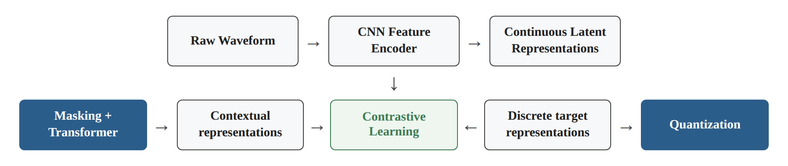
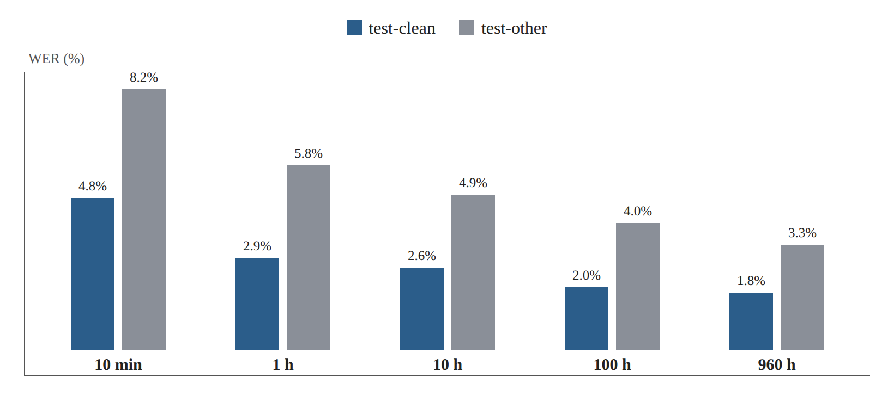

# Research Card 04 — wav2vec 2.0

## wav2vec 2.0: A Framework for Self-Supervised Learning of Speech Representations

## 1. Bibliographic Details

**Paper title:** wav2vec 2.0: A Framework for Self-Supervised Learning of Speech Representations.

**Authors:** Alexei Baevski, Henry Zhou, Abdelrahman Mohamed, Michael Auli.

**Research body:** Facebook AI.

**Year of publication:** 2020.

**Source version read:** arXiv:2006.11477v3, dated October 22, 2020.

**Link to the paper:** https://arxiv.org/abs/2006.11477

**Code and models:** https://github.com/pytorch/fairseq

**Research fields:** Self-Supervised Learning, Speech Representation Learning, Automatic Speech Recognition, Contrastive Learning, Transformer Architectures, Transfer Learning.

**Keywords:** wav2vec 2.0, SSL, CNN Feature Encoder, Transformer, Masking, Product Quantization, Gumbel-Softmax, Contrastive Loss, Diversity Loss, Fine-Tuning, CTC, WER.

**Relevance to the project:** High, but indirect in terms of the source task. The paper does not deal with voice forgery detection but with speech representation learning and speech recognition. However, it provides an important research basis for using pre-trained models for audio tasks with little labeled data, including the possibility of adapting them to forgery detection.

---

## 2. Comprehensive Summary of the Paper

The paper presents wav2vec 2.0, a framework for Self-Supervised Learning of speech representations from raw audio signals and without the need for transcription at the pre-training stage.

The central motivation is the shortage of labeled speech data. Speech recognition systems sometimes require large amounts of transcribed recordings, while recordings without transcription are available in much larger volumes. The researchers seek to exploit this information in order to learn useful speech representations, and subsequently to adapt the model to the Automatic Speech Recognition task using a limited amount of labeled data.

The architecture includes a CNN Feature Encoder that receives a Raw Waveform and produces a sequence of continuous latent representations, a Transformer that learns contextual representations, and a Quantization module that produces discrete training targets. At the pre-training stage, segments of the latent representation sequence are masked before entering the Transformer. The model is required to identify the correct discrete representation of each masked segment out of a set of candidates by means of a Contrastive Loss.

In addition, the researchers use a Diversity Loss to encourage diverse use of the discrete units learned in the Quantization module.

After the Pre-training, the model undergoes Fine-Tuning using transcribed speech data, with an output layer and a Connectionist Temporal Classification (CTC) Loss for the purpose of recognizing words or phonemes.

The researchers examined two configurations, BASE and LARGE, by means of Pre-training on 960 hours of LibriSpeech or about 53,200 hours of LibriVox. Fine-Tuning was then carried out on labeled data sets of ten minutes, one hour, ten hours, one hundred hours and 960 hours.

Under the condition of ten minutes of labeled data, a LARGE model that underwent Pre-training on LibriVox and used a language model at decoding time achieved a Word Error Rate of 4.8% on test-clean and 8.2% on test-other. Under the condition of 960 hours of labeled data, results of 1.8% and 3.3% were achieved, respectively.

Ablation experiments showed that the combination of continuous representations at the input to the Transformer and discrete training targets provides better results than the alternatives that were examined.

**The central conclusion:** It is possible to learn useful speech representations from large amounts of unlabeled audio, and to use them to improve Speech Recognition performance and to reduce the need for labeled data. However, the paper does not examine whether those same representations are also effective for detecting voice forgeries.

**Source:** Abstract, Sections 1–6.

---

## 3. The Research Problem and Motivation

### 3.1 The Central Problem

Developing Automatic Speech Recognition systems usually requires large amounts of speech recordings alongside accurate transcriptions.

Collecting recordings is possible on a wide scale, but creating quality transcriptions is an expensive and time-consuming process.

This problem is especially significant in languages and dialects for which few labeled resources exist.

### 3.2 The Limitation in Supervised Approaches

In a supervised approach, the model depends on labeled examples in order to learn the task.

When the amount of labels is limited, it is harder to train a high-performing speech recognition system.

### 3.3 The Idea of Self-Supervised Learning

Instead of learning only from labeled data, the model is given a training task whose targets are created from the data itself.

In wav2vec 2.0, the model learns to identify representations of audio segments that were masked out of the sequence of speech representations.

This process does not require human transcription.

### 3.4 The Goal of the Study

To develop a framework that makes it possible to learn high-quality speech representations from unlabeled audio and to subsequently adapt them to speech recognition tasks using relatively small amounts of labeled data.

### 3.5 The Implied Research Question

Does a combination of Masking, contrastive learning and discrete targets learned jointly with contextual representations make it possible to learn speech representations that improve Speech Recognition performance, especially when the amount of labeled data is limited?

The question is formulated here as a summary of the researchers' goal, and not as a quotation of a formal research question.

**Source:** Section 1, pages 1–2.

---

## 4. The Main Contributions of the Paper

**1. A Self-Supervised Learning framework from the Raw Waveform**

The model learns speech representations directly from the audio signal, without transcription at the Pre-training stage.

**2. Combining CNN and Transformer**

The CNN produces local acoustic features, and the Transformer creates contextual representations based on the sequence of features.

**3. Masking in the latent space**

The masking is performed after the initial feature extraction and not directly on the speech waveform.

**4. Contrastive Learning**

The model learns to distinguish between the correct target representation of a masked segment and negative examples.

**5. Joint learning of Quantization and contextual representations**

Unlike previous approaches in which the discrete units were learned in a separate stage, wav2vec 2.0 trains the components of the system jointly.

**6. Continuous Inputs with Quantized Targets**

The Transformer receives continuous representations, while the targets of the Contrastive Loss are discrete representations.

**7. High effectiveness in Low-Resource settings**

The study demonstrates a significant improvement in ASR performance even when only ten minutes of transcribed speech are available.

**8. A controlled evaluation of architectural choices**

Ablation experiments examine the contribution of the Quantization, the Masking strategies and additional parameters.

**Source:** Sections 1–3, 5.

---

## 5. The Architecture of wav2vec 2.0

### 5.1 General Structure

The model includes three central components:

1. Convolutional Feature Encoder.
2. Transformer Context Network.
3. Quantization Module.

The flow of information at the Pre-training stage:

Raw Waveform → CNN Feature Encoder → Continuous Latent Representations.

From the latent representations, two paths are created:

- A Masking and Transformer path, which produces contextual representations.
- A Quantization path, which produces discrete target representations.

The two paths meet in the Contrastive Learning task.

*Figure 1. Illustration of the information flow described in Section 5.1.*

### 5.2 CNN Feature Encoder

Let us denote the raw audio signal as X.

The Encoder produces from it a sequence of representations:

Z = f(X) = (z₁, z₂, …, zₜ)

Each zₜ is a continuous feature vector representing a short segment of the audio.

The Encoder consists of seven Convolution layers, each of which includes 512 channels.

In the implementation described, a representation is obtained at a rate of about 49 time steps per second, that is, an interval of about 20ms between consecutive steps.

The Receptive Field of the Encoder is about 25ms.

### 5.3 Transformer Context Network

The sequence of features is passed to the Transformer:

C = g(Z)

The output is a sequence of contextual representations:

C = (c₁, c₂, …, cₜ)

The Transformer uses Self-Attention in order to learn relations between different segments of the speech.

Its goal is not to transcribe words during the Pre-training, but to build useful representations based on the context of the speech signal.

### 5.4 Quantization Module

This module maps continuous representations to discrete representations from a collection of codes learned during training.

The researchers use Product Quantization and Gumbel-Softmax in order to allow the selection of discrete codes within a gradient-based training process.

The result for a particular segment is denoted qₜ.

### 5.5 An Important Distinction between the Paths

The Transformer receives a sequence of continuous representations, some of which were masked.

The Quantization module receives the original representations, without that same masking, in order to produce training targets.

Thus the model cannot solve the contrastive task by direct access to the information masked in the Transformer path.

**Source:** Section 2, Figure 1, page 2.

---

## 6. The Pre-training Process

### 6.1 Masking

After the features are extracted by means of the CNN, the researchers mask contiguous segments of the latent representations.

The masking is performed before entering the Transformer.

A learned Mask vector is placed instead of the original features at the selected positions.

In the central implementation:

- Probability of selecting the start of a segment to be masked: p = 0.065.
- Initial length of each masked segment: M = 10 time steps.
- Masked segments may overlap.
- In practice, about 49% of the time steps are masked on average.

The goal is to force the model to learn the context of the speech, instead of relying on the direct information of the masked segment.

### 6.2 Contrastive Learning

For each masked position, the model is required to identify the correct discrete target qₜ out of a set of candidates.

The set contains:

- A Positive Example — the correct target.
- Negative Examples — discrete representations sampled from other masked positions in the same recording.

The central implementation uses 100 negative examples.

The model computes the similarity between the contextual representation cₜ and the candidates, by means of Cosine Similarity.

The Contrastive Loss function encourages high similarity to the correct target and lower similarity to the negative examples.

### 6.3 Quantization

The researchers use two codebook groups, each of which contains 320 possible values.

The combination theoretically allows:

320 × 320 = 102,400 code combinations.

This is the number of possible combinations, and not proof that all the combinations actually appear or represent separate phonemes.

### 6.4 Diversity Loss

A Quantization mechanism may rely on a small number of codes and neglect others.

In order to encourage diverse use of the codes, the researchers add a Diversity Loss.

The overall loss function is:

L = Lm + αLd

where:

- Lm — Contrastive Loss.
- Ld — Diversity Loss.
- α — a coefficient controlling the weight of the Diversity Loss.

In the central implementation α = 0.1.

### 6.5 What Does the Model Learn?

The model learns speech representations that make it possible to identify the discrete units corresponding to masked segments based on the context.

At this stage it does not learn labels of words, speakers, real speech or fake speech.

**Source:** Sections 3.1–3.2, 4.2.

---

## 7. Fine-Tuning — Adapting the Model to the Speech Recognition Task

After the Pre-training stage, the researchers adapt the model to a supervised task.

In the case of LibriSpeech, the task is speech recognition and producing a sequence of characters.

The researchers add an output layer on top of the Transformer and use a Connectionist Temporal Classification (CTC) Loss.

CTC makes it possible to train a model to predict a sequence of characters without providing a precise manual alignment between each character and a particular position in the audio.

In the implementation described, the researchers first train the output layer, and subsequently also update the Transformer, while the CNN Feature Encoder remains frozen during the original Fine-Tuning.

### An Important Distinction for Our Project

The paper uses CTC for Speech Recognition.

In our Deepfake Detection task there is no need to predict a sequence of characters.

Instead, one can use the speech representations that the model learned, summarize them at the recording level, and add a binary classifier.

This possibility is a proposed adaptation to the project's task, and not an architecture that was examined in the original paper.

**Source:** Sections 3.3, 4.3.

---

## 8. The Datasets

### 8.1 Unlabeled Data for Pre-training

| Dataset | Amount of data |
|---|---:|
| LibriSpeech — LS-960 | 960 hours |
| LibriVox — LV-60k | about 53,200 hours |

The second dataset makes it possible to examine the effect of increasing the amount of unlabeled audio.

### 8.2 Labeled Data for Fine-Tuning

The researchers used five configurations:

- 10 minutes.
- One hour.
- 10 hours.
- 100 hours.
- 960 hours.

Each configuration was intended to examine the effectiveness of the representations when a different amount of labeled training data is available.

### 8.3 The TIMIT Dataset

In addition to LibriSpeech, the researchers used TIMIT for Phoneme Recognition.

The dataset contains about five hours of audio with detailed phonetic labels.

The evaluation was carried out by means of the Phoneme Error Rate (PER).

### 8.4 Evaluation Metrics

**WER — Word Error Rate**

A metric for the error rate in transcription, based on substitutions, deletions and insertions of words relative to the reference transcription.

**PER — Phoneme Error Rate**

A parallel metric for phoneme recognition.

Both metrics differ from EER, which is the central evaluation metric in our forgery detection project.

**Source:** Section 4.1.

---

## 9. Model Configurations and Implementation Details

| Parameter | BASE | LARGE |
|---|---:|---:|
| Number of parameters | about 95M | about 317M |
| Transformer layers | 12 | 24 |
| Transformer dimension | 768 | 1,024 |
| Attention Heads | 8 | 16 |
| FFN dimension | 3,072 | 4,096 |
| CNN Encoder | 7 layers | 7 layers |
| CNN channels | 512 | 512 |
| Codebook Groups | 2 | 2 |
| Entries per Group | 320 | 320 |

### Additional Details

- The models were implemented using fairseq.
- The Adam Optimizer was used.
- The Contrastive Loss used 100 negative examples.
- Cosine Similarity was used.
- The length of the masked sequences was determined by means of the parameters p and M.
- The model underwent Fine-Tuning with CTC for ASR.

### Computational Cost

The Pre-training of BASE was carried out using 64 V100 GPUs over about 1.6 days.

The Pre-training of LARGE was carried out using 128 V100 GPUs, over about 2.3 days on LibriSpeech and about 5.2 days on LibriVox.

The data illustrates the significant cost of learning speech representations from scratch.

Therefore, in our project it is preferable to first consider using pre-trained weights rather than reproducing the original Pre-training process.

**Source:** Section 4.2, Table 1.

---

## 10. Research Results — Low-Resource ASR

### 10.1 Results with Little Labeled Data

Table 1 presents WER results for varying amounts of labeled data.

Below are the results of LARGE, which underwent Pre-training on LibriVox and used a Transformer Language Model:

| Labeled data | test-clean WER | test-other WER |
|---|---:|---:|
| 10 minutes | 4.8% | 8.2% |
| 1 hour | 2.9% | 5.8% |
| 10 hours | 2.6% | 4.9% |
| 100 hours | 2.0% | 4.0% |
| 960 hours | 1.8% | 3.3% |

The result for 960 hours appears in Table 2.

*Figure 2. Illustration of the Table 1 data (Section 10.1): test-clean and test-other WER by the amount of labeled data.*

### 10.2 The Central Finding

The model succeeded in achieving relatively high Speech Recognition performance even when it used a very small amount of labeled data.

However, it is important to emphasize that these results were based on extensive Pre-training and on the use of a language model for decoding.

### 10.3 Comparison to Previous Methods

The researchers compared wav2vec 2.0 to previous systems, including Discrete BERT, Iterative Pseudo-Labeling and Noisy Student.

Under the condition of 100 labeled hours, a LARGE model that underwent Pre-training on LS-960 achieved a WER of 2.3%/5.0%, compared with 4.2%/8.6% for the Noisy Student system included in the comparison.

The researchers also report that under the condition of one hour of labeled data, the model achieved better results than a Noisy Student system that used one hundred labeled hours, under the comparison settings described.

### 10.4 The Significance of the Findings

Pre-training makes it possible to exploit extensive information about speech before the supervised training stage.

However, it should not be concluded that adaptation with few labels will succeed to the same degree in every audio task.

**Source:** Section 5.1, Table 1.

---

## 11. Research Results — High-Resource ASR

### 11.1 Comparison of Training from Scratch versus Pre-training

Under the condition of Fine-Tuning on 960 labeled hours:

| Model | test-clean WER | test-other WER |
|---|---:|---:|
| LARGE from scratch | 2.1% | 4.6% |
| LARGE after Pre-training on LS-960 | 2.0% | 4.1% |
| LARGE after Pre-training on LV-60k | **1.8%** | **3.3%** |

The results indicate an advantage of Pre-training even when the amount of labeled data is large.

However, the model that underwent Pre-training used additional information that is not included in the training from scratch.

### 11.2 The Effect of the Amount of Unlabeled Data

Increasing the amount of Pre-training data from 960 hours to about 53,200 hours improved the performance of LARGE under the conditions examined.

### 11.3 The Contribution of Model Size

LARGE generally achieved better results than BASE, especially in some of the harder scenarios.

However, LARGE required more parameters and resources.

**Source:** Section 5.2, Table 2.

---

## 12. Phoneme Recognition Results

The researchers also examined the model on TIMIT.

A LARGE model that underwent Pre-training on LS-960 achieved:

- Development PER: 7.4%.
- Test PER: 8.3%.

This result was better than the results of the previous systems included in the comparison in the paper.

The experiment provides additional evidence that the speech representations that were learned can assist in a supervised task that is not full word transcription.

However, Phoneme Recognition is still close to speech processing and recognition tasks, and therefore one should not conclude directly from it about forgery detection.

**Source:** Section 5.3, Table 3.

---

## 13. Ablation Experiments

### 13.1 The Goal of the Experiments

The researchers sought to examine the effect of the choice between continuous and discrete representations at the input to the Transformer and in the targets of the Contrastive Loss.

### 13.2 Table 4 Results

| Transformer Input | Targets | Average WER | Standard Deviation |
|---|---|---:|---:|
| Continuous | Quantized | **7.97%** | 0.02 |
| Quantized | Quantized | 12.18% | 0.41 |
| Quantized | Continuous | 11.18% | 0.16 |
| Continuous | Continuous | 8.58% | 0.08 |

The experiments were carried out in a reduced training configuration, and reported across three Seeds.

### 13.3 The Central Conclusion

The combination of Continuous Inputs and Quantized Targets achieved the best result.

The researchers propose two explanations:

1. Using a continuous representation at the input to the Transformer preserves information that is useful for learning the context.
2. Discrete targets may prevent excessive reliance on specific details of the recording, such as speaker characteristics or background noise, and thereby encourage the learning of more general representations for Speech Recognition.

### 13.4 A Limitation in the Interpretation

The explanation regarding the reason for the improvement is the researchers' interpretation, supported by a comparative experiment, but it does not prove that the discrete targets specifically preserve the information desired for forgery detection.

### 13.5 Additional Ablation Experiments

In the appendices, the following were also examined:

- Different masking lengths.
- Different masking probabilities.
- Different weights for the Diversity Loss.
- Number of negative examples.
- Negative-example sampling strategies.
- Use of Gumbel Noise.
- Number of codebook groups.
- The scope of the information the model is required to predict.

The experiments indicate sensitivity to the choice of parameters, but there is no need to copy all the configurations for our project.

**Source:** Section 5.4, Tables 4–5, Appendix F.

---

## 14. The Researchers' Conclusions

The researchers conclude that Self-Supervised Pre-training on unlabeled audio makes it possible to learn effective representations for Speech Recognition.

Using a pre-trained model significantly reduced the amount of labeled data required to achieve high performance.

Even when a large amount of labeled data was available, Pre-training continued to contribute to the improvement.

The researchers emphasize the advantage of combining contrastive learning, Masking and Quantized targets learned jointly with the contextual representations.

They also present the possibility of further improvements by means of adaptations of the speech recognition architecture and of the decoding mechanisms.

**Source:** Section 6.

---

## 15. Critical Analysis

### 15.1 Strengths of the Study

**A. Effective exploitation of unlabeled data**

The paper presents a framework that makes it possible to learn speech representations from audio without manual transcription.

**B. A significant contribution under Low-Resource conditions**

The researchers present strong performance even with very small amounts of labeled data.

**C. A clear architectural combination**

The system combines CNN, Transformer, Masking and Contrastive Learning within a unified framework.

**D. Ablation experiments**

The study examines, in a controlled manner, several central decisions in the design of the method.

**E. Evaluation in several configurations**

The researchers compare different model sizes, different amounts of Pre-training data and different amounts of labeled data.

**F. Use of different evaluation tasks**

The experiments on LibriSpeech and on TIMIT make it possible to examine the representations on several tasks related to speech recognition.

**G. Availability of code and models**

The code and models were distributed within fairseq, which supports reproduction and follow-up research.

### 15.2 Limitations of the Study

**A. The source task is not Deepfake Detection**

The paper focuses on ASR and on Phoneme Recognition, and not on detecting synthetic speech.

**B. A gap between the goal of the representation and the goal of our project**

Representations that are useful for word recognition do not necessarily preserve all the acoustic artifacts relevant to forgery detection.

**C. High Pre-training cost**

The original training required large amounts of data and significant GPU resources.

**D. Dependence on a language model in some of the results**

Some of the prominent results were achieved by means of an external Language Model at decoding time.

**E. The effect of the source of the Pre-training data**

The advantage of LV-60k was examined on the evaluation data described in the paper, and will not necessarily be preserved when transferred to any other audio dataset.

**F. The absence of a Deepfake Detection comparison**

No evaluation was carried out by means of EER, and robustness against TTS, Voice Conversion or Replay was not examined as a classification task.

**G. Generalization limitations**

The paper does not present experiments on ASVspoof 5, CodecFake or forgery detection between different sources.

**H. No proof of the effectiveness of a Frozen Encoder for our project**

The possibility of using a frozen Encoder is a proposed implementation based on Transfer Learning, and not an experiment carried out within the paper for the purpose of forgery detection.

### 15.3 What Cannot Be Concluded from the Paper

The paper does not prove that:

- wav2vec 2.0 will achieve a low EER on the course data.
- An SSL model is necessarily better than AASIST or CQCC in forgery detection.
- Fine-Tuning is always better than a Frozen Encoder.
- The LARGE model is the best choice when the amount of data is small.
- ASR representations necessarily contain all the acoustic forgery cues.
- Success in WER guarantees success in EER.
- A larger amount of unlabeled data guarantees an improvement in every target task.

---

## 16. Our Understandings and Insights from the Paper

### 16.1 The Model's Prior Knowledge May Be Significant

A model that underwent Pre-training on large amounts of audio begins the target task with speech representations that have already been learned.

Therefore there is no necessity to start learning the features from scratch.

### 16.2 Fewer Parameters to Train Are Not Necessarily Fewer Parameters in the Model

In a Frozen Encoder, the number of updated parameters can be very small, but the total number of parameters of wav2vec 2.0 is still large.

It is important to distinguish between the complexity of the model and the number of parameters learned during the adaptation.

### 16.3 Transfer Learning Requires Empirical Testing

The knowledge learned in advance may be useful, but it may also be adapted to a task different from the one we are trying to solve.

Therefore one must examine whether the representations truly contain information relevant to forgery detection.

### 16.4 Pre-training and Fine-Tuning Are Separate Stages

In the first stage, the model learns from unlabeled audio.

In the second stage, the representations can be adapted to a supervised task using labeled data.

In our project, the ASR head can be replaced with a binary classifier.

### 16.5 The Structure of the Pre-training Task Affects the Learned Representation

The Ablation experiments show that the choice between Continuous Inputs and Quantized Targets significantly affects ASR performance.

Hence the self-supervised learning method is not only a technical stage, but a significant part of the quality of the representations.

### 16.6 One Must Separate the Metrics of Different Tasks

WER measures errors in transcription.

EER measures the ability to distinguish between classes within a detection task.

A result in one metric should not be inferred from success in another metric.

---

## 17. The Significance of the Paper for Our Project

### 17.1 The Connection to the Course Data

Our course dataset includes 1,520 labeled audio recordings, originating from ASVspoof 5, CodecFake and M-AILABS.

This amount is relatively small for training a deep model with tens of millions of parameters from scratch.

Therefore using a pre-trained wav2vec 2.0 may constitute a suitable approach to examine.

### 17.2 Adapting the Architecture to the Forgery Task

Instead of a CTC head for Speech Recognition, a binary classification head can be added.

A possible architecture:

Raw Audio

→ Pretrained wav2vec 2.0 Encoder

→ Temporal Pooling

→ Binary Classification Head

→ Fake/Real Score.

This is a possible design for our project, and not the implementation examined in the paper.

### 17.3 Frozen Encoder

It is possible to freeze the CNN and Transformer weights and use them to extract representations.

A classifier can then be trained on the course's labeled data.

The possible advantage is reducing the number of learned parameters and the risk of overfitting.

However, extracting the representations still requires computational resources.

### 17.4 Fine-Tuning

Another possibility is to allow part of the pre-trained model's weights to be updated.

This approach may adapt the representations to artifacts related to forgeries.

However, it requires more resources, and may increase the risk of Overfitting.

### 17.5 Adapting the Model for EER Evaluation

The model should return a continuous score that makes it possible to distinguish between real and fake.

In accordance with the course protocol, a higher score should indicate a higher likelihood of forgery.

Choosing a classification threshold is not required for computing EER based on continuous scores.

### 17.6 Preventing Information Leakage

It is necessary to ensure that the evaluation is carried out on data that was not used for training or tuning.

In addition, if pre-trained weights are used, it is important to document their source and to examine whether there is a possible overlap between the Pre-training data and the evaluation data.

### 17.7 Comparison to the Previous Approaches

Our study can examine three families of solutions:

- Classical acoustic features, such as MFCC and CQCC.
- Deep models dedicated to forgery detection, such as AASIST.
- Pre-trained models for learning speech representations, such as wav2vec 2.0.

This way it is possible to check whether the knowledge learned in advance provides a practical advantage relative to the alternatives.

---

## 18. Possible Research Hypotheses and Experiments

### H1 — wav2vec 2.0 versus a Classical Baseline

**Hypothesis:** Representations produced from a pre-trained wav2vec 2.0 may help forgery detection better than classical features such as MFCC.

**Experiment:** Comparing MFCC + a simple classifier against wav2vec 2.0 Frozen Encoder + a classifier, under the same protocol.

**Metric:** EER.

**Limitation:** The differences include both the manner of representing the audio and the knowledge learned at the Pre-training stage.

### H2 — Frozen Encoder versus Fine-Tuning

**Hypothesis:** Adapting the wav2vec 2.0 weights to the forgery detection task may improve the EER compared with using a frozen Encoder.

**Experiment:** Comparing the two approaches when using the same initial weights, the same Dataset and the same Classification Head architecture.

**Control:** Choosing Hyperparameters on Validation only, with a similar tuning budget and an evaluation of stability between Seeds.

### H3 — Generalization Ability between Data Sources

**Hypothesis:** wav2vec 2.0 representations may show a certain robustness to changes between data sources, but there is no certainty that the robustness will be preserved against different types of forgeries.

**Experiment:** Evaluating performance on different sources, including a scenario of training on ASVspoof 5 and testing on CodecFake, if the data split and scope allow a valid evaluation.

**Limitation:** Differences between the datasets may stem from several factors, and not only from the forgery technology.

### H4 — Comparing Representations from Different Layers

**Hypothesis:** Different Transformer layers may contain different information in terms of relevance to forgery detection.

**Experiment:** Extracting representations from selected layers and training the same classifier on each representation.

**Note:** This is our own research hypothesis; the paper does not examine it for Deepfake Detection.

### H5 — Computational Efficiency

**Hypothesis:** A Frozen Encoder may offer a more suitable performance–cost ratio than full Fine-Tuning under limited resource conditions.

**Experiment:** Comparing EER, training time, memory usage and number of updated parameters.

---

## 19. Open Questions for the Continuation

1. Do wav2vec 2.0 representations indeed contain information that distinguishes between real and fake speech?
2. Is it preferable to use BASE or LARGE given the size of the course dataset?
3. Will a Frozen Encoder provide sufficient performance without Fine-Tuning?
4. Will Fine-Tuning improve the EER or lead to overfitting?
5. Which Transformer layers contain the information most relevant to forgery detection?
6. Will the model cope with forgeries based on Neural Audio Codecs?
7. How will performance change when moving between ASVspoof 5 and CodecFake?
8. Do wav2vec 2.0 representations complement the information of CQCC or of AASIST?
9. Is it possible to carry out effective Fine-Tuning when there is little labeled data?
10. What is the computational cost of using wav2vec 2.0 compared with classical models?
11. May a pre-trained model be sensitive to differences between speakers, languages and recording conditions?
12. Will using unlabeled external data improve the generalization ability in the forgery task?

---

## 20. Summarizing Conclusion

The wav2vec 2.0 paper presents a significant framework for learning speech representations by means of Self-Supervised Learning, combining CNN, Transformer, Masking, Quantization and Contrastive Learning.

The study demonstrates that Pre-training on large amounts of unlabeled audio makes it possible to achieve high performance on Speech Recognition tasks, even when a very limited amount of labeled data is available.

The Ablation experiments support the importance of the combination between continuous representations at the input to the Transformer and Quantized targets in the self-training task.

However, the paper does not deal directly with voice forgery detection, and therefore the WER results should not be seen as proof of an ability to detect TTS, Voice Conversion or Neural Audio Codecs.

For our project, the central contribution is the possibility of using pre-trained speech representations, and adapting them to a binary classification task on a relatively small labeled dataset.

**The research principle we will adopt:** We will examine the usefulness of prior knowledge learned by means of SSL, but we will not assume that a representation successful for the Speech Recognition task will necessarily be the best representation for forgery detection.

---

## 21. Reference Map to the Paper

| Topic | Location in the paper |
|---|---|
| Motivation and research question | Section 1, pp. 1–2 |
| The architecture diagram | Figure 1, p. 2 |
| CNN Feature Encoder | Section 2, p. 2 |
| Transformer Context Network | Section 2, p. 2 |
| Quantization Module | Section 2, pp. 2–3 |
| Masking | Section 3.1, p. 3 |
| Contrastive Loss | Section 3.2, p. 3 |
| Diversity Loss | Section 3.2, pp. 3–4 |
| Fine-Tuning and CTC | Section 3.3, p. 4 |
| Datasets | Section 4.1, p. 4 |
| Pre-training Details | Section 4.2, pp. 4–5 |
| Fine-Tuning Details | Section 4.3, p. 5 |
| Language Models | Section 4.4, p. 5 |
| Low-Resource Results | Section 5.1, Table 1, pp. 5–6 |
| High-Resource Results | Section 5.2, Table 2, p. 7 |
| Phoneme Recognition | Section 5.3, Table 3, pp. 7–8 |
| Ablation | Section 5.4, Table 4, p. 8 |
| The researchers' conclusions | Section 6, p. 8 |
| Masking Ablations | Appendix A, Table 5 |
| Results without a Language Model | Appendix C, Tables 9–10 |
| Analysis of discrete representations | Appendix D, Figure 3 |
| Additional Ablation experiments | Appendix F, Table 13 |

**Usage note:** All the WER and PER results in this document refer to the tasks examined in the original paper. The suggestions for using wav2vec 2.0 for forgery detection are our own applications and research hypotheses, and not findings that the authors verified in the Deepfake Detection task.
