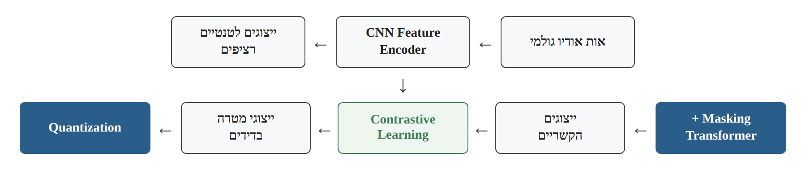
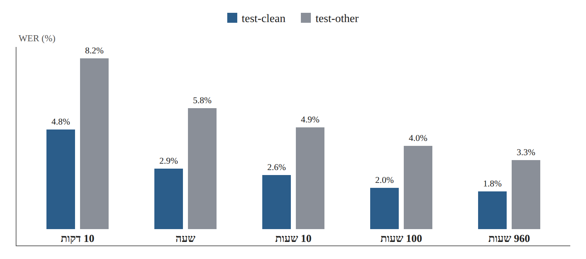

# Research Card 04 — wav2vec 2.0

## wav2vec 2.0: A Framework for Self-Supervised Learning of Speech Representations

## 1. פרטים ביבליוגרפיים

**שם המאמר:** wav2vec 2.0: A Framework for Self-Supervised Learning of Speech Representations.

**מחברים:** Alexei Baevski, Henry Zhou, Abdelrahman Mohamed, Michael Auli.

**גוף מחקרי:** Facebook AI.

**שנת פרסום:** 2020.

**גרסת המקור שנקראה:** arXiv:2006.11477v3, מ-22 באוקטובר 2020.

**קישור למאמר:** https://arxiv.org/abs/2006.11477

**קוד ומודלים:** https://github.com/pytorch/fairseq

**תחומי מחקר:** Self-Supervised Learning, Speech Representation Learning, Automatic Speech Recognition, Contrastive Learning, Transformer Architectures, Transfer Learning.

**מילות מפתח:** wav2vec 2.0, SSL, CNN Feature Encoder, Transformer, Masking, Product Quantization, Gumbel-Softmax, Contrastive Loss, Diversity Loss, Fine-Tuning, CTC, WER.

**רלוונטיות לפרויקט:** גבוהה, אך עקיפה מבחינת משימת המקור. המאמר אינו עוסק בזיהוי זיופים קוליים אלא בלמידת ייצוגי דיבור ובזיהוי דיבור. עם זאת, הוא מספק בסיס מחקרי חשוב לשימוש במודלים מאומנים מראש עבור משימות אודיו עם מעט נתונים מתויגים, לרבות האפשרות להתאימם לזיהוי זיופים.

---

## 2. תקציר מקיף של המאמר

המאמר מציג את wav2vec 2.0, מסגרת ללמידה עצמית מונחית (Self-Supervised Learning) של ייצוגי דיבור מתוך אותות אודיו גולמיים וללא צורך בתמלול בשלב האימון המקדים.

המוטיבציה המרכזית היא המחסור בנתוני דיבור מתויגים. מערכות לזיהוי דיבור דורשות לעיתים כמויות גדולות של הקלטות מתומללות, בעוד שהקלטות ללא תמלול זמינות בהיקפים גדולים בהרבה. החוקרים מבקשים לנצל מידע זה כדי ללמוד ייצוגי דיבור שימושיים, ולאחר מכן להתאים את המודל למשימת Automatic Speech Recognition באמצעות כמות מוגבלת של נתונים מתויגים.

הארכיטקטורה כוללת CNN Feature Encoder המקבל Raw Waveform ומפיק רצף ייצוגים לטנטיים רציפים, Transformer הלומד ייצוגים הקשריים, ומודול Quantization המפיק מטרות אימון בדידות. בשלב האימון המקדים, מקטעים מתוך רצף הייצוגים הלטנטיים מוסתרים לפני הכניסה ל-Transformer. המודל נדרש לזהות את הייצוג הבדיד הנכון של כל מקטע מוסתר מתוך קבוצת מועמדים באמצעות Contrastive Loss.

בנוסף, החוקרים משתמשים ב-Diversity Loss כדי לעודד שימוש מגוון ביחידות הבדידות שנלמדות במודול ה-Quantization.

לאחר ה-Pre-training, המודל עובר Fine-Tuning באמצעות נתוני דיבור מתומללים, עם שכבת פלט ו-Connectionist Temporal Classification (CTC) Loss לצורך זיהוי מילים או פונמות.

החוקרים בחנו שתי תצורות, BASE ו-LARGE, באמצעות Pre-training על 960 שעות LibriSpeech או כ-53,200 שעות LibriVox. לאחר מכן בוצע Fine-Tuning על קבוצות נתונים מתויגות בהיקפים של עשר דקות, שעה אחת, עשר שעות, מאה שעות ו-960 שעות.

בתנאי עשר דקות של נתונים מתויגים, מודל LARGE שעבר Pre-training על LibriVox והשתמש במודל שפה בזמן הפענוח השיג Word Error Rate של 4.8% על test-clean ו-8.2% על test-other. בתנאי 960 שעות נתונים מתויגים הושגו תוצאות של 1.8% ו-3.3%, בהתאמה.

ניסויי Ablation הראו שהשילוב של ייצוגים רציפים בכניסה ל-Transformer ומטרות אימון בדידות מספק תוצאות טובות יותר מהחלופות שנבדקו.

**המסקנה המרכזית:** ניתן ללמוד ייצוגי דיבור שימושיים מכמויות גדולות של אודיו לא מתויג, ולהיעזר בהם לשיפור ביצועי Speech Recognition ולהפחתת הצורך בנתונים מתויגים. עם זאת, המאמר אינו בוחן אם אותם ייצוגים יעילים גם לזיהוי זיופים קוליים.

**מקור:** Abstract, Sections 1–6.

---

## 3. בעיית המחקר והמוטיבציה

### 3.1 הבעיה המרכזית

פיתוח מערכות Automatic Speech Recognition דורש בדרך כלל כמויות גדולות של הקלטות דיבור לצד תמלולים מדויקים.

איסוף הקלטות אפשרי בהיקף רחב, אך יצירת תמלולים איכותיים היא תהליך יקר וצורך זמן.

בעיה זו משמעותית במיוחד בשפות ובניבים שעבורם קיימים מעט משאבים מתויגים.

### 3.2 המגבלה בגישות מפוקחות

בגישה מפוקחת, המודל תלוי בדוגמאות מתויגות כדי ללמוד את המשימה.

כאשר כמות התוויות מוגבלת, קשה יותר לאמן מערכת זיהוי דיבור בעלת ביצועים גבוהים.

### 3.3 הרעיון של Self-Supervised Learning

במקום ללמוד רק מתוך נתונים מתויגים, המודל מקבל משימת אימון שמטרותיה נוצרות מתוך הנתונים עצמם.

ב-wav2vec 2.0, המודל לומד לזהות ייצוגים של מקטעי אודיו שהוסתרו מתוך רצף ייצוגי הדיבור.

תהליך זה אינו דורש תמלול אנושי.

### 3.4 מטרת המחקר

לפתח מסגרת המאפשרת ללמוד ייצוגי דיבור איכותיים מתוך אודיו לא מתויג ולהתאים אותם בהמשך למשימות זיהוי דיבור באמצעות כמויות קטנות יחסית של נתונים מתויגים.

### 3.5 שאלת המחקר המשתמעת

האם שילוב של Masking, למידה ניגודית ומטרות בדידות שנלמדות במשותף עם ייצוגים הקשריים מאפשר ללמוד ייצוגי דיבור המשפרים את ביצועי Speech Recognition, במיוחד כאשר כמות הנתונים המתויגים מוגבלת?

השאלה מנוסחת כאן כסיכום מטרת החוקרים, ולא כציטוט של שאלת מחקר פורמלית.

**מקור:** Section 1, עמודים 1–2.

---

## 4. התרומות המרכזיות של המאמר

**1. מסגרת Self-Supervised Learning מתוך Raw Waveform**

המודל לומד ייצוגי דיבור ישירות מאות האודיו, ללא תמלול בשלב ה-Pre-training.

**2. שילוב CNN ו-Transformer**

CNN מפיק מאפיינים אקוסטיים מקומיים, ו-Transformer יוצר ייצוגים הקשריים על בסיס רצף המאפיינים.

**3. Masking במרחב הלטנטי**

ההסתרה מתבצעת לאחר חילוץ המאפיינים הראשוני ולא ישירות על גל הקול.

**4. Contrastive Learning**

המודל לומד להבחין בין ייצוג המטרה הנכון של מקטע מוסתר לבין דוגמאות שליליות.

**5. למידה משותפת של Quantization וייצוגים הקשריים**

בניגוד לגישות קודמות שבהן היחידות הבדידות נלמדו בשלב נפרד, wav2vec 2.0 מאמן את רכיבי המערכת במשותף.

**6. Continuous Inputs עם Quantized Targets**

ה-Transformer מקבל ייצוגים רציפים, בעוד שמטרות ה-Contrastive Loss הן ייצוגים בדידים.

**7. יעילות גבוהה במצבי Low-Resource**

המחקר מדגים שיפור משמעותי בביצועי ASR גם כאשר זמינות עשר דקות בלבד של דיבור מתומלל.

**8. הערכה מבוקרת של בחירות הארכיטקטורה**

ניסויי Ablation בוחנים את תרומת ה-Quantization, אסטרטגיות ה-Masking ופרמטרים נוספים.

**מקור:** Sections 1–3, 5.

---

## 5. הארכיטקטורה של wav2vec 2.0

### 5.1 מבנה כללי

המודל כולל שלושה רכיבים מרכזיים:

1. Convolutional Feature Encoder.
2. Transformer Context Network.
3. Quantization Module.

זרימת המידע בשלב ה-Pre-training:

Raw Waveform → CNN Feature Encoder → Continuous Latent Representations.

מהייצוגים הלטנטיים נוצרים שני מסלולים:

- מסלול Masking ו-Transformer, המפיק ייצוגים הקשריים.
- מסלול Quantization, המפיק ייצוגי מטרה בדידים.

שני המסלולים נפגשים במשימת Contrastive Learning.

*איור 1. המחשה לזרימת המידע המתוארת בסעיף 5.1.*

### 5.2 CNN Feature Encoder

נסמן את אות האודיו הגולמי ב-X.

ה-Encoder מפיק ממנו רצף ייצוגים:

Z = f(X) = (z₁, z₂, …, zₜ)

כל zₜ הוא וקטור מאפיינים רציף המייצג מקטע קצר של האודיו.

ה-Encoder מורכב משבע שכבות Convolution, שכל אחת מהן כוללת 512 ערוצים.

במימוש המתואר, מתקבל ייצוג בקצב של כ-49 צעדי זמן לשנייה, כלומר מרווח של כ-20ms בין צעדים עוקבים.

ה-Receptive Field של ה-Encoder הוא כ-25ms.

### 5.3 Transformer Context Network

רצף המאפיינים מועבר ל-Transformer:

C = g(Z)

הפלט הוא רצף ייצוגים הקשריים:

C = (c₁, c₂, …, cₜ)

ה-Transformer משתמש ב-Self-Attention כדי ללמוד קשרים בין מקטעים שונים של הדיבור.

מטרתו אינה לתמלל מילים בזמן ה-Pre-training, אלא לבנות ייצוגים שימושיים המבוססים על ההקשר של אות הדיבור.

### 5.4 Quantization Module

מודול זה ממפה ייצוגים רציפים לייצוגים בדידים מתוך אוסף קודים שנלמד במהלך האימון.

החוקרים משתמשים ב-Product Quantization וב-Gumbel-Softmax כדי לאפשר בחירת קודים בדידים במסגרת תהליך אימון מבוסס גרדיאנטים.

התוצאה עבור מקטע מסוים מסומנת qₜ.

### 5.5 הבחנה חשובה בין המסלולים

ה-Transformer מקבל רצף של ייצוגים רציפים, שחלקם הוסתרו.

מודול ה-Quantization מקבל את הייצוגים המקוריים, ללא אותה הסתרה, כדי להפיק מטרות אימון.

כך המודל אינו יכול לפתור את משימת הניגודיות על ידי גישה ישירה למידע המוסתר במסלול ה-Transformer.

**מקור:** Section 2, Figure 1, עמוד 2.

---

## 6. תהליך ה-Pre-training

### 6.1 Masking

לאחר חילוץ המאפיינים באמצעות CNN, החוקרים מסתירים מקטעים רצופים מתוך הייצוגים הלטנטיים.

ההסתרה מבוצעת לפני הכניסה ל-Transformer.

במקום המאפיינים המקוריים במיקומים שנבחרו מוצב וקטור Mask נלמד.

במימוש המרכזי:

- הסתברות בחירת תחילת מקטע להסתרה: p = 0.065.
- אורך התחלתי של כל מקטע מוסתר: M = 10 צעדי זמן.
- מקטעי הסתרה יכולים לחפוף.
- בפועל, כ-49% מצעדי הזמן מוסתרים בממוצע.

המטרה היא לחייב את המודל ללמוד את ההקשר של הדיבור, במקום להסתמך על המידע הישיר של המקטע המוסתר.

### 6.2 Contrastive Learning

עבור כל מיקום מוסתר, המודל נדרש לזהות את המטרה הבדידה הנכונה qₜ מתוך קבוצת מועמדים.

הקבוצה מכילה:

- Positive Example — המטרה הנכונה.
- Negative Examples — ייצוגים בדידים שנדגמו ממיקומים מוסתרים אחרים באותה הקלטה.

המימוש המרכזי משתמש ב-100 דוגמאות שליליות.

המודל מחשב דמיון בין הייצוג ההקשרי cₜ לבין המועמדים, באמצעות Cosine Similarity.

פונקציית ה-Contrastive Loss מעודדת דמיון גבוה למטרה הנכונה ודמיון נמוך יותר לדוגמאות השליליות.

### 6.3 Quantization

החוקרים משתמשים בשתי קבוצות קודים (Codebook Groups), שכל אחת מהן מכילה 320 ערכים אפשריים.

השילוב מאפשר באופן תיאורטי:

320 × 320 = 102,400 צירופי קודים.

מדובר במספר הצירופים האפשריים, ולא בהוכחה שכל הצירופים מופיעים בפועל או מייצגים פונמות נפרדות.

### 6.4 Diversity Loss

מנגנון Quantization עלול להסתמך על מספר קטן של קודים ולזנוח אחרים.

כדי לעודד שימוש מגוון בקודים, החוקרים מוסיפים Diversity Loss.

פונקציית האובדן הכוללת היא:

L = Lm + αLd

כאשר:

- Lm — Contrastive Loss.
- Ld — Diversity Loss.
- α — מקדם השולט במשקל ה-Diversity Loss.

במימוש המרכזי α = 0.1.

### 6.5 מה המודל לומד?

המודל לומד ייצוגי דיבור המאפשרים לזהות את היחידות הבדידות המתאימות למקטעים מוסתרים על סמך ההקשר.

הוא אינו לומד בשלב זה תוויות של מילים, דוברים, דיבור אמיתי או דיבור מזויף.

**מקור:** Sections 3.1–3.2, 4.2.

---

## 7. Fine-Tuning — התאמת המודל למשימת זיהוי דיבור

לאחר שלב ה-Pre-training, החוקרים מתאימים את המודל למשימה מפוקחת.

במקרה של LibriSpeech, המשימה היא זיהוי דיבור והפקת רצף תווים.

החוקרים מוסיפים שכבת פלט מעל ה-Transformer ומשתמשים ב-Connectionist Temporal Classification (CTC) Loss.

CTC מאפשר לאמן מודל לחיזוי רצף תווים בלי לספק יישור ידני מדויק בין כל תו לבין מיקום מסוים באודיו.

במימוש המתואר, החוקרים מאמנים תחילה את שכבת הפלט, ובהמשך מעדכנים גם את ה-Transformer, בעוד שה-CNN Feature Encoder נשאר קפוא במהלך ה-Fine-Tuning המקורי.

### הבחנה חשובה לפרויקט שלנו

המאמר משתמש ב-CTC עבור Speech Recognition.

במשימת Deepfake Detection שלנו אין צורך לחזות רצף תווים.

במקום זאת, ניתן להשתמש בייצוגי הדיבור שהמודל למד, לסכם אותם ברמת ההקלטה ולהוסיף מסווג בינארי.

האפשרות הזאת היא התאמה מוצעת למשימת הפרויקט, ולא ארכיטקטורה שנבחנה במאמר המקורי.

**מקור:** Sections 3.3, 4.3.

---

## 8. מאגרי הנתונים

### 8.1 נתונים לא מתויגים ל-Pre-training

| מאגר | כמות נתונים |
|---|---:|
| LibriSpeech — LS-960 | 960 שעות |
| LibriVox — LV-60k | כ-53,200 שעות |

המאגר השני מאפשר לבחון את השפעת הגדלת כמות האודיו הלא מתויג.

### 8.2 נתונים מתויגים ל-Fine-Tuning

החוקרים השתמשו בחמש תצורות:

- 10 דקות.
- שעה אחת.
- 10 שעות.
- 100 שעות.
- 960 שעות.

כל תצורה נועדה לבחון את יעילות הייצוגים כאשר זמינה כמות אחרת של נתוני אימון מתויגים.

### 8.3 מאגר TIMIT

בנוסף ל-LibriSpeech, החוקרים השתמשו ב-TIMIT לצורך Phoneme Recognition.

המאגר מכיל כחמש שעות אודיו עם תוויות פונטיות מפורטות.

ההערכה בוצעה באמצעות Phoneme Error Rate (PER).

### 8.4 מדדי הערכה

**WER — Word Error Rate**

מדד לשיעור שגיאות בתמלול, המבוסס על החלפות, מחיקות והוספות של מילים ביחס לתמלול הייחוס.

**PER — Phoneme Error Rate**

מדד מקביל עבור זיהוי פונמות.

שני המדדים שונים מ-EER, שהוא מדד ההערכה המרכזי בפרויקט זיהוי הזיופים שלנו.

**מקור:** Section 4.1.

---

## 9. תצורות המודל ופרטי מימוש

| פרמטר | BASE | LARGE |
|---|---:|---:|
| מספר פרמטרים | כ-95M | כ-317M |
| שכבות Transformer | 12 | 24 |
| ממד Transformer | 768 | 1,024 |
| Attention Heads | 8 | 16 |
| ממד FFN | 3,072 | 4,096 |
| CNN Encoder | 7 שכבות | 7 שכבות |
| ערוצי CNN | 512 | 512 |
| Codebook Groups | 2 | 2 |
| Entries per Group | 320 | 320 |

### פרטים נוספים

- המודלים מומשו באמצעות fairseq.
- נעשה שימוש ב-Adam Optimizer.
- ה-Contrastive Loss השתמש ב-100 דוגמאות שליליות.
- נעשה שימוש ב-Cosine Similarity.
- אורך הרצפים שהוסתרו נקבע באמצעות פרמטרים p ו-M.
- המודל עבר Fine-Tuning עם CTC עבור ASR.

### עלות חישובית

ה-Pre-training של BASE בוצע באמצעות 64 מעבדי V100 במשך כ-1.6 ימים.

ה-Pre-training של LARGE בוצע באמצעות 128 מעבדי V100, במשך כ-2.3 ימים על LibriSpeech וכ-5.2 ימים על LibriVox.

הנתונים ממחישים את העלות המשמעותית של למידת ייצוגי הדיבור מאפס.

לכן, בפרויקט שלנו עדיף לשקול תחילה שימוש במשקלים מאומנים מראש ולא שחזור של תהליך ה-Pre-training המקורי.

**מקור:** Section 4.2, Table 1.

---

## 10. תוצאות המחקר — Low-Resource ASR

### 10.1 תוצאות עם מעט נתונים מתויגים

Table 1 מציגה תוצאות WER עבור כמויות משתנות של נתונים מתויגים.

להלן תוצאות LARGE שעבר Pre-training על LibriVox והשתמש ב-Transformer Language Model:

| נתונים מתויגים | test-clean WER | test-other WER |
|---|---:|---:|
| 10 דקות | 4.8% | 8.2% |
| שעה | 2.9% | 5.8% |
| 10 שעות | 2.6% | 4.9% |
| 100 שעות | 2.0% | 4.0% |
| 960 שעות | 1.8% | 3.3% |

התוצאה עבור 960 שעות מופיעה ב-Table 2.

*איור 2. המחשה לנתוני Table 1 (סעיף 10.1): test-clean ו-test-other WER לפי כמות הנתונים המתויגים.*

### 10.2 הממצא המרכזי

המודל הצליח להשיג ביצועי Speech Recognition גבוהים יחסית גם כאשר השתמש בכמות קטנה מאוד של נתונים מתויגים.

עם זאת, חשוב להדגיש שהתוצאות הללו התבססו על Pre-training נרחב ועל שימוש במודל שפה לצורך הפענוח.

### 10.3 השוואה לשיטות קודמות

החוקרים השוו את wav2vec 2.0 למערכות קודמות, כולל Discrete BERT, Iterative Pseudo-Labeling ו-Noisy Student.

בתנאי 100 שעות מתויגות, מודל LARGE שעבר Pre-training על LS-960 השיג WER של 2.3%/5.0%, לעומת 4.2%/8.6% במערכת Noisy Student שנכללה בהשוואה.

החוקרים גם מדווחים שבתנאי שעה אחת של נתונים מתויגים, המודל השיג תוצאות טובות יותר ממערכת Noisy Student שהשתמשה במאה שעות מתויגות, תחת הגדרות ההשוואה המתוארות.

### 10.4 משמעות הממצאים

Pre-training מאפשר לנצל מידע נרחב על דיבור לפני שלב האימון המפוקח.

עם זאת, אין להסיק שהתאמה עם מעט תוויות תצליח באותה מידה בכל משימת אודיו.

**מקור:** Section 5.1, Table 1.

---

## 11. תוצאות המחקר — High-Resource ASR

### 11.1 השוואת אימון מאפס לעומת Pre-training

בתנאי Fine-Tuning על 960 שעות מתויגות:

| מודל | test-clean WER | test-other WER |
|---|---:|---:|
| LARGE מאפס | 2.1% | 4.6% |
| LARGE לאחר Pre-training על LS-960 | 2.0% | 4.1% |
| LARGE לאחר Pre-training על LV-60k | **1.8%** | **3.3%** |

התוצאות מצביעות על יתרון של Pre-training גם כאשר כמות הנתונים המתויגים גדולה.

עם זאת, המודל שעבר Pre-training השתמש במידע נוסף שאינו נכלל באימון המאפס.

### 11.2 השפעת כמות הנתונים הלא מתויגים

הגדלת כמות נתוני ה-Pre-training מ-960 שעות לכ-53,200 שעות שיפרה את ביצועי LARGE בתנאים שנבדקו.

### 11.3 תרומת גודל המודל

LARGE השיג באופן כללי תוצאות טובות יותר מ-BASE, במיוחד בחלק מהתרחישים הקשים יותר.

עם זאת, LARGE דרש יותר פרמטרים ומשאבים.

**מקור:** Section 5.2, Table 2.

---

## 12. תוצאות Phoneme Recognition

החוקרים בחנו את המודל גם על TIMIT.

מודל LARGE שעבר Pre-training על LS-960 השיג:

- Development PER: 7.4%.
- Test PER: 8.3%.

תוצאה זו הייתה טובה יותר מתוצאות המערכות הקודמות שנכללו בהשוואה במאמר.

הניסוי מספק ראיה נוספת לכך שייצוגי הדיבור שנלמדו יכולים לסייע במשימה מפוקחת שאינה תמלול מילים מלא.

עם זאת, Phoneme Recognition עדיין קרובה למשימות של עיבוד וזיהוי דיבור, ולכן אין להסיק ממנה ישירות על זיהוי זיופים.

**מקור:** Section 5.3, Table 3.

---

## 13. ניסויי Ablation

### 13.1 מטרת הניסויים

החוקרים ביקשו לבחון את השפעת הבחירה בין ייצוגים רציפים לבדידים בכניסה ל-Transformer ובמטרות ה-Contrastive Loss.

### 13.2 תוצאות Table 4

| קלט ל-Transformer | Targets | WER ממוצע | סטיית תקן |
|---|---|---:|---:|
| Continuous | Quantized | **7.97%** | 0.02 |
| Quantized | Quantized | 12.18% | 0.41 |
| Quantized | Continuous | 11.18% | 0.16 |
| Continuous | Continuous | 8.58% | 0.08 |

הניסויים בוצעו בתצורת אימון מצומצמת, ודווחו על פני שלושה Seeds.

### 13.3 המסקנה המרכזית

השילוב של Continuous Inputs ו-Quantized Targets השיג את התוצאה הטובה ביותר.

החוקרים מציעים שני הסברים:

1. שימוש בייצוג רציף בכניסה ל-Transformer משמר מידע שמועיל ללמידת ההקשר.
2. מטרות בדידות עשויות למנוע הסתמכות יתר על פרטים ספציפיים של הקלטה, כגון מאפייני דובר או רעשי רקע, ובכך לעודד למידה של ייצוגים כלליים יותר עבור Speech Recognition.

### 13.4 מגבלה בפרשנות

ההסבר לגבי הסיבה לשיפור הוא פרשנות החוקרים, הנתמכת בניסוי השוואתי, אך אינו מוכיח שהמטרות הבדידות שומרות דווקא על המידע הרצוי לזיהוי זיופים.

### 13.5 ניסויי Ablation נוספים

בנספחים נבדקו גם:

- אורכי Masking שונים.
- הסתברויות Masking שונות.
- משקלים שונים ל-Diversity Loss.
- מספר דוגמאות שליליות.
- אסטרטגיות דגימת דוגמאות שליליות.
- שימוש ב-Gumbel Noise.
- מספר Codebook Groups.
- היקף המידע שהמודל נדרש לחזות.

הניסויים מצביעים על רגישות לבחירת הפרמטרים, אך אין צורך להעתיק את כל התצורות לצורך הפרויקט שלנו.

**מקור:** Section 5.4, Tables 4–5, Appendix F.

---

## 14. מסקנות החוקרים

החוקרים מסיקים ש-Self-Supervised Pre-training על אודיו לא מתויג מאפשר ללמוד ייצוגים יעילים עבור Speech Recognition.

השימוש במודל מאומן מראש הפחית משמעותית את כמות הנתונים המתויגים הנדרשת להשגת ביצועים גבוהים.

גם כאשר הייתה זמינה כמות גדולה של נתונים מתויגים, Pre-training המשיך לתרום לשיפור.

החוקרים מדגישים את היתרון של שילוב למידה ניגודית, Masking ומטרות Quantized שנלמדות במשותף עם הייצוגים ההקשריים.

הם גם מציגים את האפשרות לשיפורים נוספים באמצעות התאמות של ארכיטקטורת זיהוי הדיבור ושל מנגנוני הפענוח.

**מקור:** Section 6.

---

## 15. ניתוח ביקורתי

### 15.1 יתרונות המחקר

**א. ניצול יעיל של נתונים לא מתויגים**

המאמר מציג מסגרת שמאפשרת ללמוד ייצוגי דיבור מתוך אודיו ללא תמלול ידני.

**ב. תרומה משמעותית בתנאי Low-Resource**

החוקרים מציגים ביצועים חזקים גם בכמויות קטנות מאוד של נתונים מתויגים.

**ג. שילוב ארכיטקטוני ברור**

המערכת משלבת CNN, Transformer, Masking ו-Contrastive Learning במסגרת אחידה.

**ד. ניסויי Ablation**

המחקר בוחן באופן מבוקר מספר החלטות מרכזיות בתכנון השיטה.

**ה. הערכה במספר תצורות**

החוקרים משווים גדלים שונים של מודל, כמויות שונות של נתוני Pre-training וכמויות שונות של נתונים מתויגים.

**ו. שימוש במשימות הערכה שונות**

הניסויים ב-LibriSpeech וב-TIMIT מאפשרים לבחון את הייצוגים במספר משימות הקשורות לזיהוי דיבור.

**ז. זמינות קוד ומודלים**

הקוד והמודלים הופצו במסגרת fairseq, דבר התומך בשחזור ובמחקר המשך.

### 15.2 מגבלות המחקר

**א. משימת המקור אינה Deepfake Detection**

המאמר מתמקד ב-ASR וב-Phoneme Recognition, ולא בזיהוי דיבור סינתטי.

**ב. פער בין מטרת הייצוג למטרת הפרויקט שלנו**

ייצוגים המועילים לזיהוי מילים אינם בהכרח משמרים את כל הארטיפקטים האקוסטיים הרלוונטיים לזיהוי זיופים.

**ג. עלות Pre-training גבוהה**

האימון המקורי דרש כמויות גדולות של נתונים ומשאבי GPU משמעותיים.

**ד. תלות במודל שפה בחלק מהתוצאות**

חלק מהתוצאות הבולטות הושגו באמצעות Language Model חיצוני בזמן הפענוח.

**ה. השפעת מקור נתוני ה-Pre-training**

היתרון של LV-60k נבחן על נתוני ההערכה המתוארים במאמר, ולא בהכרח יישמר בהעברה לכל מאגר אודיו אחר.

**ו. היעדר השוואת Deepfake Detection**

לא בוצעה הערכה באמצעות EER, ולא נבחנה עמידות בפני TTS, Voice Conversion או Replay כמשימת סיווג.

**ז. מגבלות הכללה**

המאמר אינו מציג ניסויים על ASVspoof 5, CodecFake או זיהוי זיופים בין מקורות שונים.

**ח. אין הוכחה ליעילות של Frozen Encoder בפרויקט שלנו**

האפשרות להשתמש ב-Encoder קפוא היא הצעת יישום המבוססת על Transfer Learning, ולא ניסוי שנערך במסגרת המאמר לצורך זיהוי זיופים.

### 15.3 מה לא ניתן להסיק מהמאמר

המאמר אינו מוכיח ש:

- wav2vec 2.0 ישיג EER נמוך בנתוני הקורס.
- מודל SSL עדיף בהכרח על AASIST או CQCC בזיהוי זיופים.
- Fine-Tuning תמיד עדיף על Frozen Encoder.
- מודל LARGE הוא הבחירה הטובה ביותר כאשר כמות הנתונים קטנה.
- ייצוגי ASR מכילים בהכרח את כל סממני הזיוף האקוסטיים.
- הצלחה ב-WER מבטיחה הצלחה ב-EER.
- כמות גדולה יותר של נתונים לא מתויגים מבטיחה שיפור בכל משימת יעד.

---

## 16. ההבנות והתובנות שלנו מהמאמר

### 16.1 הידע המוקדם של המודל עשוי להיות משמעותי

מודל שעבר Pre-training על כמויות גדולות של אודיו מתחיל את משימת היעד עם ייצוגי דיבור שכבר נלמדו.

לכן אין הכרח להתחיל את למידת המאפיינים מאפס.

### 16.2 פחות פרמטרים לאימון אינם בהכרח פחות פרמטרים במודל

ב-Frozen Encoder מספר הפרמטרים המתעדכנים יכול להיות קטן מאוד, אך מספר הפרמטרים הכולל של wav2vec 2.0 עדיין גדול.

חשוב להבחין בין מורכבות המודל לבין מספר הפרמטרים הנלמדים במהלך ההתאמה.

### 16.3 Transfer Learning דורש בדיקה אמפירית

הידע שנלמד מראש עשוי להיות שימושי, אך גם עשוי להיות מותאם למשימה שונה מזו שאנחנו מנסים לפתור.

לכן יש לבחון האם הייצוגים באמת מכילים מידע רלוונטי לזיהוי זיופים.

### 16.4 Pre-training ו-Fine-Tuning הם שלבים נפרדים

בשלב הראשון המודל לומד מתוך אודיו לא מתויג.

בשלב השני ניתן להתאים את הייצוגים למשימה מפוקחת באמצעות נתונים מתויגים.

בפרויקט שלנו ניתן להחליף את ראש ה-ASR במסווג בינארי.

### 16.5 מבנה משימת ה-Pre-training משפיע על הייצוג הנלמד

ניסויי ה-Ablation מראים שהבחירה בין Continuous Inputs לבין Quantized Targets משפיעה משמעותית על ביצועי ASR.

מכאן עולה ששיטת הלמידה העצמית אינה רק שלב טכני, אלא חלק משמעותי מאיכות הייצוגים.

### 16.6 יש להפריד בין מדדי משימות שונות

WER מודד שגיאות בתמלול.

EER מודד את יכולת ההבחנה בין מחלקות במסגרת משימת זיהוי.

אין להסיק תוצאה במדד אחד מתוך הצלחה במדד אחר.

---

## 17. משמעות המאמר לפרויקט שלנו

### 17.1 הקשר לנתוני הקורס

מאגר הקורס שלנו כולל 1,520 הקלטות אודיו מתויגות, שמקורן ב-ASVspoof 5, CodecFake ו-M-AILABS.

כמות זו קטנה יחסית לאימון מודל עמוק בעל עשרות מיליוני פרמטרים מאפס.

לכן שימוש ב-wav2vec 2.0 מאומן מראש עשוי להוות גישה מתאימה לבחינה.

### 17.2 התאמת הארכיטקטורה למשימת זיופים

במקום ראש CTC עבור Speech Recognition, ניתן להוסיף ראש סיווג בינארי.

ארכיטקטורה אפשרית:

Raw Audio

→ Pretrained wav2vec 2.0 Encoder

→ Temporal Pooling

→ Binary Classification Head

→ Fake/Real Score.

זהו תכנון אפשרי עבור הפרויקט שלנו, ולא המימוש שנבחן במאמר.

### 17.3 Frozen Encoder

אפשר להקפיא את משקלי ה-CNN וה-Transformer ולהשתמש בהם לחילוץ ייצוגים.

לאחר מכן ניתן לאמן מסווג על הנתונים המתויגים של הקורס.

היתרון האפשרי הוא צמצום מספר הפרמטרים הנלמדים והסיכון להתאמת יתר.

עם זאת, חילוץ הייצוגים עדיין דורש משאבי חישוב.

### 17.4 Fine-Tuning

אפשרות נוספת היא לאפשר לחלק ממשקלי המודל המאומן מראש להתעדכן.

גישה זו עשויה להתאים את הייצוגים לארטיפקטים הקשורים לזיופים.

עם זאת, היא דורשת יותר משאבים, ועשויה להגביר את הסיכון ל-Overfitting.

### 17.5 התאמת המודל להערכת EER

המודל צריך להחזיר ציון רציף שמאפשר להבחין בין אמיתי למזויף.

בהתאם לפרוטוקול הקורס, ציון גבוה יותר צריך להעיד על סבירות גבוהה יותר לזיוף.

הבחירה בסף סיווג אינה נדרשת לצורך חישוב EER על בסיס ציונים רציפים.

### 17.6 מניעת דליפת מידע

נדרש לוודא שההערכה מתבצעת על נתונים שלא שימשו לאימון או לכוונון.

בנוסף, אם משתמשים במשקלים מאומנים מראש, חשוב לתעד את מקורם ולבחון האם קיימת חפיפה אפשרית בין נתוני ה-Pre-training לבין נתוני ההערכה.

### 17.7 השוואה לגישות הקודמות

המחקר שלנו יכול לבחון שלוש משפחות של פתרונות:

- מאפיינים אקוסטיים קלאסיים, כגון MFCC ו-CQCC.
- מודלים עמוקים ייעודיים לזיהוי זיופים, כגון AASIST.
- מודלים מאומנים מראש ללמידת ייצוגי דיבור, כגון wav2vec 2.0.

כך ניתן לבדוק האם הידע שנלמד מראש מספק יתרון מעשי ביחס לחלופות.

---

## 18. השערות מחקר וניסויים אפשריים

### H1 — wav2vec 2.0 לעומת Baseline קלאסי

**השערה:** ייצוגים המופקים מ-wav2vec 2.0 מאומן מראש עשויים לסייע לזיהוי זיופים טוב יותר ממאפיינים קלאסיים כגון MFCC.

**ניסוי:** השוואת MFCC + מסווג פשוט מול wav2vec 2.0 Frozen Encoder + מסווג, באותו פרוטוקול.

**מדד:** EER.

**מגבלה:** ההבדלים כוללים גם את אופן ייצוג האודיו וגם את הידע שנלמד בשלב ה-Pre-training.

### H2 — Frozen Encoder לעומת Fine-Tuning

**השערה:** התאמת משקלי wav2vec 2.0 למשימת זיהוי זיופים עשויה לשפר את ה-EER לעומת שימוש ב-Encoder קפוא.

**ניסוי:** השוואת שתי הגישות כאשר משתמשים באותם משקלים התחלתיים, באותו Dataset ובאותה ארכיטקטורת Classification Head.

**בקרה:** בחירת Hyperparameters על Validation בלבד, עם תקציב כוונון דומה והערכת יציבות בין Seeds.

### H3 — יכולת הכללה בין מקורות נתונים

**השערה:** ייצוגי wav2vec 2.0 עשויים להציג עמידות מסוימת לשינויים בין מקורות נתונים, אך אין ודאות שהעמידות תישמר מול זיופים מסוגים שונים.

**ניסוי:** הערכת הביצועים על מקורות שונים, לרבות תרחיש של אימון על ASVspoof 5 ובדיקה על CodecFake, אם חלוקת הנתונים והיקפם מאפשרים הערכה תקפה.

**מגבלה:** הבדלים בין המאגרים עשויים לנבוע ממספר גורמים, ולא רק מטכנולוגיית הזיוף.

### H4 — השוואת ייצוגים משכבות שונות

**השערה:** שכבות שונות של Transformer עשויות להכיל מידע שונה מבחינת הרלוונטיות לזיהוי זיופים.

**ניסוי:** חילוץ ייצוגים משכבות נבחרות ואימון אותו מסווג על כל ייצוג.

**הערה:** זו השערת מחקר שלנו; המאמר אינו בוחן אותה עבור Deepfake Detection.

### H5 — יעילות חישובית

**השערה:** Frozen Encoder עשוי להציע יחס ביצועים–עלות מתאים יותר מ-Fine-Tuning מלא בתנאי משאבים מוגבלים.

**ניסוי:** השוואת EER, זמן אימון, שימוש בזיכרון ומספר פרמטרים מתעדכנים.

---

## 19. שאלות פתוחות להמשך

1. האם ייצוגי wav2vec 2.0 אכן מכילים מידע שמבחין בין דיבור אמיתי למזויף?
2. האם עדיף להשתמש ב-BASE או ב-LARGE בהינתן גודל מאגר הקורס?
3. האם Frozen Encoder יספק ביצועים מספקים ללא Fine-Tuning?
4. האם Fine-Tuning ישפר את ה-EER או יוביל להתאמת יתר?
5. אילו שכבות של ה-Transformer מכילות את המידע הרלוונטי ביותר לזיהוי זיופים?
6. האם המודל יתמודד עם זיופים מבוססי Neural Audio Codecs?
7. כיצד ישתנו הביצועים במעבר בין ASVspoof 5 ל-CodecFake?
8. האם ייצוגי wav2vec 2.0 משלימים את המידע של CQCC או של AASIST?
9. האם ניתן לבצע Fine-Tuning יעיל כאשר יש מעט נתונים מתויגים?
10. מהו המחיר החישובי של השימוש ב-wav2vec 2.0 בהשוואה למודלים קלאסיים?
11. האם מודל מאומן מראש עלול להיות רגיש להבדלים בין דוברים, שפות ותנאי הקלטה?
12. האם שימוש בנתונים חיצוניים לא מתויגים ישפר את יכולת ההכללה במשימת הזיופים?

---

## 20. מסקנה מסכמת

המאמר wav2vec 2.0 מציג מסגרת משמעותית ללמידת ייצוגי דיבור באמצעות Self-Supervised Learning, המשלבת CNN, Transformer, Masking, Quantization ו-Contrastive Learning.

המחקר מדגים כי Pre-training על כמויות גדולות של אודיו לא מתויג מאפשר להשיג ביצועים גבוהים במשימות Speech Recognition, גם כאשר זמינה כמות מוגבלת מאוד של נתונים מתויגים.

ניסויי ה-Ablation תומכים בחשיבות השילוב בין ייצוגים רציפים בכניסה ל-Transformer לבין מטרות Quantized במשימת האימון העצמית.

עם זאת, המאמר אינו עוסק ישירות בזיהוי זיופים קוליים, ולכן אין לראות בתוצאות ה-WER הוכחה ליכולת לזהות TTS, Voice Conversion או Neural Audio Codecs.

מבחינת הפרויקט שלנו, התרומה המרכזית היא האפשרות להשתמש בייצוגי דיבור שנלמדו מראש, ולהתאים אותם למשימת סיווג בינארית על מאגר מתויג קטן יחסית.

**העיקרון המחקרי שנאמץ:** נבחן את התועלת של ידע מוקדם שנלמד באמצעות SSL, אך לא נניח שייצוג מוצלח למשימת Speech Recognition יהיה בהכרח הייצוג הטוב ביותר לזיהוי זיופים.

---

## 21. מפת הפניות למאמר

| נושא | מיקום במאמר |
|---|---|
| מוטיבציה ושאלת המחקר | Section 1, עמ' 1–2 |
| תרשים הארכיטקטורה | Figure 1, עמ' 2 |
| CNN Feature Encoder | Section 2, עמ' 2 |
| Transformer Context Network | Section 2, עמ' 2 |
| Quantization Module | Section 2, עמ' 2–3 |
| Masking | Section 3.1, עמ' 3 |
| Contrastive Loss | Section 3.2, עמ' 3 |
| Diversity Loss | Section 3.2, עמ' 3–4 |
| Fine-Tuning ו-CTC | Section 3.3, עמ' 4 |
| Datasets | Section 4.1, עמ' 4 |
| Pre-training Details | Section 4.2, עמ' 4–5 |
| Fine-Tuning Details | Section 4.3, עמ' 5 |
| Language Models | Section 4.4, עמ' 5 |
| Low-Resource Results | Section 5.1, Table 1, עמ' 5–6 |
| High-Resource Results | Section 5.2, Table 2, עמ' 7 |
| Phoneme Recognition | Section 5.3, Table 3, עמ' 7–8 |
| Ablation | Section 5.4, Table 4, עמ' 8 |
| מסקנות החוקרים | Section 6, עמ' 8 |
| Masking Ablations | Appendix A, Table 5 |
| תוצאות ללא Language Model | Appendix C, Tables 9–10 |
| ניתוח ייצוגים בדידים | Appendix D, Figure 3 |
| ניסויי Ablation נוספים | Appendix F, Table 13 |

**הערת שימוש:** כל תוצאות ה-WER וה-PER במסמך מתייחסות למשימות שנבדקו במאמר המקורי. ההצעות לשימוש ב-wav2vec 2.0 לזיהוי זיופים הן יישומים והשערות מחקר שלנו, ולא ממצאים שהמחברים אימתו במשימת Deepfake Detection.
