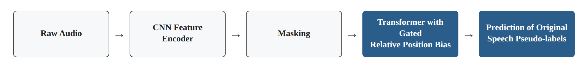
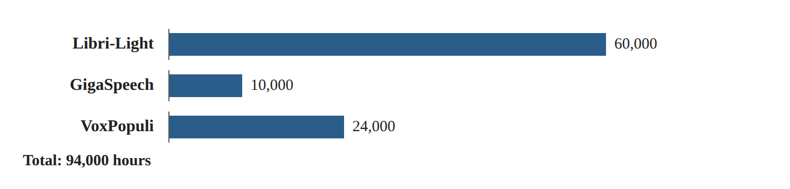
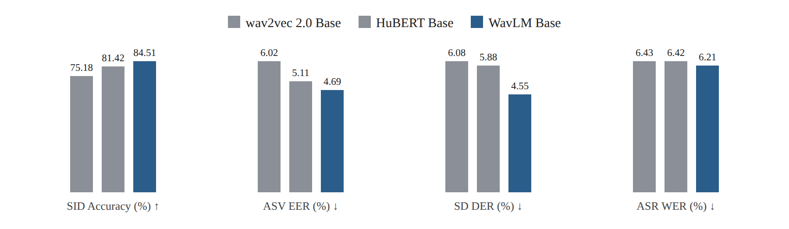

# Research Card 05 — WavLM

## WavLM: Large-Scale Self-Supervised Pre-Training for Full Stack Speech Processing

## 1. Bibliographic Details

**Paper title:** WavLM: Large-Scale Self-Supervised Pre-Training for Full Stack Speech Processing.

**Authors:** Sanyuan Chen, Chengyi Wang, Zhengyang Chen, Yu Wu, Shujie Liu, Zhuo Chen, Jinyu Li, Naoyuki Kanda, Takuya Yoshioka, Xiong Xiao, Jian Wu, Long Zhou, Shuo Ren, Yanmin Qian, Yao Qian, Jian Wu, Michael Zeng, Xiangzhan Yu, Furu Wei.

**Central research body:** Microsoft.

**Year of the paper:** 2022.

**Source version read:** arXiv:2110.13900v5, dated June 17, 2022.

**Link to the paper:** https://arxiv.org/abs/2110.13900

**Code and models:** https://aka.ms/wavlm

**Research fields:** Self-Supervised Speech Representation Learning, Universal Speech Representations, Speaker-Related Tasks, Speech Denoising, Transformer Models, Transfer Learning.

**Keywords:** WavLM, HuBERT, wav2vec 2.0, Masked Speech Prediction, Denoising, Gated Relative Position Bias, SUPERB, Speaker Verification, Speaker Diarization, Speech Separation, Weighted Layer Sum.

**Relevance to the project:** High. WavLM presents an SSL model intended to learn representations useful for a variety of speech tasks, and not only for ASR. It constitutes a candidate for comparison against wav2vec 2.0 and provides a research basis for examining the use of different layers of a pre-trained model, a Frozen Encoder and Fine-Tuning for the purpose of voice forgery detection.

---

## 2. Comprehensive Summary of the Paper

The paper presents WavLM, a pre-trained model based on Self-Supervised Learning, intended to learn general speech representations suited to a wide variety of speech processing tasks.

The researchers note that previous SSL works showed significant achievements on Speech Recognition tasks, but their success on other tasks, such as speaker verification, speech separation and identifying speakers throughout a recording, was more limited.

The problem stems from the fact that a speech signal contains several types of information simultaneously: linguistic content, speaker identity, paralinguistic features and information about the recording conditions. Different tasks may require different information, and sometimes even conflict in terms of the type of information that should be preserved.

WavLM proposes an extension of HuBERT's Masked Speech Prediction framework by means of three central changes:

1. Combining Masked Speech Denoising and Prediction, in which the model learns to predict targets of the original speech from recordings to which noise or overlapping speech were added.
2. Using a Gated Relative Position Bias in the Transformer's Self-Attention mechanism.
3. Expanding the Pre-training dataset to 94,000 hours of audio from diverse sources.

The researchers developed three configurations: WavLM Base, WavLM Base+ and WavLM Large.

The evaluation was carried out by means of the SUPERB framework, which includes 15 tasks, and by means of four additional tasks on dedicated evaluation datasets: Speaker Verification, Speaker Diarization, Speech Separation and Speech Recognition.

The results showed that WavLM improves performance on a variety of tasks compared with previous SSL models. For example, WavLM Base achieved a DER of 4.55% on the Speaker Diarization task in SUPERB, compared with 5.88% for HuBERT Base and 6.08% for wav2vec 2.0 Base.

Ablation experiments showed that Denoising contributes especially to some of the speaker-related tasks, while Gated Relative Position Bias contributes especially to tasks related to the content of the speech.

The researchers also examined the contribution of different layers in the Transformer and found that different tasks benefit from representations from different layers.

**The central conclusion:** Learning general speech representations requires addressing additional types of information beyond linguistic content. WavLM demonstrates an improvement on a variety of tasks by means of a combination of training on corrupted speech, architectural changes, and broader and more diverse Pre-training data.

**Source:** Abstract, Sections I, IV–VI.

---

## 3. The Research Problem and Motivation

### 3.1 The Central Problem

Pre-trained models for speech have been developed largely around Speech Recognition tasks.

However, the speech signal contains much information beyond the words that were said.

For example:

- Spoken Content — the content of the speech.
- Speaker Identity — the speaker's identity.
- Paralinguistic Information — information such as emotional features and manner of speaking.
- Multi-Speaker Information — the identities of several speakers and overlap between them.

A model suited to one task is not necessarily suited to the same degree to other tasks.

### 3.2 Conflicting Requirements between Tasks

In Speech Recognition the model needs to focus on the linguistic content even when different people say the same words.

In Speaker Verification the model needs to focus on the speaker's features even when they say different words.

In Speaker Diarization and in Speech Separation, coping with several speakers and with overlap between them is also required.

### 3.3 Limitations of Previous Approaches

The researchers note two central limitations:

**A. Limited adaptation to non-ASR tasks**

Previous SSL methods did not sufficiently encourage learning the information required to distinguish between speakers and to separate overlapping speech.

**B. Dependence on audiobook datasets**

Training based mainly on Audiobooks may limit the adaptation to other acoustic conditions, such as spontaneous conversations and recordings with background noise.

### 3.4 The Goal of the Study

To develop a pre-trained model capable of providing speech representations useful for a wide variety of tasks, while improving robustness to interference, learning speaker-related information, and expanding the diversity of data sources.

### 3.5 The Implied Research Question

Does combining Masked Speech Denoising, improving the modeling of relative position, and expanding the Pre-training data make it possible to learn speech representations more useful for a variety of tasks compared with previous SSL methods?

**Source:** Section I, pages 1–2.

---

## 4. The Connection to Previous Models

### 4.1 wav2vec 2.0

wav2vec 2.0 presented an SSL framework combining:

- CNN Feature Encoder.
- Transformer.
- Masking in the latent space.
- Contrastive Learning.
- Quantized Targets.

The original study focused mainly on improving Speech Recognition, especially when the amount of labeled data is limited.

### 4.2 HuBERT

HuBERT uses Masked Speech Prediction and discrete targets created by means of Clustering.

The process includes creating Pseudo-labels from acoustic data, and subsequently training the model to predict them in masked regions.

The paper also describes iterative training: in the first iteration codes are created from MFCC, and in later iterations codes can be created from learned latent representations.

### 4.3 What Does WavLM Add?

WavLM mainly extends the HuBERT framework, and not only wav2vec 2.0.

The contribution is combining prediction of masked segments with learning from audio corrupted by means of noise or overlapping speech, alongside improvements in the Attention mechanism and expansion of the data.

### 4.4 A Distinction between the Loss Functions

In wav2vec 2.0 the central training task is based on a Contrastive Loss with negative examples.

In WavLM the training task is based on predicting discrete Pseudo-labels in masked regions, in accordance with the HuBERT approach.

Therefore WavLM should not be described simply as wav2vec 2.0 with the addition of Denoising.

**Source:** Sections II–III.

---

## 5. The Main Contributions of the Paper

**1. Masked Speech Denoising and Prediction**

Combining speech corrupted by noise or overlapping speech within the Masked Prediction task.

**2. Learning speaker-related information**

Training on overlapping speech is intended to encourage the model to cope with the features of different speakers and with interference.

**3. Gated Relative Position Bias**

Changing the Attention mechanism so that the relative-position bias is also adapted to the content.

**4. A large and diverse Pre-training dataset**

Expanding the training to 94,000 hours from several sources.

**5. A broad evaluation by means of SUPERB**

Examining the quality of the representations on 15 different tasks.

**6. Dedicated evaluation experiments**

Testing the model on Speaker Verification, Diarization, Separation and ASR tasks on dedicated datasets.

**7. Analysis of the model's layers**

Examining the contribution of representations from different layers for different tasks.

**8. Ablation experiments**

Examining the contribution of the Denoising and of the architectural change.

**Source:** Sections I, IV–V.

---

## 6. The WavLM Architecture

### 6.1 General Structure

WavLM includes:

1. Convolutional Feature Encoder.
2. Transformer Encoder.
3. Gated Relative Position Bias.
4. A Masked Speech Prediction Head during the Pre-training.

The general structure:

Raw Audio

→ CNN Feature Encoder

→ Masking

→ Transformer with Gated Relative Position Bias

→ Prediction of Original Speech Pseudo-labels.

*Figure 1. Illustration of the general structure described in Section 6.1.*

### 6.2 CNN Feature Encoder

The Encoder includes seven temporal convolution layers.

Each layer contains:

- Temporal Convolution.
- Layer Normalization.
- GELU Activation.

The convolutions produce representations at a rate of about one step every 20ms, with a Receptive Field of about 25ms.

### 6.3 Transformer Encoder

The Transformer learns contextual representations from the sequence of audio features.

It uses a Self-Attention mechanism that allows each segment to attend to other segments in the sequence.

### 6.4 Masking

Segments of the CNN representations are masked before entering the Transformer.

The model is required to predict the Pseudo-labels of the original speech at the masked positions.

### 6.5 Training Targets

The training targets are not human transcriptions.

They are Pseudo-labels created by means of Clustering, in accordance with the HuBERT approach.

### 6.6 What Does the Model Learn?

The model learns representations that make it possible to identify information about the original speech from the context, even when part of the input is corrupted by means of noise or an additional speaker.

The goal is to preserve information useful for a variety of speech tasks.

**Source:** Section IV-A, Figure 1, page 3.

---

## 7. The First Novelty — Masked Speech Denoising and Prediction

### 7.1 The Idea

The researchers create corrupted versions of some of the training recordings.

The corruption is done by means of:

- Adding background noise.
- Mixing in the speech of an additional speaker.
- Creating partial overlap regions between the audio sources.

Despite the corruption, the training targets are derived from the original speech.

### 7.2 The Training Process

1. Selecting an original speech recording.
2. In some cases, adding noise or an additional speaker to a segment of the recording.
3. Extracting features by means of CNN.
4. Masking some of the segments.
5. Processing by means of the Transformer.
6. Predicting the Pseudo-labels of the original speech at the masked segments.

### 7.3 Why Combine an Additional Speaker?

The researchers seek to encourage the model to learn to cope with overlapping speech.

The model is required to focus on the original speech even when the signal contains information from another speaker.

The researchers suggest that the process may improve capabilities relevant to Speaker Diarization and to Speech Separation.

### 7.4 Mixing Details

In the process described:

- The main recording is defined as the Primary Utterance.
- Noise or a recording of an additional speaker is chosen as the secondary source.
- The mixing region is chosen randomly.
- The length of the overlap region is limited to less than half the recording.
- The intensity of the secondary source is adapted by means of an energy ratio.

In the full system, the WavLM Base+ and WavLM Large models use the addition of background noise in some cases and overlapping speech in other cases.

### 7.5 An Important Distinction

WavLM is not necessarily trained to directly reconstruct the clean speech waveform.

The goal is to predict Pseudo-labels of the original speech at masked positions.

### 7.6 Research Significance

The training encourages the model to learn representations useful also under conditions of interference and overlap.

However, the paper does not prove that the method preserves artifacts of voice forgeries.

**Source:** Section IV-B, Algorithm 1, pages 4–5.

---

## 8. The Second Novelty — Gated Relative Position Bias

### 8.1 The Problem

The Self-Attention mechanism needs to take into account not only the content of the speech segments but also their relative position.

In speech, two segments located at the same temporal distance may show a different relation depending on their content.

For example, the relation between two speech segments differs from the relation between a speech segment and a silent segment.

### 8.2 The Solution

The researchers add a Gated Relative Position Bias to the Attention mechanism.

The mechanism uses learned gates that make it possible to adapt the effect of the relative position according to the content of the representations.

### 8.3 The Difference from wav2vec 2.0

In wav2vec 2.0, a Convolutional Relative Positional Embedding is used.

WavLM adds a mechanism that makes it possible to adapt the relative-position bias to the content more dynamically.

### 8.4 The Significance

The model can learn different effects of temporal distance depending on the speech features.

### 8.5 Experimental Evidence

In Ablation experiments, removing the architectural change increased the WER on the ASR task in SUPERB from 6.21% to 6.80%.

However, the effect is not uniform across all the tasks and metrics.

**Source:** Section IV-A, Table I.

---

## 9. The Third Novelty — Expanding the Pre-training Data

### 9.1 The Problem in Previous Approaches

Previous models were trained mainly on audiobooks.

Audiobooks may present acoustic conditions and speech patterns different from real-world recordings.

### 9.2 The Mix-94k Dataset

| Source | Hours |
|---|---:|
| Libri-Light | 60,000 |
| GigaSpeech | 10,000 |
| VoxPopuli | 24,000 |
| **Total** | **94,000** |

*Figure 2. Illustration of the Pre-training dataset data in Section 9.2.*

### 9.3 The Diversity of Sources

The dataset includes:

- Audiobooks.
- Podcasts.
- Recordings originating from YouTube.
- Recordings from the European Parliament.
- Speech recorded in different styles and conditions.

The experiments described use English speech data.

### 9.4 The Goal

To reduce the dependence on the acoustic conditions of Audiobooks and to provide representations more useful for different tasks.

### 9.5 A Limitation of the Interpretation

WavLM Base+ differs from WavLM Base in the amount of Pre-training data, in its diversity, and in the training details.

Therefore, when Base+ shows an improvement, the entire improvement cannot be attributed to the data diversity alone.

**Source:** Section IV-C.

---

## 10. Model Configurations and Implementation Details

| Property | WavLM Base | WavLM Base+ | WavLM Large |
|---|---:|---:|---:|
| Parameters | 94.70M | 94.70M | 316.62M |
| Transformer layers | 12 | 12 | 24 |
| Hidden Dimension | 768 | 768 | 1,024 |
| Attention Heads | 8 | 8 | 12 |
| Pre-training data | 960h | 94,000h | 94,000h |
| CNN Encoder | 7 layers | 7 layers | 7 layers |

### Significant Training Details

- The training uses Pseudo-labels originating from HuBERT models and from Clustering.
- WavLM Base uses a smaller training dataset.
- Base+ and Large use the Mix-94k dataset.
- In some of the training examples a simulation of noisy or overlapping speech is applied.
- The paper also describes adaptations to improve training stability under reduced numerical precision.

### Computational Resources

The paper describes using 32 V100 GPUs for training Base and 64 V100 GPUs for training Large.

This fact emphasizes that the original Pre-training requires significant resources.

Therefore, for our project, using an already pre-trained model is a more practical option than fully reproducing the Pre-training.

**Source:** Section V-A, Appendix A, Table VII.

---

## 11. The Evaluation Framework — SUPERB

### 11.1 What Is SUPERB?

SUPERB is an evaluation framework for Speech Representation Learning models.

Its purpose is to test how useful pre-trained representations are for a variety of speech tasks.

### 11.2 Types of Tasks

The paper includes 15 SUPERB tasks, covering aspects such as:

- The content of the speech.
- The speaker's identity.
- Meaning and semantics.
- Paralinguistic features.
- Processing and generation of speech.

### 11.3 Manner of Evaluation

In the SUPERB evaluation, the Pretrained Encoder remains frozen.

The systems use a weighted combination of representations from different layers.

A Downstream component adapted to the task is then trained.

This way it is possible to examine the quality of the representations without performing full Fine-Tuning of the pre-trained model.

### 11.4 Evaluation Metrics

The metrics vary according to the task.

For example:

- Accuracy for speaker identification.
- EER for Speaker Verification.
- DER for Speaker Diarization.
- WER for Speech Recognition.
- PER for Phoneme Recognition.

**A critical note:** The EER of Speaker Verification is not the EER of Deepfake Detection.

**Source:** Section V-B, Table I.

---

## 12. SUPERB Results

### 12.1 Comparing Base under Similar Pre-training Conditions

| Model | SID Accuracy ↑ | ASV EER ↓ | SD DER ↓ | ASR WER ↓ |
|---|---:|---:|---:|---:|
| wav2vec 2.0 Base | 75.18% | 6.02% | 6.08% | 6.43% |
| HuBERT Base | 81.42% | 5.11% | 5.88% | 6.42% |
| WavLM Base | **84.51%** | **4.69%** | **4.55%** | **6.21%** |

*Figure 3. Illustration of the table data in Section 12.1: the four metrics for wav2vec 2.0 Base, HuBERT Base and WavLM Base.*

### 12.2 Analysis

WavLM Base achieved better results on the selected metrics compared with the two previous models.

The comparison is significant because the three models have a similar number of parameters and were trained on a similar amount of Pre-training data.

### 12.3 The Effect of Base+

WavLM Base+ showed a further improvement on a significant portion of the tasks following the expansion of the Pre-training data.

For example:

| Model | SID Accuracy | SD DER | ASR WER |
|---|---:|---:|---:|
| WavLM Base | 84.51% | 4.55% | 6.21% |
| WavLM Base+ | **89.42%** | **3.50%** | **5.59%** |

### 12.4 WavLM Large

WavLM Large achieved an Overall Score of 74.6 within SUPERB, compared with 72.2 for HuBERT Large and 70.4 for wav2vec 2.0 Large.

The Overall Score is computed within the paper by means of a normalized combination of different metrics. It should not be treated as the Accuracy or EER of a single task.

### 12.5 Conclusion

WavLM presents representations useful for a variety of speech tasks, with the addition of data and the increase in model size contributing in some of the conditions to the improvement in performance.

However, the SUPERB table does not include Deepfake Detection.

**Source:** Table I, Section V-B.

---

## 13. Ablation Experiments

### 13.1 The Goal of the Experiments

The researchers examine the contribution of the two central changes in WavLM Base:

1. Masked Speech Denoising.
2. The architectural change including the Gated Relative Position Bias.

### 13.2 Selected Results

| Configuration | ASV EER ↓ | SD DER ↓ | ASR WER ↓ |
|---|---:|---:|---:|
| Full WavLM Base | 4.69% | **4.55%** | 6.21% |
| Without Denoising | 4.91% | 6.03% | **6.08%** |
| Without the architectural change | **4.61%** | 4.72% | 6.80% |

### 13.3 Denoising

Removing Denoising increased the Speaker Diarization error from 4.55% to 6.03%.

The result supports its contribution to this task.

However, the WER on the ASR task improved slightly after its removal.

### 13.4 Gated Relative Position Bias

Removing the architectural change increased the WER from 6.21% to 6.80%.

The result supports its contribution to tasks related to the content of the speech.

However, on the ASV EER metric a slightly better result was obtained without the change.

### 13.5 Conclusion from the Ablation

The changes in WavLM contribute to different tasks to different degrees.

The study does not show that every component improves every metric, and therefore it is not correct to describe the novelties as improving every speech task across the board.

**Source:** Table I, Section V-B.

---

## 14. Speaker Verification Results

### 14.1 The Goal of the Task

Speaker Verification examines whether two recordings belong to the same speaker.

This is not a forgery detection task.

### 14.2 Datasets

The researchers used VoxCeleb1 and VoxCeleb2.

### 14.3 Downstream Model

The system is based on ECAPA-TDNN and uses representations produced from pre-trained models.

### 14.4 Table II Results

| System | Vox1-O EER | Vox1-E EER | Vox1-H EER |
|---|---:|---:|---:|
| ECAPA-TDNN | 1.010% | 1.240% | 2.320% |
| HuBERT Large | 0.808% | 0.822% | 1.678% |
| WavLM Base+ | 0.840% | 0.928% | 1.758% |
| WavLM Large | **0.617%** | **0.662%** | **1.318%** |
| WavLM Large with further adaptations | **0.383%** | **0.480%** | **0.986%** |

### 14.5 Precision of Interpretation

The results of the last row were obtained after using additional strategies of Large Margin Fine-Tuning and Quality-Aware Score Calibration.

Therefore the entire improvement should not be attributed to the WavLM Encoder alone.

### 14.6 Significance for the Project

The experiment shows that WavLM can provide good representations of speaker features.

However, it should not be concluded that good performance in speaker verification guarantees good performance in forgery detection.

**Source:** Section V-C, Table II.

---

## 15. Speaker Diarization Results

### 15.1 The Goal of the Task

Speaker Diarization is intended to identify who is speaking and when, including situations of overlap between speakers.

### 15.2 The Evaluation Datasets

The researchers used simulated data for training purposes and CALLHOME for evaluation and tuning purposes.

### 15.3 Table III Results

| System | Overall DER |
|---|---:|
| EEND-vector clustering — the researchers' implementation | 13.31% |
| HuBERT Base + EEND | 12.63% |
| HuBERT Large + EEND | 12.40% |
| WavLM Base+ + EEND | 11.78% |
| WavLM Large + EEND | **10.35%** |

### 15.4 Conclusion

WavLM showed an improvement on the Diarization task relative to the systems included in the comparison.

The result is consistent with the goal of training on overlapping speech.

### 15.5 Frozen Encoder versus Fine-Tuning

The researchers found that in this task, updating the Pretrained Model's weights did not improve performance.

They suggest that the possible reason is overfitting to the simulated training data, while the evaluation was carried out on real recordings.

### 15.6 Significance for Our Study

The finding emphasizes that Fine-Tuning is not necessarily better than a Frozen Encoder.

On a relatively small dataset, there is justification for examining both approaches rather than choosing one of them in advance.

**Source:** Section V-D, Table III.

---

## 16. Speech Separation Results

### 16.1 The Goal of the Task

Speech Separation is intended to separate the speech signals of several speakers when they overlap.

### 16.2 The Evaluation Dataset

The researchers used LibriCSS.

### 16.3 Table IV Results

| System | Average WER after separation |
|---|---:|
| Conformer — reproduced implementation | 8.3% |
| HuBERT Base | 8.1% |
| WavLM Base+ — Frozen | 7.4% |
| WavLM Base+ — Unfrozen | 8.2% |
| WavLM Large — Frozen | **6.0%** |

### 16.4 The Central Finding

WavLM Large provided the best result in the selected comparison.

In addition, using WavLM Base+ with frozen weights yielded a better result than updating the weights.

### 16.5 A Possible Explanation

The researchers suggest that Fine-Tuning on simulated mixing data may cause overfitting and harm performance on evaluation recordings under other conditions.

### 16.6 Significance for the Project

The result reinforces the need to examine generalization ability and not to rely on training performance alone.

**Source:** Section V-E, Table IV.

---

## 17. Analysis of the Transformer Layers

### 17.1 The Research Question

Do different layers of the model contain information useful for different tasks?

### 17.2 The Testing Method

The researchers use a weighted combination of representations from different layers.

Learned weights allow the Downstream model to determine the contribution of the layers.

### 17.3 Figure 2 Results

In the Base models, early layers contributed more to some of the speaker-related tasks.

Higher layers contributed more to content tasks, such as ASR and Phoneme Recognition.

In the Large models, a significant contribution was also observed from middle layers to speaker tasks.

### 17.4 Figure 3 Results

In the analysis of Speaker Verification, Diarization and Separation, the researchers found a significant contribution from early or middle layers, depending on the model and the task.

### 17.5 Conclusion

There is no single representation layer that has been proven optimal for all speech tasks.

### 17.6 Significance for the Project

It is worth examining at least two possibilities:

- Using the representation from the last layer.
- A weighted combination of representations from several layers.

One should not assume in advance which possibility is preferable for forgery detection.

**Source:** Section V-B, Figures 2–3.

---

## 18. The Researchers' Conclusions

The researchers conclude that WavLM presents an effective SSL framework for a variety of speech processing tasks.

The central novelties are:

- Combining Masked Speech Prediction with Denoising.
- Using a Gated Relative Position Bias.
- Expanding the Pre-training data to diverse sources.
- Exploiting representations from different layers for Downstream tasks.

The experiments demonstrate strong performance in speaker verification, diarization, speech separation and additional tasks.

The paper presents WavLM as a candidate for a general infrastructure for speech processing tasks, and not as a system focused only on word recognition.

**Source:** Section VI.

---

## 19. Critical Analysis

### 19.1 Strengths of the Study

**A. Expanding the scope of SSL application**

WavLM is examined on a variety of tasks and not only on ASR.

**B. Innovation in the training method**

Masked Speech Denoising combines context learning with coping with noise and overlapping speech.

**C. A broad evaluation**

The study uses SUPERB and dedicated evaluation datasets.

**D. Ablation experiments**

The researchers examine the contribution of the main changes.

**E. Layer analysis**

The paper provides insights regarding the possible roles of different layers in the model.

**F. Examining Frozen Encoder versus Fine-Tuning**

Some of the experiments show that updating the weights does not guarantee an improvement.

**G. Availability of models and code**

The pre-trained models can be used as a basis for follow-up research.

### 19.2 Limitations of the Study

**A. The absence of Deepfake Detection experiments**

The paper does not directly test classification between real and fake speech.

**B. No direct evidence of robustness against TTS, Voice Conversion or Neural Codecs**

These tasks are not equivalent to Speaker Verification, Speech Separation or ASR.

**C. Possible sensitivity to artifacts**

Training for robustness to noise may improve generalization, but it may also reduce sensitivity to subtle features important for forgery detection.

**D. A non-uniform improvement across all metrics**

Ablation experiments show that some of the changes help certain tasks and slightly harm other metrics.

**E. Only partial separation of effects**

The expansion of the amount of training data, the diversity of sources and the training details change together in some of the comparisons.

**F. Large models and extensive resources**

WavLM Large includes about 316.6 million parameters and requires significant resources.

**G. Overfitting in Fine-Tuning**

The researchers found situations in which updating the model's weights harmed performance on the evaluation data.

**H. System results, not Encoder results alone**

In some of the experiments, the results also depend on the Downstream architecture, on the Fine-Tuning and on the calibration.

**I. Generalization limitations for the project's data**

The paper contains no experiments on ASVspoof 5 or CodecFake.

### 19.3 What Cannot Be Concluded

The paper does not prove that:

- WavLM is better than wav2vec 2.0 in forgery detection.
- WavLM Large will achieve a low EER on the course data.
- Denoising directly improves the detection of voice forgery artifacts.
- Combining layers is always better than using the last layer.
- Fine-Tuning is always harmful or always beneficial.
- An improvement in Speaker Verification indicates an improvement in Deepfake Detection.
- The diversity of the Pre-training data is by itself the cause of all the improvements observed.

---

## 20. Our Insights from the Paper

### 20.1 Different Speech Representations Contain Different Types of Information

The paper emphasizes that information about the content of the speech and information about the speaker's identity are not the same.

Therefore different classification tasks may benefit from different layers of the model.

### 20.2 A General SSL Model May Be Useful Beyond the Original Training Task

WavLM presents the possibility of using a pre-trained model for a variety of tasks.

However, adaptation to forgery detection still requires a separate test.

### 20.3 Robustness May Be Both an Advantage and a Disadvantage

Robustness to noise may help generalization between different recording conditions.

But if some of the forgery artifacts look to the model like noise or interference, the robustness may reduce sensitivity to them.

This is our own hypothesis and not a finding proven in the paper.

### 20.4 Choosing a Layer Is a Research Decision

There is no reason to assume that the last layer always provides the best representation.

There is justification for examining a combination of representations from several layers.

### 20.5 Fine-Tuning Is Not Always the Best Choice

In some of WavLM's tasks, using a frozen Encoder yielded better results.

Therefore both approaches should be examined.

### 20.6 One Must Separate Metrics That Share the Same Name

The EER of Speaker Verification and the EER of Deepfake Detection are metrics used to evaluate different tasks.

They should not be compared directly.

---

## 21. The Significance of the Paper for Our Project

### 21.1 The Connection to the Dataset

The course project includes 1,520 audio recordings:

- 600 from ASVspoof 5.
- 600 from CodecFake.
- 320 from M-AILABS.

The task is binary classification of real versus fake speech.

The dataset is relatively small for training a large Deep Learning model from scratch.

### 21.2 WavLM as a Feature Extractor

A pre-trained WavLM can be used to produce representations from the recordings.

The representations can then be summarized at the recording level and a binary classifier added.

A possible architecture:

Audio

→ Pretrained WavLM

→ Layer Selection or Weighted Layer Sum

→ Temporal Pooling

→ Binary Classifier

→ Fake/Real Score.

This is our own proposed implementation and not a system that was examined in the paper.

### 21.3 Comparison to wav2vec 2.0

We would like to examine whether WavLM provides an advantage over wav2vec 2.0 when both are used as Feature Extractors.

It is important to use the same protocol, the same classifier and the same evaluation metric.

### 21.4 Layer Selection

One can examine the representation from the last layer versus a combination of representations from several layers.

It should be checked whether information from early or middle layers contributes to detecting artifacts.

### 21.5 Frozen Encoder versus Fine-Tuning

We would like to examine whether updating the weights improves the EER or leads to overfitting.

Given the relatively small dataset, it is worth starting with a simple experiment using a frozen Encoder.

### 21.6 Examining Generalization

We would like to examine whether the model identifies general patterns of forgery or exploits differences between the data sources.

One must be especially careful when using data from different datasets, because the recording source may become an alternative explanatory variable.

### 21.7 M-AILABS

The data from M-AILABS includes only real speech in our project.

Therefore it is not possible to compute an EER separately for M-AILABS without suitable fake examples for comparison.

This dataset can be used for training purposes or for analyzing the score distribution of real speech, in accordance with the protocol and the data separation.

### 21.8 Score Direction

For the purpose of the course submission, the score should be higher when the model assesses that the recording is fake.

It must be ensured that the classifier produces scores in the appropriate direction.

---

## 22. Possible Research Hypotheses and Experiments

### H1 — WavLM versus wav2vec 2.0

**Hypothesis:** WavLM representations may provide better performance for forgery detection compared with wav2vec 2.0.

**Experiment:** Using both pre-trained models as Frozen Encoders, with the same Classification Head and the same data.

**Metric:** EER.

**Limitation:** Even if WavLM achieves better results, the difference cannot be attributed exclusively to Denoising, because the source models also differ in additional aspects.

### H2 — Combining Layers versus the Last Layer

**Hypothesis:** Combining representations from several layers may improve the ability to detect forgeries.

**Experiment:** Comparing the Last Layer against a Weighted Sum of layers.

**Control:** Using the same data and the same classifier.

**Risk:** A learned combination adds parameters and may cause overfitting.

### H3 — Frozen Encoder versus Fine-Tuning

**Hypothesis:** Fine-Tuning may adapt the representations better for forgery detection, but does not guarantee an improvement.

**Experiment:** Comparing a frozen WavLM against WavLM with some of the layers updated.

**Metric:** EER, together with stability between Seeds and computation requirements.

### H4 — Generalization between ASVspoof 5 and CodecFake

**Hypothesis:** The model may show a decline in performance when examined on forgery methods from a source different from the training source.

**Experiment:** Training on one data source and evaluating on another source, if the protocol allows it.

**Limitation:** The gaps may also stem from differences in speakers, recording conditions and the data source.

### H5 — The Effect of Noise on Forgery Detection

**Hypothesis:** WavLM representations may be more stable under certain acoustic interference, but may be impaired in detecting subtle artifacts.

**Experiment:** Evaluating the model on clean and corrupted versions of the same recordings, while preserving the source labels.

**Goal:** To test Robustness against sensitivity to artifacts.

### H6 — Comparing Computational Cost

**Hypothesis:** WavLM Base+ may provide a more suitable performance–complexity ratio than WavLM Large within the course's resources.

**Experiment:** Comparing EER, feature-extraction time, training time, memory usage and number of parameters.

---

## 23. Priority Order for Project Experiments

**High priority**

1. Frozen wav2vec 2.0 versus Frozen WavLM.
2. Last Layer versus Weighted Layer Sum.
3. EER evaluation and generalization by data source.

**Medium priority**

4. Frozen Encoder versus partial Fine-Tuning.
5. WavLM Base+ versus WavLM Large, subject to computational resources.

**Lower priority at the initial stage**

6. Robustness experiments under different types of noise.
7. A detailed analysis of the Transformer layers.
8. Changing the WavLM architecture or reproducing the Pre-training.

The order is intended to prioritize experiments with high research value relative to time and resources.

---

## 24. Open Questions for the Continuation

1. Does WavLM indeed produce representations more effective for forgery detection than wav2vec 2.0?
2. Do early or middle layers contain information more relevant to artifacts?
3. Does Weighted Layer Sum consistently improve the EER?
4. Does Fine-Tuning cause overfitting on the course dataset?
5. Is WavLM especially suited to Voice Conversion-based forgeries?
6. Is the model robust to forgeries based on Neural Audio Codecs?
7. Does training for Denoising reduce sensitivity to some of the signs indicating forgery?
8. Will the comparison between models change when moving between ASVspoof 5 and CodecFake?
9. Can a simple and stable classifier be built using a frozen WavLM?
10. Do the possible advantages of WavLM justify its computational cost relative to CQCC or AASIST?

---

## 25. Summarizing Conclusion

WavLM presents a significant extension of Self-Supervised Speech Representation Learning approaches, by means of training intended to learn a wide range of speech features and not only linguistic content.

The paper combines Masked Speech Denoising and Prediction, a Gated Relative Position Bias mechanism, and an expansion of the training data to diverse sources.

The SUPERB experiments and the dedicated evaluations show an improvement on a variety of tasks, especially on tasks related to speakers and to overlapping speech.

The layer analysis indicates that information useful for different tasks appears at different levels of the Transformer, and certain Downstream experiments show that freezing a pre-trained model may be preferable to Fine-Tuning.

However, the paper does not provide direct proof of WavLM's suitability for detecting voice forgeries.

For our project, the central contribution is providing a basis for comparing pre-trained SSL representations, for choosing layers, and for examining adaptation strategies for the Fake/Real task.

**The research principle we will adopt:** We will examine not only which model produces the best result, but also which representations we use, whether their weights need to be updated, and whether the performance is preserved when the data source or the forgery technology changes.

---

## 26. Reference Map to the Paper

| Topic | Location |
|---|---|
| The research problem and motivation | Section I, pp. 1–2 |
| Previous research and the connection to wav2vec 2.0 | Section II, pp. 2–3 |
| HuBERT background | Section III, p. 3 |
| Architecture diagram | Figure 1, p. 3 |
| CNN and Transformer structure | Section IV-A, p. 3 |
| Gated Relative Position Bias | Section IV-A, pp. 3–4 |
| Masked Speech Denoising | Section IV-B, pp. 4–5 |
| Noise and overlapping-speech simulation | Algorithm 1, p. 4 |
| Expanding the Pre-training data | Section IV-C, p. 5 |
| Pre-training details | Section V-A, p. 5 |
| SUPERB evaluation | Section V-B, Table I, p. 6 |
| Ablation experiments | Table I, p. 6 |
| Layer analysis | Figure 2, p. 7 |
| Speaker Verification | Section V-C, Table II, pp. 7–8 |
| Speaker Diarization | Section V-D, Table III, pp. 8–9 |
| Speech Separation | Section V-E, Table IV, p. 9 |
| Layer analysis on speaker tasks | Figure 3, p. 10 |
| Speech Recognition | Section V-F, Tables V–VI, pp. 10–11 |
| The researchers' conclusions | Section VI, p. 11 |
| Training parameters | Appendix A, Tables VII–X, pp. 11–12 |

**Usage note:** All the EER results appearing in the WavLM paper in the context of VoxCeleb or SUPERB ASV refer to speaker identity verification. They should not be interpreted as results of voice forgery detection or compared directly to the EER of ASVspoof.
