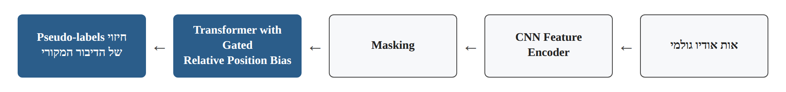
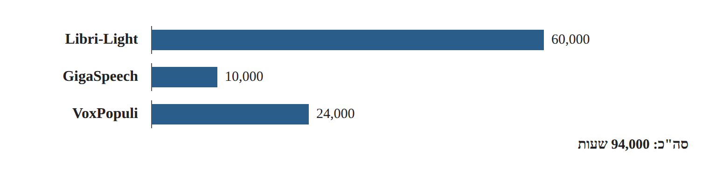
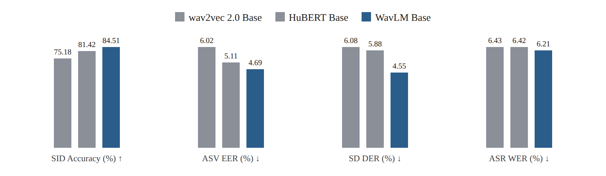

# Research Card 05 — WavLM

## WavLM: Large-Scale Self-Supervised Pre-Training for Full Stack Speech Processing

## 1. פרטים ביבליוגרפיים

**שם המאמר:** WavLM: Large-Scale Self-Supervised Pre-Training for Full Stack Speech Processing.

**מחברים:** Sanyuan Chen, Chengyi Wang, Zhengyang Chen, Yu Wu, Shujie Liu, Zhuo Chen, Jinyu Li, Naoyuki Kanda, Takuya Yoshioka, Xiong Xiao, Jian Wu, Long Zhou, Shuo Ren, Yanmin Qian, Yao Qian, Jian Wu, Michael Zeng, Xiangzhan Yu, Furu Wei.

**גוף מחקרי מרכזי:** Microsoft.

**שנת המאמר:** 2022.

**גרסת המקור שנקראה:** arXiv:2110.13900v5, מ-17 ביוני 2022.

**קישור למאמר:** https://arxiv.org/abs/2110.13900

**קוד ומודלים:** https://aka.ms/wavlm

**תחומי מחקר:** Self-Supervised Speech Representation Learning, Universal Speech Representations, Speaker-Related Tasks, Speech Denoising, Transformer Models, Transfer Learning.

**מילות מפתח:** WavLM, HuBERT, wav2vec 2.0, Masked Speech Prediction, Denoising, Gated Relative Position Bias, SUPERB, Speaker Verification, Speaker Diarization, Speech Separation, Weighted Layer Sum.

**רלוונטיות לפרויקט:** גבוהה. WavLM מציג מודל SSL המיועד ללמידת ייצוגים שימושיים למגוון משימות דיבור, ולא רק ל-ASR. הוא מהווה מועמד להשוואה מול wav2vec 2.0 ומספק בסיס מחקרי לבחינת שימוש בשכבות שונות של מודל מאומן מראש, Frozen Encoder ו-Fine-Tuning לצורך זיהוי זיופים קוליים.

---

## 2. תקציר מקיף של המאמר

המאמר מציג את WavLM, מודל מאומן מראש המבוסס על Self-Supervised Learning, שנועד ללמוד ייצוגי דיבור כלליים המתאימים למגוון רחב של משימות עיבוד דיבור.

החוקרים מציינים שעבודות SSL קודמות הציגו הישגים משמעותיים במשימות Speech Recognition, אך הצלחתן במשימות אחרות, כגון אימות דובר, הפרדת דיבור וזיהוי דוברים לאורך הקלטה, הייתה מוגבלת יותר.

הבעיה נובעת מכך שאות דיבור מכיל מספר סוגי מידע בו-זמנית: תוכן לשוני, זהות הדובר, מאפיינים פארה-לשוניים ומידע על תנאי ההקלטה. משימות שונות עשויות לדרוש מידע שונה, ולעיתים אף מתנגשות מבחינת סוג המידע שכדאי לשמר.

WavLM מציע הרחבה של מסגרת ה-Masked Speech Prediction של HuBERT באמצעות שלושה שינויים מרכזיים:

1. שילוב Masked Speech Denoising and Prediction, שבו המודל לומד לחזות מטרות של דיבור מקורי מתוך הקלטות שאליהן נוספו רעש או דיבור חופף.
2. שימוש ב-Gated Relative Position Bias במנגנון ה-Self-Attention של ה-Transformer.
3. הרחבת מאגר ה-Pre-training ל-94,000 שעות אודיו ממקורות מגוונים.

החוקרים פיתחו שלוש תצורות: WavLM Base, WavLM Base+ ו-WavLM Large.

ההערכה התבצעה באמצעות מסגרת SUPERB, הכוללת 15 משימות, ובאמצעות ארבע משימות נוספות על מאגרי הערכה ייעודיים: Speaker Verification, Speaker Diarization, Speech Separation ו-Speech Recognition.

התוצאות הראו כי WavLM משפר ביצועים במגוון משימות בהשוואה למודלי SSL קודמים. לדוגמה, WavLM Base השיג DER של 4.55% במשימת Speaker Diarization ב-SUPERB, לעומת 5.88% ב-HuBERT Base ו-6.08% ב-wav2vec 2.0 Base.

ניסויי Ablation הראו ש-Denoising תורם במיוחד לחלק מהמשימות הקשורות לדוברים, בעוד ש-Gated Relative Position Bias תורם במיוחד למשימות הקשורות לתוכן הדיבור.

החוקרים גם בחנו את התרומה של שכבות שונות ב-Transformer וגילו שמשימות שונות נעזרות בייצוגים משכבות שונות.

**המסקנה המרכזית:** למידת ייצוגי דיבור כלליים דורשת התייחסות לסוגי מידע נוספים מעבר לתוכן הלשוני. WavLM מדגים שיפור במגוון משימות באמצעות שילוב של אימון על דיבור משובש, שינויים בארכיטקטורה ונתוני Pre-training רחבים ומגוונים יותר.

**מקור:** Abstract, Sections I, IV–VI.

---

## 3. בעיית המחקר והמוטיבציה

### 3.1 הבעיה המרכזית

מודלים מאומנים מראש לדיבור פותחו במידה רבה סביב משימות Speech Recognition.

אולם אות הדיבור מכיל מידע רב מעבר למילים שנאמרו.

לדוגמה:

- Spoken Content — תוכן הדיבור.
- Speaker Identity — זהות הדובר.
- Paralinguistic Information — מידע כגון מאפייני רגש ואופן הדיבור.
- Multi-Speaker Information — זהויות של מספר דוברים וחפיפה ביניהם.

מודל המתאים למשימה אחת אינו בהכרח מתאים באותה מידה למשימות אחרות.

### 3.2 דרישות מנוגדות בין משימות

ב-Speech Recognition המודל צריך להתמקד בתוכן הלשוני גם כאשר אנשים שונים אומרים את אותן המילים.

ב-Speaker Verification המודל צריך להתמקד במאפייני הדובר גם כאשר הוא אומר מילים שונות.

ב-Speaker Diarization וב-Speech Separation נדרשת גם התמודדות עם מספר דוברים ועם חפיפה ביניהם.

### 3.3 מגבלות גישות קודמות

החוקרים מציינים שתי מגבלות מרכזיות:

**א. התאמה מוגבלת למשימות שאינן ASR**

שיטות SSL קודמות לא עודדו במידה מספקת למידת מידע הדרוש להבחנה בין דוברים ולהפרדת דיבור חופף.

**ב. תלות במאגרים של ספרים מוקלטים**

אימון המתבסס בעיקר על Audiobooks עלול להגביל את ההתאמה לתנאים אקוסטיים אחרים, כגון שיחות ספונטניות והקלטות עם רעשי רקע.

### 3.4 מטרת המחקר

לפתח מודל מאומן מראש המסוגל לספק ייצוגי דיבור שימושיים למגוון רחב של משימות, תוך שיפור העמידות להפרעות, לימוד מידע הקשור לדובר והרחבת מגוון מקורות הנתונים.

### 3.5 שאלת המחקר המשתמעת

האם שילוב של Masked Speech Denoising, שיפור המידול של מיקום יחסי והרחבת נתוני ה-Pre-training מאפשר ללמוד ייצוגי דיבור שימושיים יותר למגוון משימות בהשוואה לשיטות SSL קודמות?

**מקור:** Section I, עמודים 1–2.

---

## 4. הקשר למודלים קודמים

### 4.1 wav2vec 2.0

wav2vec 2.0 הציג מסגרת SSL המשלבת:

- CNN Feature Encoder.
- Transformer.
- Masking במרחב הלטנטי.
- Contrastive Learning.
- Quantized Targets.

המחקר המקורי התמקד בעיקר בשיפור Speech Recognition, במיוחד כאשר כמות הנתונים המתויגים מוגבלת.

### 4.2 HuBERT

HuBERT משתמש ב-Masked Speech Prediction ובמטרות בדידות שנוצרות באמצעות Clustering.

התהליך כולל יצירת Pseudo-labels מנתונים אקוסטיים, ולאחר מכן אימון המודל לחזות אותם באזורים מוסתרים.

המאמר מתאר גם אימון איטרטיבי: באיטרציה הראשונה נוצרים קודים מתוך MFCC, ובאיטרציות מאוחרות יותר ניתן ליצור קודים מתוך ייצוגים לטנטיים שנלמדו.

### 4.3 מה WavLM מוסיף?

WavLM מרחיב בעיקר את מסגרת HuBERT, ולא רק את wav2vec 2.0.

התרומה היא שילוב חיזוי מקטעים מוסתרים עם למידה מתוך אודיו משובש באמצעות רעש או דיבור חופף, לצד שיפורים במנגנון ה-Attention והרחבת הנתונים.

### 4.4 הבחנה בין פונקציות האובדן

ב-wav2vec 2.0 משימת האימון המרכזית מבוססת על Contrastive Loss עם דוגמאות שליליות.

ב-WavLM משימת האימון מבוססת על חיזוי Pseudo-labels בדידים באזורים מוסתרים, בהתאם לגישת HuBERT.

לכן אין לתאר את WavLM פשוט כ-wav2vec 2.0 בתוספת Denoising.

**מקור:** Sections II–III.

---

## 5. התרומות המרכזיות של המאמר

**1. Masked Speech Denoising and Prediction**

שילוב דיבור משובש ברעש או דיבור חופף במסגרת משימת Masked Prediction.

**2. למידה של מידע הקשור לדוברים**

האימון על דיבור חופף נועד לעודד את המודל להתמודד עם מאפיינים של דוברים שונים ועם הפרעות.

**3. Gated Relative Position Bias**

שינוי מנגנון ה-Attention כך שהטיית המיקום היחסי מותאמת גם לתוכן.

**4. מאגר Pre-training גדול ומגוון**

הרחבת האימון ל-94,000 שעות ממספר מקורות.

**5. הערכה רחבה באמצעות SUPERB**

בחינת איכות הייצוגים ב-15 משימות שונות.

**6. ניסויי הערכה ייעודיים**

בדיקת המודל במשימות Speaker Verification, Diarization, Separation ו-ASR על מאגרים ייעודיים.

**7. ניתוח שכבות המודל**

בחינת תרומת ייצוגים משכבות שונות עבור משימות שונות.

**8. ניסויי Ablation**

בדיקת תרומת ה-Denoising והשינוי הארכיטקטוני.

**מקור:** Sections I, IV–V.

---

## 6. ארכיטקטורת WavLM

### 6.1 מבנה כללי

WavLM כולל:

1. Convolutional Feature Encoder.
2. Transformer Encoder.
3. Gated Relative Position Bias.
4. Masked Speech Prediction Head במהלך ה-Pre-training.

המבנה הכללי:

Raw Audio

→ CNN Feature Encoder

→ Masking

→ Transformer with Gated Relative Position Bias

→ Prediction of Original Speech Pseudo-labels.

*איור 1. המחשה למבנה הכללי המתואר בסעיף 6.1.*

### 6.2 CNN Feature Encoder

ה-Encoder כולל שבע שכבות קונבולוציה זמניות.

כל שכבה מכילה:

- Temporal Convolution.
- Layer Normalization.
- GELU Activation.

הקונבולוציות מפיקות ייצוגים בקצב של צעד אחד בערך כל 20ms, עם Receptive Field של כ-25ms.

### 6.3 Transformer Encoder

ה-Transformer לומד ייצוגים הקשריים מתוך רצף מאפייני האודיו.

הוא משתמש במנגנון Self-Attention המאפשר לכל מקטע להתייחס למקטעים אחרים ברצף.

### 6.4 Masking

מקטעים מתוך ייצוגי ה-CNN מוסתרים לפני הכניסה ל-Transformer.

המודל נדרש לחזות את ה-Pseudo-labels של הדיבור המקורי במקומות שהוסתרו.

### 6.5 מטרות אימון

מטרות האימון אינן תמלולים אנושיים.

הן Pseudo-labels שנוצרים באמצעות Clustering, בהתאם לגישת HuBERT.

### 6.6 מה המודל לומד?

המודל לומד ייצוגים שמאפשרים לזהות מידע על הדיבור המקורי מתוך הקשר, גם כאשר חלק מהקלט משובש באמצעות רעש או דובר נוסף.

המטרה היא לשמר מידע שימושי למגוון משימות דיבור.

**מקור:** Section IV-A, Figure 1, עמוד 3.

---

## 7. החידוש הראשון — Masked Speech Denoising and Prediction

### 7.1 הרעיון

החוקרים יוצרים גרסאות משובשות של חלק מהקלטות האימון.

השיבוש נעשה באמצעות:

- הוספת רעשי רקע.
- ערבוב דיבור של דובר נוסף.
- יצירת אזורי חפיפה חלקיים בין מקורות האודיו.

למרות השיבוש, מטרות האימון נגזרות מהדיבור המקורי.

### 7.2 תהליך האימון

1. בחירת הקלטת דיבור מקורית.
2. בחלק מהמקרים, הוספת רעש או דובר נוסף למקטע מתוך ההקלטה.
3. חילוץ מאפיינים באמצעות CNN.
4. Masking של חלק מהמקטעים.
5. עיבוד באמצעות Transformer.
6. חיזוי ה-Pseudo-labels של הדיבור המקורי במקטעים המוסתרים.

### 7.3 למה לשלב דובר נוסף?

החוקרים מבקשים לעודד את המודל ללמוד להתמודד עם דיבור חופף.

המודל נדרש להתמקד בדיבור המקורי גם כאשר האות מכיל מידע מדובר אחר.

החוקרים מציעים שהתהליך עשוי לשפר יכולות רלוונטיות ל-Speaker Diarization ול-Speech Separation.

### 7.4 פרטי ערבוב

בתהליך המתואר:

- ההקלטה הראשית מוגדרת כ-Primary Utterance.
- רעש או הקלטת דובר נוסף נבחרים כמקור משני.
- אזור הערבוב נבחר באקראי.
- אורך אזור החפיפה מוגבל לפחות ממחצית ההקלטה.
- עוצמת המקור המשני מותאמת באמצעות יחס אנרגיות.

במערכת המלאה, מודל WavLM Base+ ו-WavLM Large משתמשים בהוספת רעשי רקע בחלק מהמקרים ובדיבור חופף במקרים אחרים.

### 7.5 הבחנה חשובה

WavLM אינו מאומן בהכרח לשחזר ישירות את גל הקול הנקי.

המטרה היא לחזות Pseudo-labels של הדיבור המקורי במיקומים מוסתרים.

### 7.6 משמעות מחקרית

האימון מעודד את המודל ללמוד ייצוגים שימושיים גם בתנאי הפרעה וחפיפה.

עם זאת, המאמר אינו מוכיח שהשיטה משמרת ארטיפקטים של זיופים קוליים.

**מקור:** Section IV-B, Algorithm 1, עמודים 4–5.

---

## 8. החידוש השני — Gated Relative Position Bias

### 8.1 הבעיה

מנגנון Self-Attention נדרש להביא בחשבון לא רק את תוכן מקטעי הדיבור אלא גם את מיקומם היחסי.

בדיבור, שני מקטעים המצויים באותו מרחק זמני עשויים להציג קשר שונה בהתאם לתוכנם.

למשל, הקשר בין שני מקטעי דיבור שונה מהקשר בין מקטע דיבור לבין מקטע שקט.

### 8.2 הפתרון

החוקרים מוסיפים Gated Relative Position Bias למנגנון ה-Attention.

המנגנון משתמש בשערים נלמדים שמאפשרים להתאים את השפעת המיקום היחסי בהתאם לתוכן הייצוגים.

### 8.3 ההבדל מ-wav2vec 2.0

ב-wav2vec 2.0 נעשה שימוש ב-Convolutional Relative Positional Embedding.

WavLM מוסיף מנגנון שמאפשר להתאים את הטיית המיקום היחסי לתוכן באופן דינמי יותר.

### 8.4 המשמעות

המודל יכול ללמוד השפעות שונות של מרחק זמני בהתאם למאפייני הדיבור.

### 8.5 עדות ניסויית

בניסויי Ablation, הסרת השינוי הארכיטקטוני הגדילה את ה-WER במשימת ASR ב-SUPERB מ-6.21% ל-6.80%.

עם זאת, ההשפעה אינה אחידה בכל המשימות והמדדים.

**מקור:** Section IV-A, Table I.

---

## 9. החידוש השלישי — הרחבת נתוני ה-Pre-training

### 9.1 הבעיה בגישות קודמות

מודלים קודמים אומנו בעיקר על ספרים מוקלטים.

ספרים מוקלטים עשויים להציג תנאים אקוסטיים ודפוסי דיבור שונים מהקלטות בעולם האמיתי.

### 9.2 מאגר Mix-94k

| מקור | שעות |
|---|---:|
| Libri-Light | 60,000 |
| GigaSpeech | 10,000 |
| VoxPopuli | 24,000 |
| **סה"כ** | **94,000** |

*איור 2. המחשה לנתוני מאגר ה-Pre-training בסעיף 9.2.*

### 9.3 מגוון המקורות

המאגר כולל:

- ספרים מוקלטים.
- פודקאסטים.
- הקלטות שמקורן ב-YouTube.
- הקלטות מהפרלמנט האירופי.
- דיבור מוקלט בסגנונות ובתנאים שונים.

הניסויים המתוארים משתמשים בנתוני דיבור באנגלית.

### 9.4 מטרה

לצמצם את התלות בתנאים האקוסטיים של Audiobooks ולספק ייצוגים שימושיים יותר למשימות שונות.

### 9.5 מגבלת הפרשנות

WavLM Base+ שונה מ-WavLM Base בכמות נתוני ה-Pre-training, בגיוון שלהם ובפרטי האימון.

לכן, כאשר Base+ מציג שיפור, לא ניתן לייחס את כל השיפור לגיוון הנתונים בלבד.

**מקור:** Section IV-C.

---

## 10. תצורות המודל ופרטי מימוש

| מאפיין | WavLM Base | WavLM Base+ | WavLM Large |
|---|---:|---:|---:|
| פרמטרים | 94.70M | 94.70M | 316.62M |
| שכבות Transformer | 12 | 12 | 24 |
| Hidden Dimension | 768 | 768 | 1,024 |
| Attention Heads | 8 | 8 | 12 |
| נתוני Pre-training | 960h | 94,000h | 94,000h |
| CNN Encoder | 7 שכבות | 7 שכבות | 7 שכבות |

### פרטי אימון משמעותיים

- האימון משתמש ב-Pseudo-labels שמקורם במודלי HuBERT וב-Clustering.
- WavLM Base משתמש במאגר אימון קטן יותר.
- Base+ ו-Large משתמשים במאגר Mix-94k.
- בחלק מדוגמאות האימון מופעלת סימולציה של דיבור רועש או חופף.
- המאמר מתאר גם התאמות לשיפור יציבות האימון תחת דיוק מספרי מופחת.

### משאבי חישוב

המאמר מתאר שימוש ב-32 מעבדי V100 לאימון Base וב-64 מעבדי V100 לאימון Large.

עובדה זו מדגישה שה-Pre-training המקורי דורש משאבים משמעותיים.

לכן, עבור הפרויקט שלנו, שימוש במודל שכבר אומן מראש הוא אפשרות מעשית יותר מאשר שחזור מלא של ה-Pre-training.

**מקור:** Section V-A, Appendix A, Table VII.

---

## 11. מסגרת ההערכה — SUPERB

### 11.1 מהי SUPERB?

SUPERB היא מסגרת הערכה למודלי Speech Representation Learning.

מטרתה לבדוק עד כמה ייצוגים שנלמדו מראש שימושיים למגוון משימות דיבור.

### 11.2 סוגי המשימות

המאמר כולל 15 משימות SUPERB, המכסות היבטים כגון:

- תוכן הדיבור.
- זהות הדובר.
- משמעות וסמנטיקה.
- מאפיינים פארה-לשוניים.
- עיבוד ויצירה של דיבור.

### 11.3 אופן ההערכה

בהערכת SUPERB, ה-Pretrained Encoder נשאר קפוא.

המערכות משתמשות בשילוב משוקלל של ייצוגים משכבות שונות.

לאחר מכן מאמנים רכיב Downstream המותאם למשימה.

כך ניתן לבחון את איכות הייצוגים בלי לבצע Fine-Tuning מלא של המודל המאומן מראש.

### 11.4 מדדי הערכה

המדדים משתנים בהתאם למשימה.

לדוגמה:

- Accuracy עבור זיהוי דובר.
- EER עבור Speaker Verification.
- DER עבור Speaker Diarization.
- WER עבור Speech Recognition.
- PER עבור Phoneme Recognition.

**הערה קריטית:** EER של Speaker Verification אינו EER של Deepfake Detection.

**מקור:** Section V-B, Table I.

---

## 12. תוצאות SUPERB

### 12.1 השוואת Base בתנאי Pre-training דומים

| מודל | SID Accuracy ↑ | ASV EER ↓ | SD DER ↓ | ASR WER ↓ |
|---|---:|---:|---:|---:|
| wav2vec 2.0 Base | 75.18% | 6.02% | 6.08% | 6.43% |
| HuBERT Base | 81.42% | 5.11% | 5.88% | 6.42% |
| WavLM Base | **84.51%** | **4.69%** | **4.55%** | **6.21%** |

*איור 3. המחשה לנתוני הטבלה בסעיף 12.1: ארבעת המדדים עבור wav2vec 2.0 Base, HuBERT Base ו-WavLM Base.*

### 12.2 ניתוח

WavLM Base השיג תוצאות טובות יותר במדדים הנבחרים בהשוואה לשני המודלים הקודמים.

ההשוואה משמעותית משום שלשלושת המודלים מספר פרמטרים דומה והם אומנו על כמות דומה של נתוני Pre-training.

### 12.3 השפעת Base+

WavLM Base+ הציג שיפור נוסף בחלק ניכר מהמשימות לאחר הרחבת נתוני ה-Pre-training.

למשל:

| מודל | SID Accuracy | SD DER | ASR WER |
|---|---:|---:|---:|
| WavLM Base | 84.51% | 4.55% | 6.21% |
| WavLM Base+ | **89.42%** | **3.50%** | **5.59%** |

### 12.4 WavLM Large

WavLM Large השיג Overall Score של 74.6 במסגרת SUPERB, לעומת 72.2 של HuBERT Large ו-70.4 של wav2vec 2.0 Large.

ה-Overall Score מחושב במסגרת המאמר באמצעות שילוב מנורמל של מדדים שונים. אין להתייחס אליו כאל Accuracy או EER של משימה בודדת.

### 12.5 מסקנה

WavLM מציג ייצוגים שימושיים למגוון משימות דיבור, כאשר תוספת הנתונים והגדלת המודל תורמות בחלק מהתנאים לשיפור הביצועים.

עם זאת, טבלת SUPERB אינה כוללת Deepfake Detection.

**מקור:** Table I, Section V-B.

---

## 13. ניסויי Ablation

### 13.1 מטרת הניסויים

החוקרים בוחנים את תרומת שני השינויים המרכזיים ב-WavLM Base:

1. Masked Speech Denoising.
2. השינוי הארכיטקטוני הכולל Gated Relative Position Bias.

### 13.2 תוצאות נבחרות

| תצורה | ASV EER ↓ | SD DER ↓ | ASR WER ↓ |
|---|---:|---:|---:|
| WavLM Base מלא | 4.69% | **4.55%** | 6.21% |
| ללא Denoising | 4.91% | 6.03% | **6.08%** |
| ללא שינוי ארכיטקטוני | **4.61%** | 4.72% | 6.80% |

### 13.3 Denoising

הסרת Denoising הגדילה את שגיאת Speaker Diarization מ-4.55% ל-6.03%.

התוצאה תומכת בתרומתו למשימה זו.

עם זאת, ה-WER במשימת ASR השתפר מעט לאחר הסרתו.

### 13.4 Gated Relative Position Bias

הסרת השינוי הארכיטקטוני הגדילה את ה-WER מ-6.21% ל-6.80%.

התוצאה תומכת בתרומתו למשימות הקשורות לתוכן הדיבור.

עם זאת, במדד ASV EER התקבלה תוצאה מעט טובה יותר ללא השינוי.

### 13.5 מסקנה מה-Ablation

השינויים ב-WavLM תורמים למשימות שונות במידה שונה.

המחקר אינו מראה שכל רכיב משפר את כל המדדים, ולכן לא נכון לתאר את החידושים כמשפרים באופן גורף כל משימת דיבור.

**מקור:** Table I, Section V-B.

---

## 14. תוצאות Speaker Verification

### 14.1 מטרת המשימה

Speaker Verification בוחנת האם שתי הקלטות שייכות לאותו דובר.

זו אינה משימת זיהוי זיופים.

### 14.2 מאגרים

החוקרים השתמשו ב-VoxCeleb1 וב-VoxCeleb2.

### 14.3 מודל Downstream

המערכת מבוססת על ECAPA-TDNN ומשתמשת בייצוגים שהופקו ממודלים מאומנים מראש.

### 14.4 תוצאות Table II

| מערכת | Vox1-O EER | Vox1-E EER | Vox1-H EER |
|---|---:|---:|---:|
| ECAPA-TDNN | 1.010% | 1.240% | 2.320% |
| HuBERT Large | 0.808% | 0.822% | 1.678% |
| WavLM Base+ | 0.840% | 0.928% | 1.758% |
| WavLM Large | **0.617%** | **0.662%** | **1.318%** |
| WavLM Large עם התאמות נוספות | **0.383%** | **0.480%** | **0.986%** |

### 14.5 דיוק בפרשנות

תוצאות השורה האחרונה התקבלו לאחר שימוש באסטרטגיות נוספות של Large Margin Fine-Tuning ו-Quality-Aware Score Calibration.

לכן אין לייחס את כל השיפור ל-WavLM Encoder לבדו.

### 14.6 משמעות לפרויקט

הניסוי מראה ש-WavLM יכול לספק ייצוגים טובים למאפייני דובר.

עם זאת, אין להסיק שביצועים טובים באימות דובר מבטיחים ביצועים טובים בזיהוי זיופים.

**מקור:** Section V-C, Table II.

---

## 15. תוצאות Speaker Diarization

### 15.1 מטרת המשימה

Speaker Diarization נועדה לזהות מי מדבר ומתי, כולל מצבים של חפיפה בין דוברים.

### 15.2 מאגרי ההערכה

החוקרים השתמשו בנתונים מדומים לצורכי אימון וב-CALLHOME לצורכי הערכה והתאמה.

### 15.3 תוצאות Table III

| מערכת | DER כולל |
|---|---:|
| EEND-vector clustering — מימוש החוקרים | 13.31% |
| HuBERT Base + EEND | 12.63% |
| HuBERT Large + EEND | 12.40% |
| WavLM Base+ + EEND | 11.78% |
| WavLM Large + EEND | **10.35%** |

### 15.4 מסקנה

WavLM הציג שיפור במשימת Diarization ביחס למערכות שנכללו בהשוואה.

התוצאה מתיישבת עם מטרת האימון על דיבור חופף.

### 15.5 Frozen Encoder לעומת Fine-Tuning

החוקרים מצאו שבמשימה זו עדכון משקלי ה-Pretrained Model לא שיפר את הביצועים.

הם מציעים שהסיבה האפשרית היא התאמת יתר לנתוני האימון המדומים, בעוד שההערכה התבצעה על הקלטות אמיתיות.

### 15.6 משמעות למחקר שלנו

הממצא מדגיש ש-Fine-Tuning אינו בהכרח עדיף על Frozen Encoder.

במאגר קטן יחסית, יש הצדקה לבחון את שתי הגישות ולא לבחור מראש באחת מהן.

**מקור:** Section V-D, Table III.

---

## 16. תוצאות Speech Separation

### 16.1 מטרת המשימה

Speech Separation נועדה להפריד בין אותות דיבור של מספר דוברים כאשר הם חופפים.

### 16.2 מאגר הערכה

החוקרים השתמשו ב-LibriCSS.

### 16.3 תוצאות Table IV

| מערכת | WER ממוצע לאחר הפרדה |
|---|---:|
| Conformer — מימוש חוזר | 8.3% |
| HuBERT Base | 8.1% |
| WavLM Base+ — Frozen | 7.4% |
| WavLM Base+ — Unfrozen | 8.2% |
| WavLM Large — Frozen | **6.0%** |

### 16.4 ממצא מרכזי

WavLM Large סיפק את התוצאה הטובה ביותר בהשוואה הנבחרת.

בנוסף, שימוש ב-WavLM Base+ עם משקלים קפואים הניב תוצאה טובה יותר מאשר עדכון המשקלים.

### 16.5 הסבר אפשרי

החוקרים מציעים ש-Fine-Tuning על נתוני ערבוב מדומים עלול לגרום להתאמת יתר ולפגוע בביצועים על הקלטות הערכה בתנאים אחרים.

### 16.6 משמעות לפרויקט

התוצאה מחזקת את הצורך לבחון יכולת הכללה ולא להסתמך על ביצועי אימון בלבד.

**מקור:** Section V-E, Table IV.

---

## 17. ניתוח שכבות Transformer

### 17.1 שאלת המחקר

האם שכבות שונות של המודל מכילות מידע שימושי למשימות שונות?

### 17.2 שיטת הבדיקה

החוקרים משתמשים בשילוב משוקלל של ייצוגים משכבות שונות.

משקלים נלמדים מאפשרים למודל ה-Downstream לקבוע את תרומת השכבות.

### 17.3 תוצאות Figure 2

במודלי Base, שכבות מוקדמות תרמו יותר לחלק מהמשימות הקשורות לדוברים.

שכבות גבוהות תרמו יותר למשימות תוכן, כגון ASR ו-Phoneme Recognition.

במודלי Large נצפתה תרומה משמעותית גם של שכבות אמצעיות למשימות דובר.

### 17.4 תוצאות Figure 3

בניתוח Speaker Verification, Diarization ו-Separation, החוקרים מצאו תרומה משמעותית של שכבות מוקדמות או אמצעיות, בהתאם למודל ולמשימה.

### 17.5 מסקנה

אין שכבת ייצוג אחת שהוכחה כאופטימלית לכל משימות הדיבור.

### 17.6 משמעות לפרויקט

כדאי לבחון לפחות שתי אפשרויות:

- שימוש בייצוג מהשכבה האחרונה.
- שילוב משוקלל של ייצוגים ממספר שכבות.

אין להניח מראש איזו אפשרות עדיפה לזיהוי זיופים.

**מקור:** Section V-B, Figures 2–3.

---

## 18. מסקנות החוקרים

החוקרים מסיקים כי WavLM מציג מסגרת SSL אפקטיבית למגוון משימות עיבוד דיבור.

החידושים המרכזיים הם:

- שילוב Masked Speech Prediction עם Denoising.
- שימוש ב-Gated Relative Position Bias.
- הרחבת נתוני ה-Pre-training למקורות מגוונים.
- ניצול ייצוגים משכבות שונות למשימות Downstream.

הניסויים מדגימים ביצועים חזקים באימות דובר, בדיאריזציה, בהפרדת דיבור ובמשימות נוספות.

המאמר מציג את WavLM כמועמד לתשתית כללית למשימות עיבוד דיבור, ולא כמערכת המתמקדת רק בזיהוי מילים.

**מקור:** Section VI.

---

## 19. ניתוח ביקורתי

### 19.1 יתרונות המחקר

**א. הרחבת תחום היישום של SSL**

WavLM נבחן במגוון משימות ולא רק ב-ASR.

**ב. חדשנות בשיטת האימון**

Masked Speech Denoising משלב למידת הקשר עם התמודדות עם רעש ודיבור חופף.

**ג. הערכה רחבה**

המחקר משתמש ב-SUPERB ובמאגרי הערכה ייעודיים.

**ד. ניסויי Ablation**

החוקרים בוחנים את תרומתם של השינויים העיקריים.

**ה. ניתוח שכבות**

המאמר מספק תובנות לגבי התפקידים האפשריים של שכבות שונות במודל.

**ו. בחינת Frozen Encoder מול Fine-Tuning**

חלק מהניסויים מראים שעוד עדכון משקלים אינו מבטיח שיפור.

**ז. זמינות מודלים וקוד**

ניתן להשתמש במודלים המאומנים מראש כבסיס למחקר המשך.

### 19.2 מגבלות המחקר

**א. היעדר ניסויי Deepfake Detection**

המאמר אינו בודק ישירות סיווג בין דיבור אמיתי למזויף.

**ב. אין ראיה ישירה לעמידות בפני TTS, Voice Conversion או Neural Codecs**

משימות אלו אינן שקולות ל-Speaker Verification, Speech Separation או ASR.

**ג. רגישות אפשרית לארטיפקטים**

אימון לעמידות לרעש עשוי לשפר הכללה, אך ייתכן שהוא גם מפחית רגישות למאפיינים עדינים החשובים לזיהוי זיופים.

**ד. שיפור לא אחיד בכל המדדים**

ניסויי Ablation מראים שחלק מהשינויים מועילים למשימות מסוימות ופוגעים מעט במדדים אחרים.

**ה. הפרדת השפעות חלקית בלבד**

הרחבת כמות נתוני האימון, גיוון המקורות ופרטי האימון משתנים יחד בחלק מההשוואות.

**ו. מודלים גדולים ומשאבים רבים**

WavLM Large כולל כ-316.6 מיליון פרמטרים ודורש משאבים משמעותיים.

**ז. התאמת יתר ב-Fine-Tuning**

החוקרים מצאו מצבים שבהם עדכון משקלי המודל פגע בביצועים על נתוני ההערכה.

**ח. תוצאות מערכת ולא Encoder בלבד**

בחלק מהניסויים התוצאות תלויות גם בארכיטקטורת Downstream, ב-Fine-Tuning ובכיול.

**ט. מגבלות הכללה לנתוני הפרויקט**

אין במאמר ניסויים על ASVspoof 5 או CodecFake.

### 19.3 מה לא ניתן להסיק

המאמר אינו מוכיח ש:

- WavLM עדיף על wav2vec 2.0 בזיהוי זיופים.
- WavLM Large ישיג EER נמוך בנתוני הקורס.
- Denoising משפר באופן ישיר את זיהוי הארטיפקטים של זיופים קוליים.
- שילוב שכבות תמיד עדיף על שימוש בשכבה האחרונה.
- Fine-Tuning תמיד מזיק או תמיד מועיל.
- שיפור ב-Speaker Verification מעיד על שיפור ב-Deepfake Detection.
- גיוון נתוני Pre-training הוא לבדו הגורם לכל השיפורים שנצפו.

---

## 20. התובנות שלנו מהמאמר

### 20.1 ייצוגי דיבור שונים מכילים סוגי מידע שונים

המאמר מדגיש שמידע על תוכן הדיבור ומידע על זהות הדובר אינם זהים.

לכן ייתכן שמשימות סיווג שונות יפיקו תועלת משכבות שונות של המודל.

### 20.2 מודל SSL כללי עשוי להיות שימושי מעבר למשימת האימון המקורית

WavLM מציג אפשרות להשתמש במודל מאומן מראש למגוון משימות.

עם זאת, התאמה לזיהוי זיופים עדיין דורשת בדיקה נפרדת.

### 20.3 Robustness עשוי להיות יתרון וגם חיסרון

עמידות לרעש עשויה לסייע בהכללה בין תנאי הקלטה שונים.

אבל אם חלק מהארטיפקטים של הזיוף נראים למודל כמו רעש או הפרעה, ייתכן שהעמידות תפחית את הרגישות אליהם.

זו השערה שלנו ולא ממצא מוכח במאמר.

### 20.4 בחירת שכבה היא החלטה מחקרית

אין סיבה להניח שהשכבה האחרונה תמיד מספקת את הייצוג הטוב ביותר.

יש הצדקה לבחון שילוב ייצוגים ממספר שכבות.

### 20.5 Fine-Tuning אינו תמיד הבחירה הטובה ביותר

בחלק ממשימות WavLM, שימוש ב-Encoder קפוא הניב תוצאות טובות יותר.

לכן יש לבחון את שתי הגישות.

### 20.6 יש להפריד בין מדדים הנושאים אותו שם

EER של Speaker Verification ו-EER של Deepfake Detection הם מדדים המשמשים להערכת משימות שונות.

אין להשוות ביניהם ישירות.

---

## 21. משמעות המאמר לפרויקט שלנו

### 21.1 הקשר למאגר הנתונים

פרויקט הקורס כולל 1,520 הקלטות אודיו:

- 600 מתוך ASVspoof 5.
- 600 מתוך CodecFake.
- 320 מתוך M-AILABS.

המשימה היא סיווג בינארי של דיבור אמיתי לעומת דיבור מזויף.

המאגר קטן יחסית לאימון מודל Deep Learning גדול מאפס.

### 21.2 WavLM כ-Feature Extractor

ניתן להשתמש ב-WavLM מאומן מראש להפקת ייצוגים מהקלטות.

לאחר מכן אפשר לסכם את הייצוגים ברמת ההקלטה ולהוסיף מסווג בינארי.

ארכיטקטורה אפשרית:

Audio

→ Pretrained WavLM

→ Layer Selection or Weighted Layer Sum

→ Temporal Pooling

→ Binary Classifier

→ Fake/Real Score.

זו הצעת יישום שלנו ולא מערכת שנבדקה במאמר.

### 21.3 השוואה ל-wav2vec 2.0

נרצה לבחון האם WavLM מספק יתרון על wav2vec 2.0 כאשר שניהם משמשים כ-Feature Extractors.

חשוב להשתמש באותו פרוטוקול, באותו מסווג ובאותו מדד הערכה.

### 21.4 בחירת שכבות

ניתן לבחון ייצוג מהשכבה האחרונה לעומת שילוב ייצוגים ממספר שכבות.

יש לבדוק אם מידע משכבות מוקדמות או אמצעיות תורם לזיהוי ארטיפקטים.

### 21.5 Frozen Encoder לעומת Fine-Tuning

נרצה לבחון האם עדכון המשקלים משפר את ה-EER או מוביל להתאמת יתר.

בהינתן מאגר הנתונים הקטן יחסית, כדאי להתחיל בניסוי פשוט של Encoder קפוא.

### 21.6 בחינת הכללה

נרצה לבחון האם המודל מזהה דפוסים כלליים של זיוף או מנצל הבדלים בין מקורות הנתונים.

יש להיזהר במיוחד כאשר משתמשים בנתונים ממאגרים שונים, משום שמקור ההקלטה עלול להפוך למשתנה מסביר חלופי.

### 21.7 M-AILABS

הנתונים מ-M-AILABS כוללים דיבור אמיתי בלבד בפרויקט שלנו.

לכן אי אפשר לחשב EER בנפרד על M-AILABS ללא דוגמאות מזויפות מתאימות.

ניתן להשתמש במאגר זה לצורכי אימון או ניתוח התפלגות הציונים של דיבור אמיתי, בהתאם לפרוטוקול ולהפרדת הנתונים.

### 21.8 Score Direction

לצורך ההגשה בקורס, הציון צריך להיות גבוה יותר כאשר המודל מעריך שההקלטה מזויפת.

יש לוודא שהמסווג מפיק ציונים בכיוון המתאים.

---

## 22. השערות מחקר וניסויים אפשריים

### H1 — WavLM לעומת wav2vec 2.0

**השערה:** ייצוגי WavLM עשויים לספק ביצועים טובים יותר לזיהוי זיופים בהשוואה ל-wav2vec 2.0.

**ניסוי:** שימוש בשני מודלים מאומנים מראש כ-Frozen Encoders, עם אותו Classification Head ואותם נתונים.

**מדד:** EER.

**מגבלה:** גם אם WavLM ישיג תוצאות טובות יותר, לא ניתן יהיה לייחס את ההבדל באופן בלעדי ל-Denoising, משום שמודלי המקור שונים גם בהיבטים נוספים.

### H2 — שילוב שכבות לעומת שכבה אחרונה

**השערה:** שילוב ייצוגים ממספר שכבות עשוי לשפר את היכולת לזהות זיופים.

**ניסוי:** השוואת Last Layer מול Weighted Sum של שכבות.

**בקרה:** שימוש באותם נתונים ובאותו מסווג.

**סיכון:** שילוב נלמד מוסיף פרמטרים ועלול לגרום להתאמת יתר.

### H3 — Frozen Encoder לעומת Fine-Tuning

**השערה:** Fine-Tuning עשוי להתאים את הייצוגים טוב יותר לזיהוי זיופים, אך אינו מבטיח שיפור.

**ניסוי:** השוואת WavLM קפוא מול WavLM עם עדכון חלק מהשכבות.

**מדד:** EER, יחד עם יציבות בין Seeds ודרישות חישוב.

### H4 — הכללה בין ASVspoof 5 ל-CodecFake

**השערה:** המודל עשוי להציג ירידה בביצועים כאשר הוא נבחן על שיטות זיוף ממקור שונה ממקור האימון.

**ניסוי:** אימון על מקור נתונים אחד והערכה על מקור אחר, אם הפרוטוקול מאפשר זאת.

**מגבלה:** הפערים עשויים לנבוע גם מהבדלים בדוברים, בתנאי הקלטה ובמקור הנתונים.

### H5 — השפעת רעש על זיהוי זיופים

**השערה:** ייצוגי WavLM עשויים להיות יציבים יותר תחת הפרעות אקוסטיות מסוימות, אך ייתכן שייפגעו בזיהוי ארטיפקטים עדינים.

**ניסוי:** הערכת המודל על גרסאות נקיות ומשובשות של אותן הקלטות, תוך שמירת תוויות המקור.

**מטרה:** לבדוק Robustness מול רגישות לארטיפקטים.

### H6 — השוואת עלות חישובית

**השערה:** WavLM Base+ עשוי לספק יחס ביצועים–מורכבות מתאים יותר מ-WavLM Large במסגרת משאבי הקורס.

**ניסוי:** השוואת EER, זמן חילוץ מאפיינים, זמן אימון, שימוש בזיכרון ומספר פרמטרים.

---

## 23. סדר עדיפות לניסויים בפרויקט

**עדיפות גבוהה**

1. Frozen wav2vec 2.0 מול Frozen WavLM.
2. Last Layer מול Weighted Layer Sum.
3. הערכת EER והכללה לפי מקור נתונים.

**עדיפות בינונית**

4. Frozen Encoder מול Fine-Tuning חלקי.
5. WavLM Base+ מול WavLM Large, בכפוף למשאבי החישוב.

**עדיפות נמוכה יותר בשלב הראשוני**

6. ניסויי Robustness תחת סוגי רעש שונים.
7. ניתוח מפורט של שכבות ה-Transformer.
8. שינוי ארכיטקטורת WavLM או שחזור Pre-training.

הסדר נועד לשמור על ניסויים בעלי ערך מחקרי גבוה ביחס לזמן ולמשאבים.

---

## 24. שאלות פתוחות להמשך

1. האם WavLM אכן מפיק ייצוגים יעילים יותר לזיהוי זיופים מאשר wav2vec 2.0?
2. האם שכבות מוקדמות או אמצעיות מכילות מידע רלוונטי יותר לארטיפקטים?
3. האם Weighted Layer Sum משפר EER באופן עקבי?
4. האם Fine-Tuning גורם להתאמת יתר במאגר הקורס?
5. האם WavLM מתאים במיוחד לזיופים מבוססי Voice Conversion?
6. האם המודל עמיד לזיופים מבוססי Neural Audio Codecs?
7. האם אימון ל-Denoising מפחית את הרגישות לחלק מהסימנים המעידים על זיוף?
8. האם השוואת מודלים תשתנה כאשר עוברים בין ASVspoof 5 ל-CodecFake?
9. האם ניתן לבנות מסווג פשוט ויציב באמצעות WavLM קפוא?
10. האם היתרונות האפשריים של WavLM מצדיקים את עלותו החישובית ביחס ל-CQCC או ל-AASIST?

---

## 25. מסקנה מסכמת

WavLM מציג הרחבה משמעותית של גישות Self-Supervised Speech Representation Learning, באמצעות אימון המיועד ללמידת מגוון רחב של מאפייני דיבור ולא רק תוכן לשוני.

המאמר משלב Masked Speech Denoising and Prediction, מנגנון Gated Relative Position Bias והרחבת נתוני האימון למקורות מגוונים.

ניסויי SUPERB וההערכות הייעודיות מראים שיפור במגוון משימות, במיוחד במשימות הקשורות לדוברים ולדיבור חופף.

ניתוח השכבות מצביע על כך שמידע שימושי למשימות שונות מופיע ברמות שונות של ה-Transformer, וניסויי Downstream מסוימים מראים שהקפאת מודל מאומן מראש עשויה להיות עדיפה על Fine-Tuning.

עם זאת, המאמר אינו מספק הוכחה ישירה להתאמת WavLM לזיהוי זיופים קוליים.

מבחינת הפרויקט שלנו, התרומה המרכזית היא מתן בסיס להשוואת ייצוגי SSL מאומנים מראש, לבחירת שכבות ולבחינת אסטרטגיות התאמה למשימת Fake/Real.

**העיקרון המחקרי שנאמץ:** נבחן לא רק איזה מודל מפיק את התוצאה הטובה ביותר, אלא גם אילו ייצוגים אנו משתמשים בהם, האם יש צורך בעדכון משקליהם, והאם הביצועים נשמרים כאשר מקור הנתונים או טכנולוגיית הזיוף משתנים.

---

## 26. מפת הפניות למאמר

| נושא | מיקום |
|---|---|
| בעיית המחקר והמוטיבציה | Section I, עמ' 1–2 |
| מחקר קודם והקשר ל-wav2vec 2.0 | Section II, עמ' 2–3 |
| רקע HuBERT | Section III, עמ' 3 |
| תרשים ארכיטקטורה | Figure 1, עמ' 3 |
| מבנה CNN ו-Transformer | Section IV-A, עמ' 3 |
| Gated Relative Position Bias | Section IV-A, עמ' 3–4 |
| Masked Speech Denoising | Section IV-B, עמ' 4–5 |
| סימולציית רעש ודיבור חופף | Algorithm 1, עמ' 4 |
| הרחבת נתוני Pre-training | Section IV-C, עמ' 5 |
| פרטי Pre-training | Section V-A, עמ' 5 |
| הערכת SUPERB | Section V-B, Table I, עמ' 6 |
| ניסויי Ablation | Table I, עמ' 6 |
| ניתוח שכבות | Figure 2, עמ' 7 |
| Speaker Verification | Section V-C, Table II, עמ' 7–8 |
| Speaker Diarization | Section V-D, Table III, עמ' 8–9 |
| Speech Separation | Section V-E, Table IV, עמ' 9 |
| ניתוח שכבות במשימות דובר | Figure 3, עמ' 10 |
| Speech Recognition | Section V-F, Tables V–VI, עמ' 10–11 |
| מסקנות החוקרים | Section VI, עמ' 11 |
| פרמטרי אימון | Appendix A, Tables VII–X, עמ' 11–12 |

**הערת שימוש:** כל תוצאות EER המופיעות במאמר WavLM בהקשר של VoxCeleb או SUPERB ASV מתייחסות לאימות זהות דובר. אין לפרש אותן כתוצאות של זיהוי זיופים קוליים או להשוות אותן ישירות ל-EER של ASVspoof.
