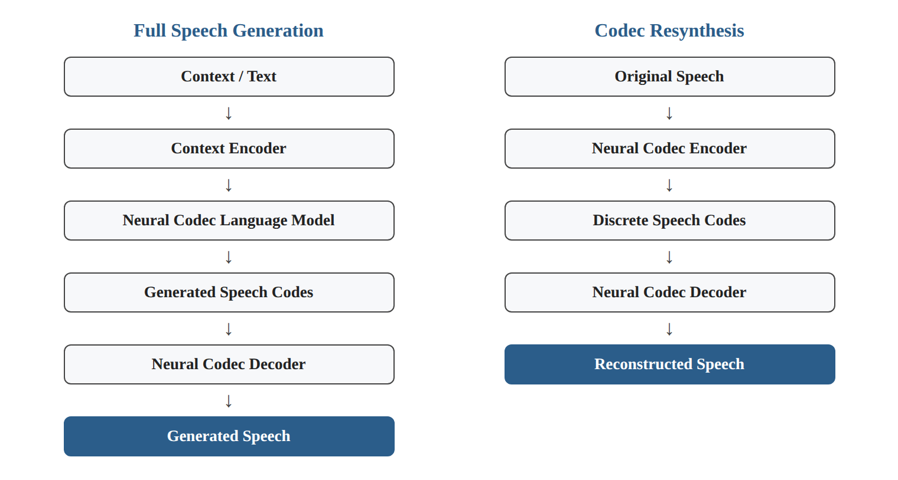
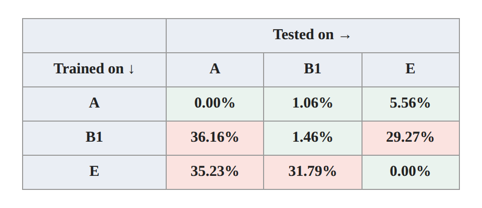
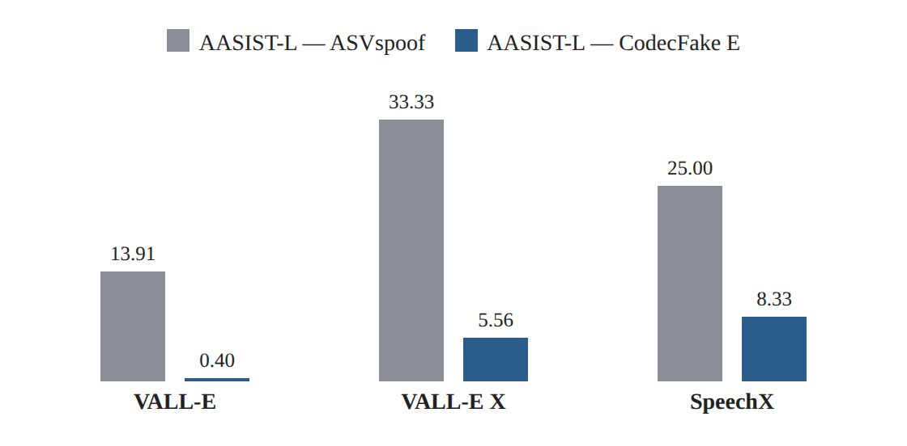

# Research Card 06 — CodecFake

## CodecFake: Enhancing Anti-Spoofing Models Against Deepfake Audios from Codec-Based Speech Synthesis Systems

## 1. Bibliographic Details

**Paper title:** CodecFake: Enhancing Anti-Spoofing Models Against Deepfake Audios from Codec-Based Speech Synthesis Systems.

**Authors:** Haibin Wu, Yuan Tseng, Hung-yi Lee.

**Research body:** Speech Processing and Machine Learning Laboratory, National Taiwan University.

**Year of publication:** 2024.

**Source version read:** arXiv:2406.07237v1, dated June 11, 2024.

**Link to the paper:** https://arxiv.org/abs/2406.07237

**Project and data site:** https://codecfake.github.io

**Research fields:** Audio Deepfake Detection, Speech Anti-Spoofing, Neural Audio Codecs, Codec-Based Speech Synthesis, Cross-Attack Generalization.

**Keywords:** CodecFake, Neural Audio Codec, Codec Resynthesis, AASIST-L, VCTK, ASVspoof 2019, VALL-E, EnCodec, SpeechTokenizer, EER, Cross-Testing, Generalization.

**Relevance to the project:** Very high. The paper deals directly with voice forgery detection, presents a dataset that serves as one of the data sources in the project, and demonstrates the importance of generalization between attacks based on different Codec mechanisms.

---

## 2. Comprehensive Summary of the Paper

The paper examines whether advanced models for detecting voice forgeries, trained on existing Anti-Spoofing datasets, are able to detect speech created by means of synthesis systems based on Neural Audio Codecs.

The researchers note that Codec-Based Speech Synthesis technologies have advanced significantly and make it possible to create high-quality synthetic speech, including voice imitation using short examples of the target speaker.

However, forgery detection models have been developed and evaluated largely on data representing previous synthesis technologies, and therefore their ability to cope with Codec-Based attacks is not guaranteed.

In order to investigate the problem, the researchers created CodecFake, a dataset including audio examples reconstructed by means of 15 Neural Audio Codec models from six different families.

The dataset is based on original recordings from VCTK. For each Codec model, a subset was created by encoding real speech recordings into discrete representations and reconstructing them by means of the corresponding Decoder.

The researchers used AASIST-L as the main Anti-Spoofing architecture.

Each model was trained on fake examples from one Codec subset, together with the real source recordings, and tested on other subsets.

In addition, a comparison was made with models trained on ASVspoof 2019 Logical Access.

Cross-Testing experiments showed that models trained on ASVspoof 2019 showed a high EER on a large portion of the new subsets, usually above 30%.

In contrast, training on CodecFake provided a significant improvement in detecting forgeries from certain sources. For example, an AASIST-L model trained on CodecFake Subset E achieved an EER of 0.40% on examples created by means of VALL-E, compared with 13.91% for an AASIST-L model trained on ASVspoof 2019.

However, the success is not uniform. Certain subsets provided better generalization than others, and many models struggled to detect examples created by means of Codecs that were not included in training.

**The central conclusion:** Codec Resynthesis data may significantly improve the ability to detect Codec-Based attacks, but generalization between different Codec types remains a significant challenge.

**Source:** Abstract, Sections 1–5.

---

## 3. The Research Problem and Motivation

### 3.1 The Central Problem

Modern Speech Synthesis systems are able to create realistic synthetic speech by means of discrete audio representations.

These systems may enable voice impersonation even when the system is given only a short example of the target speaker.

This advancement creates a need for forgery detection models that know how to cope with new generation technologies.

### 3.2 The Limitation of Existing Anti-Spoofing Datasets

Early ASVspoof datasets contain attacks created by means of synthesis and voice-conversion methods that were available at the time they were built.

A model that succeeds in detecting such attacks has not necessarily learned features that make it possible to detect forgeries based on Neural Audio Codecs.

### 3.3 Research Gap

The researchers seek to examine whether progress in Anti-Spoofing systems also transfers to Codec-Based attacks, and to what extent new training data can help.

### 3.4 The Goal of the Study

To build a forgery dataset based on Neural Audio Codecs, to use it to evaluate the performance of Anti-Spoofing models, and to examine whether training on this data improves the detection of Codec-Based attacks.

### 3.5 The Implied Research Question

Are Anti-Spoofing models trained on ASVspoof 2019 able to detect forgeries originating from Neural Audio Codecs, and does training on Codec Resynthesis examples improve the ability to detect and generalize to Codec-based synthesis systems?

**Source:** Section 1.

---

## 4. Background — Neural Audio Codecs

### 4.1 What Is a Neural Audio Codec?

A Neural Audio Codec is a model that makes it possible to represent audio in encoded form, usually by means of sequences of discrete codes.

A typical system includes:

- An Encoder that converts audio into a representation.
- A Quantization mechanism that produces discrete codes.
- A Decoder that reconstructs audio from the codes.

### 4.2 Why Are Codecs Used?

The original purpose of Neural Audio Codecs is related to audio compression and reconstruction.

With the development of Speech Generation systems, the discrete representations also became useful for models that generate speech sequences.

### 4.3 Codec-Based Speech Synthesis

In these systems, information such as text, instructions or vocal context is converted into representations that enable a language model to generate a sequence of Speech Codes.

The generated sequence is passed to a Codec Decoder, which produces the final speech signal.

### 4.4 The Security Risk

Such systems may enable the creation of new speech that sounds like a particular speaker.

When this ability is exploited without authorization, it may be used for impersonation and fraud.

### 4.5 Significance for Forgery Detection

The generation process may leave acoustic features related to the encoding, Quantization and decoding.

The paper examines whether examples that underwent this process can be exploited for training detection systems.

**Source:** Section 1, Section 2.1, Figure 1.

---

## 5. The Central Distinction — Generation versus Resynthesis

### 5.1 Full Speech Generation

A full Codec-Based Speech Synthesis system may carry out:

Context / Text

→ Context Encoder

→ Neural Codec Language Model

→ Generated Speech Codes

→ Neural Codec Decoder

→ Generated Speech.

In this case the system creates a new sequence of codes.

### 5.2 Codec Resynthesis

In Codec Resynthesis the process differs:

Original Speech

→ Neural Codec Encoder

→ Discrete Speech Codes

→ Neural Codec Decoder

→ Reconstructed Speech.

Here the original content of the recording serves as the basis for the reconstruction.

*Figure 1. Illustration of the two processes described in Sections 5.1–5.2.*

### 5.3 Why Did the Researchers Choose Resynthesis?

Different Generation systems use different language models and generation mechanisms.

The researchers wanted to focus on a component common to many Codec-Based systems: the encoding and decoding process.

By means of Resynthesis it is possible to produce examples from a large number of Codecs without relying on the full availability of different synthesis systems.

### 5.4 The Methodological Advantage

The method reduces some of the differences related to the content of the speech and to the sequence-generation mechanism.

When the original and reconstructed recording are based on the same speech, one can focus on the effect of the Codec process.

### 5.5 The Methodological Limitation

Resynthesis is not identical to generating new speech by means of a Codec Language Model system.

Therefore success in detecting reconstructed audio does not guarantee success in detecting every full Generation system.

This is the reason the researchers also carried out evaluation experiments on VALL-E, VALL-E X and SpeechX.

**Source:** Section 2.1, Figure 1.

---

## 6. The Main Contributions of the Paper

**1. Presenting CodecFake**

Building a dedicated dataset for detecting speech that underwent Resynthesis by means of Neural Audio Codecs.

**2. Coverage of several Codec families**

Collecting six Frameworks and 15 pre-trained models.

**3. A controlled data-creation process**

Using original VCTK recordings in order to create reconstructed versions.

**4. A separate split by speakers**

Separating speakers between Training, Validation and Testing.

**5. Cross-Testing between Codecs**

Testing the generalization ability between different encoding and decoding types.

**6. Comparison to ASVspoof 2019**

Evaluating the limitations of Anti-Spoofing models trained on a previous dataset.

**7. Evaluation on full Generation systems**

Testing on VALL-E, VALL-E X and SpeechX.

**8. Demonstrating the contribution of Codec data**

Presenting a significant improvement in detecting forgeries from certain systems following training on CodecFake.

**Source:** Sections 1–4.

---

## 7. The Codec Families Included in the Dataset

| Family | Notation | Number of models |
|---|---|---:|
| SpeechTokenizer | A | 1 |
| HiFi-Codec / AcademiaCodec | B1–B3 | 3 |
| AudioDec | C | 1 |
| Descript Audio Codec | D1–D3 | 3 |
| EnCodec | E | 1 |
| FunCodec | F1–F6 | 6 |
| **Total** | | **15** |

### 7.1 Differences between the Models

The models differ, among other things, in:

- The training datasets.
- The number of Codebooks.
- The sampling rate.
- The Bitrate.
- Architectures and Quantization approaches.

### 7.2 Why Does the Diversity Matter?

If the detection model learns a feature that appears only in one Codec, it may fail when the Codec type changes.

Conversely, if the model learns broader features, it may generalize to attacks that were not seen in training.

### 7.3 SpeechTokenizer

The researchers note that SpeechTokenizer is intended to separate types of information between different layers of Codebooks.

They suggest that this separation may explain part of the relatively good generalization ability observed when the model was trained on Subset A.

However, this is a possible explanation and not a causal finding proven in a separate experiment.

### 7.4 EnCodec

EnCodec is one of the Codec models used to create the subsets.

Subset E showed outstanding results in the evaluation on VALL-E, VALL-E X and SpeechX.

It should not be concluded from this that EnCodec is always the best training source for all types of attacks.

**Source:** Section 2.2, Table 1.

---

## 8. Building the CodecFake Dataset

### 8.1 The Source of the Speech

The dataset is based on recordings from VCTK.

### 8.2 The Example-Creation Process

1. Selecting a real speech recording.
2. Passing the recording to a Neural Codec Encoder.
3. Producing discrete codes.
4. Reconstructing the recording by means of the corresponding Decoder.
5. Saving the reconstructed recording as a fake example in the study protocol.

### 8.3 Subsets

A separate subset was created for each of the 15 Codec models.

Each subset is based on the same source splits of VCTK.

### 8.4 Defining Bona Fide and Fake

Bona Fide — the original recording.

Fake — the version reconstructed by means of a Neural Audio Codec model.

### 8.5 The Significance of the Definition

The definition of Fake in the dataset is based on the Resynthesis process.

Therefore this example should be distinguished from a Deepfake created by means of replacing the speaker's identity or generating new text.

**Source:** Section 2.3.

---

## 9. Data Splitting and Leakage Prevention

### 9.1 Speaker-Disjoint Split

The researchers separate speakers between the training, validation and testing sets.

### 9.2 Data in Each Codec Subset

| Split | Recordings | Speakers |
|---|---:|---:|
| Training | 42,752 | 103 |
| Validation | 735 | 2 |
| Testing | 755 | 2 |

These are the VCTK source data used to create each Codec subset, and not a count of all 15 subsets together.

### 9.3 Speaker Split

**Validation:** p226 and p229.

**Testing:** p227 and p228.

**Training:** the remaining speakers included in the split.

### 9.4 Why Does This Matter?

When the same speaker appears in both training and testing, there is a risk that the model will exploit speaker features that are not directly related to the forgery.

A separate split by speakers reduces this risk.

### 9.5 A Limitation

A Speaker-Disjoint Split does not by itself guarantee generalization to new Codecs or to new recording sources.

The effect of the attack type and the data source must be examined separately.

**Source:** Section 2.3, Table 2.

---

## 10. The Detection Architecture — AASIST-L

### 10.1 What Is AASIST-L?

The researchers use a lighter version of AASIST for classifying real versus fake speech.

AASIST is based on learning temporal and spectral relations for Anti-Spoofing.

### 10.2 Why Was AASIST-L Chosen?

The researchers note that they chose AASIST-L because it tends to overfit less compared with AASIST.

### 10.3 Manner of Use

In each experiment, AASIST-L is trained on one CodecFake subset and on the real source recordings.

### 10.4 Reported Training Settings

- Optimizer: Adam.
- Learning Rate: 0.001.
- Batch Size: 16.
- Model selection by means of the Validation of the relevant subset.

### 10.5 Comparison to ASVspoof

For the models trained on ASVspoof, the researchers used Checkpoints published by the model's authors.

It is important to remember that the comparison also includes differences in the training source and in the hyperparameter-tuning process, even though using AASIST-L in both approaches helps reduce architectural differences.

### 10.6 What Was Not Examined?

The paper does not present a comprehensive comparison of WavLM or wav2vec 2.0 against AASIST-L on CodecFake.

**Source:** Section 3.1.

---

## 11. Evaluation Methodology

### 11.1 The Evaluation Sets

The researchers used four central evaluation sets:

1. ASVspoof 2019 Evaluation.
2. CodecFake Evaluation.
3. VALL-E, by means of an open implementation.
4. Examples from the demo pages of VALL-E X and SpeechX.

### 11.2 The Evaluation Metric

The central metric is the Equal Error Rate (EER).

EER represents the operating point at which the rate of accepting fake examples as belonging to the real class equals the rate of rejecting real examples.

A lower value reflects better separability between the classes within the evaluation protocol.

### 11.3 Cross-Testing

Each model was trained on one subset and tested on all 15 subsets.

This way it is possible to distinguish between:

- In-Distribution Performance.
- Cross-Codec Generalization.

### 11.4 Why Is It Important to Use the Same Metric?

When comparing different models on the same test sets, using EER allows a performance comparison independent of choosing a fixed decision threshold in advance.

However, EER alone does not describe all the security costs of errors in a real system.

**Source:** Section 3.2, Section 4.

---

## 12. Cross-Testing Results — Figure 2

### 12.1 The Central Result

Models trained on ASVspoof 2019 showed a high EER on most of the CodecFake subsets.

The researchers note that values above 30% were usually obtained.

### 12.2 An Advantage in Detecting Known Attacks

When a model was trained and tested on the same Codec type, the EER was usually low.

### 12.3 Generalization between Codecs

In a large portion of the experiments, testing on a Codec different from the one used for training led to a significant increase in the EER.

### 12.4 Selected Values from Figure 2

| Training subset | Tested on A | Tested on B1 | Tested on E |
|---|---:|---:|---:|
| A | 0.00% | 1.06% | 5.56% |
| B1 | 36.16% | 1.46% | 29.27% |
| E | 35.23% | 31.79% | 0.00% |

*Figure 2. Illustration of the table data in Section 12.4: EER between the training subsets A, B1 and E.*

### 12.5 Non-Symmetric Generalization

A model trained on A that achieved a 5.56% EER on E is not equivalent to a model trained on E that achieved a 35.23% EER on A.

That is, the generalization between attacks can depend on the direction of transfer.

### 12.6 Subset A

The researchers report that training on Subset A showed relatively good generalization to many of the other subsets.

They suggest that the representation structure of SpeechTokenizer may contribute to this.

### 12.7 Conclusion

Excellent performance on a known attack does not guarantee the ability to detect a new attack.

This is one of the most important results of the paper.

**Source:** Section 4.1, Figure 2.

---

## 13. Results on Codec-Based Generation Systems

### 13.1 The Goal of the Experiment

To examine whether training on Codec Resynthesis can improve the detection of speech created by means of full synthesis systems.

### 13.2 Table 3 Results

| Training model | VALL-E EER | VALL-E X EER | SpeechX EER |
|---|---:|---:|---:|
| AASIST — ASVspoof | 9.93% | 36.11% | 33.33% |
| AASIST-L — ASVspoof | 13.91% | 33.33% | 25.00% |
| AASIST-L — CodecFake A | **0.53%** | 25.00% | 50.00% |
| AASIST-L — CodecFake E | **0.40%** | **5.56%** | **8.33%** |

*Figure 3. Illustration of the Table 3 data (Section 13.2): comparing AASIST-L trained on ASVspoof versus CodecFake Subset E.*

### 13.3 VALL-E

Subset E achieved an EER of 0.40% compared with 13.91% for AASIST-L trained on ASVspoof 2019.

The result indicates a significant benefit of CodecFake data under the experimental conditions.

### 13.4 VALL-E X

Subset E achieved an EER of 5.56%, compared with 33.33% for the AASIST-L model trained on ASVspoof.

However, this is a small evaluation set collected from a demo page.

### 13.5 SpeechX

Subset E achieved an EER of 8.33%, compared with 25.00% for the AASIST-L model trained on ASVspoof.

The researchers note that the statistical significance of the improvement cannot be reliably verified due to the small number of examples.

### 13.6 Not Every Subset Succeeds

For example, training on CodecFake B3 yielded an EER of 58.94% on VALL-E.

This emphasizes the dependence on the choice of the Codec used for training.

### 13.7 Significance Tests

The researchers describe using a Paired Sample t-test and a Wilcoxon Signed-Rank Test, with a significance threshold of 0.01, to compare the models trained on CodecFake to the most successful ASVspoof model in each test set.

They report significant improvements for certain models on VALL-E and on VALL-E X, but the significance of the improvements for SpeechX cannot be verified.

The paper does not provide in the table all the separate p-values for each comparison.

### 13.8 Conclusion

Training on Codec Resynthesis may help detect speech created by means of full Codec-Based systems, but not every training subset provides good generalization.

**Source:** Section 4.2, Table 3.

---

## 14. Comparison to ASVspoof

### 14.1 The Finding

Models trained on ASVspoof 2019 struggled to detect a large portion of the examples based on Neural Audio Codecs.

### 14.2 A Possible Explanation

The researchers suggest that Codec-based attacks differ from the traditional synthesis systems included in the ASVspoof 2019 dataset.

### 14.3 The Significance

An Anti-Spoofing model may learn features that are useful for detecting certain types of forgeries, but do not generalize sufficiently to new generation mechanisms.

### 14.4 An Important Distinction for the Project

The paper examines ASVspoof 2019.

Our project also includes examples from ASVspoof 5.

Therefore, the findings of ASVspoof 2019 should not automatically be attributed to the performance of models trained on ASVspoof 5.

**Source:** Sections 1, 4.

---

## 15. The Researchers' Conclusions

The researchers conclude that:

1. Models trained on previous Anti-Spoofing datasets struggle to detect forgeries based on Neural Audio Codecs.
2. CodecFake provides training data that can improve the detection of Codec-Based attacks.
3. Codec Resynthesis data may help detect speech from full synthesis systems.
4. The type of Codec used for training significantly affects detection performance.
5. There is a need to continue developing datasets and detection methods that cope with new synthesis technologies.

The researchers present CodecFake as a resource intended to assist research in the field of Codec-based voice forgery detection.

**Source:** Section 5.

---

## 16. Critical Analysis — Strengths

### 16.1 Direct Fit to the Research Problem

Unlike general SSL papers, CodecFake focuses directly on voice forgery detection.

### 16.2 A Dataset Aimed at an Evolving Attack Technology

The dataset was built to cope with Neural Audio Codecs, and not only with attacks included in early Anti-Spoofing datasets.

### 16.3 Coverage of Several Models

Using 15 models makes it possible to examine differences between Codec families.

### 16.4 Controlled Design of Resynthesis Data

Using original recordings and reconstructed versions helps reduce some of the content differences.

### 16.5 Speaker Separation

The split by speakers reduces the risk of speaker-identity leakage between sets.

### 16.6 Cross-Codec Evaluation

The study is not content with detecting known attacks.

### 16.7 Evaluation on Full Generation Systems

The researchers test whether the knowledge learned from Resynthesis is also useful for systems such as VALL-E.

### 16.8 Use of EER

The metric makes it possible to evaluate the ability to separate real from fake speech in a manner consistent with the goal of our study.

---

## 17. Critical Analysis — Limitations

### 17.1 Resynthesis Is Not Identical to Generation

The reconstructed examples do not necessarily represent all the features of speech created by means of a full TTS system.

### 17.2 Generalization Limitations

The experiments show that significant gaps exist between different Codecs.

Therefore CodecFake does not guarantee universal generalization.

### 17.3 Dependence on the Training Subset

Models trained on different subsets showed very different results on the same test systems.

### 17.4 A Single Central Detection Model

Most of the evaluation experiments are based on AASIST-L, and therefore it cannot be concluded that they represent all families of Anti-Spoofing models.

### 17.5 The Absence of a Central Experiment of Joint Training on All 15 Subsets

The paper focuses on separate training for each Codec subset.

Therefore it contains no direct evidence on the question of whether training on all of them together provides better performance.

### 17.6 Small Evaluation Sets

The VALL-E X and SpeechX evaluations are based on a small number of examples.

### 17.7 Differences in Sources and Training Protocols

Comparing models trained on ASVspoof to models trained on CodecFake also includes differences in the data and in the hyperparameter-selection process.

### 17.8 A Central Recording Source

The data used to create CodecFake is based on VCTK.

Success on the dataset does not guarantee success on recording conditions and speakers from every possible source.

### 17.9 The Absence of Experiments on ASVspoof 5

The paper examines ASVspoof 2019, and not the ASVspoof 5 dataset that we use.

### 17.10 No Direct Comparison to SSL Encoders

The paper does not test whether wav2vec 2.0 or WavLM generalize better between Codecs.

---

## 18. What Does the Paper Not Prove?

It should not be concluded from the paper that:

- Every type of Codec is equally suited to Anti-Spoofing training.
- Success on a known attack indicates generalization ability.
- CodecFake guarantees the detection of every future Speech Generation system.
- AASIST-L is necessarily the best model for detecting Codec-Based attacks.
- Joint training on ASVspoof 5 and CodecFake necessarily improves EER.
- Resynthesis and Generation produce identical artifacts.
- WavLM or wav2vec 2.0 will be better than AASIST-L on CodecFake.
- The paper's results necessarily reflect the models' performance on our small course dataset.

---

## 19. Our Central Insights

### 19.1 Generalization Is No Less Important than Performance on a Known Test Set

A model may achieve an almost zero EER on a particular Codec and fail on another Codec.

Therefore performance must also be evaluated on attacks that were not included in training.

### 19.2 The Type of Attack Is a Significant Variable

The Codec source is not just a technical detail in the data.

It may fundamentally affect the features the model learns to detect.

### 19.3 Resynthesis Can Provide a Useful Data Source

Examples can be created for training even without a full TTS system.

However, one must check whether the knowledge learned from them transfers to Generation systems.

### 19.4 Cross-Testing Reveals Problems That an Overall Metric May Hide

An average or overall EER may hide large gaps between attacks.

A Cross-Testing matrix provides a richer picture of the generalization ability.

### 19.5 The Choice of Training Source Affects the Model's Success

The paper points to subsets that provide better generalization than others.

Therefore the choice of data is part of the research problem, and not just a technical step before training.

### 19.6 One Must Be Careful of Shortcuts

In our study, combining examples from different sources may create a link between the data source and the class label.

If the model learns to identify the source instead of the forgery, we will get a misleading evaluation of its generalization ability.

This is our own methodological implication, beyond the experiments explicit in the paper.

---

## 20. Relevance to Our Project's Data

### 20.1 The Structure of the Dataset

The course dataset includes 1,520 recordings:

| Source | Real | Fake | Total |
|---|---:|---:|---:|
| ASVspoof 5 | 300 | 300 | 600 |
| CodecFake | 300 | 300 | 600 |
| M-AILABS | 320 | 0 | 320 |
| **Total** | **920** | **600** | **1,520** |

Each recording is four seconds long and at a sampling rate of 16kHz, according to the project's data specification.

### 20.2 The Limitations of Our Dataset

The original paper includes 15 Codec subsets.

But we do not yet have a basis for determining that the 600 recordings we received in the course represent all 15 subsets.

Therefore, before designing an experiment by Codec, it is necessary to check which source and attack identifiers are actually available.

### 20.3 The Significance of M-AILABS

M-AILABS contains only real speech in our case.

Therefore it is not possible to compute an EER separately for M-AILABS without suitable fake examples.

It can be used for analyzing the scores of real speech, subject to the evaluation protocol.

### 20.4 The Significance of ASVspoof 5

The paper refers to ASVspoof 2019.

Our data includes ASVspoof 5, and therefore we will need to examine the differences between the sources and not assume that the paper's results transfer directly to our dataset.

### 20.5 The Significance of CodecFake

CodecFake may present features related to audio encoding and reconstruction processes.

We would like to check whether the models we chose are able to learn them and to distinguish them from real speech.

---

## 21. Fit to the Architectures We Have Studied

### 21.1 MFCC / CQCC

Approaches based on acoustic features may detect spectral changes created in the Resynthesis process.

The question is whether these features generalize between different Codec types.

### 21.2 AASIST

The paper uses AASIST-L as the central model.

Therefore it provides a direct reference point for using a deep Anti-Spoofing model on Codec data.

### 21.3 wav2vec 2.0

Pre-trained wav2vec 2.0 representations can be used for Fake/Real classification.

The paper does not test this approach, and therefore this would be our own experimental extension.

### 21.4 WavLM

One can examine whether WavLM representations provide better generalization ability between data sources or Codec types.

This too is our own hypothesis, and not a finding of CodecFake.

### 21.5 Conclusion

The paper provides justification for comparative research between classical features, a dedicated Anti-Spoofing model, and pre-trained SSL representations.

---

## 22. Possible Research Hypotheses and Experiments

### H1 — Cross-Dataset Generalization

**Hypothesis:** A model trained on one forgery source may show a higher EER on another source.

**Experiment:** Training on one source and evaluating on another source, when the number of examples, the labels and the split allow a valid protocol.

**Metric:** EER.

**Limitation:** The data source may be entangled with differences in speakers, recording conditions and forgery methods.

### H2 — Identifying Codec Features

**Hypothesis:** Detection performance may vary between Codec types.

**Experiment:** Evaluation by Codec identifiers, if the information is available in the course data.

**Goal:** To identify attacks that the model struggles to generalize to.

### H3 — AASIST versus SSL Models

**Hypothesis:** WavLM or wav2vec 2.0 may show certain advantages in generalization between sources compared with AASIST-L.

**Experiment:** Comparing the models under the same training and testing protocol.

**Metric:** EER.

### H4 — Training on Combined Sources

**Hypothesis:** Combining examples from ASVspoof 5 and from CodecFake may improve performance on a mixture of attacks, but not necessarily on attacks that were not seen in training.

**Experiment:** Comparing a model trained on a single source to a model trained on several sources.

**Control:** Examining the effect of the ratio between data sources and class labels.

### H5 — Detecting Shortcuts

**Hypothesis:** A model may learn features related to the recording source instead of to the forgery features.

**Experiment:** Analyzing scores by data source, speaker and attack type, subject to Metadata availability.

**Goal:** To identify suspicious patterns of dependence on the source.

### H6 — Comparing Codec Subsets

**Hypothesis:** If we have several Codec subsets, some of them may provide better generalization ability than others.

**Experiment:** Cross-Testing between subsets, if the number of examples allows a stable evaluation.

**Limitation:** The course dataset is significantly smaller than the original dataset.

---

## 23. Priority Order for Experiments

**High priority**

1. Verifying the data and label split by source.
2. Checking the availability of Metadata on Codec types and attacks.
3. Creating a simple and reliable Baseline.
4. Evaluating EER on a separate test set.
5. Comparing performance by data source.

**Medium priority**

6. AASIST-L versus wav2vec 2.0 and WavLM.
7. Frozen Encoder versus Fine-Tuning.
8. Comparing training on a single source versus combined sources.

**Priority conditional on the data**

9. Cross-Testing between Codec types.
10. Artifact analysis by Codec families.
11. Robustness experiments under different recording conditions.

The goal is to produce reliable conclusions and not to overload experiments that are not supported by the dataset's size or by the available data details.

---

## 24. Open Questions

1. Which of the 15 original Codec models are represented in the course data?
2. Can the Codec family of each recording be identified?
3. Are our real and fake recordings matched by speaker and content?
4. Is there a separation by speakers between the training and testing sets?
5. Is it possible to perform Cross-Testing between different Codec types?
6. Will AASIST-L succeed on our small CodecFake subset to the same degree as in the original study?
7. Will wav2vec 2.0 or WavLM improve the EER?
8. Does the data source affect the classification scores beyond the true label?
9. Does combining sources improve generalization or create shortcuts?
10. Is it possible to detect unknown attacks without seeing examples from the same Codec family in training?
11. What is the difference between success on Codec Resynthesis and success on Codec-Based Generation?
12. What limitations arise from the size of the course dataset compared with the original CodecFake dataset?

---

## 25. Summarizing Conclusion

CodecFake presents an important research contribution to the field of voice forgery detection, by means of building a dedicated dataset for speech that underwent Resynthesis by means of Neural Audio Codecs.

The paper demonstrates that Anti-Spoofing models trained on ASVspoof 2019 struggle to detect a large portion of the attacks based on new Codecs.

By means of training on CodecFake, the researchers achieve a significant improvement in detecting speech created by means of certain Codec-Based systems, in particular VALL-E.

However, Cross-Testing experiments show that the generalization ability between Codecs is not uniform, and that success on a known Codec type does not guarantee good performance on another type.

For our project, the central contribution of the paper is in establishing the generalization ability between attacks and between data sources as a central component in the evaluation process.

The paper provides a basis for comparing AASIST-L, classical features and pre-trained SSL representations, while examining EER and analyzing dependence on the data source.

**The research principle we will adopt:** We will not be content with a model that achieves a low EER on one test set; we will examine, to the extent the data allows, whether it detects general features of forgery and whether its performance is preserved when the recording source or the generation technology changes.

---

## 26. Reference Map to the Paper

| Topic | Location in the paper |
|---|---|
| Motivation and the research problem | Section 1, p. 1 |
| Codec-Based Speech Generation | Section 2.1, p. 2 |
| Speech-generation process diagram | Figure 1, p. 1 |
| The distinction between Generation and Resynthesis | Section 2.1, p. 2 |
| The Codec families | Section 2.2, Table 1, p. 2 |
| The dataset-creation process | Section 2.3, pp. 2–3 |
| Data statistics | Table 2, p. 2 |
| Split by speakers | Section 2.3, p. 3 |
| The AASIST-L model | Section 3.1, p. 3 |
| Training settings | Section 3.1, p. 3 |
| Evaluation sets | Section 3.2, pp. 3–4 |
| Cross-Testing | Figure 2, p. 3 |
| Analysis of Cross-Codec results | Section 4.1, p. 4 |
| VALL-E, VALL-E X and SpeechX results | Table 3, p. 4 |
| Significance tests | Section 4.2, p. 4 |
| The researchers' conclusions | Section 5, p. 4 |
| References to systems and models | Section 6, p. 5 |

**Usage note:** The numerical results presented in this document refer to the original study protocol. Experiments on ASVspoof 5, on the course dataset, or on SSL models for forgery detection are our own proposed research extensions, and not results examined in the paper.
