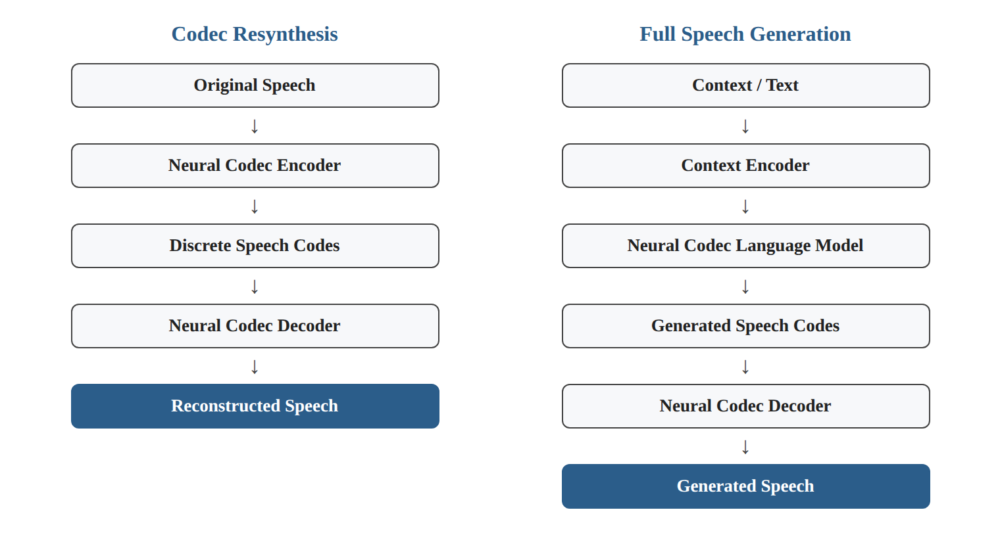
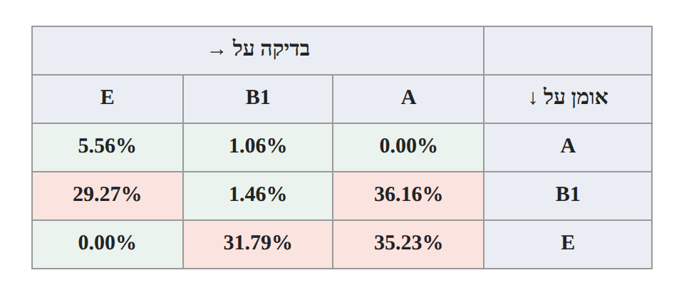
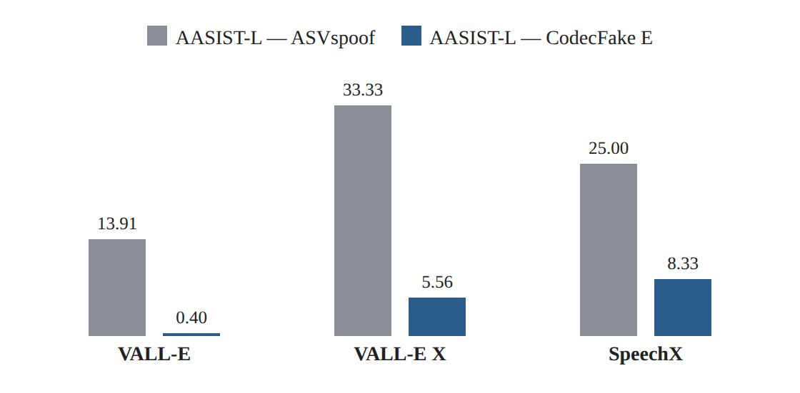

# Research Card 06 — CodecFake

## CodecFake: Enhancing Anti-Spoofing Models Against Deepfake Audios from Codec-Based Speech Synthesis Systems

## 1. פרטים ביבליוגרפיים

**שם המאמר:** CodecFake: Enhancing Anti-Spoofing Models Against Deepfake Audios from Codec-Based Speech Synthesis Systems.

**מחברים:** Haibin Wu, Yuan Tseng, Hung-yi Lee.

**גוף מחקרי:** Speech Processing and Machine Learning Laboratory, National Taiwan University.

**שנת פרסום:** 2024.

**גרסת המקור שנקראה:** arXiv:2406.07237v1, מ-11 ביוני 2024.

**קישור למאמר:** https://arxiv.org/abs/2406.07237

**אתר הפרויקט והנתונים:** https://codecfake.github.io

**תחומי מחקר:** Audio Deepfake Detection, Speech Anti-Spoofing, Neural Audio Codecs, Codec-Based Speech Synthesis, Cross-Attack Generalization.

**מילות מפתח:** CodecFake, Neural Audio Codec, Codec Resynthesis, AASIST-L, VCTK, ASVspoof 2019, VALL-E, EnCodec, SpeechTokenizer, EER, Cross-Testing, Generalization.

**רלוונטיות לפרויקט:** גבוהה מאוד. המאמר עוסק ישירות בזיהוי זיופים קוליים, מציג מאגר המשמש אחד ממקורות הנתונים בפרויקט, ומדגים את חשיבות ההכללה בין מתקפות המבוססות על מנגנוני Codec שונים.

---

## 2. תקציר מקיף של המאמר

המאמר בוחן האם מודלים מתקדמים לזיהוי זיופים קוליים, שאומנו על מאגרי Anti-Spoofing קיימים, מסוגלים לזהות דיבור שנוצר באמצעות מערכות סינתזה המבוססות על Neural Audio Codecs.

החוקרים מציינים שטכנולוגיות Codec-Based Speech Synthesis התקדמו באופן משמעותי ומאפשרות יצירת דיבור סינתטי באיכות גבוהה, לרבות חיקוי קול באמצעות דוגמאות קצרות של דובר היעד.

עם זאת, מודלים לזיהוי זיופים פותחו והוערכו במידה רבה על נתונים שמייצגים טכנולוגיות סינתזה קודמות, ולכן יכולתם להתמודד עם מתקפות Codec-Based אינה מובטחת.

כדי לחקור את הבעיה, החוקרים יצרו את CodecFake, מאגר הכולל דוגמאות אודיו משוחזרות באמצעות 15 מודלי Neural Audio Codec משש משפחות שונות.

המאגר מבוסס על הקלטות מקוריות מתוך VCTK. לכל מודל Codec נוצרה תת-קבוצה באמצעות קידוד הקלטות דיבור אמיתיות לייצוגים בדידים ושחזורן באמצעות ה-Decoder המתאים.

החוקרים השתמשו ב-AASIST-L בתור ארכיטקטורת Anti-Spoofing עיקרית.

כל מודל אומן על דוגמאות מזויפות מתת-קבוצת Codec אחת, יחד עם הקלטות המקור האמיתיות, ונבדק על תתי-קבוצות אחרות.

בנוסף, נערכה השוואה למודלים שאומנו על ASVspoof 2019 Logical Access.

ניסויי Cross-Testing הראו שמודלים שאומנו על ASVspoof 2019 הציגו EER גבוה בחלק גדול מתתי-הקבוצות החדשות, לרוב מעל 30%.

מנגד, אימון על CodecFake סיפק שיפור משמעותי בזיהוי זיופים ממקורות מסוימים. לדוגמה, מודל AASIST-L שאומן על CodecFake Subset E השיג EER של 0.40% על דוגמאות שנוצרו באמצעות VALL-E, לעומת 13.91% למודל AASIST-L שאומן על ASVspoof 2019.

עם זאת, ההצלחה אינה אחידה. תתי-קבוצות מסוימות סיפקו הכללה טובה יותר מאחרות, ומודלים רבים התקשו לזהות דוגמאות שנוצרו באמצעות Codecs שלא נכללו באימון.

**המסקנה המרכזית:** נתוני Codec Resynthesis עשויים לשפר משמעותית את יכולת הזיהוי של מתקפות Codec-Based, אך ההכללה בין סוגי Codec שונים נותרת אתגר משמעותי.

**מקור:** Abstract, Sections 1–5.

---

## 3. בעיית המחקר והמוטיבציה

### 3.1 הבעיה המרכזית

מערכות Speech Synthesis מודרניות מסוגלות ליצור דיבור סינתטי מציאותי באמצעות ייצוגי אודיו בדידים.

מערכות אלו עשויות לאפשר התחזות קולית גם כאשר למערכת ניתנת דוגמה קצרה בלבד של דובר היעד.

התקדמות זו יוצרת צורך במודלים לזיהוי זיופים שיודעים להתמודד עם טכנולוגיות יצירה חדשות.

### 3.2 המגבלה של מאגרי Anti-Spoofing קיימים

מאגרי ASVspoof מוקדמים מכילים מתקפות שנוצרו באמצעות שיטות סינתזה והמרת קול שהיו זמינות בעת בנייתם.

מודל שמצליח לזהות מתקפות כאלה לא בהכרח למד מאפיינים שמאפשרים לזהות זיופים המבוססים על Neural Audio Codecs.

### 3.3 פער מחקרי

החוקרים מבקשים לבחון האם ההתקדמות במערכות Anti-Spoofing עוברת גם למתקפות Codec-Based, ובאיזו מידה נתוני אימון חדשים מסוגלים לסייע.

### 3.4 מטרת המחקר

לבנות מאגר זיופים המבוסס על Neural Audio Codecs, להעריך באמצעותו את ביצועי מודלי Anti-Spoofing ולבחון האם אימון על נתונים אלה משפר זיהוי של מתקפות Codec-Based.

### 3.5 שאלת המחקר המשתמעת

האם מודלי Anti-Spoofing שאומנו על ASVspoof 2019 מסוגלים לזהות זיופים שמקורם ב-Neural Audio Codecs, והאם אימון על דוגמאות Codec Resynthesis משפר את יכולת הזיהוי וההכללה למערכות סינתזה מבוססות Codec?

**מקור:** Section 1.

---

## 4. רקע — Neural Audio Codecs

### 4.1 מהו Neural Audio Codec?

Neural Audio Codec הוא מודל המאפשר לייצג אודיו באופן מקודד, בדרך כלל באמצעות רצפים של קודים בדידים.

מערכת טיפוסית כוללת:

- Encoder הממיר אודיו לייצוג.
- מנגנון Quantization המפיק קודים בדידים.
- Decoder המשחזר אודיו מתוך הקודים.

### 4.2 למה משתמשים ב-Codecs?

הייעוד המקורי של Neural Audio Codecs קשור לדחיסה ולשחזור אודיו.

עם התפתחות מערכות Speech Generation, הייצוגים הבדידים הפכו שימושיים גם למודלים שיוצרים רצפי דיבור.

### 4.3 Codec-Based Speech Synthesis

במערכות אלו, מידע כגון טקסט, הוראות או הקשר קולי מומר לייצוגים המאפשרים למודל שפה ליצור רצף Speech Codes.

הרצף שנוצר מועבר ל-Codec Decoder, המפיק את אות הדיבור הסופי.

### 4.4 הסיכון האבטחתי

מערכות כאלה עשויות לאפשר יצירת דיבור חדש שנשמע כמו דובר מסוים.

כאשר יכולת זו מנוצלת ללא הרשאה, היא עשויה לשמש להתחזות ולהונאה.

### 4.5 משמעות לזיהוי זיופים

תהליך היצירה עשוי להותיר מאפיינים אקוסטיים הקשורים לקידוד, ל-Quantization ולפענוח.

המאמר בוחן האם ניתן לנצל דוגמאות שעברו תהליך זה לצורך אימון מערכות זיהוי.

**מקור:** Section 1, Section 2.1, Figure 1.

---

## 5. ההבחנה המרכזית — Generation לעומת Resynthesis

### 5.1 Full Speech Generation

מערכת Codec-Based Speech Synthesis מלאה עשויה לבצע:

Context / Text

→ Context Encoder

→ Neural Codec Language Model

→ Generated Speech Codes

→ Neural Codec Decoder

→ Generated Speech.

במקרה זה המערכת יוצרת רצף קודים חדש.

### 5.2 Codec Resynthesis

ב-Codec Resynthesis התהליך שונה:

Original Speech

→ Neural Codec Encoder

→ Discrete Speech Codes

→ Neural Codec Decoder

→ Reconstructed Speech.

כאן התוכן המקורי של ההקלטה משמש כבסיס לשחזור.

*איור 1. המחשה לשני התהליכים המתוארים בסעיפים 5.1–5.2.*

### 5.3 למה החוקרים בחרו ב-Resynthesis?

מערכות Generation שונות משתמשות במודלי שפה ובמנגנוני יצירה שונים.

החוקרים רצו להתמקד ברכיב משותף למערכות Codec-Based רבות: תהליך הקידוד והפענוח.

באמצעות Resynthesis ניתן להפיק דוגמאות ממספר גדול של Codecs בלי להסתמך על זמינות מלאה של מערכות סינתזה שונות.

### 5.4 היתרון המתודולוגי

השיטה מצמצמת חלק מההבדלים הקשורים לתוכן הדיבור ולמנגנון יצירת הרצף.

כאשר ההקלטה המקורית והמשוחזרת מבוססות על אותו דיבור, אפשר להתמקד בהשפעת תהליך ה-Codec.

### 5.5 המגבלה המתודולוגית

Resynthesis אינו זהה ליצירת דיבור חדש באמצעות מערכת Codec Language Model.

לכן הצלחה בזיהוי אודיו משוחזר אינה מבטיחה הצלחה בזיהוי כל מערכת Generation מלאה.

זוהי הסיבה לכך שהחוקרים ביצעו גם ניסויי הערכה על VALL-E, VALL-E X ו-SpeechX.

**מקור:** Section 2.1, Figure 1.

---

## 6. התרומות המרכזיות של המאמר

**1. הצגת CodecFake**

בניית מאגר ייעודי לזיהוי דיבור שעבר Resynthesis באמצעות Neural Audio Codecs.

**2. כיסוי מספר משפחות Codec**

איסוף שישה Frameworks ו-15 מודלים מאומנים מראש.

**3. תהליך יצירת נתונים מבוקר**

שימוש בהקלטות VCTK מקוריות לצורך יצירת גרסאות משוחזרות.

**4. חלוקה נפרדת לפי דוברים**

הפרדת דוברים בין Training, Validation ו-Testing.

**5. Cross-Testing בין Codecs**

בדיקת יכולת הכללה בין סוגי קידוד ופענוח שונים.

**6. השוואה ל-ASVspoof 2019**

הערכת מגבלותיהם של מודלי Anti-Spoofing שאומנו על מאגר קודם.

**7. הערכה על מערכות Generation מלאות**

בדיקה על VALL-E, VALL-E X ו-SpeechX.

**8. הדגמת תרומת נתוני Codec**

הצגת שיפור משמעותי בזיהוי זיופים ממערכות מסוימות בעקבות אימון על CodecFake.

**מקור:** Sections 1–4.

---

## 7. משפחות ה-Codec שנכללו במאגר

| משפחה | סימון | מספר מודלים |
|---|---|---:|
| SpeechTokenizer | A | 1 |
| HiFi-Codec / AcademiaCodec | B1–B3 | 3 |
| AudioDec | C | 1 |
| Descript Audio Codec | D1–D3 | 3 |
| EnCodec | E | 1 |
| FunCodec | F1–F6 | 6 |
| **סה"כ** | | **15** |

### 7.1 הבדלים בין המודלים

המודלים נבדלים בין היתר ב:

- מאגרי האימון.
- מספר ה-Codebooks.
- קצב הדגימה.
- Bitrate.
- ארכיטקטורות וגישות Quantization.

### 7.2 למה המגוון חשוב?

אם מודל הזיהוי לומד מאפיין שמופיע רק ב-Codec אחד, הוא עשוי להיכשל כאשר סוג ה-Codec משתנה.

לעומת זאת, אם המודל לומד מאפיינים רחבים יותר, הוא עשוי להכליל למתקפות שלא נראו באימון.

### 7.3 SpeechTokenizer

החוקרים מציינים ש-SpeechTokenizer נועד להפריד סוגי מידע בין שכבות שונות של Codebooks.

הם מציעים שהפרדה זו עשויה להסביר חלק מיכולת ההכללה הטובה יחסית שנצפתה כאשר המודל אומן על Subset A.

עם זאת, זהו הסבר אפשרי ולא ממצא סיבתי שהוכח בניסוי נפרד.

### 7.4 EnCodec

EnCodec הוא אחד ממודלי ה-Codec ששימשו ליצירת תתי-הקבוצות.

Subset E הציג תוצאות בולטות בהערכה על VALL-E, VALL-E X ו-SpeechX.

אין להסיק מכך ש-EnCodec הוא תמיד מקור האימון הטוב ביותר לכל סוגי המתקפות.

**מקור:** Section 2.2, Table 1.

---

## 8. בניית מאגר CodecFake

### 8.1 מקור הדיבור

המאגר מבוסס על הקלטות מתוך VCTK.

### 8.2 תהליך יצירת דוגמה

1. בחירת הקלטת דיבור אמיתית.
2. העברת ההקלטה ל-Neural Codec Encoder.
3. הפקת קודים בדידים.
4. שחזור ההקלטה באמצעות ה-Decoder המתאים.
5. שמירת ההקלטה המשוחזרת כדוגמה מזויפת בפרוטוקול המחקר.

### 8.3 תתי-קבוצות

לכל אחד מ-15 מודלי ה-Codec נוצרה תת-קבוצה נפרדת.

כל תת-קבוצה מבוססת על אותן חלוקות מקור של VCTK.

### 8.4 הגדרת Bona Fide ו-Fake

Bona Fide — ההקלטה המקורית.

Fake — הגרסה המשוחזרת באמצעות מודל Neural Audio Codec.

### 8.5 משמעות ההגדרה

ההגדרה של Fake במאגר מבוססת על תהליך Resynthesis.

לכן יש להבדיל בין דוגמה זו לבין Deepfake שנוצר באמצעות החלפת זהות דובר או יצירת טקסט חדש.

**מקור:** Section 2.3.

---

## 9. חלוקת נתונים ומניעת דליפה

### 9.1 Speaker-Disjoint Split

החוקרים מפרידים בין דוברים בקבוצות האימון, האימות והבדיקה.

### 9.2 נתונים בכל תת-קבוצת Codec

| Split | הקלטות | דוברים |
|---|---:|---:|
| Training | 42,752 | 103 |
| Validation | 735 | 2 |
| Testing | 755 | 2 |

אלה נתוני המקור של VCTK המשמשים ליצירת כל תת-קבוצת Codec, ולא ספירה של 15 תתי-הקבוצות יחד.

### 9.3 חלוקת דוברים

**Validation:** p226 ו-p229.

**Testing:** p227 ו-p228.

**Training:** יתר הדוברים שנכללו בחלוקה.

### 9.4 למה זה חשוב?

כאשר אותו דובר מופיע גם באימון וגם בבדיקה, קיים סיכון שהמודל ינצל מאפייני דובר שאינם קשורים ישירות לזיוף.

חלוקה נפרדת לפי דוברים מצמצמת סיכון זה.

### 9.5 מגבלה

Speaker-Disjoint Split אינו מבטיח כשלעצמו הכללה ל-Codecs או למקורות הקלטה חדשים.

נדרש לבחון בנפרד את השפעת סוג המתקפה ומקור הנתונים.

**מקור:** Section 2.3, Table 2.

---

## 10. ארכיטקטורת הזיהוי — AASIST-L

### 10.1 מהו AASIST-L?

החוקרים משתמשים בגרסה קלה יותר של AASIST לצורך סיווג בין דיבור אמיתי לדיבור מזויף.

AASIST מבוסס על למידת קשרים זמניים וספקטרליים לצורך Anti-Spoofing.

### 10.2 למה נבחר AASIST-L?

החוקרים מציינים שבחרו ב-AASIST-L משום שהוא נוטה פחות להתאמת יתר בהשוואה ל-AASIST.

### 10.3 אופן השימוש

בכל ניסוי מבוצע אימון של AASIST-L על תת-קבוצת CodecFake אחת ועל הקלטות המקור האמיתיות.

### 10.4 הגדרות אימון שדווחו

- Optimizer: Adam.
- Learning Rate: 0.001.
- Batch Size: 16.
- בחירת מודל באמצעות Validation של תת-הקבוצה הרלוונטית.

### 10.5 השוואה ל-ASVspoof

לצורך מודלים שאומנו על ASVspoof, החוקרים השתמשו ב-Checkpoints שפורסמו על ידי מחברי המודל.

חשוב לזכור שההשוואה כוללת גם הבדלים במקור האימון ובתהליך כוונון ההיפר-פרמטרים, אף שהשימוש ב-AASIST-L בשתי הגישות מסייע לצמצם הבדלים ארכיטקטוניים.

### 10.6 מה לא נבדק?

המאמר אינו מציג השוואה מקיפה של WavLM או wav2vec 2.0 מול AASIST-L על CodecFake.

**מקור:** Section 3.1.

---

## 11. מתודולוגיית הערכה

### 11.1 מערכי ההערכה

החוקרים השתמשו בארבע קבוצות הערכה מרכזיות:

1. ASVspoof 2019 Evaluation.
2. CodecFake Evaluation.
3. VALL-E, באמצעות מימוש פתוח.
4. דוגמאות מדפי ההדגמה של VALL-E X ו-SpeechX.

### 11.2 מדד הערכה

המדד המרכזי הוא Equal Error Rate (EER).

EER מייצג את נקודת העבודה שבה שיעור קבלת דוגמאות מזויפות כשייכות למחלקה האמיתית משתווה לשיעור דחיית דוגמאות אמיתיות.

ערך נמוך יותר משקף יכולת הפרדה טובה יותר בין המחלקות במסגרת פרוטוקול ההערכה.

### 11.3 Cross-Testing

כל מודל אומן על תת-קבוצה אחת ונבדק על כל 15 תתי-הקבוצות.

כך ניתן להבחין בין:

- In-Distribution Performance.
- Cross-Codec Generalization.

### 11.4 למה חשוב להשתמש באותו מדד?

כאשר משווים מודלים שונים על אותן קבוצות בדיקה, שימוש ב-EER מאפשר השוואת ביצועים בלתי תלויה בבחירת סף החלטה קבוע מראש.

עם זאת, EER לבדו אינו מתאר את כל העלויות האבטחתיות של טעויות במערכת אמיתית.

**מקור:** Section 3.2, Section 4.

---

## 12. תוצאות Cross-Testing — Figure 2

### 12.1 תוצאה מרכזית

מודלים שאומנו על ASVspoof 2019 הציגו EER גבוה ברוב תתי-הקבוצות של CodecFake.

החוקרים מציינים שבדרך כלל התקבלו ערכים הגבוהים מ-30%.

### 12.2 יתרון לזיהוי מתקפות מוכרות

כאשר מודל אומן ונבדק על אותו סוג Codec, ה-EER היה בדרך כלל נמוך.

### 12.3 הכללה בין Codecs

בחלק גדול מהניסויים, בדיקה על Codec שונה מזה ששימש לאימון הובילה לעלייה משמעותית ב-EER.

### 12.4 ערכים נבחרים מתוך Figure 2

| תת-קבוצת אימון | בדיקה על A | בדיקה על B1 | בדיקה על E |
|---|---:|---:|---:|
| A | 0.00% | 1.06% | 5.56% |
| B1 | 36.16% | 1.46% | 29.27% |
| E | 35.23% | 31.79% | 0.00% |

*איור 2. המחשה לנתוני הטבלה בסעיף 12.4: EER בין תתי-קבוצות האימון A, B1 ו-E.*

### 12.5 הכללה שאינה סימטרית

מודל שאומן על A והשיג 5.56% EER על E אינו שקול למודל שאומן על E והשיג 35.23% EER על A.

כלומר, ההכללה בין מתקפות יכולה להיות תלויה בכיוון המעבר.

### 12.6 Subset A

החוקרים מדווחים שאימון על Subset A הציג הכללה טובה יחסית לרבות מתתי-הקבוצות האחרות.

הם מציעים שמבנה הייצוג של SpeechTokenizer עשוי לתרום לכך.

### 12.7 מסקנה

ביצועים מצוינים על מתקפה מוכרת אינם מבטיחים יכולת זיהוי של מתקפה חדשה.

זוהי אחת התוצאות החשובות ביותר של המאמר.

**מקור:** Section 4.1, Figure 2.

---

## 13. תוצאות על מערכות Codec-Based Generation

### 13.1 מטרת הניסוי

לבחון האם אימון על Codec Resynthesis יכול לשפר את הזיהוי של דיבור שנוצר באמצעות מערכות סינתזה מלאות.

### 13.2 תוצאות Table 3

| מודל אימון | VALL-E EER | VALL-E X EER | SpeechX EER |
|---|---:|---:|---:|
| AASIST — ASVspoof | 9.93% | 36.11% | 33.33% |
| AASIST-L — ASVspoof | 13.91% | 33.33% | 25.00% |
| AASIST-L — CodecFake A | **0.53%** | 25.00% | 50.00% |
| AASIST-L — CodecFake E | **0.40%** | **5.56%** | **8.33%** |

*איור 3. המחשה לנתוני Table 3 (סעיף 13.2): השוואת AASIST-L שאומן על ASVspoof לעומת CodecFake Subset E.*

### 13.3 VALL-E

Subset E השיג EER של 0.40% לעומת 13.91% עבור AASIST-L שאומן על ASVspoof 2019.

התוצאה מצביעה על תועלת משמעותית של נתוני CodecFake בתנאי הניסוי.

### 13.4 VALL-E X

Subset E השיג EER של 5.56%, לעומת 33.33% למודל AASIST-L שאומן על ASVspoof.

עם זאת, מדובר בקבוצת הערכה קטנה שנאספה מדף הדגמה.

### 13.5 SpeechX

Subset E השיג EER של 8.33%, לעומת 25.00% למודל AASIST-L שאומן על ASVspoof.

החוקרים מציינים שלא ניתן לאמת באופן מהימן את המשמעות הסטטיסטית של השיפור בשל מספר הדוגמאות הקטן.

### 13.6 לא כל Subset מצליח

למשל, אימון על CodecFake B3 הניב EER של 58.94% על VALL-E.

הדבר מדגיש את התלות בבחירת ה-Codec ששימש לאימון.

### 13.7 בדיקות מובהקות

החוקרים מתארים שימוש ב-Paired Sample t-test וב-Wilcoxon Signed-Rank Test, עם סף מובהקות של 0.01, להשוואת המודלים המאומנים על CodecFake למודל ה-ASVspoof המוצלח ביותר בכל קבוצת בדיקה.

הם מדווחים על שיפורים מובהקים עבור מודלים מסוימים על VALL-E ועל VALL-E X, אך לא ניתן לאמת את מובהקות השיפורים עבור SpeechX.

המאמר אינו מספק בטבלה את כל ערכי ה-p הנפרדים לכל השוואה.

### 13.8 מסקנה

אימון על Codec Resynthesis עשוי לסייע בזיהוי דיבור שנוצר באמצעות מערכות Codec-Based מלאות, אך לא כל תת-קבוצת אימון מספקת הכללה טובה.

**מקור:** Section 4.2, Table 3.

---

## 14. השוואה ל-ASVspoof

### 14.1 הממצא

מודלים שאומנו על ASVspoof 2019 התקשו לזהות חלק גדול מהדוגמאות המבוססות על Neural Audio Codecs.

### 14.2 הסבר אפשרי

החוקרים מציעים שמתקפות מבוססות Codec שונות ממערכות הסינתזה המסורתיות שנכללו במאגר ASVspoof 2019.

### 14.3 המשמעות

מודל Anti-Spoofing עשוי ללמוד מאפיינים שמועילים לזיהוי סוגי זיופים מסוימים, אך אינם מכלילים באופן מספק למנגנוני יצירה חדשים.

### 14.4 הבחנה חשובה לפרויקט

המאמר בודק ASVspoof 2019.

בפרויקט שלנו קיימות גם דוגמאות מתוך ASVspoof 5.

לכן אין לייחס אוטומטית את כל ממצאי ASVspoof 2019 לביצועיהם של מודלים שאומנו על ASVspoof 5.

**מקור:** Sections 1, 4.

---

## 15. מסקנות החוקרים

החוקרים מסיקים כי:

1. מודלים שאומנו על מאגרי Anti-Spoofing קודמים מתקשים לזהות זיופים המבוססים על Neural Audio Codecs.
2. CodecFake מספק נתוני אימון שיכולים לשפר את הזיהוי של מתקפות Codec-Based.
3. נתוני Codec Resynthesis עשויים לסייע בזיהוי דיבור ממערכות סינתזה מלאות.
4. סוג ה-Codec המשמש לאימון משפיע באופן משמעותי על ביצועי הזיהוי.
5. קיים צורך להמשיך ולפתח מאגרים ושיטות זיהוי המתמודדים עם טכנולוגיות סינתזה חדשות.

החוקרים מציגים את CodecFake כמשאב שאמור לסייע למחקר בתחום זיהוי זיופים קוליים מבוססי Codec.

**מקור:** Section 5.

---

## 16. ניתוח ביקורתי — יתרונות

### 16.1 התאמה ישירה לבעיית המחקר

בניגוד למאמרי SSL כלליים, CodecFake מתמקד ישירות בזיהוי זיופים קוליים.

### 16.2 מאגר המכוון לטכנולוגיית תקיפה מתפתחת

המאגר נבנה כדי להתמודד עם Neural Audio Codecs, ולא רק עם מתקפות שנכללו במאגרי Anti-Spoofing מוקדמים.

### 16.3 כיסוי של מספר מודלים

השימוש ב-15 מודלים מאפשר לבחון הבדלים בין משפחות Codec.

### 16.4 תכנון מבוקר של נתוני Resynthesis

שימוש בהקלטות מקוריות ובגרסאות משוחזרות מסייע לצמצם חלק מהבדלי התוכן.

### 16.5 הפרדת דוברים

החלוקה לפי דוברים מצמצמת את הסיכון לדליפת זהות דובר בין קבוצות.

### 16.6 הערכת Cross-Codec

המחקר אינו מסתפק בזיהוי מתקפות מוכרות.

### 16.7 הערכה על מערכות Generation מלאות

החוקרים בודקים אם הידע שנלמד מתוך Resynthesis מועיל גם למערכות כגון VALL-E.

### 16.8 שימוש ב-EER

המדד מאפשר להעריך את יכולת ההפרדה בין דיבור אמיתי למזויף באופן התואם למטרת המחקר שלנו.

---

## 17. ניתוח ביקורתי — מגבלות

### 17.1 Resynthesis אינו זהה ל-Generation

הדוגמאות המשוחזרות אינן מייצגות בהכרח את כל המאפיינים של דיבור שנוצר באמצעות מערכת TTS מלאה.

### 17.2 מגבלות ההכללה

הניסויים מראים שקיימים פערים ניכרים בין Codecs שונים.

לכן CodecFake אינו מבטיח הכללה אוניברסלית.

### 17.3 תלות בתת-קבוצת האימון

מודלים שאומנו על תתי-קבוצות שונות הציגו תוצאות שונות מאוד על אותן מערכות בדיקה.

### 17.4 מודל זיהוי מרכזי אחד

מרבית ניסויי ההערכה מבוססים על AASIST-L, ולכן לא ניתן להסיק שהם מייצגים את כל משפחות מודלי Anti-Spoofing.

### 17.5 היעדר ניסוי מרכזי של אימון משותף על כל 15 תתי-הקבוצות

המאמר מתמקד באימון נפרד לכל תת-קבוצת Codec.

לכן אין בו ראיה ישירה לשאלה האם אימון על כולן יחד מספק ביצועים טובים יותר.

### 17.6 קבוצות הערכה קטנות

הערכות VALL-E X ו-SpeechX מבוססות על מספר קטן של דוגמאות.

### 17.7 הבדלים במקורות ובפרוטוקולי אימון

השוואת מודלים המאומנים על ASVspoof למודלים המאומנים על CodecFake כוללת גם הבדלים בנתונים ובתהליך בחירת ההיפר-פרמטרים.

### 17.8 מקור הקלטות מרכזי

הנתונים המשמשים ליצירת CodecFake מבוססים על VCTK.

הצלחה על המאגר אינה מבטיחה הצלחה על תנאי הקלטה ודוברים מכל מקור אפשרי.

### 17.9 היעדר ניסויים על ASVspoof 5

המאמר בוחן ASVspoof 2019, ולא את מאגר ASVspoof 5 שבו אנו משתמשים.

### 17.10 אין השוואה ישירה ל-SSL Encoders

המאמר אינו בודק אם wav2vec 2.0 או WavLM מצליחים להכליל טוב יותר בין Codecs.

---

## 18. מה המאמר אינו מוכיח?

אין להסיק מהמאמר ש:

- כל סוג Codec מתאים באותה מידה לאימון Anti-Spoofing.
- הצלחה על מתקפה מוכרת מעידה על יכולת הכללה.
- CodecFake מבטיח זיהוי של כל מערכת Speech Generation עתידית.
- AASIST-L הוא בהכרח המודל הטוב ביותר לזיהוי מתקפות Codec-Based.
- אימון משותף על ASVspoof 5 ו-CodecFake משפר בהכרח EER.
- Resynthesis ו-Generation מייצרים ארטיפקטים זהים.
- WavLM או wav2vec 2.0 יהיו טובים יותר מ-AASIST-L על CodecFake.
- תוצאות המאמר משקפות בהכרח את ביצועי המודלים על מאגר הקורס המצומצם שלנו.

---

## 19. התובנות המרכזיות שלנו

### 19.1 הכללה חשובה לא פחות מביצועים על קבוצת בדיקה מוכרת

מודל עשוי להשיג EER כמעט אפסי על Codec מסוים ולהיכשל על Codec אחר.

לכן יש להעריך ביצועים גם על מתקפות שלא נכללו באימון.

### 19.2 סוג המתקפה הוא משתנה משמעותי

מקור ה-Codec אינו רק פרט טכני בנתונים.

הוא עשוי להשפיע באופן מהותי על המאפיינים שהמודל לומד לזהות.

### 19.3 Resynthesis יכול לספק מקור נתונים שימושי

ניתן ליצור דוגמאות לצורך אימון גם ללא מערכת TTS מלאה.

עם זאת, צריך לבדוק אם הידע שנלמד מהן עובר למערכות Generation.

### 19.4 Cross-Testing חושף בעיות שמדד כולל עלול להסתיר

EER ממוצע או כולל עשוי להסתיר פערים גדולים בין מתקפות.

מטריצת Cross-Testing מספקת תמונה עשירה יותר של יכולת ההכללה.

### 19.5 בחירת מקור האימון משפיעה על הצלחת המודל

המאמר מצביע על תתי-קבוצות שמספקות הכללה טובה יותר מאחרות.

לכן בחירת הנתונים היא חלק מהבעיה המחקרית, ולא רק שלב טכני לפני האימון.

### 19.6 צריך להיזהר מקיצורי דרך

במחקר שלנו, שילוב דוגמאות ממקורות שונים עלול ליצור קשר בין מקור הנתונים לבין תווית המחלקה.

אם המודל ילמד לזהות מקור במקום זיוף, נקבל הערכה מטעה של יכולת ההכללה שלו.

זו השלכה מתודולוגית שלנו, מעבר לניסויים המפורשים במאמר.

---

## 20. רלוונטיות לנתוני הפרויקט שלנו

### 20.1 מבנה המאגר

מאגר הקורס כולל 1,520 הקלטות:

| מקור | אמיתי | מזויף | סה"כ |
|---|---:|---:|---:|
| ASVspoof 5 | 300 | 300 | 600 |
| CodecFake | 300 | 300 | 600 |
| M-AILABS | 320 | 0 | 320 |
| **סה"כ** | **920** | **600** | **1,520** |

כל הקלטה באורך ארבע שניות ובקצב דגימה של 16kHz, לפי מפרט הנתונים של הפרויקט.

### 20.2 מגבלות המאגר שלנו

המאמר המקורי כולל 15 תתי-קבוצות Codec.

אך אין לנו עדיין בסיס לקבוע ש-600 ההקלטות שקיבלנו בקורס מייצגות את כל 15 תתי-הקבוצות.

לכן, לפני תכנון ניסוי לפי Codec, יש לבדוק אילו מזהי מקור ומתקפה זמינים בפועל.

### 20.3 משמעות M-AILABS

M-AILABS מכיל אצלנו דיבור אמיתי בלבד.

לכן אי אפשר לחשב EER בנפרד על M-AILABS בלי דוגמאות מזויפות מתאימות.

ניתן להשתמש בו לצורך ניתוח ציונים על דיבור אמיתי, בכפוף לפרוטוקול ההערכה.

### 20.4 משמעות ASVspoof 5

המאמר מתייחס ל-ASVspoof 2019.

הנתונים שלנו כוללים ASVspoof 5, ולכן נצטרך לבדוק את ההבדלים בין המקורות ולא להניח שתוצאות המאמר מועברות ישירות למאגר שלנו.

### 20.5 משמעות CodecFake

CodecFake עשוי להציג מאפיינים הקשורים לתהליכי קידוד ושחזור אודיו.

נרצה לבדוק האם המודלים שבחרנו מסוגלים ללמוד אותם ולהבחין בינם לבין דיבור אמיתי.

---

## 21. התאמה לארכיטקטורות שלמדנו

### 21.1 MFCC / CQCC

גישות המבוססות על מאפיינים אקוסטיים עשויות לזהות שינויים ספקטרליים שנוצרים בתהליך Resynthesis.

השאלה היא האם מאפיינים אלה מכלילים בין סוגי Codec שונים.

### 21.2 AASIST

המאמר משתמש ב-AASIST-L כמודל המרכזי.

לכן הוא מספק נקודת ייחוס ישירה לשימוש במודל Anti-Spoofing עמוק על נתוני Codec.

### 21.3 wav2vec 2.0

אפשר להשתמש בייצוגי wav2vec 2.0 מאומנים מראש לצורך סיווג Fake/Real.

המאמר אינו בודק גישה זו, ולכן תהיה זו הרחבה ניסויית שלנו.

### 21.4 WavLM

אפשר לבחון האם ייצוגי WavLM מספקים יכולת הכללה טובה יותר בין מקורות נתונים או סוגי Codec.

גם זו השערה שלנו, ולא ממצא של CodecFake.

### 21.5 מסקנה

המאמר מספק הצדקה למחקר השוואתי בין מאפיינים קלאסיים, מודל Anti-Spoofing ייעודי וייצוגי SSL מאומנים מראש.

---

## 22. השערות מחקר וניסויים אפשריים

### H1 — Cross-Dataset Generalization

**השערה:** מודל המאומן על מקור זיופים אחד עלול להציג EER גבוה יותר על מקור אחר.

**ניסוי:** אימון על מקור אחד והערכה על מקור אחר, כאשר מספר הדוגמאות, התוויות והחלוקה מאפשרים פרוטוקול תקף.

**מדד:** EER.

**מגבלה:** מקור הנתונים עשוי להיות מעורבב עם הבדלי דוברים, תנאי הקלטה ושיטות זיוף.

### H2 — זיהוי מאפייני Codec

**השערה:** ביצועי הזיהוי עשויים להשתנות בין סוגי Codec.

**ניסוי:** הערכה לפי מזהי Codec, אם המידע זמין בנתוני הקורס.

**מטרה:** לזהות מתקפות שהמודל מתקשה להכליל אליהן.

### H3 — AASIST לעומת מודלי SSL

**השערה:** WavLM או wav2vec 2.0 עשויים להציג יתרונות מסוימים בהכללה בין מקורות בהשוואה ל-AASIST-L.

**ניסוי:** השוואת המודלים תחת אותו פרוטוקול אימון ובדיקה.

**מדד:** EER.

### H4 — אימון על מקורות משולבים

**השערה:** שילוב דוגמאות מ-ASVspoof 5 ומ-CodecFake עשוי לשפר ביצועים על תערובת מתקפות, אך לא בהכרח על מתקפות שלא נראו באימון.

**ניסוי:** השוואת מודל שאומן על מקור יחיד למודל שאומן על מספר מקורות.

**בקרה:** בדיקת השפעת היחס בין מקורות הנתונים ובין תוויות המחלקות.

### H5 — איתור קיצורי דרך

**השערה:** מודל עשוי ללמוד מאפיינים הקשורים למקור ההקלטה במקום למאפייני הזיוף.

**ניסוי:** ניתוח ציונים לפי מקור נתונים, דובר וסוג מתקפה, בכפוף לזמינות Metadata.

**מטרה:** לזהות דפוסים מחשידים של תלות במקור.

### H6 — השוואת תתי-קבוצות Codec

**השערה:** אם קיימות אצלנו מספר תתי-קבוצות Codec, חלקן עשויות לספק יכולת הכללה טובה יותר מאחרות.

**ניסוי:** Cross-Testing בין תתי-קבוצות, אם מספר הדוגמאות מאפשר הערכה יציבה.

**מגבלה:** מאגר הקורס מצומצם משמעותית מהמאגר המקורי.

---

## 23. סדר עדיפות לניסויים

**עדיפות גבוהה**

1. אימות חלוקת הנתונים והתוויות לפי מקור.
2. בדיקת זמינות Metadata על סוגי Codec ומתקפות.
3. יצירת Baseline פשוט ואמין.
4. הערכת EER על קבוצת בדיקה מופרדת.
5. השוואת ביצועים לפי מקור נתונים.

**עדיפות בינונית**

6. AASIST-L מול wav2vec 2.0 ו-WavLM.
7. Frozen Encoder מול Fine-Tuning.
8. השוואת אימון על מקור יחיד מול מקורות משולבים.

**עדיפות מותנית בנתונים**

9. Cross-Testing בין סוגי Codec.
10. ניתוח ארטיפקטים לפי משפחות Codec.
11. ניסויי Robustness תחת תנאי הקלטה שונים.

המטרה היא להפיק מסקנות אמינות ולא להעמיס ניסויים שאינם נתמכים בגודל המאגר או בפרטי הנתונים הזמינים.

---

## 24. שאלות פתוחות

1. אילו מתוך 15 מודלי ה-Codec המקוריים מיוצגים בנתוני הקורס?
2. האם ניתן לזהות את משפחת ה-Codec של כל הקלטה?
3. האם הקלטות אמיתיות ומזויפות אצלנו מותאמות לפי דובר ותוכן?
4. האם קיימת הפרדה לפי דוברים בין קבוצות האימון והבדיקה?
5. האם ניתן לבצע Cross-Testing בין סוגי Codec שונים?
6. האם AASIST-L יצליח על CodecFake הקטן שלנו באותה מידה כמו במחקר המקורי?
7. האם wav2vec 2.0 או WavLM ישפרו את EER?
8. האם מקור הנתונים משפיע על ציוני הסיווג מעבר לתווית האמיתית?
9. האם שילוב מקורות משפר הכללה או יוצר קיצורי דרך?
10. האם ניתן לזהות מתקפות לא מוכרות בלי לראות דוגמאות מאותה משפחת Codec באימון?
11. מהו ההבדל בין הצלחה על Codec Resynthesis לבין הצלחה על Codec-Based Generation?
12. אילו מגבלות נובעות מגודל מאגר הקורס לעומת מאגר CodecFake המקורי?

---

## 25. מסקנה מסכמת

CodecFake מציג תרומה מחקרית חשובה לתחום זיהוי הזיופים הקוליים, באמצעות בניית מאגר ייעודי לדיבור שעבר Resynthesis באמצעות Neural Audio Codecs.

המאמר מדגים שמודלי Anti-Spoofing שאומנו על ASVspoof 2019 מתקשים לזהות חלק גדול מהמתקפות המבוססות על Codecs חדשים.

באמצעות אימון על CodecFake, החוקרים משיגים שיפור משמעותי בזיהוי דיבור שנוצר באמצעות מערכות Codec-Based מסוימות, ובפרט VALL-E.

עם זאת, ניסויי Cross-Testing מראים כי יכולת ההכללה בין Codecs אינה אחידה, וכי הצלחה על סוג Codec מוכר אינה מבטיחה ביצועים טובים על סוג אחר.

מבחינת הפרויקט שלנו, התרומה המרכזית של המאמר היא בהצבת יכולת ההכללה בין מתקפות ובין מקורות נתונים כמרכיב מרכזי בתהליך ההערכה.

המאמר מספק בסיס להשוואת AASIST-L, מאפיינים קלאסיים וייצוגי SSL מאומנים מראש, תוך בחינת EER וניתוח תלות במקור הנתונים.

**העיקרון המחקרי שנאמץ:** לא נסתפק במודל שמשיג EER נמוך על קבוצת בדיקה אחת; נבחן, ככל שהנתונים מאפשרים, האם הוא מזהה מאפיינים כלליים של זיוף והאם ביצועיו נשמרים כאשר מקור ההקלטה או טכנולוגיית היצירה משתנים.

---

## 26. מפת הפניות למאמר

| נושא | מיקום במאמר |
|---|---|
| מוטיבציה ובעיית המחקר | Section 1, עמ' 1 |
| Codec-Based Speech Generation | Section 2.1, עמ' 2 |
| תרשים תהליך יצירת דיבור | Figure 1, עמ' 1 |
| ההבחנה בין Generation ל-Resynthesis | Section 2.1, עמ' 2 |
| משפחות ה-Codec | Section 2.2, Table 1, עמ' 2 |
| תהליך יצירת המאגר | Section 2.3, עמ' 2–3 |
| סטטיסטיקות הנתונים | Table 2, עמ' 2 |
| חלוקה לפי דוברים | Section 2.3, עמ' 3 |
| מודל AASIST-L | Section 3.1, עמ' 3 |
| הגדרות אימון | Section 3.1, עמ' 3 |
| קבוצות הערכה | Section 3.2, עמ' 3–4 |
| Cross-Testing | Figure 2, עמ' 3 |
| ניתוח תוצאות Cross-Codec | Section 4.1, עמ' 4 |
| תוצאות VALL-E, VALL-E X ו-SpeechX | Table 3, עמ' 4 |
| בדיקות מובהקות | Section 4.2, עמ' 4 |
| מסקנות החוקרים | Section 5, עמ' 4 |
| הפניות למערכות ולמודלים | Section 6, עמ' 5 |

**הערת שימוש:** התוצאות המספריות המוצגות במסמך מתייחסות לפרוטוקול המחקר המקורי. ניסויים על ASVspoof 5, על מאגר הקורס או על מודלי SSL לזיהוי זיופים הם הרחבות מחקריות מוצעות שלנו, ולא תוצאות שנבדקו במאמר.
