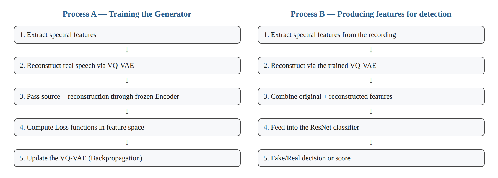
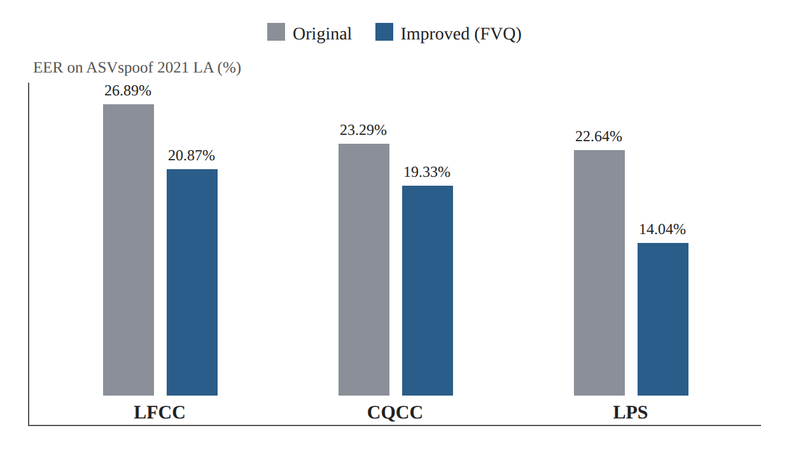

# Research Card 07 — Enhanced Forensic Trace Generation

## Robust Speech Forgery Detection via Enhanced Forensic Trace Generation

## 1. Bibliographic Details

**Paper title:** Robust Speech Forgery Detection via Enhanced Forensic Trace Generation.

**Authors:** Site Wu, Yawei Cheng, Rangding Wang, Diqun Yan.

**Institutions:** Ningbo University; Ningbo University of Finance and Economics, China.

**Year of publication:** 2026.

**Journal:** Signal, Image and Video Processing.

**Publication details:** Volume 20, Article 130.

**Online publication date:** March 3, 2026.

**DOI:** https://doi.org/10.1007/s11760-026-05167-y

**Research fields:** Audio Deepfake Detection, Speech Anti-Spoofing, Feature Reconstruction, Generative Representation Learning, Cross-Domain Generalization.

**Keywords:** VQ-VAE, LFCC, CQCC, LPS, ResNet, Knowledge-Driven Generation Optimization, Triplet Loss, True Speech Consistency Loss, Feature Fusion, EER, min-tDCF.

**Classification in the literature review:** Extension paper 01, Research Card 07.

**Relevance to the project:** Medium–high from a research perspective; lower in terms of initial implementation priority. The paper presents a way to improve spectral features without a necessary move to a large SSL model, but requires training an additional reconstruction component.

---

## 2. Comprehensive Summary of the Paper

The paper presents a framework for improving spectral features for voice forgery detection by means of task-guided reconstruction.

The researchers seek to cope with the limitations of methods based on pre-computed features, such as LFCC and CQCC, which may show good performance on known training data but struggle to generalize to different attacks and recording conditions.

Instead of developing a larger classifier, the researchers propose improving the input representations by means of a Vector Quantized Variational Autoencoder (VQ-VAE). The model learns to reconstruct spectral features through a discrete latent space. The reconstruction is intended to highlight discriminative information related to forgeries, and not only to reconstruct the spectrogram accurately.

In order to guide the reconstruction process, the researchers propose Knowledge-Driven Generation Optimization. Within this framework, the Encoder of a pre-trained Anti-Spoofing classifier serves as a source of discriminative knowledge, and its weights remain frozen during the training of the Generator.

The VQ-VAE reconstructs features of real speech, while fake examples serve as supervisory signals within dedicated Loss functions.

The three central loss components are:

- True Speech Consistency Loss — preserving the similarity between real speech representations and the representations of their reconstruction.
- Triplet Loss — creating relative separation between real and fake speech representations.
- Positive Sample Constraint — an additional constraint on the distance between the real speech representation and the representation of its reconstruction.

After training the Generator, the system combines the original features with the reconstructed features and passes the combined representation to a ResNet classifier.

The researchers tested three feature families — LFCC, CQCC and LPS — training on ASVspoof 2019 LA and evaluating on ASVspoof 2019 LA and ASVspoof 2021 LA.

The outstanding result was obtained by means of FVQ-LPS: on ASVspoof 2021 LA the EER dropped from 22.64% to 14.04% relative to a ResNet using original LPS.

Ablation experiments showed that the Triplet Loss component is especially significant for the success of the method, and a comparison of reconstruction models showed that within the experiment VQ-VAE showed better performance than AE and than VAE.

However, the method adds computational complexity, and the improvement was not tested directly on ASVspoof 5 or CodecFake.

**The central conclusion:** Spectral reconstruction guided by the representations of an Anti-Spoofing classifier may strengthen discriminative features and improve generalization between different evaluation conditions. The main contribution of the work is in improving the input representations, and not in presenting an entirely new classification architecture.

**Source:** Abstract, Sections 1–5.

---

## 3. The Research Problem and Motivation

### 3.1 The Central Problem

Voice forgery detection systems sometimes struggle to generalize to new attacks and to changes in recording conditions.

The researchers identify limitations in two families of approaches:

**Pre-computed features:** have fixed formulas, are stable and relatively efficient to compute, but are not automatically adapted to every type of forgery.

**Deep learning:** makes it possible to learn complex representations, but may require significant resources and be sensitive to distribution shifts.

### 3.2 The Research Gap

The researchers argue that focusing on the classifier itself is not enough. There is room to also improve the acoustic features fed into it.

### 3.3 The Goal of the Study

To develop a method that improves the ability to distinguish between real and fake speech by means of task-guided spectral reconstruction, while preserving valuable original information.

### 3.4 The Implied Research Question

Can a Generator based on VQ-VAE, guided by the representations of a forgery-detection classifier, be used to highlight discriminative features and improve performance and generalization ability compared with using original spectral features alone?

**Source:** Sections 1–2.

---

## 4. The Main Contributions of the Paper

**1. Artifact-Amplified Reconstruction**

Reconstructing spectral features with the aim of highlighting information related to forgeries.

**2. Use of VQ-VAE**

Learning discrete representations by means of a Codebook for the purpose of reconstructing spectrograms.

**3. Knowledge-Driven Generation Optimization**

Guiding the Generator by means of a frozen Encoder from a classifier already trained on the Anti-Spoofing task.

**4. True Speech Consistency Loss**

Preserving the similarity between real speech representations and the representations of their reconstruction.

**5. Dual-Margin Triplet Loss**

Combining a Triplet Loss and an additional constraint on the distance between a positive pair.

**6. Feature Fusion**

Combining original and reconstructed features in order to exploit complementary information.

**7. Testing several feature families**

Demonstrating the method with LFCC, CQCC and LPS.

**8. Ablation and Cross-Feature experiments**

A separate examination of the loss components, the representation forms and the reconstruction models.

**Source:** Section 1, Section 3.

---

## 5. The General Architecture

### 5.1 The Stages of the System

The system includes two main processes:

**Process A — Training the Generator**

1. Extracting spectral features.
2. Reconstructing real speech by means of VQ-VAE.
3. Passing the source and the reconstruction through a trained, frozen Encoder.
4. Computing the Loss functions in the feature space.
5. Updating the VQ-VAE by means of Backpropagation.

**Process B — Producing features for detection**

1. Extracting spectral features from the recording.
2. Reconstructing them by means of the trained VQ-VAE.
3. Combining the original and reconstructed features.
4. Feeding the combined representation to the ResNet classifier.
5. Obtaining a decision or score for Fake/Real.

*Figure 1. Illustration of the Generator training process (A) and the detection feature-production process (B), described in Section 5.1.*

### 5.2 The Difference from a Regular Classifier

In a regular classifier:

Audio → Spectral Features → Classifier.

In the proposed method:

Audio → Spectral Features → VQ-VAE Reconstruction → Feature Fusion → Classifier.

### 5.3 A Guiding Principle

The source features are not discarded, because the reconstruction may change important acoustic details.

Instead, the reconstructed features are used as an extension to the original information.

**Source:** Section 3, Figure 1.

---

## 6. The VQ-VAE Component — Artifact-Amplified Reconstruction

### 6.1 What Is VQ-VAE?

A Vector Quantized Variational Autoencoder is an Encoder–Decoder model that uses a discrete latent representation based on a learned Codebook.

### 6.2 The Structure of the Component

The Encoder maps a spectrogram to a latent representation.

The representation is matched to values from a discrete Codebook.

The Decoder reconstructs the spectrogram from the discrete representation.

### 6.3 Why Use Quantization?

The researchers suggest that the discrete space helps capture stable spectral structures, reduce redundant information, and expose inconsistencies in synthesized speech.

This is a motivation and interpretation of the researchers, and not proof that every forgery artifact is strengthened after Quantization.

### 6.4 The Basic Loss Functions of VQ-VAE

The paper presents three basic components:

**Reconstruction Loss**

Measures the error between the input and the reconstruction, by means of a squared difference.

**Quantization Loss**

Updates the Codebook representations in order to match them to the Encoder's continuous representations.

**Commitment Loss**

Encourages the Encoder to stay close to the discrete codes that were chosen.

The β parameter of the Commitment Loss is set to 0.25.

### 6.5 Why Are These Losses Not Enough?

They encourage a stable reconstruction similar to the source, but do not by themselves provide direct guidance for forgery detection.

Therefore the researchers add Loss components based on the representations the classifier produces.

**Source:** Section 3.1, Equations 1–3.

---

## 7. Knowledge-Driven Generation Optimization

### 7.1 The Idea

The researchers use the knowledge of a trained Anti-Spoofing classifier in order to guide the Generator.

### 7.2 The Role of the Encoder

The Encoder produces representations from the spectral features.

It serves as a source of information regarding the features the classifier has learned to use for distinguishing between real and fake.

### 7.3 What Is Frozen?

The weights of the classifier's Encoder remain frozen during the training of the guided VQ-VAE.

### 7.4 What Is Updated?

The Gradient is computed through the system and used to update the Generator.

### 7.5 The Possible Advantage

Instead of reconstructing the spectrogram only according to numerical closeness to the source, the Generator also receives feedback according to the features the classifier finds useful.

### 7.6 A Limitation

If the guiding Encoder learned shortcuts or features that do not generalize, the Generator may also be affected by them.

This is a possible methodological limitation that we infer from the structure of the method; it was not directly tested in the paper.

**Source:** Section 3.2, Figure 1.

---

## 8. True Speech Consistency Loss

### 8.1 The Goal

To encourage similarity between the representation of original real speech and the representation of its reconstruction.

### 8.2 The Mechanism

The researchers use Cosine Similarity.

The loss function is averaged over the real speech examples, and is in principle equal to:

L_TSC = mean(1 − cosine(real representation, reconstructed-real representation)).

### 8.3 Why Does This Matter?

When reconstructing real speech, one wants to preserve the information the classifier identifies as characterizing the real class.

### 8.4 What the Function Does Not Guarantee

It does not by itself provide a direct comparison to the distance of fake speech.

Therefore one can preserve high similarity between a real source and its reconstruction without achieving sufficient separation between the classes.

### 8.5 An Additional Limitation

Cosine Similarity focuses on the relative direction of the vectors, and not necessarily on the Euclidean distance between them.

Hence one of the justifications for adding the Positive Sample Constraint.

**Source:** Section 3.3, Equation 4.

---

## 9. Triplet Loss

### 9.1 The Three Representations

- Anchor — the representation of original real speech.
- Positive — the representation of the reconstruction of that same real speech.
- Negative — the representation of fake speech.

### 9.2 The Goal

To cause real speech and its reconstruction to be relatively close, while fake speech is farther away in the feature space.

### 9.3 The Mathematical Idea

The Loss penalizes when the distance between the Anchor and the Positive is not sufficiently smaller than the distance between the Anchor and the Negative.

The separation is required to meet a defined Margin.

### 9.4 What the Component Adds

Unlike TSC, it explicitly includes fake examples and guides the Generator in a manner that distinguishes between the classes.

### 9.5 The Risk of Its Absence

The Generator may learn to reconstruct real speech stably, but not learn a transformation useful for separating forgeries from real speech.

### 9.6 An Experimental Finding

Removing the Triplet Loss increased the EER on ASVspoof 2021 LA from 14.04% to 20.92%.

This is the largest change among the separate removals of the loss components in the experiment.

**Source:** Section 3.4, Equation 5, Table 2.

---

## 10. Positive Sample Constraint

### 10.1 The Problem

Triplet Loss is based on a relative relation between distances.

Therefore it may allow a solution in which the Negative is sufficiently far from the Anchor, even though the Positive itself is not particularly close to the Anchor.

### 10.2 The Solution

The researchers add an independent constraint on the distance between the real speech representation and its reconstructed representation.

### 10.3 The Principal Formula

L_positive = mean(max(d(real, reconstructed-real) − m_p, 0)).

That is, when the distance between the positive pair is greater than the threshold m_p, a penalty is obtained.

### 10.4 What the Component Adds

It encourages the reconstruction to maintain sufficient closeness to the real speech representation in terms of Euclidean distance.

### 10.5 An Experimental Finding

Removing the Positive Sample Constraint increased the EER on ASVspoof 2021 LA from 14.04% to 15.30%.

### 10.6 A Conceptual Precision

Although the paper's text refers to m_p in terms of a Margin, the formula actually presented functions as an upper bound on the positive distance: the penalty is triggered when the distance exceeds it.

**Source:** Section 3.4, Equation 6.

---

## 11. The Overall Loss Function

The paper defines:

L_total = L_TSC + L_triplet + L_positive.

In the central version, each of the three components receives a weight of 1.

### The Role of Each Component

| Loss | Central role |
|---|---|
| TSC | Preserving the representational similarity of real speech |
| Triplet | Relative separation between real and fake |
| Positive | Limiting the distance between real and its reconstruction |

### An Important Distinction

These are the discriminative guidance components the authors propose for the Generator.

They do not replace the very existence of the VQ-VAE model and its basic reconstruction and Quantization mechanisms.

**Source:** Section 3.5, Equation 7.

---

## 12. The Datasets

### 12.1 The Training Dataset

ASVspoof 2019 Logical Access.

### 12.2 Training Data

The authors report that the classifier's Encoder was trained on 25,380 training examples.

For training the reconstruction, the VQ-VAE used 2,580 real speech examples, while additional fake examples served as supervisory signals.

### 12.3 The Validation Set

The authors used the official development set of ASVspoof 2019 LA for hyperparameter tuning.

### 12.4 The Evaluation Sets

**ASVspoof 2019 LA Evaluation**

Testing within the same research dataset.

**ASVspoof 2021 LA Evaluation**

Testing under conditions including compression changes, channels and attack types that did not appear in the 2019 training set, in accordance with the authors' description.

### 12.5 The Significance of the Evaluation

The transition from 2019 to 2021 makes it possible to evaluate aspects of robustness to distribution shift.

However, it is not equivalent to proving generalization to every audio source or every forgery method.

**Source:** Section 4.1.

---

## 13. Implementation and Training Details

### 13.1 The Backend

The researchers use a ResNet based on an architecture from previous work.

### 13.2 Training the Classifier

- Optimizer: Adam.
- Initial Learning Rate: 0.0003.
- Learning Rate halved every ten Epochs.
- Number of Epochs: 100.
- Batch Size: 64.

### 13.3 VQ-VAE Settings

| Parameter | Value |
|---|---:|
| Encoder Hidden Dimension | 128 |
| Residual Hidden Dimension | 64 |
| Residual Layers | 5 |
| Codebook Size | 1,024 |
| Codeword Embedding Dimension | 128 |
| Commitment β | 0.25 |

### 13.4 Additional Details

- Codebook Initialization: Xavier.
- Optimizer for VQ-VAE: FusedAdam.
- Learning Rate Scheduler: LambdaLR.
- Use of Exponential Moving Average to stabilize training.

### 13.5 The Computing Environment

The experiments were carried out using an NVIDIA RTX 4080 Super, with 16GB VRAM and CUDA 12.4.

### 13.6 Implementation Availability

The paper notes that the implementation code is available from the responsible author upon reasonable request.

No link to a full public code repository is presented in the paper.

**Source:** Section 4.3; Code Availability, page 10.

---

## 14. Evaluation Metrics

### 14.1 Equal Error Rate — EER

The central metric for evaluating the ability to distinguish between real and fake speech.

A lower value is better.

### 14.2 Minimum Tandem Detection Cost Function — min-tDCF

A metric that weighs the costs and probabilities relevant to the joint operation of a speaker verification system and an Anti-Spoofing mechanism.

A lower value is better.

### 14.3 Significance for the Project

In our project, EER is a central metric.

min-tDCF may be used to understand the implications of using an Anti-Spoofing mechanism alongside Speaker Verification, but it does not replace the course's evaluation protocol.

**Source:** Section 4.2.

---

## 15. The Central Results — Table 1

### 15.1 Comparison of Original and Improved Features

| Feature | 2019 Original EER | 2019 Improved EER | 2021 Original EER | 2021 Improved EER |
|---|---:|---:|---:|---:|
| LFCC → FVQ-LFCC | 2.45% | 2.41% | 26.89% | 20.87% |
| CQCC → FVQ-CQCC | **2.24%** | 2.48% | 23.29% | 19.33% |
| LPS → FVQ-LPS | 1.22% | **1.02%** | 22.64% | **14.04%** |

*Figure 2. Illustration of the Table 1 data (Section 15.1): EER on ASVspoof 2021 LA, original versus improved, for each of the three families.*

### 15.2 The Important Finding

On ASVspoof 2021 LA, all three feature families showed an improvement in EER.

### 15.3 An Important Precision

On ASVspoof 2019 LA the improvement is not uniform.

In particular, FVQ-CQCC achieved an EER of 2.48%, slightly worse than 2.24% for the original CQCC.

Therefore it cannot be said that the method improved the EER in every feature family and every test set.

### 15.4 The Improvement in LPS

On ASVspoof 2021 LA:

- Original LPS: 22.64%.
- FVQ-LPS: 14.04%.
- Absolute improvement: 8.60 percentage points.
- Relative decrease: about 38%.

### 15.5 Comparison to Other Models

| Model | EER on 2019 | EER on 2021 |
|---|---:|---:|
| AASIST | **0.83%** | 15.84% |
| Res-TSSDNet | 1.64% | 15.65% |
| GMM + CQCC | 9.57% | 15.62% |
| ResNet + FVQ-LPS | 1.02% | **14.04%** |

### 15.6 Conclusion

The proposed method does not lead on every evaluation set, but it shows a notable advantage in generalization to ASVspoof 2021 LA within the reported comparison.

**Source:** Section 4.4, Table 1.

---

## 16. Ablation Experiments — Table 2

### 16.1 The Goal of the Experiment

To examine whether each of the three Loss components contributes to improving detection performance.

### 16.2 Results

| Configuration | 2019 EER | 2021 EER | 2021 min-tDCF |
|---|---:|---:|---:|
| Original LPS | 1.22% | 22.64% | 0.694 |
| FVQ-LPS without the three Losses | 1.57% | 26.99% | 0.891 |
| FVQ-LPS without TSC | 1.15% | 16.00% | 0.599 |
| FVQ-LPS without Triplet | 1.36% | 20.92% | 0.624 |
| FVQ-LPS without Positive | 1.12% | 15.30% | 0.551 |
| **FVQ-LPS with all three** | **1.02%** | **14.04%** | **0.485** |

### 16.3 What Do We Learn?

Removing all three of the proposed Loss functions significantly harmed performance.

Removing the Triplet Loss alone had the largest effect among the three separate removals.

### 16.4 Changing the Loss Weights

The researchers also tested reducing the weight of each component separately.

Reducing the Triplet weight from 1 to 0.5 increased the EER on 2021 from 14.04% to 15.23%.

Reducing the TSC or Positive weights affected the results less.

### 16.5 Figure 2

The researchers present Cosine Similarity distributions between source representations and reconstruction representations.

According to their analysis, using all the loss components preserves high similarity for a large portion of the real speech examples, while simultaneously creating a different pattern for fake examples.

### 16.6 Conclusion

The discriminative separation between the classes is a central component in the method's success.

However, the results relate to the configuration and the evaluation datasets that were examined, and not necessarily to every possible use of Triplet Loss.

**Source:** Section 4.5, Table 2, Figure 2.

---

## 17. Cross-Feature Experiments — Table 3

### 17.1 The Goal of the Experiment

To examine how different configurations of original, reconstructed and combined features affect the classifier's performance.

### 17.2 The Three Types of Representations

**LPS:** the original features.

**VQ-LPS:** the features reconstructed by means of VQ-VAE.

**FVQ-LPS:** the combination of the original and reconstructed features.

### 17.3 Selected Results

When ResNet was trained on original LPS:

| Test features | 2019 EER | 2021 EER |
|---|---:|---:|
| LPS | 1.22% | 22.64% |
| VQ-LPS | 1.38% | 17.42% |
| FVQ-LPS | **1.02%** | **14.04%** |

### 17.4 The Significance of the Findings

Even the reconstructed features alone improved the EER on 2021 compared with original LPS, in this configuration.

The combination of the original and reconstructed features provided an even better result.

### 17.5 An Additional Result

When the model was trained on VQ-LPS alone, the EER on 2021 when tested on VQ-LPS was 17.89%, and on FVQ-LPS it was 19.58%.

Therefore using the reconstructed features alone does not consistently lead to the best result.

### 17.6 Conclusion

Reconstructing the features can provide useful information, but it also matters how the classifier is trained and how the features are combined at the evaluation stage.

**Source:** Section 4.6, Table 3.

---

## 18. Comparison of Reconstruction Models — Table 4

### 18.1 The Goal of the Experiment

To examine whether the improvement depends specifically on the choice of VQ-VAE.

### 18.2 The Models

- AE — Autoencoder.
- VAE — Variational Autoencoder.
- VQ-VAE — Vector Quantized Variational Autoencoder.

### 18.3 Results

| Reconstruction Model | 2019 EER | 2021 EER | 2021 min-tDCF |
|---|---:|---:|---:|
| AE | 1.26% | 15.98% | 0.613 |
| VAE | 1.57% | 17.90% | 0.671 |
| **VQ-VAE** | **1.02%** | **14.04%** | **0.485** |

### 18.4 Conclusion

VQ-VAE achieved the best performance under the comparison conditions.

### 18.5 A Possible Explanation

The researchers suggest that the discrete space of VQ-VAE helps preserve stable structures of real speech and highlight inconsistencies in fake speech.

This is not proof that every discrete latent structure is better than every continuous alternative.

**Source:** Section 4.7, Table 4.

---

## 19. Visual Analysis of the Representations — Figure 3

### 19.1 What Is Shown?

Figure 3 presents Heatmaps of latent representations from real and fake examples in ASVspoof 2019.

The figures compare:

- Representations from original features.
- Representations from reconstructed features.

### 19.2 The Researchers' Interpretation

In the fake examples presented, the reconstruction process changed the representation patterns in a way that helped classification.

In the real examples, the representations remained relatively stable.

### 19.3 A Limitation

This is a visual illustration using selected examples, and not an independent metric indicating that every forgery or every real speech example will behave the same way.

**Source:** Section 4.7, Figure 3.

---

## 20. Computational Complexity and Efficiency

### 20.1 Table 5 Results

| Metric | Regular ResNet | The proposed model |
|---|---:|---:|
| Approximate number of parameters | 2.34M | 5.67M |
| MACs | 1.25G | 3.12G |
| Real-Time Factor | 0.0085 | 0.0071 |

### 20.2 The Significance of the Numbers

The proposed method adds about 3.33 million parameters relative to the original ResNet.

The number of MAC operations grows from 1.25G to 3.12G.

Therefore the method is computationally more expensive compared with its direct Baseline.

### 20.3 How to Interpret the RTF?

The measured Real-Time Factor is slightly lower for the proposed model, but the researchers themselves explain that the difference may stem from the timing and parallelism of the GPU's processing.

This is not evidence that the model requires fewer computational operations.

### 20.4 A Note on the Units of Measurement

In the table itself there is an ambiguity in the labeling of the model-size column: an MB notation appears, while the text describes the values as a number of parameters in millions.

For the purpose of a research comparison, it is correct to preserve the reported numbers and note the ambiguity, rather than treating MB and millions of parameters as identical units.

### 20.5 Conclusion

The method may be small compared with certain large models, but it is not lighter than the original ResNet on which it is based.

**Source:** Section 4.8, Table 5.

---

## 21. Critical Analysis — Strengths of the Study

**A. A complementary approach to forgery detection**

The study proposes an improvement of acoustic features and not only a change to the classification architecture.

**B. Use of the knowledge of an existing classifier**

The Generator is guided by means of representations related to the Anti-Spoofing task.

**C. Preservation of the original information**

Combining the original and reconstructed features reduces full dependence on the reconstruction process.

**D. Experiments on several feature families**

The method was tested on LFCC, CQCC and LPS.

**E. Evaluation outside the original training conditions**

The study examines ASVspoof 2021 LA after training on 2019 LA.

**F. Ablation experiments**

The researchers show the separate contribution of the Loss components.

**G. Comparison of reconstruction models**

The paper is not content with VQ-VAE but also compares AE and VAE.

**H. Analysis of computational cost**

The researchers report parameters, MACs and RTF.

---

## 22. Critical Analysis — Limitations of the Study

**A. Generalization was examined in a defined transition between datasets**

The method was trained on ASVspoof 2019 LA and tested on ASVspoof 2021 LA.

Generalization to ASVspoof 5 or to CodecFake was not tested.

**B. An improvement that is not uniform under all conditions**

On ASVspoof 2019 LA, FVQ-CQCC showed a slightly worse EER than the original CQCC.

**C. Added complexity**

The method requires training a VQ-VAE in addition to the classifier and increases the number of parameters and operations.

**D. Dependence on the quality of the guiding Encoder**

The Generator receives guidance from a classifier that has already been trained. If its representations do not generalize, there is a risk that the guidance will be limited.

**E. A limited number of features examined**

The study focuses on LFCC, CQCC and LPS.

It does not prove a similar improvement in representations of wav2vec 2.0 or WavLM.

**F. A limited number of reconstruction architectures**

AE, VAE and VQ-VAE were examined, and not all possible reconstruction methods.

**G. Combination with fixed weights**

The main combination uses equal weights of 0.5. No proof is presented that this weight is optimal under all conditions.

**H. Limited implementation availability**

The code is available from the author upon request, and not by means of an explicit public link in the paper.

**I. Some of the conclusions rely on visual illustration**

The Heatmaps support the researchers' interpretation, but do not constitute general proof regarding all examples.

**J. Efficiency results that require careful interpretation**

A slightly lower RTF does not cancel out the increase in MACs.

---

## 23. What Does the Paper Not Prove?

It should not be concluded from the paper that:

- Every spectral reconstruction improves forgery detection.
- A more accurate reconstruction necessarily leads to a lower EER.
- VQ-VAE is always better than AE or VAE.
- Triplet Loss is always the most important component in every architecture.
- An improvement on ASVspoof 2021 LA guarantees an improvement on CodecFake.
- The method reduces the computational cost compared with the original ResNet.
- Feature Fusion with equal weights is optimal in every situation.
- The method is necessarily better than WavLM or wav2vec 2.0 as a forgery-detection solution.
- The reconstructed representations preserve all the original acoustic information.
- The results will be preserved on a small dataset of 1,520 recordings.

---

## 24. Our Understandings and Insights from the Paper

### 24.1 Feature Engineering Need Not Be Static

One can start from pre-computed features and use a learned model to improve them.

### 24.2 A Perfect Reconstruction Is Not Necessarily the Goal

If the reconstruction is identical to the source, an equal combination of the two versions does not change the input representation.

Therefore the goal of the method is not only to achieve an accurate reconstruction, but a reconstruction that contributes to distinguishing between the classes.

### 24.3 The Reconstruction May Also Erase Information

The reconstruction process may lose useful acoustic details.

This is one of the justifications for combining the original features with the reconstructed ones.

### 24.4 Preserving Real Speech Is Not Enough by Itself

True Speech Consistency Loss encourages preserving the representations of real speech.

But it does not explicitly push fake representations away.

Triplet Loss adds the component of separation between the classes.

### 24.5 Relative Closeness Is Not Equivalent to Absolute Closeness

Triplet Loss focuses on the difference between distances.

Positive Sample Constraint adds a constraint on the distance between the real representation and its reconstruction.

### 24.6 Cross-Domain Results Are Especially Important

The method's most notable improvement appeared on ASVspoof 2021 LA, and not necessarily on the evaluation set from 2019.

### 24.7 Performance and Cost Must Be Examined Together

An improvement in EER does not necessarily justify adding generative components, especially when there are resource and time constraints.

---

## 25. The Significance of the Paper for Our Project

### 25.1 The Dataset

The course dataset includes 1,520 recordings four seconds long, at a sampling rate of 16kHz:

| Source | Bona Fide | Spoof | Total |
|---|---:|---:|---:|
| ASVspoof 5 | 300 | 300 | 600 |
| CodecFake | 300 | 300 | 600 |
| M-AILABS | 320 | 0 | 320 |
| **Total** | **920** | **600** | **1,520** |

### 25.2 A Possible Adaptation

One can consider reconstructing CQCC or LPS features and then comparing three types of representations:

- Original features.
- Reconstructed features.
- A combination of original and reconstructed features.

### 25.3 What Should Be Checked before Implementation?

- Can the required features be produced consistently?
- Are there enough examples for stable training of VQ-VAE?
- Are there suitable GPU resources?
- Does the method improve EER relative to the Baseline?
- Is the improvement preserved when the data source changes?

### 25.4 A Possible Difficulty

Our amount of data is significantly limited relative to the study's original training dataset.

Therefore training a VQ-VAE and a classifier from scratch may be sensitive to overfitting.

### 25.5 Priority Order

From our perspective, the method is suited to an extension experiment and not to the opening experiment.

The preferred order:

1. Building a Baseline with MFCC or CQCC.
2. Testing pre-trained models such as wav2vec 2.0 and WavLM.
3. Analyzing EER, stability, computational costs and generalization.
4. Only afterwards, a decision on whether there is justification for implementing the guided VQ-VAE method.

### 25.6 Connection to the Required Papers

**CQCC:** classical acoustic features to which reconstruction can be applied.

**AASIST:** provides a comparison point of a dedicated Anti-Spoofing model.

**wav2vec 2.0 / WavLM:** present an alternative of using pre-trained representations instead of building an additional Generator.

**ASVspoof 5 / CodecFake:** make it possible to examine, subject to a valid protocol, the generalization ability between different attack sources.

---

## 26. Possible Research Hypotheses and Experiments

### H1 — Original versus Reconstructed versus Fused

**Hypothesis:** Combining original and reconstructed features may show a lower EER than using each of them separately.

**Experiment:** Training and evaluating an identical classifier with three representation configurations.

**Metric:** EER.

**Limitation:** One must ensure the differences do not stem from increasing the classifier's capacity or from an uneven tuning budget.

### H2 — The Contribution of Reconstruction to CQCC Features

**Hypothesis:** Reconstructing CQCC features by means of VQ-VAE may help highlight spectral artifacts.

**Experiment:** Original CQCC versus reconstructed and combined CQCC.

**Limitation:** The improvement in the paper on CQCC was not uniform between the evaluation datasets.

### H3 — Generalization between Datasets

**Hypothesis:** Feature Reconstruction may improve EER on a test source different from the training source.

**Experiment:** A Cross-Dataset scenario between ASVspoof 5 and CodecFake, subject to the quality of the data split.

**Limitation:** The differences between the datasets include additional factors besides the type of forgery.

### H4 — The Contribution of Knowledge-Driven Optimization

**Hypothesis:** Training VQ-VAE with supervision from the classifier may produce more discriminative representations than regular reconstruction training.

**Experiment:** VQ-VAE with Reconstruction Loss alone versus VQ-VAE with the proposed loss components.

**Limitation:** This experiment requires a more complex implementation and additional training resources.

### H5 — Comparing Performance and Cost

**Hypothesis:** The possible improvement in EER may not justify the added cost relative to a pre-trained model or a classical Baseline.

**Experiment:** Comparing EER, training time, inference time, memory usage and MACs.

**Goal:** To examine the engineering benefit and not only the research metric.

---

## 27. Open Questions for the Continuation

1. Can a VQ-VAE be trained stably on the small course dataset?
2. Will reconstructing CQCC help detect forgeries based on Neural Audio Codecs?
3. Will the improvement in LPS in the paper also appear on ASVspoof 5?
4. Can the guiding Encoder be replaced with WavLM representations?
5. Can Fusion weights be learned instead of using fixed weights?
6. Does the method actually improve generalization between data sources?
7. Does the reconstruction process lose acoustic information relevant to some of the attacks?
8. Can the Reconstruction Error be used as an additional feature in its own right?
9. Is the computational cost suited to the project's constraints?
10. Will a small improvement in EER justify training an additional Generator?
11. Does the method's advantage stem mainly from the feature reconstruction or from the guided training method?
12. Which attacks will benefit from the reconstruction and which will not?

---

## 28. Summarizing Conclusion

The paper presents an approach for improving spectral features for voice forgery detection, by means of a VQ-VAE guided by the knowledge of an Anti-Spoofing classifier.

Unlike approaches that replace the feature-extraction process with a new deep model, the method seeks to enrich the original representations by means of guided reconstruction and the combination of original and reconstructed information.

The three proposed loss functions contribute to learning the preservation of real speech features and to separating real from fake speech, with Ablation experiments indicating the special importance of the Triplet Loss.

In the paper's experiments, FVQ-LPS improved the EER on ASVspoof 2021 LA from 22.64% to 14.04%, thereby showing an advantage in generalization relative to a ResNet with original LPS features.

However, the method adds computational complexity, and the improvement was not proven on our project's datasets.

**The research conclusion we adopt:** Guided reconstruction can be a way to improve acoustic features and highlight forgery traces, but its use must be justified by means of controlled experiments and comparison to simpler Baselines.

**Our practical decision:** In the first stage we will build a stable Baseline and examine pre-trained models. Only after we know the performance and the resource constraints will we decide whether to implement the proposed VQ-VAE method.

---

## 29. Reference Map to the Paper

| Topic | Location in the paper |
|---|---|
| Bibliographic details and abstract | p. 1 |
| The research problem and motivation | Section 1, pp. 1–2 |
| Previous approaches | Section 2, pp. 2–3 |
| The Generator training diagram | Figure 1, p. 3 |
| Artifact-Amplified Reconstruction | Section 3.1, p. 3 |
| VQ-VAE Losses | Equations 1–3, p. 3 |
| Knowledge-Driven Generation Optimization | Section 3.2, p. 4 |
| True Speech Consistency Loss | Section 3.3, Equation 4, p. 4 |
| Triplet Loss | Section 3.4, Equation 5, p. 4 |
| Positive Sample Constraint | Section 3.4, Equation 6, p. 4 |
| The overall loss function | Section 3.5, Equation 7, p. 5 |
| The datasets | Section 4.1, p. 5 |
| EER and min-tDCF | Section 4.2, p. 5 |
| Training settings | Section 4.3, pp. 5–6 |
| Central results | Table 1, p. 6 |
| Ablation | Table 2, p. 7 |
| Similarity between representations | Figure 2, p. 7 |
| Cross-Feature | Table 3, p. 8 |
| Comparison of AE, VAE and VQ-VAE | Table 4, p. 8 |
| Heatmaps of the representations | Figure 3, p. 9 |
| Computational cost | Table 5, p. 9 |
| The researchers' conclusions | Section 5, p. 9 |
| Code availability | p. 10 |

**Usage note:** The paper's results are based on ASVspoof 2019 LA and ASVspoof 2021 LA. Any proposal to apply the method to ASVspoof 5, CodecFake or SSL models is our own possible research extension, and not a finding the researchers verified.
