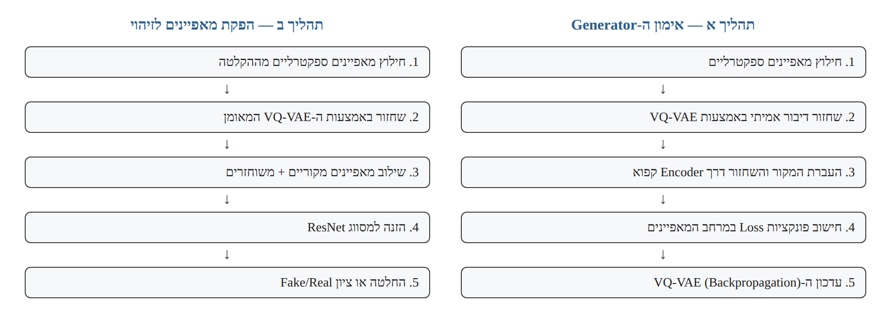
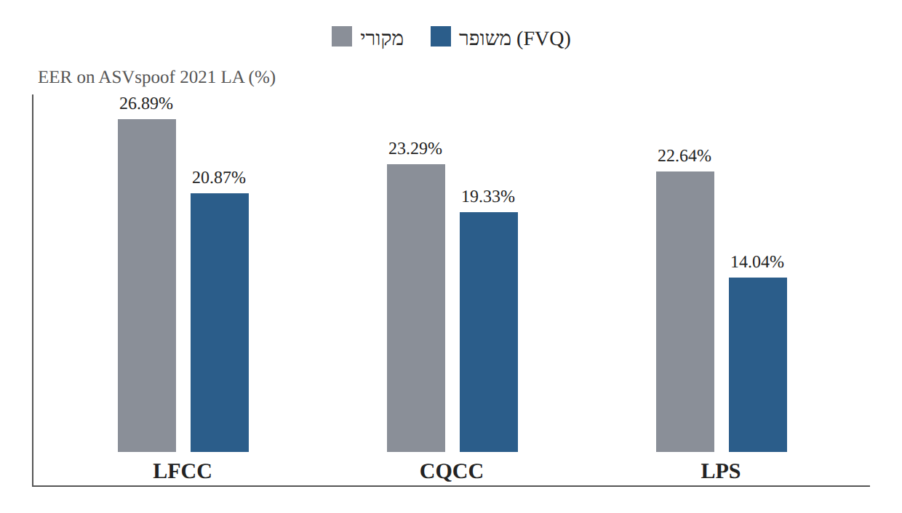

# Research Card 07 — Enhanced Forensic Trace Generation

## Robust Speech Forgery Detection via Enhanced Forensic Trace Generation

## 1. פרטים ביבליוגרפיים

**שם המאמר:** Robust Speech Forgery Detection via Enhanced Forensic Trace Generation.

**מחברים:** Site Wu, Yawei Cheng, Rangding Wang, Diqun Yan.

**מוסדות:** Ningbo University; Ningbo University of Finance and Economics, China.

**שנת פרסום:** 2026.

**כתב עת:** Signal, Image and Video Processing.

**פרטי פרסום:** Volume 20, Article 130.

**תאריך פרסום מקוון:** 3 במרץ 2026.

**DOI:** https://doi.org/10.1007/s11760-026-05167-y

**תחומי מחקר:** Audio Deepfake Detection, Speech Anti-Spoofing, Feature Reconstruction, Generative Representation Learning, Cross-Domain Generalization.

**מילות מפתח:** VQ-VAE, LFCC, CQCC, LPS, ResNet, Knowledge-Driven Generation Optimization, Triplet Loss, True Speech Consistency Loss, Feature Fusion, EER, min-tDCF.

**סיווג בסקירת הספרות:** מאמר הרחבה 01, Research Card 07.

**רלוונטיות לפרויקט:** בינונית–גבוהה מבחינה מחקרית; נמוכה יותר מבחינת עדיפות המימוש הראשונית. המאמר מציג דרך לשיפור מאפיינים ספקטרליים ללא מעבר הכרחי למודל SSL גדול, אך מחייב אימון של רכיב שחזור נוסף.

---

## 2. תקציר מקיף של המאמר

המאמר מציג מסגרת לשיפור מאפיינים ספקטרליים עבור זיהוי זיופים קוליים באמצעות שחזור מונחה-משימה.

החוקרים מבקשים להתמודד עם מגבלותיהן של שיטות המבוססות על מאפיינים מחושבים מראש, כגון LFCC ו-CQCC, אשר עשויות להציג ביצועים טובים על נתוני אימון מוכרים אך להתקשות בהכללה למתקפות ותנאי הקלטה שונים.

במקום לפתח מסווג גדול יותר, החוקרים מציעים לשפר את ייצוגי הקלט באמצעות Vector Quantized Variational Autoencoder (VQ-VAE). המודל לומד לשחזר מאפיינים ספקטרליים דרך מרחב לטנטי בדיד. השחזור נועד להבליט מידע מבחין הקשור לזיופים, ולא רק לשחזר את הספקטרוגרמה באופן מדויק.

לצורך הכוונת תהליך השחזור, החוקרים מציעים Knowledge-Driven Generation Optimization. במסגרת זו, Encoder של מסווג Anti-Spoofing שאומן מראש משמש כמקור לידע מבחין, ומשקלו נשאר קפוא בזמן אימון ה-Generator.

ה-VQ-VAE משחזר מאפיינים של דיבור אמיתי, בעוד שדוגמאות מזויפות משמשות כאותות פיקוח במסגרת פונקציות Loss ייעודיות.

שלושת רכיבי האובדן המרכזיים הם:

- True Speech Consistency Loss — שימור הדמיון בין ייצוגי דיבור אמיתי לייצוגי השחזור שלו.
- Triplet Loss — יצירת הפרדה יחסית בין ייצוגי דיבור אמיתי ומזויף.
- Positive Sample Constraint — מגבלה נוספת על המרחק בין ייצוג הדיבור האמיתי לבין ייצוג השחזור שלו.

לאחר אימון ה-Generator, המערכת משלבת בין המאפיינים המקוריים לבין המאפיינים המשוחזרים ומעבירה את הייצוג המשולב למסווג ResNet.

החוקרים בדקו שלוש משפחות מאפיינים — LFCC, CQCC ו-LPS — באימון על ASVspoof 2019 LA ובהערכה על ASVspoof 2019 LA ו-ASVspoof 2021 LA.

התוצאה הבולטת התקבלה באמצעות FVQ-LPS: על ASVspoof 2021 LA ה-EER ירד מ-22.64% ל-14.04% ביחס ל-ResNet המשתמש ב-LPS מקורי.

ניסויי Ablation הראו שרכיב ה-Triplet Loss משמעותי במיוחד להצלחת השיטה, והשוואת מודלי שחזור הראתה שבמסגרת הניסוי VQ-VAE הציג ביצועים טובים יותר מ-AE ומ-VAE.

עם זאת, השיטה מוסיפה מורכבות חישובית, והשיפור לא נבדק ישירות על ASVspoof 5 או CodecFake.

**המסקנה המרכזית:** שחזור ספקטרלי המונחה על ידי ייצוגים של מסווג Anti-Spoofing עשוי לחזק מאפיינים מבחינים ולשפר הכללה בין תנאי הערכה שונים. התרומה העיקרית של העבודה היא בשיפור ייצוגי הקלט, ולא בהצגת ארכיטקטורת סיווג חדשה לחלוטין.

**מקור:** Abstract, Sections 1–5.

---

## 3. בעיית המחקר והמוטיבציה

### 3.1 הבעיה המרכזית

מערכות לזיהוי זיופים קוליים מתקשות לעיתים להכליל למתקפות חדשות ולשינויים בתנאי ההקלטה.

החוקרים מזהים מגבלות בשתי משפחות גישות:

**מאפיינים מחושבים מראש:** בעלי נוסחאות קבועות, יציבים ויחסית יעילים לחישוב, אך אינם מותאמים אוטומטית לכל סוג זיוף.

**למידה עמוקה:** מאפשרת ללמוד ייצוגים מורכבים, אך עלולה לדרוש משאבים רבים ולהיות רגישה לשינויי התפלגות.

### 3.2 הפער המחקרי

החוקרים טוענים שאין די בהתמקדות במסווג עצמו. יש מקום לשפר גם את המאפיינים האקוסטיים שמוזנים אליו.

### 3.3 מטרת המחקר

לפתח שיטה המשפרת את יכולת ההבחנה בין דיבור אמיתי למזויף באמצעות שחזור ספקטרלי מונחה-משימה, תוך שמירה על מידע מקורי בעל ערך.

### 3.4 שאלת המחקר המשתמעת

האם ניתן להשתמש ב-Generator המבוסס על VQ-VAE, המונחה על ידי ייצוגים של מסווג זיהוי זיופים, כדי להבליט מאפיינים מבחינים ולשפר את הביצועים ואת יכולת ההכללה בהשוואה לשימוש במאפיינים ספקטרליים מקוריים בלבד?

**מקור:** Sections 1–2.

---

## 4. התרומות המרכזיות של המאמר

**1. Artifact-Amplified Reconstruction**

שחזור מאפיינים ספקטרליים במטרה להבליט מידע הקשור לזיופים.

**2. שימוש ב-VQ-VAE**

למידת ייצוגים בדידים באמצעות Codebook לצורך שחזור ספקטרוגרמות.

**3. Knowledge-Driven Generation Optimization**

הנחיית ה-Generator באמצעות Encoder קפוא של מסווג שכבר אומן על משימת Anti-Spoofing.

**4. True Speech Consistency Loss**

שימור הדמיון בין ייצוגי דיבור אמיתי לבין ייצוגי השחזור שלו.

**5. Dual-Margin Triplet Loss**

שילוב של Triplet Loss ושל מגבלה נוספת על המרחק בין זוג חיובי.

**6. Feature Fusion**

שילוב מאפיינים מקוריים ומשוחזרים כדי לנצל מידע משלים.

**7. בדיקת מספר משפחות מאפיינים**

הדגמת השיטה עם LFCC, CQCC ו-LPS.

**8. ניסויי Ablation ו-Cross-Feature**

בחינה נפרדת של רכיבי האובדן, צורות הייצוג ומודלי השחזור.

**מקור:** Section 1, Section 3.

---

## 5. הארכיטקטורה הכללית

### 5.1 שלבי המערכת

המערכת כוללת שני תהליכים עיקריים:

**תהליך א — אימון ה-Generator**

1. חילוץ מאפיינים ספקטרליים.
2. שחזור דיבור אמיתי באמצעות VQ-VAE.
3. העברת המקור והשחזור דרך Encoder מאומן וקפוא.
4. חישוב פונקציות Loss במרחב המאפיינים.
5. עדכון ה-VQ-VAE באמצעות Backpropagation.

**תהליך ב — הפקת מאפיינים לזיהוי**

1. חילוץ מאפיינים ספקטרליים מההקלטה.
2. שחזורם באמצעות ה-VQ-VAE המאומן.
3. שילוב המאפיינים המקוריים והמשוחזרים.
4. הזנת הייצוג המשולב למסווג ResNet.
5. קבלת החלטה או ציון עבור Fake/Real.

*איור 1. המחשה לתהליך אימון ה-Generator (א) ולתהליך הפקת המאפיינים לזיהוי (ב), המתוארים בסעיף 5.1.*

### 5.2 ההבדל ממסווג רגיל

במסווג רגיל:

Audio → Spectral Features → Classifier.

בשיטה המוצעת:

Audio → Spectral Features → VQ-VAE Reconstruction → Feature Fusion → Classifier.

### 5.3 עיקרון מנחה

לא מוותרים על מאפייני המקור, משום שהשחזור עשוי לשנות פרטים אקוסטיים חשובים.

במקום זאת, משתמשים במאפיינים המשוחזרים כהרחבה למידע המקורי.

**מקור:** Section 3, Figure 1.

---

## 6. רכיב VQ-VAE — Artifact-Amplified Reconstruction

### 6.1 מהו VQ-VAE?

Vector Quantized Variational Autoencoder הוא מודל Encoder–Decoder המשתמש בייצוג לטנטי בדיד המבוסס על Codebook נלמד.

### 6.2 מבנה הרכיב

ה-Encoder ממפה ספקטרוגרמה לייצוג לטנטי.

הייצוג מותאם לערכים מתוך Codebook בדיד.

ה-Decoder משחזר את הספקטרוגרמה מתוך הייצוג הבדיד.

### 6.3 למה להשתמש ב-Quantization?

החוקרים מציעים שהמרחב הבדיד מסייע ללכוד מבנים ספקטרליים יציבים, לצמצם מידע עודף ולחשוף אי-התאמות בדיבור מסונתז.

מדובר במוטיבציה ובפרשנות של החוקרים, ולא בהוכחה שכל ארטיפקט זיוף מתחזק לאחר Quantization.

### 6.4 פונקציות האובדן הבסיסיות של VQ-VAE

המאמר מציג שלושה רכיבים בסיסיים:

**Reconstruction Loss**

מודד את השגיאה בין הקלט לשחזור, באמצעות הפרש ריבועי.

**Quantization Loss**

מעדכן את ייצוגי ה-Codebook כדי להתאים אותם לייצוגים הרציפים של ה-Encoder.

**Commitment Loss**

מעודד את ה-Encoder להישאר קרוב לקודים הבדידים שנבחרו.

הפרמטר β של Commitment Loss נקבע ל-0.25.

### 6.5 למה האובדנים האלה אינם מספיקים?

הם מעודדים שחזור יציב ודומה למקור, אך אינם מספקים לבדם הנחיה ישירה לזיהוי זיופים.

לכן החוקרים מוסיפים רכיבי Loss המבוססים על הייצוגים שהמסווג מפיק.

**מקור:** Section 3.1, Equations 1–3.

---

## 7. Knowledge-Driven Generation Optimization

### 7.1 הרעיון

החוקרים משתמשים בידע של מסווג Anti-Spoofing מאומן כדי להנחות את ה-Generator.

### 7.2 תפקיד ה-Encoder

ה-Encoder מפיק ייצוגים מתוך המאפיינים הספקטרליים.

הוא משמש מקור מידע לגבי מאפיינים שהמסווג למד להשתמש בהם לצורך הבחנה בין אמיתי למזויף.

### 7.3 מה מוקפא?

משקלי ה-Encoder של המסווג נשארים קפואים בזמן אימון ה-VQ-VAE המונחה.

### 7.4 מה מתעדכן?

ה-Gradient מחושב דרך המערכת ומשמש לעדכון ה-Generator.

### 7.5 היתרון האפשרי

במקום לשחזר את הספקטרוגרמה רק לפי קרבה מספרית למקור, ה-Generator מקבל משוב גם לפי המאפיינים שהמסווג מוצא שימושיים.

### 7.6 מגבלה

אם ה-Encoder המנחה למד קיצורי דרך או מאפיינים שאינם מכלילים, גם ה-Generator עלול להיות מושפע מהם.

זוהי מגבלה מתודולוגית אפשרית שאנו מסיקים ממבנה השיטה; היא לא נבדקה באופן ישיר במאמר.

**מקור:** Section 3.2, Figure 1.

---

## 8. True Speech Consistency Loss

### 8.1 המטרה

לעודד דמיון בין הייצוג של דיבור אמיתי מקורי לבין הייצוג של השחזור שלו.

### 8.2 המנגנון

החוקרים משתמשים ב-Cosine Similarity.

פונקציית האובדן ממוצעת על פני דוגמאות הדיבור האמיתי, ושווה באופן עקרוני ל:

L_TSC = mean(1 − cosine(real representation, reconstructed-real representation)).

### 8.3 למה זה חשוב?

כאשר משחזרים דיבור אמיתי, רוצים לשמר את המידע שהמסווג מזהה כמאפיין את המחלקה האמיתית.

### 8.4 מה הפונקציה אינה מבטיחה?

היא אינה מספקת בפני עצמה השוואה ישירה למרחק של דיבור מזויף.

לכן אפשר לשמר דמיון גבוה בין מקור אמיתי לשחזורו בלי להשיג הפרדה מספקת בין המחלקות.

### 8.5 מגבלה נוספת

Cosine Similarity מתמקדת בכיוון היחסי של הווקטורים, ולא בהכרח במרחק האוקלידי ביניהם.

מכאן נובעת אחת ההצדקות להוספת Positive Sample Constraint.

**מקור:** Section 3.3, Equation 4.

---

## 9. Triplet Loss

### 9.1 שלושת הייצוגים

- Anchor — ייצוג של דיבור אמיתי מקורי.
- Positive — ייצוג של השחזור של אותו דיבור אמיתי.
- Negative — ייצוג של דיבור מזויף.

### 9.2 המטרה

לגרום לכך שדיבור אמיתי והשחזור שלו יהיו קרובים יחסית, בעוד שדיבור מזויף יהיה רחוק יותר במרחב המאפיינים.

### 9.3 הרעיון המתמטי

ה-Loss מעניש כאשר המרחק בין ה-Anchor ל-Positive אינו קטן מספיק מהמרחק בין ה-Anchor ל-Negative.

ההפרדה נדרשת לעמוד ב-Margin מוגדר.

### 9.4 מה הרכיב מוסיף?

בניגוד ל-TSC, הוא כולל במפורש דוגמאות מזויפות ומנחה את ה-Generator באופן מבחין בין המחלקות.

### 9.5 הסיכון בהיעדרו

ה-Generator עשוי ללמוד לשחזר דיבור אמיתי בצורה יציבה, אך לא ללמוד טרנספורמציה המועילה להפרדת זיופים מדיבור אמיתי.

### 9.6 ממצא ניסויי

הסרת Triplet Loss העלתה את ה-EER על ASVspoof 2021 LA מ-14.04% ל-20.92%.

זהו השינוי הגדול ביותר מבין הסרת רכיבי האובדן הבודדים בניסוי.

**מקור:** Section 3.4, Equation 5, Table 2.

---

## 10. Positive Sample Constraint

### 10.1 הבעיה

Triplet Loss מבוסס על קשר יחסי בין מרחקים.

לכן הוא עשוי לאפשר פתרון שבו ה-Negative רחוק מספיק מה-Anchor, אף שה-Positive עצמו אינו קרוב במיוחד ל-Anchor.

### 10.2 הפתרון

החוקרים מוסיפים מגבלה עצמאית על המרחק בין ייצוג הדיבור האמיתי לייצוג המשוחזר שלו.

### 10.3 הנוסחה העקרונית

L_positive = mean(max(d(real, reconstructed-real) − m_p, 0)).

כלומר, כאשר המרחק בין הזוג החיובי גדול מהסף m_p, מתקבל עונש.

### 10.4 מה הרכיב מוסיף?

הוא מעודד את השחזור לשמור על קרבה מספקת לייצוג הדיבור האמיתי במונחי מרחק אוקלידי.

### 10.5 ממצא ניסויי

הסרת Positive Sample Constraint העלתה את ה-EER על ASVspoof 2021 LA מ-14.04% ל-15.30%.

### 10.6 דיוק מושגי

למרות שבטקסט המאמר קיימת התייחסות ל-m_p במונחי Margin, הנוסחה המוצגת בפועל פועלת כסף עליון למרחק החיובי: העונש מופעל כאשר המרחק חורג ממנו.

**מקור:** Section 3.4, Equation 6.

---

## 11. פונקציית האובדן הכוללת

המאמר מגדיר:

L_total = L_TSC + L_triplet + L_positive.

בגרסה המרכזית כל אחד משלושת הרכיבים מקבל משקל 1.

### תפקיד כל רכיב

| Loss | תפקיד מרכזי |
|---|---|
| TSC | שמירה על דמיון ייצוגי של דיבור אמיתי |
| Triplet | הפרדה יחסית בין אמיתי למזויף |
| Positive | הגבלת המרחק בין אמיתי לשחזורו |

### הבחנה חשובה

אלה רכיבי ההנחיה המבחינים שהמחברים מציעים ל-Generator.

הם אינם מחליפים את עצם קיומו של מודל VQ-VAE ואת מנגנוני השחזור וה-Quantization הבסיסיים שלו.

**מקור:** Section 3.5, Equation 7.

---

## 12. מאגרי הנתונים

### 12.1 מאגר האימון

ASVspoof 2019 Logical Access.

### 12.2 נתוני האימון

המחברים מדווחים שה-Encoder של המסווג אומן על 25,380 דוגמאות אימון.

לצורך אימון השחזור, ה-VQ-VAE השתמש ב-2,580 דוגמאות דיבור אמיתי, בעוד שדוגמאות מזויפות נוספות שימשו כאותות פיקוח.

### 12.3 קבוצת Validation

המחברים השתמשו בקבוצת הפיתוח הרשמית של ASVspoof 2019 LA לצורך כוונון ההיפר-פרמטרים.

### 12.4 קבוצות ההערכה

**ASVspoof 2019 LA Evaluation**

בדיקה במסגרת אותו מאגר מחקרי.

**ASVspoof 2021 LA Evaluation**

בדיקה בתנאים הכוללים שינויי דחיסה, ערוצים וסוגי מתקפות שלא הופיעו בקבוצת האימון של 2019, בהתאם לתיאור המחברים.

### 12.5 משמעות ההערכה

המעבר מ-2019 ל-2021 מאפשר להעריך היבטים של עמידות לשינויי התפלגות.

עם זאת, הוא אינו שקול להוכחת הכללה לכל מקור אודיו או לכל שיטת זיוף.

**מקור:** Section 4.1.

---

## 13. פרטי מימוש ואימון

### 13.1 ה-Backend

החוקרים משתמשים ב-ResNet המבוסס על ארכיטקטורה מעבודה קודמת.

### 13.2 אימון המסווג

- Optimizer: Adam.
- Learning Rate התחלתי: 0.0003.
- הפחתת Learning Rate בחצי כל עשרה Epochs.
- מספר Epochs: 100.
- Batch Size: 64.

### 13.3 הגדרות VQ-VAE

| פרמטר | ערך |
|---|---:|
| Encoder Hidden Dimension | 128 |
| Residual Hidden Dimension | 64 |
| Residual Layers | 5 |
| Codebook Size | 1,024 |
| Codeword Embedding Dimension | 128 |
| Commitment β | 0.25 |

### 13.4 פרטים נוספים

- Codebook Initialization: Xavier.
- Optimizer ל-VQ-VAE: FusedAdam.
- Learning Rate Scheduler: LambdaLR.
- שימוש ב-Exponential Moving Average לייצוב האימון.

### 13.5 סביבת החישוב

הניסויים בוצעו באמצעות NVIDIA RTX 4080 Super, עם 16GB VRAM ו-CUDA 12.4.

### 13.6 זמינות מימוש

המאמר מציין שקוד המימוש זמין מהמחבר האחראי לפי בקשה סבירה.

לא מוצג במאמר קישור למאגר קוד ציבורי מלא.

**מקור:** Section 4.3; Code Availability, עמוד 10.

---

## 14. מדדי הערכה

### 14.1 Equal Error Rate — EER

המדד המרכזי להערכת יכולת ההבחנה בין דיבור אמיתי למזויף.

ערך נמוך יותר עדיף.

### 14.2 Minimum Tandem Detection Cost Function — min-tDCF

מדד המשקלל את העלויות וההסתברויות הרלוונטיות לפעולה משותפת של מערכת אימות דובר ושל מנגנון Anti-Spoofing.

ערך נמוך יותר עדיף.

### 14.3 משמעות לפרויקט

בפרויקט שלנו, EER הוא מדד מרכזי.

min-tDCF עשוי לשמש להבנת ההשלכות של שימוש במנגנון Anti-Spoofing לצד Speaker Verification, אך אינו מחליף את פרוטוקול ההערכה של הקורס.

**מקור:** Section 4.2.

---

## 15. התוצאות המרכזיות — Table 1

### 15.1 השוואת מאפיינים מקוריים ומשופרים

| מאפיין | 2019 EER מקורי | 2019 EER משופר | 2021 EER מקורי | 2021 EER משופר |
|---|---:|---:|---:|---:|
| LFCC → FVQ-LFCC | 2.45% | 2.41% | 26.89% | 20.87% |
| CQCC → FVQ-CQCC | **2.24%** | 2.48% | 23.29% | 19.33% |
| LPS → FVQ-LPS | 1.22% | **1.02%** | 22.64% | **14.04%** |

*איור 2. המחשה לנתוני Table 1 (סעיף 15.1): EER על ASVspoof 2021 LA, מקורי מול משופר, בכל אחת משלוש המשפחות.*

### 15.2 הממצא החשוב

על ASVspoof 2021 LA, שלוש משפחות המאפיינים הציגו שיפור ב-EER.

### 15.3 דיוק חשוב

על ASVspoof 2019 LA השיפור אינו אחיד.

בפרט, FVQ-CQCC השיג EER של 2.48%, מעט גרוע יותר מ-2.24% עבור CQCC המקורי.

לכן אין לומר שהשיטה שיפרה את ה-EER בכל משפחת מאפיינים ובכל קבוצת בדיקה.

### 15.4 השיפור ב-LPS

על ASVspoof 2021 LA:

- Original LPS: 22.64%.
- FVQ-LPS: 14.04%.
- שיפור מוחלט: 8.60 נקודות אחוז.
- ירידה יחסית: כ-38%.

### 15.5 השוואה למודלים אחרים

| מודל | EER על 2019 | EER על 2021 |
|---|---:|---:|
| AASIST | **0.83%** | 15.84% |
| Res-TSSDNet | 1.64% | 15.65% |
| GMM + CQCC | 9.57% | 15.62% |
| ResNet + FVQ-LPS | 1.02% | **14.04%** |

### 15.6 מסקנה

השיטה המוצעת אינה מובילה בכל קבוצת הערכה, אך היא מציגה יתרון בולט בהכללה ל-ASVspoof 2021 LA במסגרת ההשוואה המדווחת.

**מקור:** Section 4.4, Table 1.

---

## 16. ניסויי Ablation — Table 2

### 16.1 מטרת הניסוי

לבחון האם כל אחד משלושת רכיבי ה-Loss תורם לשיפור ביצועי הזיהוי.

### 16.2 תוצאות

| תצורה | 2019 EER | 2021 EER | 2021 min-tDCF |
|---|---:|---:|---:|
| Original LPS | 1.22% | 22.64% | 0.694 |
| FVQ-LPS ללא שלושת ה-Losses | 1.57% | 26.99% | 0.891 |
| FVQ-LPS ללא TSC | 1.15% | 16.00% | 0.599 |
| FVQ-LPS ללא Triplet | 1.36% | 20.92% | 0.624 |
| FVQ-LPS ללא Positive | 1.12% | 15.30% | 0.551 |
| **FVQ-LPS עם שלושתם** | **1.02%** | **14.04%** | **0.485** |

### 16.3 מה לומדים?

הסרת כל שלוש פונקציות ה-Loss המוצעות פגעה משמעותית בביצועים.

הסרת Triplet Loss לבדה הייתה בעלת ההשפעה הגדולה ביותר מבין שלוש ההסרות הנפרדות.

### 16.4 שינוי משקלי Loss

החוקרים בדקו גם הקטנת המשקל של כל רכיב בנפרד.

הקטנת משקל Triplet מ-1 ל-0.5 העלתה את ה-EER על 2021 מ-14.04% ל-15.23%.

הקטנת משקלי TSC או Positive השפיעה פחות על התוצאות.

### 16.5 Figure 2

החוקרים מציגים התפלגויות Cosine Similarity בין ייצוגי מקור לייצוגי שחזור.

לפי הניתוח שלהם, שימוש בכל רכיבי האובדן משמר דמיון גבוה עבור חלק גדול מדוגמאות הדיבור האמיתי, ובמקביל יוצר דפוס שונה עבור דוגמאות מזויפות.

### 16.6 מסקנה

ההפרדה המבחינה בין המחלקות היא מרכיב מרכזי בהצלחת השיטה.

עם זאת, התוצאות נוגעות לתצורה ולמאגרי ההערכה שנבדקו, ולא בהכרח לכל שימוש אפשרי ב-Triplet Loss.

**מקור:** Section 4.5, Table 2, Figure 2.

---

## 17. ניסויי Cross-Feature — Table 3

### 17.1 מטרת הניסוי

לבחון כיצד תצורות שונות של מאפיינים מקוריים, משוחזרים ומשולבים משפיעות על ביצועי המסווג.

### 17.2 שלושת סוגי הייצוגים

**LPS:** המאפיינים המקוריים.

**VQ-LPS:** המאפיינים המשוחזרים באמצעות VQ-VAE.

**FVQ-LPS:** שילוב המאפיינים המקוריים והמשוחזרים.

### 17.3 תוצאות נבחרות

כאשר ResNet אומן על LPS מקורי:

| מאפייני בדיקה | 2019 EER | 2021 EER |
|---|---:|---:|
| LPS | 1.22% | 22.64% |
| VQ-LPS | 1.38% | 17.42% |
| FVQ-LPS | **1.02%** | **14.04%** |

### 17.4 משמעות הממצאים

גם מאפיינים משוחזרים לבדם שיפרו את ה-EER על 2021 לעומת LPS מקורי, בתצורה זו.

השילוב בין המאפיינים המקוריים למשוחזרים סיפק תוצאה טובה עוד יותר.

### 17.5 תוצאה נוספת

כאשר המודל אומן על VQ-LPS בלבד, ה-EER על 2021 בבדיקה על VQ-LPS היה 17.89%, ועל FVQ-LPS היה 19.58%.

לכן שימוש במאפיינים משוחזרים בלבד אינו מוביל באופן עקבי לתוצאה הטובה ביותר.

### 17.6 מסקנה

שחזור המאפיינים יכול לספק מידע שימושי, אך חשוב גם כיצד המסווג מאומן וכיצד משלבים את המאפיינים בשלב ההערכה.

**מקור:** Section 4.6, Table 3.

---

## 18. השוואת מודלי שחזור — Table 4

### 18.1 מטרת הניסוי

לבחון האם השיפור תלוי בבחירה דווקא ב-VQ-VAE.

### 18.2 המודלים

- AE — Autoencoder.
- VAE — Variational Autoencoder.
- VQ-VAE — Vector Quantized Variational Autoencoder.

### 18.3 תוצאות

| Reconstruction Model | 2019 EER | 2021 EER | 2021 min-tDCF |
|---|---:|---:|---:|
| AE | 1.26% | 15.98% | 0.613 |
| VAE | 1.57% | 17.90% | 0.671 |
| **VQ-VAE** | **1.02%** | **14.04%** | **0.485** |

### 18.4 מסקנה

VQ-VAE השיג את הביצועים הטובים ביותר בתנאי ההשוואה.

### 18.5 הסבר אפשרי

החוקרים מציעים שהמרחב הבדיד של VQ-VAE מסייע לשמר מבנים יציבים של דיבור אמיתי ולהבליט אי-התאמות בדיבור מזויף.

אין בכך הוכחה שכל מבנה לטנטי בדיד עדיף על כל חלופה רציפה.

**מקור:** Section 4.7, Table 4.

---

## 19. ניתוח ויזואלי של הייצוגים — Figure 3

### 19.1 מה מוצג?

Figure 3 מציגה Heatmaps של ייצוגים לטנטיים מתוך דוגמאות אמיתיות ומזויפות ב-ASVspoof 2019.

האיורים משווים:

- ייצוגים מתוך מאפיינים מקוריים.
- ייצוגים מתוך מאפיינים משוחזרים.

### 19.2 פרשנות החוקרים

בדוגמאות המזויפות שהוצגו, תהליך השחזור שינה את דפוסי הייצוג באופן שסייע לסיווג.

בדוגמאות האמיתיות, הייצוגים נשארו יציבים יחסית.

### 19.3 מגבלה

מדובר בהמחשה ויזואלית באמצעות דוגמאות נבחרות, ולא במדד עצמאי המעיד שכל זיוף או כל דוגמת דיבור אמיתי יתנהגו באותו אופן.

**מקור:** Section 4.7, Figure 3.

---

## 20. מורכבות חישובית ויעילות

### 20.1 תוצאות Table 5

| מדד | ResNet רגיל | המודל המוצע |
|---|---:|---:|
| מספר פרמטרים בקירוב | 2.34M | 5.67M |
| MACs | 1.25G | 3.12G |
| Real-Time Factor | 0.0085 | 0.0071 |

### 20.2 משמעות המספרים

השיטה המוצעת מוסיפה כ-3.33 מיליון פרמטרים ביחס ל-ResNet המקורי.

מספר פעולות ה-MAC גדל מ-1.25G ל-3.12G.

לכן השיטה יקרה יותר מבחינה חישובית בהשוואה ל-Baseline הישיר שלה.

### 20.3 כיצד לפרש את ה-RTF?

ה-Real-Time Factor שנמדד נמוך מעט במודל המוצע, אך החוקרים עצמם מסבירים שההבדל עשוי לנבוע מתזמון וממקביליות העיבוד של ה-GPU.

אין בכך ראיה שהמודל דורש פחות פעולות חישוב.

### 20.4 הערה על יחידות המדידה

בטבלה עצמה קיימת אי-בהירות בתיוג העמודה של גודל המודל: מופיע סימון MB, בעוד שהטקסט מתאר את הערכים כמספר פרמטרים במיליונים.

לצורך השוואה מחקרית, נכון לשמר את המספרים המדווחים ולציין את אי-הבהירות במקום להתייחס ל-MB ולמיליוני פרמטרים כיחידות זהות.

### 20.5 מסקנה

השיטה עשויה להיות קטנה בהשוואה למודלים גדולים מסוימים, אך היא אינה קלה יותר מה-ResNet המקורי שעליו היא מבוססת.

**מקור:** Section 4.8, Table 5.

---

## 21. ניתוח ביקורתי — יתרונות המחקר

**א. גישה משלימה לזיהוי זיופים**

המחקר מציע שיפור של מאפיינים אקוסטיים ולא רק שינוי ארכיטקטורת הסיווג.

**ב. שימוש בידע של מסווג קיים**

ה-Generator מונחה באמצעות ייצוגים הקשורים למשימת Anti-Spoofing.

**ג. שימור המידע המקורי**

שילוב המאפיינים המקוריים והמשוחזרים מצמצם תלות מלאה בתהליך השחזור.

**ד. ניסויים על מספר משפחות מאפיינים**

השיטה נבדקה על LFCC, CQCC ו-LPS.

**ה. הערכה מחוץ לתנאי האימון המקוריים**

המחקר בוחן ASVspoof 2021 LA לאחר אימון על 2019 LA.

**ו. ניסויי Ablation**

החוקרים מראים את תרומתם הנפרדת של רכיבי ה-Loss.

**ז. השוואת מודלי שחזור**

המאמר אינו מסתפק ב-VQ-VAE אלא משווה גם AE ו-VAE.

**ח. ניתוח עלות חישובית**

החוקרים מדווחים על פרמטרים, MACs ו-RTF.

---

## 22. ניתוח ביקורתי — מגבלות המחקר

**א. ההכללה נבחנה במעבר מוגדר בין מאגרים**

השיטה אומנה על ASVspoof 2019 LA ונבדקה על ASVspoof 2021 LA.

לא נבדקה הכללה ל-ASVspoof 5 או ל-CodecFake.

**ב. שיפור שאינו אחיד בכל התנאים**

על ASVspoof 2019 LA, FVQ-CQCC הציג EER מעט גרוע יותר מ-CQCC המקורי.

**ג. תוספת מורכבות**

השיטה דורשת אימון של VQ-VAE בנוסף למסווג ומגדילה את מספר הפרמטרים והפעולות.

**ד. תלות באיכות ה-Encoder המנחה**

ה-Generator מקבל הנחיה ממסווג שכבר אומן. אם הייצוגים שלו אינם מכלילים, קיים סיכון שההנחיה תהיה מוגבלת.

**ה. מספר מוגבל של מאפיינים שנבדקו**

המחקר מתמקד ב-LFCC, CQCC ו-LPS.

הוא אינו מוכיח שיפור דומה בייצוגים של wav2vec 2.0 או WavLM.

**ו. מספר מוגבל של ארכיטקטורות שחזור**

נבדקו AE, VAE ו-VQ-VAE, ולא כל שיטות השחזור האפשריות.

**ז. שילוב במשקלים קבועים**

השילוב העיקרי משתמש במשקלים שווים של 0.5. לא מוצגת הוכחה שמשקל זה הוא האופטימלי לכל תנאי.

**ח. זמינות מימוש מוגבלת**

הקוד זמין מהמחבר לפי בקשה, ולא באמצעות קישור ציבורי מפורש במאמר.

**ט. חלק מהמסקנות נשענות על המחשה ויזואלית**

ה-Heatmaps תומכים בפרשנות החוקרים, אך אינם מהווים הוכחה כללית לגבי כלל הדוגמאות.

**י. תוצאות יעילות שדורשות פרשנות זהירה**

RTF נמוך מעט יותר אינו מבטל את העלייה ב-MACs.

---

## 23. מה המאמר אינו מוכיח?

אין להסיק מהמאמר ש:

- כל שחזור ספקטרלי משפר זיהוי זיופים.
- שחזור מדויק יותר בהכרח מוביל ל-EER נמוך יותר.
- VQ-VAE תמיד עדיף על AE או VAE.
- Triplet Loss הוא תמיד הרכיב החשוב ביותר בכל ארכיטקטורה.
- שיפור על ASVspoof 2021 LA מבטיח שיפור על CodecFake.
- השיטה מפחיתה את העלות החישובית בהשוואה ל-ResNet המקורי.
- Feature Fusion במשקלים שווים הוא אופטימלי בכל מצב.
- השיטה עדיפה בהכרח על WavLM או wav2vec 2.0 כפתרון לזיהוי זיופים.
- הייצוגים המשוחזרים משמרים את כל המידע האקוסטי המקורי.
- התוצאות יישמרו על מאגר קטן של 1,520 הקלטות.

---

## 24. ההבנות והתובנות שלנו מהמאמר

### 24.1 Feature Engineering אינו חייב להיות סטטי

אפשר להתחיל ממאפיינים מחושבים מראש ולהשתמש במודל נלמד כדי לשפר אותם.

### 24.2 שחזור מושלם אינו בהכרח המטרה

אם השחזור זהה למקור, שילוב שווה של שתי הגרסאות אינו משנה את ייצוג הקלט.

לכן מטרת השיטה אינה רק להגיע לשחזור מדויק, אלא לשחזור שתורם להבחנה בין המחלקות.

### 24.3 השחזור עלול גם למחוק מידע

תהליך השחזור עשוי לאבד פרטים אקוסטיים שימושיים.

זו אחת ההצדקות לשילוב המאפיינים המקוריים עם המשוחזרים.

### 24.4 שימור דיבור אמיתי אינו מספיק לבדו

True Speech Consistency Loss מעודד שימור ייצוגי של דיבור אמיתי.

אבל הוא אינו מרחיק באופן מפורש ייצוגים מזויפים.

Triplet Loss מוסיף את רכיב ההפרדה בין המחלקות.

### 24.5 קרבה יחסית אינה שקולה לקרבה מוחלטת

Triplet Loss מתמקד בהפרש בין מרחקים.

Positive Sample Constraint מוסיף מגבלה על המרחק בין ייצוג אמיתי לשחזורו.

### 24.6 תוצאות Cross-Domain חשובות במיוחד

השיפור הבולט ביותר של השיטה הופיע על ASVspoof 2021 LA, ולא בהכרח על קבוצת ההערכה מתוך 2019.

### 24.7 ביצועים ועלות צריכים להיבחן יחד

שיפור ב-EER אינו בהכרח מצדיק הוספת רכיבים גנרטיביים, במיוחד כאשר יש מגבלות משאבים וזמן.

---

## 25. משמעות המאמר לפרויקט שלנו

### 25.1 מאגר הנתונים

מאגר הקורס כולל 1,520 הקלטות בנות ארבע שניות, בקצב דגימה של 16kHz:

| מקור | Bona Fide | Spoof | סה"כ |
|---|---:|---:|---:|
| ASVspoof 5 | 300 | 300 | 600 |
| CodecFake | 300 | 300 | 600 |
| M-AILABS | 320 | 0 | 320 |
| **סה"כ** | **920** | **600** | **1,520** |

### 25.2 התאמה אפשרית

ניתן לשקול שחזור של מאפייני CQCC או LPS ולאחר מכן השוואה בין שלושה סוגי ייצוגים:

- מאפיינים מקוריים.
- מאפיינים משוחזרים.
- שילוב מאפיינים מקוריים ומשוחזרים.

### 25.3 מה צריך לבדוק לפני מימוש?

- האם ניתן להפיק את המאפיינים הנדרשים בצורה עקבית?
- האם יש מספיק דוגמאות לאימון יציב של VQ-VAE?
- האם יש משאבי GPU מתאימים?
- האם השיטה משפרת EER ביחס ל-Baseline?
- האם השיפור נשמר כאשר מקור הנתונים משתנה?

### 25.4 קושי אפשרי

כמות הנתונים שלנו מוגבלת משמעותית ביחס למאגר האימון המקורי של המחקר.

לכן אימון של VQ-VAE ומסווג מאפס עשוי להיות רגיש להתאמת יתר.

### 25.5 סדר עדיפות

מבחינתנו, השיטה מתאימה לניסוי הרחבה ולא לניסוי הפתיחה.

הסדר המועדף:

1. בניית Baseline עם MFCC או CQCC.
2. בדיקת מודלים מאומנים מראש כגון wav2vec 2.0 ו-WavLM.
3. ניתוח EER, יציבות, עלויות חישוב והכללה.
4. רק לאחר מכן החלטה האם יש הצדקה למימוש VQ-VAE מונחה.

### 25.6 קשר למאמרי החובה

**CQCC:** מאפיינים אקוסטיים קלאסיים שעליהם אפשר ליישם שחזור.

**AASIST:** מספק נקודת השוואה של מודל Anti-Spoofing ייעודי.

**wav2vec 2.0 / WavLM:** מציגים חלופה של שימוש בייצוגים מאומנים מראש במקום בניית Generator נוסף.

**ASVspoof 5 / CodecFake:** מאפשרים לבחון, בכפוף לפרוטוקול תקף, את יכולת ההכללה בין מקורות מתקפות שונים.

---

## 26. השערות מחקר וניסויים אפשריים

### H1 — Original לעומת Reconstructed לעומת Fused

**השערה:** שילוב מאפיינים מקוריים ומשוחזרים עשוי להציג EER נמוך יותר משימוש בכל אחד מהם בנפרד.

**ניסוי:** אימון והערכה של מסווג זהה עם שלוש תצורות ייצוג.

**מדד:** EER.

**מגבלה:** יש לוודא שההבדלים אינם נובעים מהגדלת קיבולת המסווג או מתקציב כוונון לא אחיד.

### H2 — תרומת השחזור למאפייני CQCC

**השערה:** שחזור מאפייני CQCC באמצעות VQ-VAE עשוי לסייע בהבלטת ארטיפקטים ספקטרליים.

**ניסוי:** CQCC מקורי מול CQCC משוחזר ומשולב.

**מגבלה:** השיפור במאמר על CQCC לא היה אחיד בין מאגרי ההערכה.

### H3 — הכללה בין מאגרי נתונים

**השערה:** Feature Reconstruction עשוי לשפר EER על מקור בדיקה שונה ממקור האימון.

**ניסוי:** תרחיש Cross-Dataset בין ASVspoof 5 ל-CodecFake, בכפוף לאיכות חלוקת הנתונים.

**מגבלה:** ההבדלים בין המאגרים כוללים גורמים נוספים מלבד סוג הזיוף.

### H4 — תרומת Knowledge-Driven Optimization

**השערה:** אימון VQ-VAE עם פיקוח מהמסווג עשוי להפיק ייצוגים מבחינים יותר מאימון שחזור רגיל.

**ניסוי:** VQ-VAE עם Reconstruction Loss בלבד מול VQ-VAE עם רכיבי האובדן המוצעים.

**מגבלה:** ניסוי זה דורש מימוש מורכב יותר ומשאבי אימון נוספים.

### H5 — השוואת ביצועים ועלות

**השערה:** השיפור האפשרי ב-EER עשוי שלא להצדיק את תוספת העלות ביחס למודל מאומן מראש או ל-Baseline קלאסי.

**ניסוי:** השוואת EER, זמן אימון, זמן חיזוי, שימוש בזיכרון ו-MACs.

**מטרה:** לבחון את התועלת ההנדסית ולא רק את המדד המחקרי.

---

## 27. שאלות פתוחות להמשך

1. האם אפשר לאמן VQ-VAE בצורה יציבה על מאגר הקורס המצומצם?
2. האם שחזור CQCC יועיל לזיהוי זיופים המבוססים על Neural Audio Codecs?
3. האם השיפור ב-LPS במאמר יופיע גם על ASVspoof 5?
4. האם ניתן להחליף את ה-Encoder המנחה בייצוגים של WavLM?
5. האם ניתן ללמוד משקלי Fusion במקום להשתמש במשקלים קבועים?
6. האם השיטה באמת משפרת הכללה בין מקורות נתונים?
7. האם תהליך השחזור מאבד מידע אקוסטי הרלוונטי לחלק מהמתקפות?
8. האם אפשר להשתמש ב-Reconstruction Error כמאפיין נוסף בפני עצמו?
9. האם העלות החישובית מתאימה למגבלות הפרויקט?
10. האם שיפור קטן ב-EER יצדיק אימון של Generator נוסף?
11. האם יתרון השיטה נובע בעיקר משחזור המאפיינים או משיטת האימון המונחית?
12. אילו מתקפות יפיקו תועלת מהשחזור ואילו לא?

---

## 28. מסקנה מסכמת

המאמר מציג גישה לשיפור מאפיינים ספקטרליים לצורך זיהוי זיופים קוליים, באמצעות VQ-VAE המונחה על ידי ידע של מסווג Anti-Spoofing.

בניגוד לגישות שמחליפות את תהליך חילוץ המאפיינים במודל עמוק חדש, השיטה מבקשת להעשיר את הייצוגים המקוריים באמצעות שחזור מונחה ושילוב המידע המקורי והמשוחזר.

שלוש פונקציות האובדן המוצעות תורמות ללמידת שימור מאפייני דיבור אמיתי ולהפרדה בין דיבור אמיתי למזויף, כאשר ניסויי Ablation מצביעים על חשיבותו המיוחדת של Triplet Loss.

בניסויי המאמר, FVQ-LPS שיפר את ה-EER על ASVspoof 2021 LA מ-22.64% ל-14.04%, ובכך הציג יתרון בהכללה ביחס ל-ResNet עם מאפייני LPS מקוריים.

עם זאת, השיטה מוסיפה מורכבות חישובית והשיפור לא הוכח על מאגרי הפרויקט שלנו.

**המסקנה המחקרית שנאמץ:** שחזור מונחה יכול להיות דרך לשפר מאפיינים אקוסטיים ולהבליט עקבות זיוף, אך יש להצדיק את השימוש בו באמצעות ניסויים מבוקרים והשוואה ל-Baselines פשוטים יותר.

**ההחלטה המעשית שלנו:** בשלב הראשון נבנה Baseline יציב ונבחן מודלים מאומנים מראש. רק לאחר שנכיר את הביצועים ואת מגבלות המשאבים נחליט אם לממש את שיטת ה-VQ-VAE המוצעת.

---

## 29. מפת הפניות למאמר

| נושא | מיקום במאמר |
|---|---|
| פרטים ביבליוגרפיים ותקציר | עמ' 1 |
| בעיית המחקר והמוטיבציה | Section 1, עמ' 1–2 |
| גישות קודמות | Section 2, עמ' 2–3 |
| תרשים אימון ה-Generator | Figure 1, עמ' 3 |
| Artifact-Amplified Reconstruction | Section 3.1, עמ' 3 |
| VQ-VAE Losses | Equations 1–3, עמ' 3 |
| Knowledge-Driven Generation Optimization | Section 3.2, עמ' 4 |
| True Speech Consistency Loss | Section 3.3, Equation 4, עמ' 4 |
| Triplet Loss | Section 3.4, Equation 5, עמ' 4 |
| Positive Sample Constraint | Section 3.4, Equation 6, עמ' 4 |
| פונקציית האובדן הכוללת | Section 3.5, Equation 7, עמ' 5 |
| מאגרי הנתונים | Section 4.1, עמ' 5 |
| EER ו-min-tDCF | Section 4.2, עמ' 5 |
| הגדרות אימון | Section 4.3, עמ' 5–6 |
| תוצאות מרכזיות | Table 1, עמ' 6 |
| Ablation | Table 2, עמ' 7 |
| דמיון בין ייצוגים | Figure 2, עמ' 7 |
| Cross-Feature | Table 3, עמ' 8 |
| השוואת AE, VAE ו-VQ-VAE | Table 4, עמ' 8 |
| Heatmaps של ייצוגים | Figure 3, עמ' 9 |
| עלות חישובית | Table 5, עמ' 9 |
| מסקנות החוקרים | Section 5, עמ' 9 |
| זמינות קוד | עמ' 10 |

**הערת שימוש:** תוצאות המאמר מבוססות על ASVspoof 2019 LA ו-ASVspoof 2021 LA. כל הצעה להפעיל את השיטה על ASVspoof 5, CodecFake או מודלי SSL היא הרחבה מחקרית אפשרית שלנו, ולא ממצא שהחוקרים אימתו.
