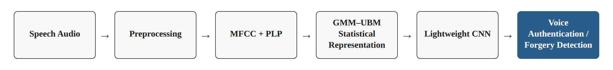
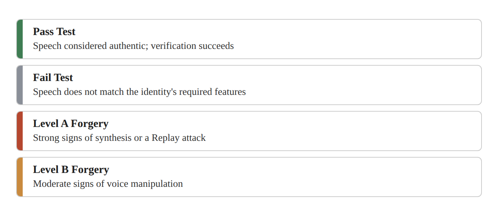
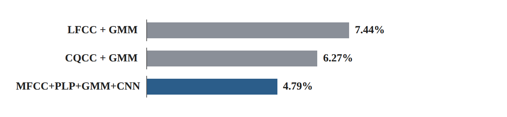

# Research Card 08 — Intelligent Voice Fraud Detection

## Intelligent Voice Fraud Detection Methods in Authentication Systems

## 1. Bibliographic Details

**Paper title:** Intelligent Voice Fraud Detection Methods in Authentication Systems.

**Authors:** K. E. Izrailov, I. V. Kotenko, A. A. Chechulin.

**Research institution:** St. Petersburg Federal Research Center of the Russian Academy of Sciences, Russia.

**Year of publication:** 2026.

**Journal:** Pattern Recognition and Image Analysis.

**Publication details:** Volume 36, Issue 2, Pages 391–399.

**DOI:** https://doi.org/10.1134/S1054661826700203

**Research fields:** Audio Deepfake Detection, Voice Biometrics, Speaker Verification, Speech Anti-Spoofing, Hybrid Machine Learning, Digital Forensics.

**Keywords:** MFCC, PLP, GMM–UBM, CNN, Voice Spoofing, Speaker Authentication, Gaussian Mixture Model, Acoustic Feature Fusion, EER, FAR, FRR, minDCF.

**Classification in the literature review:** Extension paper 02 — Research Card 08.

**Relevance to the project:** Medium–high for the purpose of planning Baselines and comparing acoustic features. The paper deals directly with voice forgery detection, but does not include a comparison to modern SSL models and does not specifically examine Codec-Based attacks.

---

## 2. Comprehensive Summary of the Paper

The paper presents a hybrid method for detecting voice forgeries in speech-based biometric authentication systems.

The researchers start from the assumption that Speaker Verification systems are vulnerable to attacks in which an attacker uses recorded, synthesized or converted speech in order to impersonate an authorized speaker.

An identity verification system may accept a fake voice if the speaker features match the claimed identity. Therefore an Anti-Spoofing mechanism is required that also examines the authenticity of the speech.

The proposed method combines four components:

1. MFCC — acoustic features based on Mel-Frequency Cepstral Coefficients.
2. PLP — features based on Perceptual Linear Prediction.
3. GMM–UBM — statistical modeling of the feature distribution.
4. CNN — a neural network for detecting relations in the combined representation and for classification.

The system also includes Preprocessing, focusing on silence removal, loudness normalization, conversion to mono and adjusting the sampling rate.

After the feature extraction, the researchers use a GMM–UBM with 512 Gaussian components to create a statistical representation. The distribution parameters are passed to the CNN classifier.

In addition, the paper describes a decision system with four categories: successful verification, failed verification, high-suspicion forgery and moderate-suspicion forgery.

The system was tested on ASVspoof 2019 LA and on additional evaluation data from the TED-LIUM dataset.

On ASVspoof 2019 LA, an Accuracy of 97.8% and an EER of 4.79% were obtained, compared with an EER of 7.44% for LFCC+GMM and 6.27% for CQCC+GMM.

On TED-LIUM, an Accuracy of about 97% and an EER of about 5.1% were reported.

The researchers conclude that combining acoustic features, statistical modeling and deep learning can improve forgery detection relative to the classical approaches examined.

However, the paper does not include detailed Ablation experiments, does not provide all the architectural details required for reproduction, and does not present direct computational measurements.

**The central conclusion:** Using complementary acoustic features together with a statistical model and a learned classifier may improve Anti-Spoofing performance, but the reported experiments are not sufficient to determine the independent contribution of each component or the extent to which the method generalizes to new attacks.

**Source:** Abstract, Sections 1–6.

---

## 3. The Research Problem and Motivation

### 3.1 The Central Problem

Voice authentication systems are used for access control, banking services, remote services and other systems that rely on speaker recognition.

The advancement of Speech Synthesis and Voice Conversion technologies allows attackers to produce speech resembling the voice of an authorized user.

As a result, speaker identity verification alone is not sufficient to protect against impersonation attacks.

### 3.2 The Distinction between Speaker Verification and Anti-Spoofing

**Speaker Verification:** checking whether the recording matches the voice features of a claimed identity.

**Anti-Spoofing:** checking whether the recording is authentic or is recorded, synthesized or converted speech.

Example: a Speaker Verification system may detect a high match between a TTS voice and a bank account holder. An Anti-Spoofing mechanism is required to detect the signs of synthesis even when the match to the speaker's identity is high.

### 3.3 The Limitation of Previous Approaches

Classical approaches based on statistical features may struggle to generalize to new attacks.

Neural models can learn complex relations, but combining them with classical features may make it possible to exploit complementary information.

### 3.4 The Goal of the Study

To develop a forgery detection method that combines acoustic features, a statistical model and a neural network, with the aim of improving the reliability of decisions in voice authentication systems.

### 3.5 The Implied Research Question

Can a combination of MFCC, PLP, GMM–UBM and CNN show better forgery-detection performance than classical approaches based on acoustic features and GMM alone?

The question is formulated here on the basis of the researchers' goal and is not a quotation of a formal research question.

**Source:** Section 1, pages 1–2.

---

## 4. The Main Contributions of the Paper

**1. A hybrid architecture**

Combining acoustic feature extraction, statistical modeling and a neural classifier.

**2. Feature Fusion**

Combining MFCC and PLP on the assumption that they represent complementary aspects of the speech signal.

**3. Use of GMM–UBM**

Producing a statistical representation based on the distribution of the features across the recording.

**4. Combining CNN**

Learning relations between the components of the statistical representation for forgery detection.

**5. A combined decision framework**

Proposing four categories relating to the speaker-verification result and the degree of suspicion of forgery.

**6. Evaluation on ASVspoof 2019 LA**

A comparison to two classical methods.

**7. An additional evaluation on TED-LIUM**

Testing on recordings from a different source, with forgeries created by additional methods.

**8. An applied direction**

Addressing the integration of the system into biometric, banking and forensic environments.

**A reservation:** The contributions are as the researchers present them. The paper does not establish the contribution of each component in a separate experiment.

**Source:** Sections 1, 3–4.

---

## 5. A Review of the Previous Approaches

### 5.1 GMM–UBM for Speaker Recognition

A Universal Background Model trained on speech from several speakers, and subsequently adapted to a particular speaker.

### 5.2 i-vectors and PLDA

Statistical approaches for producing speaker representations and for comparing identities.

### 5.3 x-vectors

Speaker representations produced by means of a neural network.

### 5.4 ECAPA-TDNN

An advanced speaker-recognition architecture combining Attention mechanisms and aggregation of information over time.

### 5.5 CQCC and MFCC

Acoustic features common in speech processing and in Anti-Spoofing systems.

### 5.6 AASIST

A dedicated forgery-detection model, based on learning temporal and spectral relations by means of Graph Attention.

### 5.7 The Difference in the Proposed Approach

The paper does not propose replacing all the classical components with a single deep network.

Instead, it combines pre-computed features with GMM–UBM and CNN.

**Source:** Section 2, pages 2–3.

---

## 6. The General Architecture

### 6.1 The Processing Stages

1. Receiving the speech recording.
2. Preprocessing.
3. Extracting MFCC and PLP features.
4. Creating a statistical representation by means of GMM–UBM.
5. Classification by means of CNN.
6. Producing a verification result or a suspicion of forgery.

### 6.2 Schematic Description

Speech Audio

→ Preprocessing

→ MFCC + PLP

→ GMM–UBM Statistical Representation

→ Lightweight CNN

→ Voice Authentication / Forgery Detection.

*Figure 1. Illustration of the schematic description in Section 6.2.*

### 6.3 The Goal of Combining the Components

The acoustic features provide a pre-computed description of the speech.

The statistical model summarizes features of the recording's distribution.

The CNN tries to learn relations that may distinguish between real and fake speech.

### 6.4 A Limitation of the Architecture Description

The paper does not present a full specification of the CNN layers, the input dimensions, the Normalization details of the GMM parameters, or a detailed training protocol for each component.

Therefore the paper alone is not sufficient for an exact reproduction of the system without additional implementation decisions.

**Source:** Section 3.1–3.4.

---

## 7. Preprocessing

### 7.1 Removing Silent Segments

The researchers propose using an energy threshold in order to remove segments that do not contain speech.

### 7.2 Loudness Normalization

Normalizing the loudness level and the dynamic range.

### 7.3 Conversion to Mono

Converting stereophonic audio to a single channel.

### 7.4 Sample Rate Adjustment

Changing the sampling rate to a uniform frequency, such as 16kHz.

### 7.5 The Goal of the Process

To reduce irrelevant variance and to provide a consistent input for feature extraction.

### 7.6 A Reservation for Our Project

In forgery detection, some of the silent segments, background noise and loudness changes may contain discriminative information.

Therefore one should not assume that VAD or silence removal always improves detection performance.

A suitable experiment can compare Preprocessing with and without silence removal.

**Source:** Section 3.2.

---

## 8. MFCC — Mel-Frequency Cepstral Coefficients

### 8.1 What Is MFCC?

A Cepstral representation based on the Mel scale that describes features of the spectral envelope.

### 8.2 The Extraction Process

1. Dividing the audio into short frames.
2. Computing the spectrum by means of FFT.
3. Passing the spectrum through a Mel Filterbank.
4. Computing the logarithm of the energy.
5. Performing a Discrete Cosine Transform.
6. Producing Cepstrum coefficients.
7. Adding energy features and temporal derivatives, according to the configuration.

### 8.3 The Time Window

The researchers describe Frames about 20–30 milliseconds long, with partial overlap.

### 8.4 The Dimension of the Representation

The paper describes an MFCC configuration of 39 components per Frame.

### 8.5 Relevance to Forgery Detection

MFCC features may describe differences in the spectral envelope of real speech compared with synthesized speech.

### 8.6 A Limitation

MFCC focuses on particular information from the spectrum and may not preserve subtle spectral artifacts.

**Source:** Section 3.3, pages 3–4.

---

## 9. PLP — Perceptual Linear Prediction

### 9.1 What Is PLP?

An acoustic representation that combines principles of auditory perception with Linear Predictive Coding.

### 9.2 Its Purpose

To describe features of the resonance structure and the spectral envelope of the speech.

### 9.3 The Difference from MFCC

MFCC uses a Mel Filterbank and Cepstral Analysis.

PLP uses a hearing model and an analysis based on Linear Prediction.

### 9.4 The Logic of the Combination

The two representations may emphasize different features from the speech signal.

If a particular artifact is not prominent in MFCC, it may appear in PLP features.

### 9.5 A Limitation of the Claim

The paper does not present an experiment comparing MFCC alone, PLP alone and MFCC+PLP under the same classifier.

Therefore we do not have direct evidence from the paper regarding the independent contribution of PLP.

**Source:** Section 3.3.

---

## 10. GMM — Gaussian Mixture Model

### 10.1 The Goal of the Model

To describe the distribution of the speech feature vectors by means of several Gaussian distributions.

### 10.2 The General Formula

p(x) = Σ (i=1 to M) w_i · N(x | μ_i, Σ_i)

where:

- M — the number of Gaussian components.
- w_i — the weight of the component.
- μ_i — the mean vector.
- Σ_i — the covariance matrix.

This is the standard formula for GMM, presented here for explanatory purposes and not as an equation the paper explicitly prints.

### 10.3 Number of Components

The researchers report using 512 Gaussian Components.

### 10.4 Why Are More Components Not Always Better?

A model with too large a number of components may fit itself to noise and to random patterns in the data.

### 10.5 The Advantage over a Simple Mean

A single mean does not describe a multimodal distribution well.

A GMM can represent several different concentration regions in the feature space.

### 10.6 A Limitation

The paper does not present an Ablation of the number of components, and therefore does not prove that 512 is the optimal value.

**Source:** Section 3.3, page 4.

---

## 11. UBM — Universal Background Model

### 11.1 What Is UBM?

A background model describing a general distribution of speech features from data of many speakers.

### 11.2 Mode of Operation

The model can be adapted to a speaker by means of Maximum a Posteriori Adaptation.

### 11.3 Its Role in the Study

The paper describes using GMM–UBM to create a statistical representation of the recording, by means of parameters of the Gaussian distributions.

### 11.4 A Possible Advantage

Modeling the distribution may allow the classifier to use statistical information beyond the means of the features.

### 11.5 A Methodological Limitation

It is not adequately described how exactly all the GMM parameters are encoded into the CNN's input tensor.

In addition, no controlled comparison of using UBM versus a regular GMM is presented.

**Source:** Sections 2.1, 3.3.

---

## 12. CNN — The Learned Classifier

### 12.1 The Role of the CNN

Learning relations between the components of the combined statistical representation.

### 12.2 The Possible Advantage

Unlike GMM, which is used to summarize the distribution, CNN is able to learn distinguishing patterns from the numerical representation.

### 12.3 The Connection to the Statistical Modeling

The CNN uses the representation created after the features are extracted and processed, instead of learning directly from the raw audio signal.

### 12.4 What Is Missing from the Paper?

Not fully detailed:

- The number of Convolution layers.
- The number of channels in each layer.
- Kernel sizes.
- The input representation dimensions.
- Pooling details.
- The Classification Head architecture.
- The total number of parameters.

### 12.5 Significance

The paper provides a principled description of the method, but does not detail an architecture that can be reproduced exactly without additional assumptions.

**Source:** Section 3.4.

---

## 13. The Four Decision Categories

### 13.1 Pass Test

The speech is considered authentic and passes the verification process.

### 13.2 Fail Test

The speech does not match the features required for identity verification.

### 13.3 Level A Forgery

Strong signs of synthesis or a Replay attack were found.

### 13.4 Level B Forgery

Moderate signs of voice manipulation were found.

### 13.5 Figure 1

The decision diagram on page 5 shows a logic of checking scores and conditions leading to one of four outcomes.

*Figure 2. Illustration of the four decision categories described in Sections 13.1–13.4.*

### 13.6 A Methodological Distinction

Table 1 reports general classification metrics for real versus fake speech.

The paper does not present separate Precision, Recall, F1 or Confusion Matrix metrics for the four categories.

Therefore the Accuracy of 97.8% should not be attributed to a proven quality of four-class classification.

**Source:** Section 3.4, Figure 1, Table 1.

---

## 14. The Datasets

### 14.1 ASVspoof 2019 LA

The paper notes using the Training, Development and Evaluation splits of ASVspoof 2019 Logical Access.

According to the data reported in it:

| Split | Approximate Bona Fide | Approximate Spoof |
|---|---:|---:|
| Training | 2,580 | 22,800 |
| Development | 2,548 | 22,296 |
| Evaluation | 7,355 | 63,882 |

The numbers are presented as reported in the paper; the card does not independently verify them against the original dataset documentation.

### 14.2 VCTK

The researchers note using VCTK recordings in order to create fake examples by means of TTS and Voice Conversion.

### 14.3 TED-LIUM

Within an additional experiment, 50 speakers were selected from TED-LIUM Release 3.

Fake examples were created by means of:

- WaveNet Vocoder.
- AutoVC Voice Conversion.

### 14.4 An Important Distinction

The paper describes VCTK, ASVspoof 2019 and TED-LIUM, but does not provide a full and consistent account of the process of combining and separating them during the system's training.

Therefore one should avoid completing an experimental protocol that was not explicitly described.

### 14.5 Generalization Limitations

The additional test on TED-LIUM includes only the two forgery-creation methods described.

No separate and detailed evaluation of Neural Audio Codecs was carried out.

**Source:** Section 4.1.

---

## 15. The Evaluation Metrics

### 15.1 Accuracy

The rate of correct classifications out of all the examples.

### 15.2 EER — Equal Error Rate

The error rate at the point where the False Acceptance Rate and the False Rejection Rate are equal.

A lower value is better.

### 15.3 FAR — False Acceptance Rate

The rate of forgery attempts or unauthorized verifications that are wrongly accepted, according to the class and threshold definitions.

### 15.4 FRR — False Rejection Rate

The rate of authentic speech examples that are wrongly rejected.

### 15.5 minDCF

A minimum decision-cost metric that takes into account the error costs and the evaluation-protocol parameters.

### 15.6 A Reservation

The paper reports minDCF values, but does not adequately detail all the cost-function and normalization parameters required for a direct comparison against other minDCF or min-tDCF protocols.

Therefore the paper's minDCF values should not be compared directly to data from ASVspoof papers without first verifying protocol compatibility.

**Source:** Section 4.2, Table 1.

---

## 16. The Central Results — ASVspoof 2019 LA

### 16.1 Table 1

| Method | Accuracy | EER | FAR | FRR | minDCF |
|---|---:|---:|---:|---:|---:|
| LFCC + GMM | 94.5% | 7.44% | 7.21% | 7.68% | 1.312 |
| CQCC + GMM | 95.3% | 6.27% | 5.90% | 6.65% | 0.989 |
| **MFCC+PLP+GMM+CNN** | **97.8%** | **4.79%** | **4.61%** | **4.94%** | **0.623** |

*Figure 3. Illustration of the Table 1 data (Section 16.1): EER for LFCC+GMM, CQCC+GMM and MFCC+PLP+GMM+CNN.*

### 16.2 The Central Finding

The hybrid system showed better performance than both Baselines on all the metrics presented.

### 16.3 EER Improvement Relative to CQCC+GMM

The EER dropped from 6.27% to 4.79%.

The absolute improvement is 1.48 percentage points.

The relative decrease is about 23.6%.

### 16.4 EER Improvement Relative to LFCC+GMM

The EER dropped from 7.44% to 4.79%.

The absolute improvement is 2.65 percentage points.

The relative decrease is about 35.6%.

### 16.5 What Can Be Concluded?

The hybrid system achieved better performance than the two comparison methods chosen, within the reported research protocol.

### 16.6 What Cannot Be Concluded?

It is not possible to determine which component is responsible for the improvement, since different features and classification components were added together.

In addition, it cannot be concluded that the method is better than AASIST or than WavLM, since no direct comparison to them was carried out under identical conditions.

### 16.7 A Note on the Metrics

The table shows an EER of 4.79%, an FAR of 4.61% and an FRR of 4.94%.

The values are not exactly identical; they may stem from rounding, from the manner of threshold selection, or from a different measurement process. The paper does not provide enough detail to determine which.

Therefore we will use each value as reported, without claiming the differences have been explained or verified.

**Source:** Section 4.3, Table 1.

---

## 17. An Additional Evaluation — TED-LIUM

### 17.1 The Goal of the Experiment

To examine the system's performance on a recording source different from ASVspoof 2019.

### 17.2 The Data

The researchers chose 50 speakers from TED-LIUM Release 3.

### 17.3 The Forgery Methods

- WaveNet.
- AutoVC.

### 17.4 Results

The researchers report approximately:

- Accuracy: 97%.
- EER: 5.1%.

### 17.5 The Significance of the Result

The system showed relatively similar performance to that measured on ASVspoof 2019.

### 17.6 Limitations

The paper does not provide a detailed table of results by attack.

No confidence intervals or results across several Seeds are presented.

The number of forgery types is limited.

In addition, full detail on the composition of the test examples and their creation process is missing.

### 17.7 Conclusion

The result provides an indication of a certain generalization ability, but does not prove broad robustness against attacks not seen in training.

**Source:** Sections 4.1, 4.3.

---

## 18. Analysis of the Training Graph — Figure 2

### 18.1 What Is Shown?

Figure 2 on page 6 presents Loss curves over about 175 Epochs.

### 18.2 The General Pattern

The Loss drops sharply at the beginning of training and subsequently stabilizes around relatively low values.

### 18.3 A Limitation of the Interpretation

The figure bears the title Recon loss, even though the paper describes a GMM–CNN classifier for forgery detection and does not detail a corresponding Reconstruction Loss component as part of the architecture.

Therefore the graph should not be confidently attributed to a particular Loss of the classifier.

### 18.4 Conclusion

The figure indicates a decrease in some Loss function during training, but does not by itself provide proof of the absence of Overfitting or of generalization ability.

**Source:** Figure 2, page 6.

---

## 19. Critical Analysis — Strengths of the Study

**A. A focus on an applied problem**

The study addresses the protection of biometric authentication systems against voice forgeries.

**B. Combining complementary approaches**

The system combines acoustic features, statistical modeling and deep learning.

**C. Use of familiar components**

MFCC, PLP and GMM are relatively common components in speech processing.

**D. Comparison to Baselines**

The researchers present results relative to the LFCC+GMM and CQCC+GMM methods.

**E. Use of several evaluation metrics**

Accuracy, EER, FAR, FRR and minDCF are examined.

**F. Evaluation on an additional source**

The study also includes TED-LIUM data.

**G. Addressing the complete security system**

The paper emphasizes the difference between speaker verification and forgery detection and the need to combine them.

**H. A discussion of deployment limitations**

The researchers note the need to evaluate noise, compression, additional languages and hardware requirements.

---

## 20. Critical Analysis — Limitations of the Study

### 20.1 The Absence of Ablation Experiments

No detailed comparison isolating the effect of MFCC, PLP, GMM and CNN was carried out.

### 20.2 A Lack of Implementation Detail

The CNN structure, the connection details to GMM–UBM, and all the training settings are not sufficiently detailed.

### 20.3 The Absence of a Comparison to Dedicated Deep Models

There is no direct experiment against AASIST under the same protocol.

### 20.4 The Absence of a Comparison to SSL Models

wav2vec 2.0 and WavLM were not tested.

### 20.5 A Limited Evaluation of Generalization Ability

The TED-LIUM experiment includes a limited number of forgery methods.

### 20.6 The Absence of a Dedicated Test for Neural Audio Codecs

The paper does not directly evaluate CodecFake-type forgeries.

### 20.7 Language Limitations

Most of the data is in English.

### 20.8 The Absence of Direct Computational Measurements

Inference time, memory consumption and computational complexity on target hardware were not measured in detail.

### 20.9 The Four-Category System Is Not Evaluated Separately

Performance metrics for each of the four decision categories are not presented.

### 20.10 The Effect of Preprocessing Is Not Isolated

It was not tested whether silence removal or loudness normalization improve detection.

### 20.11 The Absence of a Stability Examination

Detailed results across different Seeds or confidence intervals for the performance metrics are not presented.

### 20.12 Methodological Ambiguity

The description of the use of VCTK, ASVspoof 2019 and TED-LIUM is not sufficient to reproduce all the stages of data creation and separation.

### 20.13 Ambiguity in the minDCF Measurement

The absence of full detail of the cost function prevents a safe comparison between studies.

### 20.14 A Certain Inconsistency in Presenting the Training Graph

Figure 2 is labeled Recon loss, even though the central description is of a classification system.

---

## 21. What Does the Paper Not Prove?

It should not be concluded from the paper that:

- Combining MFCC and PLP is always better than MFCC alone.
- PLP is the central factor behind the improvement.
- GMM–UBM is essential for every Anti-Spoofing system.
- CNN necessarily improves performance compared with a simpler classifier.
- The hybrid system is better than AASIST.
- The hybrid system is better than wav2vec 2.0 or WavLM.
- An Accuracy result of 97.8% describes an accurate classification of four categories.
- The system is able to cope with every Codec attack.
- The system operates in real time on limited target hardware.
- The reported improvement will be preserved on ASVspoof 5 or on CodecFake.
- Adding features always reduces errors.
- Success on TED-LIUM proves generalization to every new forgery technology.

---

## 22. Our Insights from the Paper

### 22.1 Feature Fusion May Improve Performance

Different features can describe complementary aspects of the same speech signal.

### 22.2 More Features Are Not Necessarily Better

Adding features may add noise, duplicate information or random correlations.

### 22.3 A Statistical Model Can Provide an Alternative Representation

GMM–UBM describes the distribution of the features, and not only their mean.

### 22.4 Combining GMM and CNN Is Not Necessarily Essential

In order to determine whether an additional component is useful, it must be compared to simpler versions.

### 22.5 Accuracy Is Not Enough

In forgery detection it is important to also use EER and metrics reflecting different types of errors.

### 22.6 Results on an Additional Source Are Not Equivalent to Proof of General Generalization

The variety of attacks, the recording conditions and the size of the test set must be examined.

### 22.7 An Architecture Description Is Not a Substitute for an Experiment

The fact that the paper presents a four-category decision system does not prove its quality in each category.

### 22.8 The Cost of the System Is Part of the Research Question

A small improvement in EER does not necessarily justify added complexity.

### 22.9 One Must Avoid Shortcuts between Data Sources

Combining different sources requires checking whether the model learned forgery features or source features.

---

## 23. Relevance to Our Project's Data

### 23.1 The Structure of the Data

The course dataset includes:

| Source | Real | Fake | Total |
|---|---:|---:|---:|
| ASVspoof 5 | 300 | 300 | 600 |
| CodecFake | 300 | 300 | 600 |
| M-AILABS | 320 | 0 | 320 |
| **Total** | **920** | **600** | **1,520** |

Each recording is four seconds long and at a sampling rate of 16kHz, according to the project's specification.

### 23.2 Why Is the Paper Relevant?

It proposes using classical acoustic features as a basis for a forgery detection system.

### 23.3 A First Baseline

A Baseline can be built based on MFCC with a classifier such as Logistic Regression or SVM.

### 23.4 An Additional Baseline

CQCC can be examined with the same classifier and the same protocol.

### 23.5 Extending with PLP

Afterwards PLP can be added and it can be examined whether there is an improvement.

### 23.6 Extending with GMM

If the improvement justifies it, a richer statistical description by means of GMM can be considered.

### 23.7 CNN

Only after establishing a simple reference point, it is worth examining whether CNN improves performance.

### 23.8 The Evaluation Metric

The central metric is EER.

A continuous Score should be produced in which a high value indicates a higher likelihood of forgery, in accordance with the course protocol.

### 23.9 The M-AILABS Limitation

Since in the course data M-AILABS contains only real speech, it is not possible to compute EER for it separately without suitable fake examples.

### 23.10 Preventing Data Leakage

Separation must be maintained between the training, validation and testing sets.

If speaker or source identifiers exist, separation at their level should also be examined.

---

## 24. Possible Research Hypotheses and Experiments

### H1 — MFCC versus MFCC+PLP

**Hypothesis:** Combining PLP with MFCC may improve EER compared with MFCC alone.

**Experiment:** Using the same classifier, the same data and the same protocol.

**Metric:** EER.

**Limitation:** Adding PLP increases the representation dimension.

### H2 — CQCC versus MFCC+PLP

**Hypothesis:** The combined features may provide complementary information to other spectral features, but there is no certainty that they will be better than CQCC.

**Experiment:** Comparing the two feature configurations with the same classifier.

### H3 — GMM versus a Simple Classifier

**Hypothesis:** Statistical modeling of the feature distribution may provide an advantage over using means and standard deviations alone.

**Experiment:** Comparing a simple statistical representation against a GMM representation.

### H4 — Adding CNN

**Hypothesis:** CNN may improve EER by means of learning complex relations in the features.

**Experiment:** Comparison to a simple classifier on the same representation.

**Additional metrics:** training time, inference time, memory and stability.

### H5 — Generalization Ability between Datasets

**Hypothesis:** Combining features may affect the ability to generalize between ASVspoof 5 and CodecFake.

**Experiment:** A Cross-Dataset evaluation, subject to the protocol and the available labels.

**Limitation:** Changing the data source also includes differences in speakers, content and recording conditions.

### H6 — The Effect of Preprocessing

**Hypothesis:** Silence removal and loudness normalization may affect EER, positively or negatively.

**Experiment:** Comparing the same system with and without selected Preprocessing components.

### H7 — Examining Cost versus Benefit

**Hypothesis:** A small improvement in EER following the addition of CNN may not justify the added complexity.

**Experiment:** Comparing the performance improvement against cost and stability metrics.

---

## 25. Priority Order for Experiments

**High priority**

1. Checking the data and label split.
2. MFCC with a simple classifier.
3. CQCC with a simple classifier.
4. Evaluating EER on a separate test set.
5. Analyzing results by data source.

**Medium priority**

6. Adding PLP and comparing MFCC versus MFCC+PLP.
7. Examining additional statistical representations.
8. Comparing the results to a pre-trained SSL model.

**Conditional priority**

9. Combining GMM–UBM.
10. Adding CNN.
11. Reproducing the full hybrid system, if there are sufficient implementation details and resources.

The order is intended to avoid adding components whose contribution has not been proven for the course data.

---

## 26. Open Questions for the Continuation

1. Does PLP add useful information to MFCC on the project's data?
2. Is MFCC+PLP better than CQCC?
3. Does GMM–UBM provide an advantage over Mean and Standard Deviation representations?
4. Does CNN consistently improve EER?
5. Is the improvement preserved across several Seeds?
6. Do the results vary by data source?
7. Does the method generalize between ASVspoof 5 and CodecFake?
8. Does silence removal harm the detection of artifacts?
9. Are there shortcuts related to the recording source?
10. Does the computational cost justify the improvement?
11. Can the classical features be combined with WavLM representations?
12. Is a complex hybrid system more useful than a simple Baseline when there are only 1,520 recordings?
13. Can a similar advantage be achieved by means of Feature Selection instead of Feature Fusion?
14. Is it worth extending the experiment to temporal features and not only distribution statistics?

---

## 27. Summarizing Conclusion

The paper presents a hybrid approach for detecting voice forgeries in biometric authentication systems, based on combining MFCC and PLP features, statistical modeling by means of GMM–UBM, and classification by means of CNN.

The researchers propose that combining several types of information makes it possible to exploit complementary features of the speech signal and to better distinguish between real and fake speech.

In an experiment on ASVspoof 2019 LA, the system showed an Accuracy of 97.8% and an EER of 4.79%, thereby achieving better results than the LFCC+GMM and CQCC+GMM methods included in the comparison.

However, the study does not present Ablation experiments isolating the contribution of the components, and the implementation details do not provide for a full reproduction of the architecture. In addition, the evaluation on TED-LIUM is limited and does not prove broad generalization to new attacks.

For our project, the central contribution of the paper is in supporting the examination of combining acoustic features within controlled experiments.

**The research principle we adopt:** It should not be assumed that a system with more components will necessarily be better. Every addition, such as PLP, GMM–UBM or CNN, will need to show a measurable and stable improvement in performance, alongside a reasonable computational cost.

**Our practical decision:** We will start with simple Baselines based on MFCC and CQCC, subsequently examine adding PLP, and only afterwards consider implementing the full hybrid method.

---

## 28. Reference Map to the Paper

| Topic | Location in the paper |
|---|---|
| Bibliographic details and abstract | p. 1, p. 391 |
| The research problem and motivation | Section 1, pp. 391–392 |
| Speaker Verification review | Section 2.1, p. 392 |
| Anti-Spoofing review | Section 2.2, p. 393 |
| The general architecture | Section 3.1, p. 393 |
| Preprocessing | Section 3.2, p. 393 |
| MFCC and PLP | Section 3.3, pp. 393–394 |
| GMM–UBM and 512 components | Section 3.3, p. 394 |
| CNN and decision logic | Section 3.4, p. 394 |
| Four decision categories | Figure 1, p. 395 |
| The datasets | Section 4.1, p. 395 |
| Evaluation metrics | Section 4.2, p. 396 |
| ASVspoof 2019 results | Table 1, p. 396 |
| TED-LIUM results | Section 4.3, p. 396 |
| Loss graph | Figure 2, p. 396 |
| Strengths of the method | Section 5.1, p. 397 |
| Limitations of the study | Section 5.2, p. 397 |
| The researchers' conclusions | Section 6, pp. 397–398 |
| Future research directions | Section 6, p. 398 |

**Usage note:** The numerical data in the card reflects the reporting in the original paper. The proposed experimental design for ASVspoof 5, CodecFake and M-AILABS is our own research extension, and not a result verified by the paper's authors.
