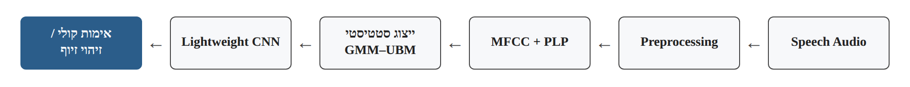
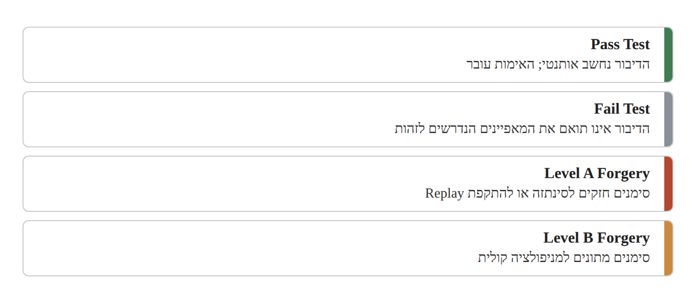
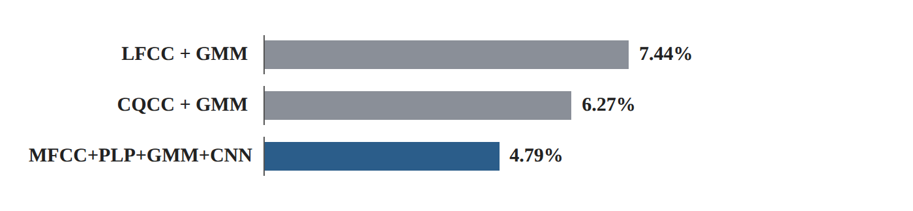

# Research Card 08 — Intelligent Voice Fraud Detection

## Intelligent Voice Fraud Detection Methods in Authentication Systems

## 1. פרטים ביבליוגרפיים

**שם המאמר:** Intelligent Voice Fraud Detection Methods in Authentication Systems.

**מחברים:** K. E. Izrailov, I. V. Kotenko, A. A. Chechulin.

**מוסד מחקרי:** St. Petersburg Federal Research Center of the Russian Academy of Sciences, Russia.

**שנת פרסום:** 2026.

**כתב עת:** Pattern Recognition and Image Analysis.

**פרטי פרסום:** Volume 36, Issue 2, Pages 391–399.

**DOI:** https://doi.org/10.1134/S1054661826700203

**תחומי מחקר:** Audio Deepfake Detection, Voice Biometrics, Speaker Verification, Speech Anti-Spoofing, Hybrid Machine Learning, Digital Forensics.

**מילות מפתח:** MFCC, PLP, GMM–UBM, CNN, Voice Spoofing, Speaker Authentication, Gaussian Mixture Model, Acoustic Feature Fusion, EER, FAR, FRR, minDCF.

**סיווג בסקירת הספרות:** מאמר הרחבה 02 — Research Card 08.

**רלוונטיות לפרויקט:** בינונית–גבוהה לצורך תכנון Baselines והשוואת מאפיינים אקוסטיים. המאמר עוסק ישירות בזיהוי זיופים קוליים, אך אינו כולל השוואה למודלי SSL מודרניים ואינו בוחן מתקפות Codec-Based באופן ייעודי.

---

## 2. תקציר מקיף של המאמר

המאמר מציג שיטה היברידית לזיהוי זיופים קוליים במערכות אימות ביומטרי מבוססות דיבור.

החוקרים יוצאים מנקודת ההנחה שמערכות Speaker Verification פגיעות להתקפות שבהן תוקף משתמש בדיבור מוקלט, מסונתז או מומר כדי להתחזות לדובר מורשה.

מערכת אימות זהות עשויה לקבל קול מזויף אם מאפייני הדובר תואמים לזהות הנטענת. לכן נדרש מנגנון Anti-Spoofing הבוחן גם את אותנטיות הדיבור.

השיטה המוצעת משלבת ארבעה רכיבים:

1. MFCC — מאפיינים אקוסטיים המבוססים על Mel-Frequency Cepstral Coefficients.
2. PLP — מאפיינים המבוססים על Perceptual Linear Prediction.
3. GMM–UBM — מידול סטטיסטי של התפלגות המאפיינים.
4. CNN — רשת נוירונים לזיהוי קשרים בייצוג המשולב ולסיווג.

המערכת כוללת גם Preprocessing, המתמקד בהסרת שקט, נרמול עוצמה, המרה למונו והתאמת קצב הדגימה.

לאחר חילוץ המאפיינים, החוקרים משתמשים ב-GMM–UBM עם 512 רכיבים גאוסיים ליצירת ייצוג סטטיסטי. פרמטרי ההתפלגות מועברים למסווג CNN.

בנוסף, המאמר מתאר מערכת החלטה בעלת ארבע קטגוריות: אימות מוצלח, אימות שנכשל, זיוף ברמת חשד גבוהה וזיוף ברמת חשד בינונית.

המערכת נבחנה על ASVspoof 2019 LA ועל נתוני הערכה נוספים ממאגר TED-LIUM.

ב-ASVspoof 2019 LA התקבלו Accuracy של 97.8% ו-EER של 4.79%, לעומת EER של 7.44% עבור LFCC+GMM ו-6.27% עבור CQCC+GMM.

ב-TED-LIUM דווחו Accuracy של כ-97% ו-EER של כ-5.1%.

החוקרים מסיקים כי שילוב מאפיינים אקוסטיים, מידול סטטיסטי ולמידה עמוקה יכול לשפר את זיהוי הזיופים ביחס לגישות הקלאסיות שנבדקו.

עם זאת, המאמר אינו כולל ניסויי Ablation מפורטים, אינו מספק את מלוא פרטי הארכיטקטורה הנדרשים לשחזור ואינו מציג מדידות חישוביות ישירות.

**המסקנה המרכזית:** שימוש במאפיינים אקוסטיים משלימים יחד עם מודל סטטיסטי ומסווג נלמד עשוי לשפר ביצועי Anti-Spoofing, אך אין די בניסויים המדווחים כדי לקבוע איזו תרומה עצמאית יש לכל רכיב או עד כמה השיטה מכלילה למתקפות חדשות.

**מקור:** Abstract, Sections 1–6.

---

## 3. בעיית המחקר והמוטיבציה

### 3.1 הבעיה המרכזית

מערכות אימות קולי משמשות לבקרת גישה, לשירותי בנקאות, לשירותים מרוחקים ולמערכות אחרות המסתמכות על זיהוי דובר.

התקדמות טכנולוגיות Speech Synthesis ו-Voice Conversion מאפשרת לתוקפים לייצר דיבור הדומה לקול של משתמש מורשה.

כתוצאה מכך, אימות זהות הדובר אינו מספיק לבדו להגנה מפני מתקפות התחזות.

### 3.2 ההבחנה בין Speaker Verification ל-Anti-Spoofing

**Speaker Verification:** בדיקה האם ההקלטה תואמת את מאפייני הקול של זהות נטענת.

**Anti-Spoofing:** בדיקה האם ההקלטה אותנטית או שמדובר בדיבור מוקלט, מסונתז או מומר.

דוגמה: מערכת Speaker Verification עשויה לזהות התאמה גבוהה בין קול TTS לבין בעל חשבון בנק. מנגנון Anti-Spoofing נדרש לזהות את סימני הסינתזה גם כאשר ההתאמה לזהות הדובר גבוהה.

### 3.3 המגבלה בגישות קודמות

גישות קלאסיות המבוססות על מאפיינים סטטיסטיים עשויות להתקשות בהכללה למתקפות חדשות.

מודלים נוירוניים יכולים ללמוד קשרים מורכבים, אך שילובם עם מאפיינים קלאסיים עשוי לאפשר ניצול של מידע משלים.

### 3.4 מטרת המחקר

לפתח שיטה לזיהוי זיופים המשלבת מאפיינים אקוסטיים, מודל סטטיסטי ורשת נוירונים, במטרה לשפר את אמינות ההחלטות במערכות אימות קולי.

### 3.5 שאלת המחקר המשתמעת

האם שילוב של MFCC, PLP, GMM–UBM ו-CNN מסוגל להציג ביצועי זיהוי זיופים טובים יותר מגישות קלאסיות המבוססות על מאפיינים אקוסטיים ו-GMM בלבד?

השאלה מנוסחת כאן על בסיס מטרת החוקרים ואינה ציטוט של שאלת מחקר פורמלית.

**מקור:** Section 1, עמודים 1–2.

---

## 4. התרומות המרכזיות של המאמר

**1. ארכיטקטורה היברידית**

שילוב בין חילוץ מאפיינים אקוסטיים, מידול סטטיסטי ומסווג נוירוני.

**2. Feature Fusion**

שילוב MFCC ו-PLP מתוך הנחה שהם מייצגים היבטים משלימים של אות הדיבור.

**3. שימוש ב-GMM–UBM**

הפקת ייצוג סטטיסטי המבוסס על התפלגות המאפיינים לאורך ההקלטה.

**4. שילוב CNN**

למידת קשרים בין רכיבי הייצוג הסטטיסטי לצורך זיהוי זיוף.

**5. מסגרת החלטה משולבת**

הצעת ארבע קטגוריות המתייחסות לתוצאת אימות הדובר ולמידת החשד לזיוף.

**6. הערכה על ASVspoof 2019 LA**

השוואה לשתי שיטות קלאסיות.

**7. הערכה נוספת על TED-LIUM**

בדיקה על הקלטות ממקור אחר, עם זיופים שנוצרו בשיטות נוספות.

**8. כיוון יישומי**

התייחסות לשילוב המערכת בסביבות ביומטריות, בנקאיות ופורנזיות.

**הסתייגות:** התרומות הן כפי שהחוקרים מציגים אותן. המאמר אינו מבסס בניסוי נפרד את תרומתו של כל רכיב.

**מקור:** Sections 1, 3–4.

---

## 5. סקירת הגישות הקודמות

### 5.1 GMM–UBM לזיהוי דובר

מודל Universal Background Model מאומן על דיבור ממספר דוברים, ולאחר מכן מותאם לדובר מסוים.

### 5.2 i-vectors ו-PLDA

גישות סטטיסטיות להפקת ייצוגי דובר ולהשוואה בין זהויות.

### 5.3 x-vectors

ייצוגי דובר המופקים באמצעות רשת נוירונים.

### 5.4 ECAPA-TDNN

ארכיטקטורה מתקדמת לזיהוי דוברים המשלבת מנגנוני Attention וצבירת מידע לאורך זמן.

### 5.5 CQCC ו-MFCC

מאפיינים אקוסטיים נפוצים בעיבוד דיבור ובמערכות Anti-Spoofing.

### 5.6 AASIST

מודל ייעודי לזיהוי זיופים, המבוסס על למידת קשרים זמניים וספקטרליים באמצעות Graph Attention.

### 5.7 ההבדל בגישה המוצעת

המאמר אינו מציע להחליף את כל הרכיבים הקלאסיים ברשת עמוקה אחת.

במקום זאת, הוא משלב מאפיינים מחושבים מראש עם GMM–UBM ו-CNN.

**מקור:** Section 2, עמודים 2–3.

---

## 6. הארכיטקטורה הכללית

### 6.1 שלבי העיבוד

1. קליטת הקלטת דיבור.
2. Preprocessing.
3. חילוץ מאפייני MFCC ו-PLP.
4. יצירת ייצוג סטטיסטי באמצעות GMM–UBM.
5. סיווג באמצעות CNN.
6. הפקת תוצאת אימות או חשד לזיוף.

### 6.2 תיאור סכמטי

Speech Audio

→ Preprocessing

→ MFCC + PLP

→ GMM–UBM Statistical Representation

→ Lightweight CNN

→ Voice Authentication / Forgery Detection.

*איור 1. המחשה לתיאור הסכמטי בסעיף 6.2.*

### 6.3 מטרת שילוב הרכיבים

המאפיינים האקוסטיים מספקים תיאור מחושב מראש של הדיבור.

המודל הסטטיסטי מסכם מאפיינים של התפלגות ההקלטה.

ה-CNN מנסה ללמוד קשרים שעשויים להבחין בין דיבור אמיתי למזויף.

### 6.4 מגבלת תיאור הארכיטקטורה

המאמר אינו מציג מפרט מלא של שכבות ה-CNN, ממדי הקלט, פרטי ה-Normalization של פרמטרי ה-GMM או פרוטוקול אימון מפורט לכל רכיב.

לכן אין די במאמר לשחזור מדויק של המערכת ללא החלטות מימוש נוספות.

**מקור:** Section 3.1–3.4.

---

## 7. Preprocessing

### 7.1 הסרת מקטעי שקט

החוקרים מציעים שימוש בסף אנרגיה לצורך הסרת מקטעים שאינם מכילים דיבור.

### 7.2 התאמת עוצמה

נרמול רמת העוצמה והטווח הדינמי.

### 7.3 המרה למונו

המרת אודיו סטריאופוני לערוץ יחיד.

### 7.4 התאמת Sample Rate

שינוי קצב הדגימה לתדר אחיד, למשל 16kHz.

### 7.5 מטרת התהליך

להפחית שונות שאינה רלוונטית ולספק קלט עקבי לחילוץ המאפיינים.

### 7.6 הסתייגות לפרויקט שלנו

בזיהוי זיופים, חלק ממקטעי השקט, רעשי הרקע והשינויים בעוצמה עשויים להכיל מידע מבחין.

לכן אין להניח ש-VAD או הסרת שקט תמיד משפרים את ביצועי הזיהוי.

ניסוי מתאים יכול להשוות בין Preprocessing עם ובלי הסרת שקט.

**מקור:** Section 3.2.

---

## 8. MFCC — Mel-Frequency Cepstral Coefficients

### 8.1 מהו MFCC?

ייצוג Cepstral המבוסס על סולם Mel ומתאר מאפיינים של המעטפת הספקטרלית.

### 8.2 תהליך חילוץ

1. חלוקת האודיו למסגרות קצרות.
2. חישוב ספקטרום באמצעות FFT.
3. העברת הספקטרום דרך Mel Filterbank.
4. חישוב לוגריתם האנרגיה.
5. ביצוע Discrete Cosine Transform.
6. הפקת מקדמי Cepstrum.
7. הוספת מאפייני אנרגיה ונגזרות זמניות, בהתאם לתצורה.

### 8.3 חלון זמן

החוקרים מתארים Frames באורך של כ-20–30 מילישניות, עם חפיפה חלקית.

### 8.4 ממד הייצוג

המאמר מתאר תצורת MFCC בת 39 רכיבים לכל Frame.

### 8.5 רלוונטיות לזיהוי זיופים

מאפייני MFCC עשויים לתאר הבדלים במעטפת הספקטרלית של דיבור אמיתי לעומת דיבור מסונתז.

### 8.6 מגבלה

MFCC מתמקד במידע מסוים מתוך הספקטרום ועלול שלא לשמר ארטיפקטים ספקטרליים עדינים.

**מקור:** Section 3.3, עמודים 3–4.

---

## 9. PLP — Perceptual Linear Prediction

### 9.1 מהו PLP?

ייצוג אקוסטי המשלב עקרונות של תפיסה שמיעתית עם Linear Predictive Coding.

### 9.2 מטרתו

לתאר מאפיינים של מבנה התהודה והמעטפת הספקטרלית של הדיבור.

### 9.3 ההבדל מ-MFCC

MFCC משתמש ב-Mel Filterbank וב-Cepstral Analysis.

PLP משתמש במודל שמיעה ובניתוח מבוסס Linear Prediction.

### 9.4 ההיגיון בשילוב

שני הייצוגים עשויים להדגיש מאפיינים שונים מתוך אות הדיבור.

אם ארטיפקט מסוים אינו בולט ב-MFCC, ייתכן שהוא יופיע במאפייני PLP.

### 9.5 מגבלת הטענה

המאמר אינו מציג ניסוי המשווה MFCC בלבד, PLP בלבד ו-MFCC+PLP תחת אותו מסווג.

לכן אין בידינו ראיה ישירה מהמאמר לגבי התרומה העצמאית של PLP.

**מקור:** Section 3.3.

---

## 10. GMM — Gaussian Mixture Model

### 10.1 מטרת המודל

לתאר את ההתפלגות של וקטורי מאפייני הדיבור באמצעות מספר התפלגויות גאוסיות.

### 10.2 הנוסחה הכללית

p(x) = Σ (i=1 עד M) w_i · N(x | μ_i, Σ_i)

כאשר:

- M — מספר הרכיבים הגאוסיים.
- w_i — משקל הרכיב.
- μ_i — וקטור הממוצע.
- Σ_i — מטריצת השונות המשותפת.

זוהי הנוסחה הסטנדרטית ל-GMM, המובאת כאן לצורך הסבר ולא כמשוואה שהמאמר מדפיס במפורש.

### 10.3 מספר רכיבים

החוקרים מדווחים על שימוש ב-512 Gaussian Components.

### 10.4 למה יותר מרכיבים אינם תמיד טובים יותר?

מודל בעל מספר רכיבים גדול מדי עשוי להתאים עצמו לרעש ולדפוסים מקריים בנתונים.

### 10.5 היתרון על ממוצע פשוט

ממוצע אחד אינו מתאר היטב התפלגות רב-שיאית.

GMM יכול לייצג מספר אזורי ריכוז שונים במרחב המאפיינים.

### 10.6 מגבלה

המאמר אינו מציג Ablation של מספר הרכיבים, ולכן אינו מוכיח ש-512 הוא הערך האופטימלי.

**מקור:** Section 3.3, עמוד 4.

---

## 11. UBM — Universal Background Model

### 11.1 מהו UBM?

מודל רקע המתאר התפלגות כללית של מאפייני דיבור מתוך נתונים של דוברים רבים.

### 11.2 אופן הפעולה

ניתן להתאים את המודל לדובר באמצעות Maximum a Posteriori Adaptation.

### 11.3 התפקיד במחקר

המאמר מתאר שימוש ב-GMM–UBM ליצירת ייצוג סטטיסטי של ההקלטה, באמצעות פרמטרים של התפלגויות גאוסיות.

### 11.4 יתרון אפשרי

מידול ההתפלגות עשוי לאפשר למסווג להשתמש במידע סטטיסטי מעבר לממוצעי המאפיינים.

### 11.5 מגבלה מתודולוגית

לא מתואר באופן מספק כיצד כל פרמטרי ה-GMM מקודדים בדיוק לטנזור הקלט של ה-CNN.

בנוסף, לא מוצגת השוואה מבוקרת של שימוש ב-UBM לעומת GMM רגיל.

**מקור:** Sections 2.1, 3.3.

---

## 12. CNN — המסווג הנלמד

### 12.1 תפקיד ה-CNN

למידת קשרים בין רכיבים בייצוג הסטטיסטי המשולב.

### 12.2 היתרון האפשרי

בניגוד ל-GMM המשמש לסיכום ההתפלגות, CNN מסוגל ללמוד תבניות נבדלות מתוך הייצוג המספרי.

### 12.3 הקשר למידול הסטטיסטי

ה-CNN משתמש בייצוג שנוצר לאחר חילוץ ועיבוד המאפיינים, במקום ללמוד ישירות מתוך אות האודיו הגולמי.

### 12.4 מה חסר במאמר?

לא מפורטים באופן מלא:

- מספר שכבות ה-Convolution.
- מספר ערוצים בכל שכבה.
- גדלי Kernels.
- ממדי הייצוג הנכנס.
- פרטי Pooling.
- ארכיטקטורת Classification Head.
- מספר הפרמטרים הכולל.

### 12.5 משמעות

המאמר מספק תיאור עקרוני של השיטה, אך לא מפרט ארכיטקטורה הניתנת לשחזור מדויק ללא הנחות נוספות.

**מקור:** Section 3.4.

---

## 13. ארבע קטגוריות ההחלטה

### 13.1 Pass Test

הדיבור נחשב אותנטי ועובר את תהליך האימות.

### 13.2 Fail Test

הדיבור אינו תואם את המאפיינים הנדרשים לאימות הזהות.

### 13.3 Level A Forgery

נמצאו סימנים חזקים לסינתזה או להתקפת Replay.

### 13.4 Level B Forgery

נמצאו סימנים מתונים למניפולציה קולית.

### 13.5 Figure 1

בתרשים ההחלטות בעמוד 5 מוצגת לוגיקה של בדיקת ציונים ותנאים המובילה לאחת מארבע תוצאות.

*איור 2. המחשה לארבע קטגוריות ההחלטה המתוארות בסעיפים 13.1–13.4.*

### 13.6 הבחנה מתודולוגית

Table 1 מדווחת על מדדי סיווג כלליים של דיבור אמיתי לעומת מזויף.

המאמר אינו מציג מדדי Precision, Recall, F1 או Confusion Matrix נפרדים עבור ארבע הקטגוריות.

לכן אין לייחס את Accuracy של 97.8% לאיכות מוכחת של סיווג ארבע-מחלקתי.

**מקור:** Section 3.4, Figure 1, Table 1.

---

## 14. מאגרי הנתונים

### 14.1 ASVspoof 2019 LA

המאמר מציין שימוש בחלוקות Training, Development ו-Evaluation של ASVspoof 2019 Logical Access.

לפי הנתונים המדווחים בו:

| Split | Bona Fide בקירוב | Spoof בקירוב |
|---|---:|---:|
| Training | 2,580 | 22,800 |
| Development | 2,548 | 22,296 |
| Evaluation | 7,355 | 63,882 |

המספרים מוצגים בהתאם לדיווח במאמר; הכרטיס אינו מבצע אימות עצמאי שלהם מול מסמכי המאגר המקוריים.

### 14.2 VCTK

החוקרים מציינים שימוש בהקלטות VCTK לצורך יצירת דוגמאות מזויפות באמצעות TTS ו-Voice Conversion.

### 14.3 TED-LIUM

במסגרת ניסוי נוסף נבחרו 50 דוברים מתוך TED-LIUM Release 3.

דוגמאות מזויפות נוצרו באמצעות:

- WaveNet Vocoder.
- AutoVC Voice Conversion.

### 14.4 הבחנה חשובה

המאמר מתאר את VCTK, ASVspoof 2019 ו-TED-LIUM, אך אינו מספק פירוט מלא ועקבי של תהליך השילוב וההפרדה ביניהם במהלך אימון המערכת.

לכן יש להימנע מהשלמת פרוטוקול ניסוי שלא תואר במפורש.

### 14.5 מגבלות ההכללה

הבדיקה הנוספת על TED-LIUM כוללת רק שני סוגי יצירת זיוף שתוארו.

לא בוצעה הערכה נפרדת ומפורטת על Neural Audio Codecs.

**מקור:** Section 4.1.

---

## 15. מדדי ההערכה

### 15.1 Accuracy

שיעור הסיווגים הנכונים מתוך כלל הדוגמאות.

### 15.2 EER — Equal Error Rate

שיעור השגיאה בנקודה שבה False Acceptance Rate ו-False Rejection Rate משתווים.

ערך נמוך יותר עדיף.

### 15.3 FAR — False Acceptance Rate

שיעור ניסיונות הזיוף או האימות הלא מורשים שמתקבלים בטעות, לפי הגדרת המחלקות והסף.

### 15.4 FRR — False Rejection Rate

שיעור דוגמאות הדיבור האותנטיות שנדחות בטעות.

### 15.5 minDCF

מדד עלות החלטה מינימלית המביא בחשבון את מחירי השגיאות ואת פרמטרי פרוטוקול ההערכה.

### 15.6 הסתייגות

המאמר מדווח ערכי minDCF, אך אינו מפרט באופן מספק את כל פרמטרי פונקציית העלות והנרמול הנדרשים להשוואה ישירה מול פרוטוקולי minDCF או min-tDCF אחרים.

לכן אין להשוות את ערכי minDCF של המאמר ישירות לנתונים ממאמרי ASVspoof בלי לאמת תחילה התאמה בפרוטוקול.

**מקור:** Section 4.2, Table 1.

---

## 16. התוצאות המרכזיות — ASVspoof 2019 LA

### 16.1 Table 1

| שיטה | Accuracy | EER | FAR | FRR | minDCF |
|---|---:|---:|---:|---:|---:|
| LFCC + GMM | 94.5% | 7.44% | 7.21% | 7.68% | 1.312 |
| CQCC + GMM | 95.3% | 6.27% | 5.90% | 6.65% | 0.989 |
| **MFCC+PLP+GMM+CNN** | **97.8%** | **4.79%** | **4.61%** | **4.94%** | **0.623** |

*איור 3. המחשה לנתוני Table 1 (סעיף 16.1): EER עבור LFCC+GMM, CQCC+GMM ו-MFCC+PLP+GMM+CNN.*

### 16.2 הממצא המרכזי

המערכת ההיברידית הציגה ביצועים טובים יותר משני ה-Baselines בכל המדדים המוצגים.

### 16.3 שיפור EER לעומת CQCC+GMM

ה-EER ירד מ-6.27% ל-4.79%.

השיפור המוחלט הוא 1.48 נקודות אחוז.

הירידה היחסית היא כ-23.6%.

### 16.4 שיפור EER לעומת LFCC+GMM

ה-EER ירד מ-7.44% ל-4.79%.

השיפור המוחלט הוא 2.65 נקודות אחוז.

הירידה היחסית היא כ-35.6%.

### 16.5 מה ניתן להסיק?

המערכת ההיברידית השיגה ביצועים טובים יותר משתי שיטות ההשוואה שנבחרו, במסגרת פרוטוקול המחקר המדווח.

### 16.6 מה לא ניתן להסיק?

אין אפשרות לקבוע איזה רכיב אחראי לשיפור, מכיוון שנוספו יחד מאפיינים ורכיבי סיווג שונים.

בנוסף, לא ניתן להסיק שהשיטה עדיפה על AASIST או על WavLM, משום שלא בוצעה השוואה ישירה אליהם בתנאים זהים.

### 16.7 הערה על המדדים

הטבלה מציגה EER של 4.79%, FAR של 4.61% ו-FRR של 4.94%.

הערכים אינם זהים בדיוק; ייתכן שהם נובעים מעיגול, מאופן בחירת הסף או מתהליך מדידה שונה. המאמר אינו מספק מספיק פירוט כדי להכריע.

לפיכך נשתמש בכל ערך כפי שדווח, בלי לטעון שההבדלים הוסברו או אומתו.

**מקור:** Section 4.3, Table 1.

---

## 17. הערכה נוספת — TED-LIUM

### 17.1 מטרת הניסוי

לבחון את ביצועי המערכת על מקור הקלטות שונה מ-ASVspoof 2019.

### 17.2 הנתונים

החוקרים בחרו 50 דוברים מתוך TED-LIUM Release 3.

### 17.3 שיטות הזיוף

- WaveNet.
- AutoVC.

### 17.4 תוצאות

החוקרים מדווחים בקירוב על:

- Accuracy: 97%.
- EER: 5.1%.

### 17.5 משמעות התוצאה

המערכת הציגה ביצועים דומים יחסית לאלו שנמדדו על ASVspoof 2019.

### 17.6 מגבלות

המאמר אינו מספק טבלה מפורטת של תוצאות לפי התקפה.

לא מוצגות רווחי סמך או תוצאות על פני מספר Seeds.

מספר סוגי הזיוף מוגבל.

בנוסף, חסר פירוט מלא על הרכב דוגמאות הבדיקה ועל תהליך יצירתן.

### 17.7 מסקנה

התוצאה מספקת אינדיקציה ליכולת הכללה מסוימת, אך אינה מוכיחה עמידות רחבה בפני מתקפות שלא נראו באימון.

**מקור:** Sections 4.1, 4.3.

---

## 18. ניתוח גרפי האימון — Figure 2

### 18.1 מה מוצג?

Figure 2 בעמוד 6 מציגה עקומות Loss לאורך כ-175 Epochs.

### 18.2 הדפוס הכללי

ה-Loss יורד בחדות בתחילת האימון ולאחר מכן מתייצב סביב ערכים נמוכים יחסית.

### 18.3 מגבלת הפרשנות

בתרשים מופיעה הכותרת Recon loss, אף שהמאמר מתאר מסווג GMM–CNN לזיהוי זיופים ולא מפרט רכיב Reconstruction Loss מתאים כחלק מהארכיטקטורה.

לכן אין לייחס בוודאות את הגרף ל-Loss מסוים של המסווג.

### 18.4 מסקנה

התרשים מצביע על ירידה בפונקציית Loss כלשהי במהלך האימון, אך אינו מספק לבדו הוכחה להיעדר Overfitting או ליכולת הכללה.

**מקור:** Figure 2, עמוד 6.

---

## 19. ניתוח ביקורתי — יתרונות המחקר

**א. התמקדות בבעיה יישומית**

המחקר מתייחס להגנה על מערכות אימות ביומטרי מפני זיופים קוליים.

**ב. שילוב גישות משלימות**

המערכת משלבת מאפיינים אקוסטיים, מידול סטטיסטי ולמידה עמוקה.

**ג. שימוש ברכיבים מוכרים**

MFCC, PLP ו-GMM הם רכיבים נפוצים יחסית בעיבוד דיבור.

**ד. השוואה ל-Baselines**

החוקרים מציגים תוצאות ביחס לשיטות LFCC+GMM ו-CQCC+GMM.

**ה. שימוש במספר מדדי הערכה**

נבחנים Accuracy, EER, FAR, FRR ו-minDCF.

**ו. הערכה על מקור נוסף**

המחקר כולל גם נתוני TED-LIUM.

**ז. התייחסות למערכת האבטחה השלמה**

המאמר מדגיש את ההבדל בין אימות דובר לזיהוי זיופים ואת הצורך בשילוב ביניהם.

**ח. דיון במגבלות פריסה**

החוקרים מציינים את הצורך בהערכת רעש, דחיסה, שפות נוספות ודרישות חומרה.

---

## 20. ניתוח ביקורתי — מגבלות המחקר

### 20.1 היעדר ניסויי Ablation

לא בוצעה השוואה מפורטת המבודדת את השפעת MFCC, PLP, GMM ו-CNN.

### 20.2 חוסר פירוט מימוש

לא מפורטים די הצורך מבנה ה-CNN, פרטי החיבור ל-GMM–UBM וכל הגדרות האימון.

### 20.3 היעדר השוואה למודלים עמוקים ייעודיים

אין ניסוי ישיר מול AASIST באותו פרוטוקול.

### 20.4 היעדר השוואה למודלי SSL

לא נבדקו wav2vec 2.0 או WavLM.

### 20.5 הערכה מוגבלת של יכולת הכללה

ניסוי TED-LIUM כולל מספר מוגבל של שיטות זיוף.

### 20.6 היעדר בדיקה ייעודית ל-Neural Audio Codecs

המאמר אינו מעריך ישירות זיופים מסוג CodecFake.

### 20.7 מגבלות שפה

עיקר הנתונים בשפה האנגלית.

### 20.8 היעדר מדידות חישוביות ישירות

לא נמדדו באופן מפורט זמן חיזוי, צריכת זיכרון ומורכבות חישובית על חומרת יעד.

### 20.9 מערכת ארבע הקטגוריות אינה מוערכת בנפרד

לא מוצגים מדדי ביצוע לכל אחת מארבע קטגוריות ההחלטה.

### 20.10 השפעת Preprocessing אינה מבודדת

לא נבדק האם הסרת שקט או נרמול עוצמה משפרים את הזיהוי.

### 20.11 היעדר בחינת יציבות

לא מוצגות תוצאות מפורטות על פני Seeds שונים או רווחי סמך למדדי הביצועים.

### 20.12 אי-בהירות במתודולוגיה

תיאור השימוש ב-VCTK, ב-ASVspoof 2019 וב-TED-LIUM אינו מספיק כדי לשחזר את כל שלבי יצירת הנתונים והפרדתם.

### 20.13 אי-בהירות במדידת minDCF

היעדר פירוט מלא של פונקציית העלות מונע השוואה בטוחה בין מחקרים.

### 20.14 אי-התאמה מסוימת בהצגת גרף האימון

Figure 2 מכונה Recon loss, למרות שהתיאור המרכזי הוא של מערכת סיווג.

---

## 21. מה המאמר אינו מוכיח?

אין להסיק מהמאמר ש:

- שילוב MFCC ו-PLP תמיד עדיף על MFCC בלבד.
- PLP הוא הגורם המרכזי לשיפור.
- GMM–UBM חיוני לכל מערכת Anti-Spoofing.
- CNN בהכרח משפר ביצועים בהשוואה למסווג פשוט יותר.
- המערכת ההיברידית עדיפה על AASIST.
- המערכת ההיברידית עדיפה על wav2vec 2.0 או WavLM.
- תוצאת Accuracy של 97.8% מתארת סיווג מדויק של ארבע קטגוריות.
- המערכת מסוגלת להתמודד עם כל התקפות ה-Codec.
- המערכת פועלת בזמן אמת על חומרת יעד מוגבלת.
- השיפור המדווח יישמר על ASVspoof 5 או על CodecFake.
- הוספת מאפיינים תמיד מפחיתה טעויות.
- ההצלחה על TED-LIUM מוכיחה הכללה לכל טכנולוגיית זיוף חדשה.

---

## 22. התובנות שלנו מהמאמר

### 22.1 Feature Fusion עשוי לשפר ביצועים

מאפיינים שונים יכולים לתאר היבטים משלימים של אותו אות דיבור.

### 22.2 יותר מאפיינים אינם בהכרח טובים יותר

הוספת מאפיינים עשויה להוסיף רעש, מידע כפול או קשרים מקריים.

### 22.3 מודל סטטיסטי יכול לספק ייצוג חלופי

GMM–UBM מתאר את התפלגות המאפיינים, ולא רק ממוצע שלהם.

### 22.4 שילוב GMM ו-CNN אינו בהכרח הכרחי

כדי לקבוע אם רכיב נוסף מועיל, יש להשוות אותו לגרסאות פשוטות יותר.

### 22.5 Accuracy אינו מספיק

בזיהוי זיופים חשוב להשתמש גם ב-EER ובמדדים המשקפים סוגי שגיאות שונים.

### 22.6 תוצאות על מקור נוסף אינן שקולות להוכחת הכללה כללית

יש לבחון את מגוון המתקפות, את תנאי ההקלטה ואת גודל קבוצת הבדיקה.

### 22.7 תיאור ארכיטקטורה אינו תחליף לניסוי

העובדה שהמאמר מציג מערכת החלטה בארבע קטגוריות אינה מוכיחה את איכותה בכל קטגוריה.

### 22.8 עלות המערכת היא חלק מהשאלה המחקרית

שיפור קטן ב-EER לא בהכרח מצדיק תוספת מורכבות.

### 22.9 יש להימנע מקיצורי דרך בין מקורות נתונים

שילוב מקורות שונים מחייב בדיקה האם המודל למד מאפייני זיוף או מאפייני מקור.

---

## 23. רלוונטיות לנתוני הפרויקט שלנו

### 23.1 מבנה הנתונים

מאגר הקורס כולל:

| מקור | אמיתי | מזויף | סה"כ |
|---|---:|---:|---:|
| ASVspoof 5 | 300 | 300 | 600 |
| CodecFake | 300 | 300 | 600 |
| M-AILABS | 320 | 0 | 320 |
| **סה"כ** | **920** | **600** | **1,520** |

כל הקלטה באורך ארבע שניות ובקצב דגימה של 16kHz, לפי מפרט הפרויקט.

### 23.2 למה המאמר רלוונטי?

הוא מציע שימוש במאפיינים אקוסטיים קלאסיים כבסיס למערכת זיהוי זיופים.

### 23.3 Baseline ראשון

ניתן לבנות Baseline המבוסס על MFCC עם מסווג כגון Logistic Regression או SVM.

### 23.4 Baseline נוסף

ניתן לבחון CQCC עם אותו מסווג ואותו פרוטוקול.

### 23.5 הרחבת PLP

לאחר מכן אפשר להוסיף PLP ולבחון האם קיים שיפור.

### 23.6 הרחבת GMM

אם השיפור מצדיק זאת, ניתן לשקול תיאור סטטיסטי עשיר יותר באמצעות GMM.

### 23.7 CNN

רק לאחר קביעת נקודת ייחוס פשוטה, כדאי לבחון האם CNN משפר את הביצועים.

### 23.8 מדד הערכה

המדד המרכזי הוא EER.

יש להפיק Score רציף שבו ערך גבוה מציין סבירות גבוהה יותר לזיוף, בהתאם לפרוטוקול הקורס.

### 23.9 מגבלת M-AILABS

מכיוון שבנתוני הקורס M-AILABS מכיל דיבור אמיתי בלבד, לא ניתן לחשב עליו EER בנפרד ללא דוגמאות מזויפות מתאימות.

### 23.10 מניעת Data Leakage

יש לשמור על הפרדה בין קבוצות האימון, האימות והבדיקה.

אם קיימים מזהי דוברים או מקורות, יש לבחון גם הפרדה ברמתם.

---

## 24. השערות מחקר וניסויים אפשריים

### H1 — MFCC לעומת MFCC+PLP

**השערה:** שילוב PLP עם MFCC עשוי לשפר EER בהשוואה ל-MFCC בלבד.

**ניסוי:** שימוש באותו מסווג, אותם נתונים ואותו פרוטוקול.

**מדד:** EER.

**מגבלה:** הוספת PLP מגדילה את ממד הייצוג.

### H2 — CQCC לעומת MFCC+PLP

**השערה:** מאפיינים משולבים עשויים לספק מידע משלים למאפיינים ספקטרליים אחרים, אך אין ודאות שיהיו טובים יותר מ-CQCC.

**ניסוי:** השוואת שתי תצורות המאפיינים עם אותו מסווג.

### H3 — GMM לעומת מסווג פשוט

**השערה:** מידול סטטיסטי של התפלגות המאפיינים עשוי לספק יתרון על פני שימוש בממוצעים וסטיות תקן בלבד.

**ניסוי:** השוואת ייצוג סטטיסטי פשוט מול ייצוג GMM.

### H4 — הוספת CNN

**השערה:** CNN עשוי לשפר את EER באמצעות למידת קשרים מורכבים במאפיינים.

**ניסוי:** השוואה למסווג פשוט על אותו ייצוג.

**מדדים נוספים:** זמן אימון, זמן חיזוי, זיכרון ויציבות.

### H5 — יכולת הכללה בין מאגרים

**השערה:** שילוב מאפיינים עשוי להשפיע על היכולת להכליל בין ASVspoof 5 ל-CodecFake.

**ניסוי:** הערכת Cross-Dataset, בכפוף לפרוטוקול ולתוויות הזמינות.

**מגבלה:** שינוי מקור הנתונים כולל גם הבדלי דוברים, תוכן ותנאי הקלטה.

### H6 — השפעת Preprocessing

**השערה:** הסרת שקט ונרמול עוצמה עשויים להשפיע על EER, לטובה או לרעה.

**ניסוי:** השוואת אותה מערכת עם ובלי רכיבי Preprocessing נבחרים.

### H7 — בחינת עלות מול תועלת

**השערה:** שיפור קטן ב-EER בעקבות הוספת CNN עשוי שלא להצדיק את תוספת המורכבות.

**ניסוי:** השוואת שיפור בביצועים מול מדדי עלות ויציבות.

---

## 25. סדר עדיפות לניסויים

**עדיפות גבוהה**

1. בדיקת חלוקת הנתונים והתוויות.
2. MFCC עם מסווג פשוט.
3. CQCC עם מסווג פשוט.
4. הערכת EER על קבוצת בדיקה מופרדת.
5. ניתוח תוצאות לפי מקור נתונים.

**עדיפות בינונית**

6. הוספת PLP והשוואת MFCC מול MFCC+PLP.
7. בחינת ייצוגים סטטיסטיים נוספים.
8. השוואת התוצאות למודל SSL מאומן מראש.

**עדיפות מותנית**

9. שילוב GMM–UBM.
10. הוספת CNN.
11. שחזור המערכת ההיברידית המלאה, אם יהיו די פרטי מימוש ומשאבים.

הסדר נועד להימנע מהוספת רכיבים שלא הוכחה תרומתם עבור נתוני הקורס.

---

## 26. שאלות פתוחות להמשך

1. האם PLP מוסיף מידע שימושי ל-MFCC בנתוני הפרויקט?
2. האם MFCC+PLP עדיף על CQCC?
3. האם GMM–UBM מספק יתרון על ייצוגי Mean ו-Standard Deviation?
4. האם CNN משפר EER באופן עקבי?
5. האם השיפור נשמר על פני מספר Seeds?
6. האם התוצאות משתנות לפי מקור הנתונים?
7. האם השיטה מכלילה בין ASVspoof 5 ל-CodecFake?
8. האם הסרת שקט פוגעת בזיהוי ארטיפקטים?
9. האם קיימים קיצורי דרך הקשורים למקור ההקלטה?
10. האם עלות החישוב מצדיקה את השיפור?
11. האם ניתן לשלב את המאפיינים הקלאסיים עם ייצוגי WavLM?
12. האם מערכת היברידית מורכבת מועילה יותר מ-Baseline פשוט כאשר יש רק 1,520 הקלטות?
13. האם ניתן להשיג יתרון דומה באמצעות Feature Selection במקום Feature Fusion?
14. האם כדאי להרחיב את הניסוי למאפיינים זמניים ולא רק סטטיסטיקות של התפלגות?

---

## 27. מסקנה מסכמת

המאמר מציג גישה היברידית לזיהוי זיופים קוליים במערכות אימות ביומטרי, המבוססת על שילוב מאפייני MFCC ו-PLP, מידול סטטיסטי באמצעות GMM–UBM וסיווג באמצעות CNN.

החוקרים מציעים ששילוב מספר סוגי מידע מאפשר לנצל מאפיינים משלימים של אות הדיבור ולהבחין טוב יותר בין דיבור אמיתי למזויף.

בניסוי על ASVspoof 2019 LA, המערכת הציגה Accuracy של 97.8% ו-EER של 4.79%, ובכך השיגה תוצאות טובות יותר משיטות LFCC+GMM ו-CQCC+GMM שנכללו בהשוואה.

עם זאת, המחקר אינו מציג ניסויי Ablation המבודדים את תרומת הרכיבים, ופרטי המימוש אינם מספקים לשחזור מלא של הארכיטקטורה. בנוסף, ההערכה על TED-LIUM מוגבלת ואינה מוכיחה הכללה רחבה למתקפות חדשות.

מבחינת הפרויקט שלנו, התרומה המרכזית של המאמר היא בתמיכה בבחינת שילוב מאפיינים אקוסטיים במסגרת ניסויים מבוקרים.

**העיקרון המחקרי שנאמץ:** אין להניח שמערכת הכוללת יותר רכיבים תהיה בהכרח טובה יותר. כל תוספת, כגון PLP, GMM–UBM או CNN, תידרש להציג שיפור מדיד ויציב בביצועים, לצד עלות חישובית סבירה.

**ההחלטה המעשית שלנו:** נתחיל ב-Baselines פשוטים המבוססים על MFCC ו-CQCC, נבחן בהמשך הוספת PLP, ורק לאחר מכן נשקול את מימוש השיטה ההיברידית המלאה.

---

## 28. מפת הפניות למאמר

| נושא | מיקום במאמר |
|---|---|
| פרטים ביבליוגרפיים ותקציר | עמ' 1, עמ' 391 |
| בעיית המחקר והמוטיבציה | Section 1, עמ' 391–392 |
| סקירת Speaker Verification | Section 2.1, עמ' 392 |
| סקירת Anti-Spoofing | Section 2.2, עמ' 393 |
| הארכיטקטורה הכללית | Section 3.1, עמ' 393 |
| Preprocessing | Section 3.2, עמ' 393 |
| MFCC ו-PLP | Section 3.3, עמ' 393–394 |
| GMM–UBM ו-512 רכיבים | Section 3.3, עמ' 394 |
| CNN ולוגיקת החלטה | Section 3.4, עמ' 394 |
| ארבע קטגוריות החלטה | Figure 1, עמ' 395 |
| מאגרי הנתונים | Section 4.1, עמ' 395 |
| מדדי הערכה | Section 4.2, עמ' 396 |
| תוצאות ASVspoof 2019 | Table 1, עמ' 396 |
| תוצאות TED-LIUM | Section 4.3, עמ' 396 |
| גרף Loss | Figure 2, עמ' 396 |
| יתרונות השיטה | Section 5.1, עמ' 397 |
| מגבלות המחקר | Section 5.2, עמ' 397 |
| מסקנות החוקרים | Section 6, עמ' 397–398 |
| כיווני מחקר עתידיים | Section 6, עמ' 398 |

**הערת שימוש:** הנתונים המספריים בכרטיס משקפים את הדיווח במאמר המקורי. תכנון הניסויים המוצע עבור ASVspoof 5, CodecFake ו-M-AILABS הוא הרחבה מחקרית שלנו, ולא תוצאה שאומתה על ידי מחברי המאמר.
