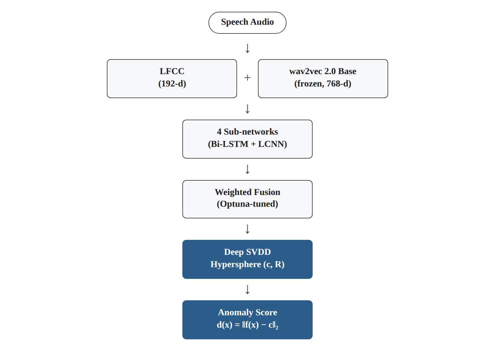
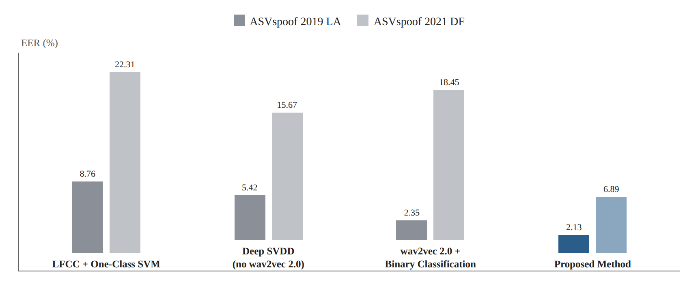

# Research Card 09 — One-Class Learning + wav2vec 2.0

## A Novel Attack-Resistant Speech Forgery Detection Method Integrating One-Class Learning and Wav2vec2

## 1. Bibliographic Details

**Paper title:** A Novel Attack-Resistant Speech Forgery Detection Method Integrating One-Class Learning and Wav2vec2.

**Authors:** Jing Yin, Senyang Lei.

**Research institution:** College of Artificial Intelligence, Wuhan Technology and Business University, Wuhan, China.

**Year of publication:** 2026.

**Conference:** International Conference on Communication Networks and Machine Learning (CNML).

**Publisher:** IEEE.

**Pages:** 415–419.

**DOI:** 10.1109/CNML68938.2026.11452384.

**Link:** https://doi.org/10.1109/CNML68938.2026.11452384

**Research fields:** Audio Deepfake Detection, Speech Anti-Spoofing, Anomaly Detection, One-Class Learning, Self-Supervised Speech Representations, Unknown Attack Generalization.

**Keywords:** One-Class Learning, Deep SVDD, wav2vec 2.0, LFCC, Hypersphere, Anomaly Score, Bi-LSTM, LCNN, Weighted Fusion, Optuna, EER.

**Classification in the literature review:** Research Card 09 — Extension paper 03.

**Relevance to the project:** Very high from a research perspective. The paper proposes a learning paradigm different from binary classification, while using an SSL model already covered in our literature review. It is especially relevant to the question of generalization to forgeries that do not appear in the training data.

---

## 2. Comprehensive Summary of the Paper

The paper presents a system for detecting voice forgeries based on combining One-Class Learning with speech representations of pre-trained wav2vec 2.0.

The researchers seek to cope with two central limitations of Anti-Spoofing systems:

1. A decline in performance against attacks that were not included in training.
2. Dependence on labeled forgery examples in order to learn a decision boundary between real and fake speech.

The central solution is to learn the distribution of real speech by means of Deep Support Vector Data Description — Deep SVDD.

The model maps real recordings to a representation space and learns to describe them by means of a compact Hypersphere. Examples located outside the sphere's boundary are classified as anomalous, and in the context of the task, as fake.

For representing the speech, the researchers combine LFCC features with deep representations of wav2vec 2.0 Base.

The system includes four sub-networks and a Weighted Fusion mechanism. The combination weights are chosen by means of Optuna according to the EER on the Validation set.

The evaluation is carried out on two datasets:

- ASVspoof 2019 LA — a known-attacks scenario.
- ASVspoof 2021 DF — an unknown-attacks scenario.

According to the reported results, the system achieves an EER of 2.13% on ASVspoof 2019 LA and 6.89% on ASVspoof 2021 DF.

On the 2021 DF set, its performance is better than the three Baselines examined, including a supervised binary classifier using wav2vec 2.0.

However, the paper includes inconsistencies in the Ablation table and a lack of clarity regarding the need for labeled forgery examples during the tuning of the full system.

**The central conclusion:** Combining SSL representations with one-class learning may improve forgery detection in distribution-shift scenarios, but one must distinguish between the contribution of One-Class Learning and the contribution of the representations, the sub-networks, and the Fusion optimization.

**Source:** Abstract; Sections I–V.

---

## 3. The Research Problem and Motivation

### 3.1 The Central Problem

TTS and Voice Conversion technologies make it possible to create high-quality fake speech.

Forgery detection models tend to rely on attack examples included in training.

When a new generation technology appears, its forgery features may differ from the features the model learned.

### 3.2 The Limitation of Binary Classification

A binary classifier is trained on examples from two classes — real and fake.

In a situation where the types of forgery are diverse and evolving, it cannot be assumed that the training data covers all future attacks.

### 3.3 The Limitation in Labeled Data

According to the researchers, labeled forgery examples are not always available in sufficient scope, especially for new attacks.

### 3.4 The Proposed Direction

Learning the distribution of real speech, instead of relying directly on the distribution of forgery examples.

### 3.5 The Goal of the Study

To develop a system that detects unknown forgeries by means of Deep SVDD, while using pre-trained speech representations and combining several sub-networks.

### 3.6 The Implied Research Question

Does combining wav2vec 2.0 representations with One-Class Learning and Weighted Fusion improve the ability to generalize to unknown forgery attacks compared with classical approaches and supervised binary classification?

**Source:** Section I, p. 415.

---

## 4. The Connection to Our Previous Papers

### 4.1 ASVspoof 5

Presents challenges of generalization between speakers, sources and attacks.

The current paper proposes coping with the generalization problem by means of learning the distribution of real speech.

### 4.2 CQCC

Represents an approach based on pre-computed acoustic features.

The current paper uses LFCC and adds pre-trained deep representations.

### 4.3 AASIST

Represents a deep approach to forgery detection, based on learning to distinguish between classes.

Deep SVDD changes the definition of the learning problem and seeks to model the real class.

### 4.4 wav2vec 2.0

Provides the basis for learning speech representations from unlabeled audio.

The current paper uses these representations for anomaly detection, and not for speech transcription.

### 4.5 WavLM

Offers additional SSL representations relevant to a variety of speech tasks.

Replacing wav2vec 2.0 with WavLM can be proposed within a follow-up experiment, but this possibility was not tested in the paper.

### 4.6 CodecFake

Demonstrates the generalization problem between attacks based on Neural Audio Codecs.

One-Class Learning may be a suitable direction for examining attacks not seen in training, but the current paper does not include an experiment on CodecFake.

### 4.7 Enhanced Forensic Trace Generation

Combines feature reconstruction with supervision that distinguishes between real and fake speech.

The current approach differs in that it models the real-speech region for the purpose of anomaly detection.

### 4.8 Intelligent Voice Fraud Detection

Combines traditional features, a statistical model and a deep classifier.

The current paper also combines classical and deep features, but uses a one-class approach.

---

## 5. The Main Contributions

**1. Combining One-Class Learning with wav2vec 2.0**

Using pre-trained SSL representations for modeling real speech.

**2. Deep SVDD for anomaly detection**

Learning a decision boundary in the shape of a Hypersphere.

**3. Combining LFCC and deep representations**

Exploiting classical acoustic features alongside contextual speech representations.

**4. Four sub-networks**

Using several processing paths to produce detection scores.

**5. Weighted Fusion**

Combining the sub-networks' scores with learned weights.

**6. Weight optimization by means of Optuna**

Choosing weights that minimize EER on Validation.

**7. Evaluation on two ASVspoof datasets**

A comparison between ASVspoof 2019 LA and ASVspoof 2021 DF.

**8. Comparison to supervised and one-class approaches**

Examining LFCC+One-Class SVM, Deep SVDD without wav2vec 2.0, and a binary classifier based on wav2vec 2.0.

**Source:** Sections I, III–IV.

---

## 6. The Theoretical Basis — One-Class Learning

### 6.1 The Idea

One-Class Learning learns the features of a single class only.

In our case, the class is real speech.

### 6.2 What Is the Difference from Binary Classification?

In Binary Classification the model learns to distinguish between real and fake.

In One-Class Learning the model defines what is considered to match real speech, and anything deviating from the learned region may be considered anomalous.

### 6.3 A Possible Advantage

There is no need to know every type of forgery in advance in order to train the anomaly classifier.

### 6.4 A Fundamental Limitation

Real speech under different recording conditions may be considered anomalous.

Conversely, a very high-quality forgery may fall within the real-speech region.

### 6.5 An Important Distinction

Detecting a deviation from the distribution is not necessarily the same as detecting the reason for the deviation.

**Source:** Section II-B, p. 416.

---

## 7. Deep SVDD — The Learning Mechanism

### 7.1 What Is Deep SVDD?

Deep Support Vector Data Description is an algorithm that combines a neural network with one-class learning.

### 7.2 Mapping to the Feature Space

Let us denote the speech mapping:

z = f_θ(x)

where x is the speech signal and θ represents the network's parameters.

*Figure 1. Illustration of the general structure: the two feature-extraction paths (LFCC and wav2vec 2.0), the four sub-networks, Weighted Fusion and Deep SVDD, as described in Sections 7–12.*

### 7.3 Decision Boundary

The model describes the representations of real speech by means of a Hypersphere.

The sphere has two central parameters:

- c — the center.
- R — the radius.

### 7.4 The Goal of the Training

To learn a representation space in which real examples are concentrated in a compact region.

### 7.5 Description of the Training Stages

The authors describe two stages:

**Pre-training:** minimizing a loss function related to the volume of the sphere and to real speech representations.

**Fine-Tuning:** reducing the distance of real examples to the center of the sphere.

### 7.6 Ambiguity in the Training Equation

In Equation (1), as printed in the paper, an expression appears that includes the norm of the center c and the norm of f(x_i, θ), alongside a radius R, but the distance from c is not presented in the same form as in the decision rule later on.

The verbal description speaks of reducing the volume of the sphere and of bringing real examples closer to its center.

There is therefore ambiguity regarding the exact loss function that should be implemented.

**Decision for our study:** We will not reproduce the training equation on the assumption that it is equivalent to the standard Deep SVDD formula. If we wish to implement the method, we will use a verified definition of Deep SVDD and document the difference from the formula printed in the paper.

**Source:** Section III-B, Equation (1), p. 416.

---

## 8. The Decision Rule and the Anomaly Score

### 8.1 The Distance from the Center

The paper defines:

d(x) = ||f_θ(x) − c||₂

### 8.2 Real Classification

If:

d(x) ≤ R

the recording is inside the sphere and is classified as real.

### 8.3 Fake Classification

If:

d(x) > R

the recording is outside the sphere and is classified as fake.

### 8.4 The Score in the Paper

S(x) = R − d(x)

A higher score indicates a greater match to real speech.

### 8.5 Adaptation for Our Project

In the course project, a higher score is required for fake speech.

Therefore we can use:

FakeScore(x) = d(x) − R

### 8.6 The Distinction between Score and Threshold

EER is computed by means of continuous scores across possible thresholds.

There is no need for the fixed threshold R to be the decision threshold at which the EER is obtained.

### 8.7 Significance

Deep SVDD can be used as a producer of anomaly scores and EER can be measured, even if in practice a decision threshold must be calibrated for an application system.

**Source:** Section III-B, Equation (2), p. 417.

---

## 9. The wav2vec 2.0 Component

### 9.1 The Goal of the Component

To produce deep speech representations from a model that underwent Pre-training on unlabeled audio.

### 9.2 The Model Chosen

wav2vec 2.0 Base.

### 9.3 The Dimension of the Representation

768.

### 9.4 Adapting the Model

The authors note that the Transformer layers remain frozen and the output layer is adapted.

### 9.5 Why May the Model Be Useful?

It contains representations that describe spectral, temporal and contextual information about speech.

### 9.6 The Connection to One-Class Learning

Deep SVDD can operate on these representations, so that the model is not required to learn all the features of speech from scratch.

### 9.7 A Limitation

The fact that the representations were learned within an SSL framework does not guarantee that they are optimally suited to detecting anomalies indicating forgery.

### 9.8 An Important Distinction

The Quantization module and the Contrastive Pre-training task of wav2vec 2.0 are not required as part of the forgery classification head in the Downstream stage described.

**Source:** Sections II-C, IV-A, pp. 416–417.

---

## 10. The LFCC Component

### 10.1 What Is LFCC?

Linear Frequency Cepstral Coefficients are acoustic features based on spectral analysis by means of a linear frequency scale.

### 10.2 Extraction Settings

- Frame length: 20ms.
- Frame Shift: 10ms.
- Hamming window.
- 64 LFCC coefficients.

### 10.3 Temporal Derivatives

The authors add first- and second-order derivatives.

### 10.4 The Total Representation Dimension

64 × 3 = 192

### 10.5 Why Combine LFCC?

The researchers seek to use classical acoustic information alongside SSL representations.

### 10.6 A Limitation

No experiment is presented that fully separates the contribution of LFCC from the contribution of wav2vec 2.0 across all the processing and Fusion paths.

**Source:** Section IV-A, p. 417.

---

## 11. The Sub-Networks

### 11.1 The Networks Described

The authors note four networks:

- LF-LBiGF.
- 2V-LBiGF.
- W2V-BiGF.
- W2V-GF.

### 11.2 Architectural Components

The paper notes the use of:

- Bi-LSTM.
- LCNN.
- Fully Connected Layers.

### 11.3 Reported Implementation Details

- Bi-LSTM Hidden Dimension: 512.
- Dropout: 0.3.
- LCNN Kernel: 3×3.
- Stride: 1.
- Padding: 1.
- Activation: ReLU.
- Output dimension to Deep SVDD: 256.

### 11.4 The Role of the Networks

Each sub-network produces a representation and a score according to the way it processes the features.

### 11.5 A Methodological Limitation

The paper does not provide in the text a full and consistent account that allows exact reproduction of the four architectures and the meaning of each abbreviation in their names.

Therefore a full architecture should not be invented for each sub-network.

**Source:** Section III-C and Section IV-A, p. 417.

---

## 12. Multi-Model Weighted Fusion

### 12.1 The Goal of the Combination

To exploit the strengths of several sub-networks and reduce dependence on a single model.

### 12.2 The Formula

S_fusion = Σ (i=1 to 4) ω_i · S_i

### 12.3 The Weight Constraint

Σ (i=1 to 4) ω_i = 1, ω_i > 0

### 12.4 Optimization

The authors use Optuna and TPE — Tree-Structured Parzen Estimator — in order to choose weights.

### 12.5 The Objective Function

Minimizing EER on the Validation set.

### 12.6 The Decision Rule

- S_fusion ≥ 0: real.
- S_fusion < 0: fake.

### 12.7 A Possible Advantage

Combining scores may help when different sub-networks detect complementary types of anomalies.

### 12.8 A Limitation

The paper does not adequately report the final combination weights or the degree of their stability between experiments.

### 12.9 The Validation Labels Problem

Choosing weights by means of EER requires scores and labels of both classes.

Therefore, although Deep SVDD training may be carried out using real speech alone, selecting the Fusion system described apparently also requires labeled information about fake speech.

**Source:** Section III-C, p. 417.

---

## 13. Training Details

### 13.1 Deep SVDD

- The center of the sphere is initialized as the mean of the training data representations.
- Initial radius: R = 0.1.
- The radius is updated during training, according to the authors' description.

### 13.2 Optimizer

Adam.

### 13.3 Learning Rate

10⁻⁴.

### 13.4 Weight Decay

10⁻⁵.

### 13.5 Batch Size

32.

### 13.6 Number of Epochs

100.

### 13.7 Early Stopping

Patience of 5 Epochs.

### 13.8 The Early Stopping Criterion

The authors describe stopping when the Validation EER does not improve for five Epochs.

### 13.9 A Limitation

The paper does not detail how the validation set was built for Early Stopping, and in particular how the EER was obtained within the framework of the claim of training that does not require labeled forgery examples.

**Source:** Section IV-A, p. 417.

---

## 14. The Datasets

### 14.1 ASVspoof 2019 LA

Used for evaluating what the authors call Known Attack Detection.

### 14.2 ASVspoof 2021 DF

Used for evaluating what the authors call Unknown Attack Detection.

### 14.3 The Goal of the Comparison

To examine the method's generalization ability when moving to an additional evaluation dataset with different attacks.

### 14.4 A Limitation of the Data Description

The paper does not provide a full account of:

- The number of recordings in each Split.
- The identity of the speakers in each split.
- All the attack identifiers.
- The protocol for preparing the validation sets.
- The effect of recording channels and source differences.
- Mechanisms for preventing possible overlap between sources.

### 14.5 A Methodological Distinction

The transition between ASVspoof 2019 LA and ASVspoof 2021 DF does not guarantee that the only variable that changed is the attack type.

Therefore the experiment should be described as an evaluation under a transition between datasets and protocols, and not as isolated proof of generalization to unknown attacks.

**Source:** Section IV-A, p. 417.

---

## 15. The Comparison Models

The authors present three Baselines.

### 15.1 LFCC + One-Class SVM

A classical one-class approach.

Its purpose is to provide a reference point without deep SSL representations.

### 15.2 Deep SVDD without wav2vec 2.0

A deep One-Class Learning approach based on LFCC features.

Its purpose is to examine the possible advantage of using wav2vec 2.0 representations.

### 15.3 wav2vec 2.0 + Supervised Binary Classification

A supervised classifier using wav2vec 2.0 representations and trained by means of Cross-Entropy.

Its purpose is to compare using SSL representations in binary classification versus using them within One-Class Learning.

### 15.4 A Limitation of the Comparison

The proposed method includes additional components, including Fusion of several sub-networks.

Therefore the comparison does not necessarily change only the learning paradigm.

**Source:** Section IV-A, p. 417.

---

## 16. Results on ASVspoof 2019 LA — Table I

### 16.1 Results

| Model | EER | DCF | Accuracy |
|---|---:|---:|---:|
| LFCC + One-Class SVM | 8.76% | 0.124 | 91.23% |
| Deep SVDD without wav2vec 2.0 | 5.42% | 0.089 | 94.57% |
| wav2vec 2.0 + Binary Classification | 2.35% | 0.042 | 97.64% |
| **The proposed method** | **2.13%** | **0.038** | **97.86%** |

*Figure 2. Illustration of the Table I and Table II data (Sections 16.1 and 17.1): EER of the four configurations on ASVspoof 2019 LA and ASVspoof 2021 DF.*

### 16.2 The Central Finding

The proposed method achieved the best result among the four configurations examined.

### 16.3 Relative to One-Class SVM

A decrease in EER from 8.76% to 2.13%.

An absolute improvement of 6.63 percentage points.

### 16.4 Relative to Deep SVDD without wav2vec 2.0

A decrease from 5.42% to 2.13%.

An absolute improvement of 3.29 percentage points.

### 16.5 Relative to the Binary Classifier with wav2vec 2.0

A decrease from 2.35% to 2.13%.

An absolute improvement of 0.22 percentage points.

### 16.6 Conclusion

The method manages to compete with the supervised binary classifier also within the ASVspoof 2019 LA evaluation set.

### 16.7 A Limitation

The difference of 0.22 percentage points is not accompanied by confidence intervals or a stability evaluation across Seeds.

Therefore it should not be concluded that it is necessarily significant or stable.

**Source:** Section IV-B, Table I, p. 418.

---

## 17. Results on ASVspoof 2021 DF — Table II

### 17.1 Results

| Model | EER | DCF | Accuracy |
|---|---:|---:|---:|
| LFCC + One-Class SVM | 22.31% | 0.287 | 77.68% |
| Deep SVDD without wav2vec 2.0 | 15.67% | 0.214 | 84.32% |
| wav2vec 2.0 + Binary Classification | 18.45% | 0.246 | 81.54% |
| **The proposed method** | **6.89%** | **0.095** | **93.10%** |

### 17.2 The Central Finding

The proposed method achieved an EER significantly lower than the three Baselines.

### 17.3 Relative to One-Class SVM

An absolute improvement of 15.42 percentage points.

### 17.4 Relative to Deep SVDD without wav2vec 2.0

An absolute improvement of 8.78 percentage points.

### 17.5 Relative to the Binary Classifier with wav2vec 2.0

An absolute improvement of 11.56 percentage points.

### 17.6 The Research Significance

The result supports the idea that the combined method may cope better with evaluation data different from the source.

### 17.7 What Cannot Be Concluded?

It cannot be determined from the table alone that the improvement stems exclusively from One-Class Learning.

In addition, there is not sufficient evidence that the result will be preserved for every new forgery technology.

**Source:** Section IV-B, Table II, p. 418.

---

## 18. Ablation Experiments — Table III

### 18.1 The Goal of the Experiment

To examine the contribution of:

- wav2vec 2.0 representations.
- Deep SVDD.
- Weighted Fusion.
- Data Augmentation.

### 18.2 The Values Appearing in the Table

| Configuration as printed | EER |
|---|---:|
| Garbled header row — Dissolution Model | 10.34% |
| LFCC + Deep SVDD Only | 8.57% |
| wav2vec 2.0 + One-Class SVM | 7.92% |
| wav2vec 2.0 + Deep SVDD (No Fusion) | 5.21% |
| Proposed Method + Data Augmentation | 6.89% |

### 18.3 The Contradiction with the Text

In the explanatory paragraphs the authors link the results differently:

- Removing wav2vec 2.0 is described as causing an EER of 10.34%.
- Replacing Deep SVDD with One-Class SVM is described as causing an EER of 8.57%.
- Removing Fusion is described as causing an EER of 7.92%.
- Adding Data Augmentation is described as improving the EER to 5.21%.

Accordingly, it appears that there is a misalignment or mismatch between the configuration names and the values, but we do not have an official confirmation of the correction.

### 18.4 What Can Be Said Cautiously?

The authors claim that wav2vec 2.0 representations, Deep SVDD and Fusion improve performance.

They also claim that Augmentation by means of Gaussian noise, speech-rate change and loudness adjustment improves generalization.

### 18.5 What Cannot Be Done?

All the Ablation values should not be presented as consistent and verified findings regarding the contribution of each component.

### 18.6 Significance for the Literature Review

One should rely mainly on Tables I–II for describing the central performance, and document the problem in Table III within the critical review.

**Source:** Section IV-B, Table III, p. 418, and the continuation on p. 419.

---

## 19. The Claim of Training without Labeled Forgeries

### 19.1 The Authors' Claim

The paper presents One-Class Learning as an approach that does not require labeled fake examples for training the anomaly classifier.

### 19.2 What Supports the Claim?

Deep SVDD is trained on examples of real speech, according to the description of the method.

### 19.3 What Qualifies the Claim?

The authors describe using EER for:

- Choosing the Fusion weights by means of Optuna.
- Early Stopping.

### 19.4 Why Is This a Problem?

In order to compute EER within a forgery-detection framework, labeled evaluation data including both real and fake speech is required.

### 19.5 The Critical Conclusion

One must distinguish between:

**One-Class Training:** training on real speech alone.

**Full Model Selection:** choosing a system by means of EER, which apparently also requires labeled fake examples.

### 19.6 What Is Missing from the Paper?

No explanation is presented that removes the contradiction between the claim of independence from forgery labels and the system-tuning process.

### 19.7 Significance for Our Project

If we wish to cleanly examine the advantage of One-Class Learning, we will take care to separate training on real speech from the choice of hyperparameters.

Where possible, we will also examine a configuration in which the tuning of the one-class model does not use forgery examples at all.

---

## 20. Critical Analysis — Strengths of the Study

**A. A substantive change in the learning paradigm**

The study examines the model of real speech instead of full dependence on forgery examples.

**B. Combination with SSL**

The model uses knowledge pre-learned from unlabeled speech datasets.

**C. Use of Deep SVDD**

Learning a compact feature space may be suited to deep representations.

**D. Combining complementary features**

The system uses LFCC and wav2vec 2.0.

**E. Multi-Model Fusion**

Combining several scores may reduce dependence on a single sub-network.

**F. Comparison to several Baselines**

The paper includes both one-class models and a supervised binary classifier.

**G. Evaluation on an additional dataset**

The researchers also examine the system on ASVspoof 2021 DF.

**H. Direct engagement with generalization to unknown attacks**

The study focuses on one of the most important problems of Audio Deepfake Detection.

---

## 21. Critical Analysis — Limitations of the Study

### 21.1 Inconsistencies in the Ablation Table

The result of each configuration cannot be unambiguously determined.

### 21.2 Ambiguity in the Validation Protocol

Choosing weights and Early Stopping use EER, but the paper does not explain how this is reconciled with the claim of training without forgery labels.

### 21.3 Ambiguity in the Loss Function

Equation (1) is not presented consistently with the distance from the center in the decision rule.

### 21.4 A Lack of Detail in the Data Split

There is not enough information to verify all the separations between the training, validation and testing sets.

### 21.5 A Comparison between Different Datasets

ASVspoof 2019 LA and ASVspoof 2021 DF differ in more than one respect.

### 21.6 No Full Isolation of the Contribution of One-Class Learning

The proposed method also combines a change in features and in the Fusion mechanism.

### 21.7 The Absence of Stability Metrics

There are no confidence intervals, standard deviations, or results across several Seeds.

### 21.8 A Limited Description of the Sub-Networks

Not all the architectural components and connections are detailed to the level needed for reproduction.

### 21.9 No Evaluation on CodecFake

Forgeries originating from the CodecFake dataset were not directly tested.

### 21.10 No Evaluation on ASVspoof 5

The results cannot be directly transferred to our course dataset.

### 21.11 No Detailed Analysis of False Rejection by Source

The paper does not present a dedicated analysis of real speech from different sources.

### 21.12 No Comparison to WavLM

Therefore it cannot be concluded that wav2vec 2.0 is the most suitable Encoder for the approach.

### 21.13 No Detailed Computational Measurements

The paper does not present a full comparison of inference time, memory and computational complexity.

### 21.14 No Proof of Universal Robustness

Success on an additional evaluation dataset does not guarantee success against every future forgery technology.

---

## 22. What Does the Paper Not Prove?

It should not be concluded from the paper that:

- Every One-Class approach is better than binary classification.
- Every new forgery will fall outside the Deep SVDD sphere.
- All real speech will fall inside the sphere.
- Deep SVDD training guarantees generalization between sources.
- There is no need for labeled forgery examples at any stage of the full system.
- Every improvement stems from One-Class Learning alone.
- Fusion is always better than a single sub-network.
- wav2vec 2.0 is always the best speech representation for anomaly detection.
- Data Augmentation improves the EER exactly to the degree that can be reproduced without clarifying Table III.
- The system will succeed to the same degree on ASVspoof 5 or CodecFake.
- The system is suitable for practical deployment without further examination of cost, inference time and stability.

---

## 23. Our Insights from the Paper

### 23.1 One Does Not Have to Learn All Types of Forgery

One can try to learn the distribution of real speech and detect deviations from it.

### 23.2 An Anomaly Is Not Necessarily a Forgery

Real speech under different conditions may be anomalous relative to the training data.

### 23.3 The Quality of the Speech Representation Matters Greatly

One-Class Learning depends on the feature space in which the decision boundary is defined.

### 23.4 Pre-training May Reduce the Need to Learn Features from Scratch

The wav2vec 2.0 model provides pre-trained speech representations.

### 23.5 A Compact Decision Boundary Can Be Both an Advantage and a Disadvantage

A narrow sphere may reject forgeries, but also real examples that are not similar to the training data.

A wider sphere may accept diverse real examples, but also some of the forgeries.

### 23.6 The Diversity of Real Data Is Especially Important

This is relevant to our dataset, in which real examples come from several sources.

### 23.7 A Complex Model Is Not Necessarily the Best Way to Examine a New Idea

One can first test a One-Class SVM on frozen wav2vec 2.0 representations, and only afterwards move to Deep SVDD.

### 23.8 One Must Distinguish between Training and Model Selection

The claim of training without labeled forgeries also depends on how Hyperparameter Tuning is carried out.

### 23.9 Criticism of Tables Is No Less Important than Understanding the Architecture

Inconsistencies in the paper require us to limit the strength of the conclusions.

---

## 24. Relevance to Our Project

### 24.1 The Structure of the Dataset

The course dataset includes:

| Source | Bona Fide | Spoof | Total |
|---|---:|---:|---:|
| ASVspoof 5 | 300 | 300 | 600 |
| CodecFake | 300 | 300 | 600 |
| M-AILABS | 320 | 0 | 320 |
| **Total** | **920** | **600** | **1,520** |

The recordings are four seconds long and at a sampling rate of 16kHz, according to the project's specification.

### 24.2 Why Is One-Class Relevant?

We have real examples that can be used to learn the distribution of authentic speech.

### 24.3 What Is the Possible Advantage?

One can examine whether a model trained on real speech succeeds in detecting forgeries not included in training the classifier.

### 24.4 What Is the Central Risk?

A model trained on real speech from a particular source may reject real speech from another source.

### 24.5 M-AILABS

Since M-AILABS contains only real speech in our case, it may be especially useful for examining False Rejection on an additional source.

### 24.6 The Evaluation Metric

The central metric in the project is EER.

### 24.7 Score Direction

The score should be higher for fake speech.

In Deep SVDD one can use the distance from the center or the score d−R.

### 24.8 Data Split

Separation must be maintained between Training, Validation and Test.

If speaker and attack identifiers exist, they should be exploited in order to prevent leakage and ensure a fair evaluation.

### 24.9 Evaluation by Source

We will examine the distribution of the real and fake speech scores separately by data source.

### 24.10 A Limitation

M-AILABS has no fake examples in our case, and therefore EER cannot be computed on M-AILABS alone.

---

## 25. The Central Comparison Experiment We Propose

### 25.1 The Goal of the Experiment

To isolate the effect of the learning paradigm — Binary Classification versus One-Class Learning.

### 25.2 Shared Conditions

- The same pre-trained wav2vec 2.0.
- The same recordings.
- The same data split.
- The same feature-extraction process.
- The same evaluation protocol.
- The same EER metric.
- Hyperparameter tuning on Validation only.

### 25.3 Experiment A — Binary Classifier

Using frozen wav2vec 2.0 representations.

Training a classifier using real and fake examples.

### 25.4 Experiment B — One-Class SVM

Using the same frozen representations.

Training the anomaly classifier on real examples alone.

### 25.5 Why Start with One-Class SVM?

Because it makes it possible to examine the idea of one-class learning without first adding a learned deep network.

### 25.6 Experiment C — Deep SVDD

If Experiment B shows potential, we can train Deep SVDD on the same representation basis.

### 25.7 What Will We Measure?

- Overall EER on the test set.
- Performance by data source, where both classes exist.
- False Rejection on real speech from each source.
- Stability between Seeds, where relevant.
- Training and inference time.
- Sensitivity to hyperparameter tuning.

### 25.8 A Low-Label Protocol

In order to explicitly test the usefulness of One-Class Learning without forgery labels, we can define an additional experiment in which hyperparameter selection is carried out without using forgery examples.

### 25.9 Why Is the Separation Important?

If we use forgery examples for choosing the one-class model, we are examining a one-class approach in training but not a system fully free of forgery labels.

Both scenarios may be relevant, but they should be reported separately.

---

## 26. Research Hypotheses

### H1 — Binary Classification versus One-Class Learning

**Hypothesis:** One-Class Learning may generalize better to new attacks, even if it does not achieve the lowest EER on known attacks.

**Experiment:** The same Encoder and the same data split, with a binary classifier versus a one-class classifier.

### H2 — Diversity of Real Speech Sources

**Hypothesis:** Using real speech from several sources may reduce False Rejection on sources not previously included in training.

**Experiment:** Comparing a One-Class trained on a single source versus a One-Class trained on several real sources.

**Risk:** A change in the decision boundary may also affect the acceptance of forgeries.

### H3 — One-Class SVM versus Deep SVDD

**Hypothesis:** A mapping learned by means of Deep SVDD may improve the modeling of real speech relative to One-Class SVM.

**Experiment:** The same Encoder and dataset, with a comparison between the two anomaly classifiers.

### H4 — wav2vec 2.0 versus WavLM

**Hypothesis:** WavLM representations may be more or less suited to learning the One-Class boundary.

**Experiment:** Replacing the Encoder while keeping the same classifier, the same data split and the same metric.

### H5 — Combining LFCC and SSL

**Hypothesis:** Combining classical and deep features may provide complementary information for anomaly detection.

**Experiment:** LFCC alone, SSL alone, and a combination of the two.

### H6 — The Effect of Model Tuning

**Hypothesis:** Using forgery examples at the Validation stage may improve EER, but changes the claim of a system that does not depend on forgery labels.

**Experiment:** Tuning without forgery labels versus tuning based on EER.

### H7 — Sensitivity to the Data Source

**Hypothesis:** One-Class Learning may identify source differences as anomalies and reject real speech from a new dataset.

**Experiment:** Analyzing Score Distributions and False Rejection by ASVspoof 5, CodecFake and M-AILABS.

---

## 27. Priority Order for Experiments

**High priority**

1. A Baseline with MFCC/CQCC.
2. Frozen wav2vec 2.0 with a binary classifier.
3. Frozen wav2vec 2.0 with One-Class SVM.
4. Analyzing False Rejection by the real-speech source.
5. Comparing EER between binary and one-class classification.

**Medium priority**

6. One-Class SVM on WavLM representations.
7. Deep SVDD on frozen representations.
8. Comparing real speech from a single source versus several sources.
9. Examining a tuning protocol without forgery labels.

**Low priority at the initial stage**

10. Reproducing the paper's four sub-networks.
11. Full Weighted Fusion.
12. Reproducing Optuna and the Data Augmentation.
13. Deep architectural changes.

The order is intended to allow us to first examine the central research hypothesis without loading unnecessary complexity.

---

## 28. Open Questions

1. Does One-Class Learning truly improve generalization to CodecFake, which was not included in training?
2. Is using a frozen wav2vec 2.0 sufficient for anomaly detection?
3. Does WavLM provide a feature space more suited to Deep SVDD?
4. Does adding real speech from M-AILABS reduce False Rejection?
5. Does a model trained on a single real-speech source generalize to other sources?
6. How does the sphere's radius affect the acceptance of real speech and the rejection of forgeries?
7. Does Deep SVDD justify its complexity relative to One-Class SVM?
8. Does combining LFCC with SSL representations improve EER?
9. Can hyperparameters be chosen without labeled forgery examples?
10. Is the Fusion method useful beyond using a single one-class classifier?
11. Does an improvement in EER justify the added inference and training time?
12. What is the degree of stability of the results across several Seeds?
13. Is One-Class Learning especially sensitive to microphone and noise differences?
14. Do certain high-quality forgeries fall within the real-speech region?
15. How do the model's performance change when the real-speech source differs from the fake-speech source?

---

## 29. Summarizing Conclusion

The paper presents an approach for detecting voice forgeries that combines One-Class Learning with pre-trained wav2vec 2.0 representations.

The system learns the real-speech region by means of Deep SVDD and uses the distance from the center of a Hypersphere as a measure for anomaly detection.

In addition, the paper combines LFCC features, several sub-networks and Weighted Fusion in order to improve performance.

In the reported experiments the method achieved an EER of 2.13% on ASVspoof 2019 LA and 6.89% on ASVspoof 2021 DF, with a significant improvement relative to the Baselines examined, especially in the transition to the 2021 evaluation set.

However, there are significant limitations: inconsistencies in the Ablation table, ambiguity in the model-selection protocol, insufficient detail regarding all the architectural components, and the absence of a direct evaluation on CodecFake or ASVspoof 5.

**The central research insight:** Detecting unknown forgeries can be examined by means of modeling real speech alone, but a deviation from the learned distribution does not necessarily indicate forgery.

**Our practical decision:** We will first examine One-Class SVM on frozen SSL representations and compare it to a binary classifier under a shared protocol. Only afterwards will we consider Deep SVDD and a more complex Fusion mechanism.

---

## 30. Reference Map to the Paper

| Topic | Location |
|---|---|
| Publication details and abstract | p. 415 |
| The motivation and the generalization problem | Section I, p. 415 |
| TTS and Voice Conversion background | Section II-A, p. 415 |
| One-Class Learning | Section II-B, p. 416 |
| Deep SVDD | Section II-B, p. 416 |
| wav2vec 2.0 | Section II-C, p. 416 |
| The general architecture | Figure 1, p. 416 |
| The two feature-extraction paths | Section III-A, p. 416 |
| The sub-networks diagram | Figure 2, p. 416 |
| Deep SVDD Training | Section III-B, Equation (1), p. 416 |
| Distance Score | Section III-B, Equation (2), p. 417 |
| Weighted Fusion | Section III-C, Equation (3) and the formula after it, p. 417 |
| Optimization by means of Optuna | Section III-C, p. 417 |
| Implementation and training details | Section IV-A, p. 417 |
| The comparison models | Section IV-A, p. 417 |
| ASVspoof 2019 LA results | Table I, p. 418 |
| ASVspoof 2021 DF results | Table II, p. 418 |
| Ablation | Table III, p. 418 |
| Description of the Data Augmentation | Section IV-B, p. 419 |
| Conclusions and limitations | Section V, p. 419 |

**Usage note:** The paper's results reflect the experiments as originally reported. Adapting the method to ASVspoof 5, CodecFake and M-AILABS, as well as comparing it to WavLM, are our own proposed research extensions. The contradictions in the Ablation table and in the description of the validation process are not considered resolved, and the conflicting values should not be used as if they were independently verified.
