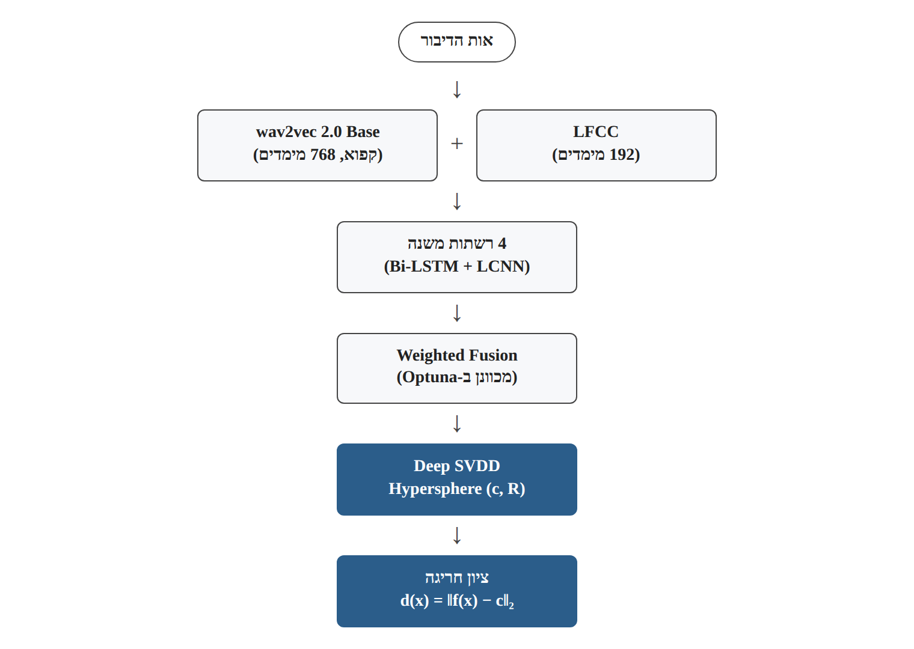
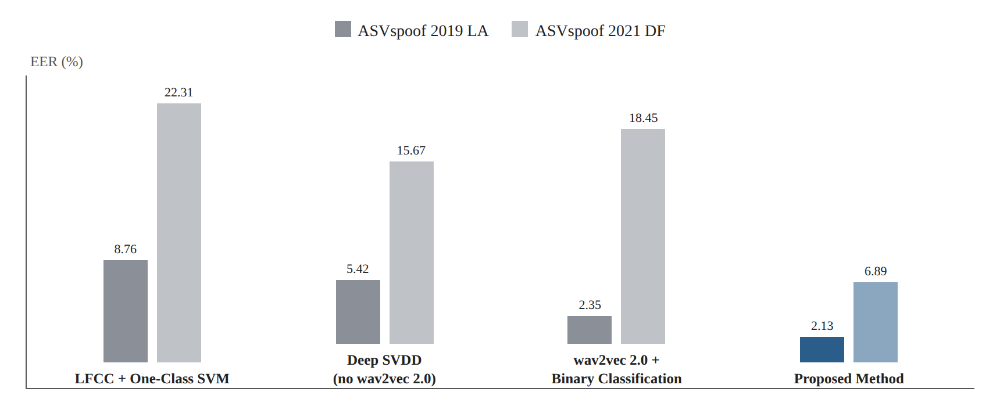

# Research Card 09 — One-Class Learning + wav2vec 2.0

## A Novel Attack-Resistant Speech Forgery Detection Method Integrating One-Class Learning and Wav2vec2

## 1. פרטים ביבליוגרפיים

**שם המאמר:** A Novel Attack-Resistant Speech Forgery Detection Method Integrating One-Class Learning and Wav2vec2.

**מחברים:** Jing Yin, Senyang Lei.

**מוסד מחקרי:** College of Artificial Intelligence, Wuhan Technology and Business University, Wuhan, China.

**שנת פרסום:** 2026.

**כנס:** International Conference on Communication Networks and Machine Learning (CNML).

**מוציא לאור:** IEEE.

**עמודים:** 415–419.

**DOI:** 10.1109/CNML68938.2026.11452384.

**קישור:** https://doi.org/10.1109/CNML68938.2026.11452384

**תחומי מחקר:** Audio Deepfake Detection, Speech Anti-Spoofing, Anomaly Detection, One-Class Learning, Self-Supervised Speech Representations, Unknown Attack Generalization.

**מילות מפתח:** One-Class Learning, Deep SVDD, wav2vec 2.0, LFCC, Hypersphere, Anomaly Score, Bi-LSTM, LCNN, Weighted Fusion, Optuna, EER.

**סיווג בסקירת הספרות:** Research Card 09 — מאמר הרחבה 03.

**רלוונטיות לפרויקט:** גבוהה מאוד מבחינה מחקרית. המאמר מציע פרדיגמת למידה שונה מסיווג בינארי, תוך שימוש במודל SSL שכבר נלמד בסקירת הספרות שלנו. הוא רלוונטי במיוחד לשאלת ההכללה לזיופים שאינם מופיעים בנתוני האימון.

---

## 2. תקציר מקיף של המאמר

המאמר מציג מערכת לזיהוי זיופים קוליים המבוססת על שילוב One-Class Learning עם ייצוגי דיבור של wav2vec 2.0 מאומן מראש.

החוקרים מבקשים להתמודד עם שתי מגבלות מרכזיות של מערכות Anti-Spoofing:

1. ירידה בביצועים מול מתקפות שלא נכללו באימון.
2. תלות בדוגמאות זיוף מתויגות לצורך למידת גבול החלטה בין דיבור אמיתי למזויף.

הפתרון המרכזי הוא ללמוד את ההתפלגות של דיבור אמיתי באמצעות Deep Support Vector Data Description — Deep SVDD.

המודל ממפה הקלטות אמיתיות למרחב ייצוגים ולומד לתאר אותן באמצעות Hypersphere קומפקטי. דוגמאות הנמצאות מחוץ לגבול הכדור מסווגות כחריגות, ובהקשר המשימה כמזויפות.

לצורך ייצוג הדיבור, החוקרים משלבים מאפייני LFCC עם ייצוגים עמוקים של wav2vec 2.0 Base.

המערכת כוללת ארבע רשתות משנה ומנגנון Weighted Fusion. משקלי השילוב נבחרים באמצעות Optuna לפי EER על קבוצת Validation.

ההערכה מתבצעת על שני מאגרים:

- ASVspoof 2019 LA — תרחיש מתקפות מוכרות.
- ASVspoof 2021 DF — תרחיש מתקפות לא מוכרות.

לפי התוצאות המדווחות, המערכת משיגה EER של 2.13% על ASVspoof 2019 LA ו-6.89% על ASVspoof 2021 DF.

על קבוצת 2021 DF, ביצועיה טובים יותר משלושה Baselines שנבדקו, ובהם מסווג בינארי מפוקח המשתמש ב-wav2vec 2.0.

עם זאת, המאמר כולל אי-התאמות בטבלת ה-Ablation וחוסר בהירות לגבי הצורך בדוגמאות זיוף מתויגות במהלך כוונון המערכת המלאה.

**המסקנה המרכזית:** שילוב ייצוגי SSL עם למידה חד-מחלקתית עשוי לשפר את זיהוי הזיופים בתרחישי שינוי התפלגות, אך יש להבחין בין תרומת One-Class Learning לבין תרומת הייצוגים, רשתות המשנה ואופטימיזציית ה-Fusion.

**מקור:** Abstract; Sections I–V.

---

## 3. בעיית המחקר והמוטיבציה

### 3.1 הבעיה המרכזית

טכנולוגיות TTS ו-Voice Conversion מאפשרות ליצור דיבור מזויף באיכות גבוהה.

מודלים לזיהוי זיופים נוטים להסתמך על דוגמאות מתקפה שנכללו באימון.

כאשר מופיעה טכנולוגיית יצירה חדשה, מאפייני הזיוף שלה עשויים להיות שונים מהמאפיינים שהמודל למד.

### 3.2 המגבלה של סיווג בינארי

מסווג בינארי מאומן על דוגמאות משתי מחלקות — אמיתי ומזויף.

במצב שבו סוגי הזיוף מגוונים ומתפתחים, לא ניתן להניח שנתוני האימון מכסים את כל המתקפות העתידיות.

### 3.3 המגבלה בנתונים מתויגים

לפי החוקרים, דוגמאות זיוף מתויגות אינן תמיד זמינות בהיקף מספק, במיוחד עבור מתקפות חדשות.

### 3.4 הכיוון המוצע

למידה של ההתפלגות של דיבור אמיתי, במקום הסתמכות ישירה על התפלגות דוגמאות זיוף.

### 3.5 מטרת המחקר

לפתח מערכת שמזהה זיופים לא מוכרים באמצעות Deep SVDD, תוך שימוש בייצוגי דיבור מאומנים מראש ובשילוב מספר רשתות משנה.

### 3.6 שאלת המחקר המשתמעת

האם שילוב ייצוגי wav2vec 2.0 עם One-Class Learning ו-Weighted Fusion משפר את יכולת ההכללה למתקפות זיוף לא מוכרות בהשוואה לגישות קלאסיות ולסיווג בינארי מפוקח?

**מקור:** Section I, עמ' 415.

---

## 4. הקשר למאמרים הקודמים שלנו

### 4.1 ASVspoof 5

מציג אתגרים של הכללה בין דוברים, מקורות ומתקפות.

המאמר הנוכחי מציע להתמודד עם בעיית ההכללה באמצעות למידת ההתפלגות של דיבור אמיתי.

### 4.2 CQCC

מייצג גישה המבוססת על מאפיינים אקוסטיים מחושבים מראש.

המאמר הנוכחי משתמש ב-LFCC ומוסיף ייצוגים עמוקים מאומנים מראש.

### 4.3 AASIST

מייצג גישה עמוקה לזיהוי זיופים, המבוססת על למידת הבחנה בין מחלקות.

Deep SVDD משנה את הגדרת בעיית הלמידה ומבקש למדל את המחלקה האמיתית.

### 4.4 wav2vec 2.0

מספק את הבסיס ללמידת ייצוגי דיבור מתוך אודיו לא מתויג.

המאמר הנוכחי משתמש בייצוגים אלה לצורך זיהוי חריגות, ולא לצורך תמלול דיבור.

### 4.5 WavLM

מציע ייצוגי SSL נוספים בעלי רלוונטיות למגוון משימות דיבור.

ניתן להציע החלפה של wav2vec 2.0 ב-WavLM במסגרת ניסוי המשך, אך אפשרות זו לא נבדקה במאמר.

### 4.6 CodecFake

מדגים את בעיית ההכללה בין מתקפות המבוססות על Neural Audio Codecs.

One-Class Learning עשוי להיות כיוון מתאים לבחינת מתקפות שלא נראו באימון, אך המאמר הנוכחי אינו כולל ניסוי על CodecFake.

### 4.7 Enhanced Forensic Trace Generation

משלב שחזור מאפיינים עם פיקוח המבחין בין דיבור אמיתי למזויף.

הגישה הנוכחית שונה בכך שהיא ממדלת את אזור הדיבור האמיתי לצורך זיהוי חריגות.

### 4.8 Intelligent Voice Fraud Detection

משלב מאפיינים מסורתיים, מודל סטטיסטי ומסווג עמוק.

המאמר הנוכחי משלב גם מאפיינים קלאסיים ועמוקים, אבל משתמש בגישה חד-מחלקתית.

---

## 5. התרומות המרכזיות

**1. שילוב One-Class Learning עם wav2vec 2.0**

שימוש בייצוגי SSL מאומנים מראש לצורך מידול דיבור אמיתי.

**2. Deep SVDD לזיהוי חריגות**

למידת גבול החלטה בצורת Hypersphere.

**3. שילוב LFCC וייצוגים עמוקים**

ניצול מאפיינים אקוסטיים קלאסיים לצד ייצוגי דיבור הקשריים.

**4. ארבע רשתות משנה**

שימוש במספר מסלולי עיבוד לצורך הפקת ציוני זיהוי.

**5. Weighted Fusion**

שילוב ציוני רשתות המשנה במשקלים נלמדים.

**6. אופטימיזציית משקלים באמצעות Optuna**

בחירת משקלים הממזערים EER על Validation.

**7. הערכה על שני מאגרי ASVspoof**

השוואה בין ASVspoof 2019 LA לבין ASVspoof 2021 DF.

**8. השוואה לגישות מפוקחות וחד-מחלקתיות**

בחינת LFCC+One-Class SVM, Deep SVDD ללא wav2vec 2.0 ומסווג בינארי המבוסס על wav2vec 2.0.

**מקור:** Sections I, III–IV.

---

## 6. הבסיס התיאורטי — One-Class Learning

### 6.1 הרעיון

One-Class Learning לומד את המאפיינים של מחלקה אחת בלבד.

במקרה שלנו, המחלקה היא דיבור אמיתי.

### 6.2 מה ההבדל מסיווג בינארי?

ב-Binary Classification המודל לומד להבחין בין אמיתי למזויף.

ב-One-Class Learning המודל מגדיר מה נחשב תואם לדיבור אמיתי, וכל מה שחורג מהאזור הנלמד עשוי להיחשב חריג.

### 6.3 יתרון אפשרי

אין צורך להכיר מראש כל סוג זיוף כדי לאמן את מסווג החריגות.

### 6.4 מגבלה עקרונית

דיבור אמיתי בתנאי הקלטה שונים עשוי להיחשב חריג.

מנגד, זיוף איכותי מאוד עשוי להימצא בתוך אזור הדיבור האמיתי.

### 6.5 הבחנה חשובה

זיהוי חריגה מההתפלגות אינו זהה בהכרח לזיהוי הסיבה לחריגה.

**מקור:** Section II-B, עמ' 416.

---

## 7. Deep SVDD — מנגנון הלמידה

### 7.1 מהו Deep SVDD?

Deep Support Vector Data Description הוא אלגוריתם המשלב רשת נוירונים עם למידה חד-מחלקתית.

### 7.2 מיפוי למרחב המאפיינים

נסמן את מיפוי הדיבור:

z = f_θ(x)

כאשר x הוא אות הדיבור ו-θ מייצג את פרמטרי הרשת.

*איור 1. המחשה למבנה הכללי: שני מסלולי חילוץ המאפיינים (LFCC ו-wav2vec 2.0), ארבע רשתות המשנה, Weighted Fusion ו-Deep SVDD, כמתואר בסעיפים 7–12.*

### 7.3 גבול החלטה

המודל מתאר את הייצוגים של הדיבור האמיתי באמצעות Hypersphere.

לכדור שני פרמטרים מרכזיים:

- c — המרכז.
- R — הרדיוס.

### 7.4 מטרת האימון

ללמוד מרחב ייצוג שבו דוגמאות אמיתיות מרוכזות באזור קומפקטי.

### 7.5 תיאור שלבי האימון

המחברים מתארים שני שלבים:

**Pre-training:** מזעור פונקציית אובדן הקשורה לנפח הכדור ולייצוגי דיבור אמיתי.

**Fine-Tuning:** צמצום המרחק של דוגמאות אמיתיות למרכז הכדור.

### 7.6 אי-בהירות במשוואת האימון

ב-Equation (1), כפי שהיא מודפסת במאמר, מופיע ביטוי הכולל את הנורמה של המרכז c ואת הנורמה של f(x_i, θ), לצד רדיוס R, אך המרחק מ-c אינו מוצג באותה צורה כמו בכלל ההחלטה בהמשך.

התיאור המילולי מדבר על צמצום נפח הכדור ועל קירוב דוגמאות אמיתיות למרכזו.

קיימת לכן אי-בהירות לגבי פונקציית האובדן המדויקת שיש לממש.

**החלטה למחקר שלנו:** לא נשחזר את משוואת האימון מתוך הנחה שהיא שקולה לנוסחת Deep SVDD סטנדרטית. אם נרצה לממש את השיטה, נשתמש בהגדרה מאומתת של Deep SVDD ונתעד את ההבדל מהנוסחה המודפסת במאמר.

**מקור:** Section III-B, Equation (1), עמ' 416.

---

## 8. כלל ההחלטה וציון החריגה

### 8.1 המרחק מהמרכז

המאמר מגדיר:

d(x) = ||f_θ(x) − c||₂

### 8.2 סיווג אמיתי

אם:

d(x) ≤ R

ההקלטה נמצאת בתוך הכדור ומסווגת כאמיתית.

### 8.3 סיווג מזויף

אם:

d(x) > R

ההקלטה נמצאת מחוץ לכדור ומסווגת כמזויפת.

### 8.4 הציון במאמר

S(x) = R − d(x)

ציון גבוה מצביע על התאמה גבוהה יותר לדיבור אמיתי.

### 8.5 התאמה לפרויקט שלנו

בפרויקט הקורס נדרש ציון גבוה יותר עבור דיבור מזויף.

לכן נוכל להשתמש ב:

FakeScore(x) = d(x) − R

### 8.6 הבחנה בין Score לסף

EER מחושב באמצעות ציונים רציפים על פני ספים אפשריים.

אין צורך שהסף הקבוע R יהיה סף ההחלטה שבו מתקבל EER.

### 8.7 משמעות

אפשר להשתמש ב-Deep SVDD כמפיק ציוני חריגה ולמדוד EER, גם אם בפועל נדרש לכייל סף החלטה עבור מערכת יישומית.

**מקור:** Section III-B, Equation (2), עמ' 417.

---

## 9. רכיב wav2vec 2.0

### 9.1 מטרת הרכיב

להפיק ייצוגי דיבור עמוקים ממודל שעבר Pre-training על אודיו לא מתויג.

### 9.2 המודל שנבחר

wav2vec 2.0 Base.

### 9.3 ממד הייצוג

768.

### 9.4 התאמת המודל

המחברים מציינים ששכבות ה-Transformer נשארות קפואות ומבוצעת התאמה של שכבת הפלט.

### 9.5 למה המודל עשוי להועיל?

הוא מכיל ייצוגים המתארים מידע ספקטרלי, זמני והקשרי של דיבור.

### 9.6 קשר ל-One-Class Learning

Deep SVDD יכול לפעול על ייצוגים אלה, כך שהמודל אינו נדרש ללמוד את כל מאפייני הדיבור מאפס.

### 9.7 מגבלה

העובדה שהייצוגים נלמדו במסגרת SSL אינה מבטיחה שהם מתאימים באופן אופטימלי לזיהוי חריגות המעידות על זיוף.

### 9.8 הבחנה חשובה

מודול ה-Quantization ומשימת ה-Contrastive Pre-training של wav2vec 2.0 אינם נדרשים כחלק מראש סיווג הזיופים בשלב ה-Downstream המתואר.

**מקור:** Sections II-C, IV-A, עמ' 416–417.

---

## 10. רכיב LFCC

### 10.1 מהו LFCC?

Linear Frequency Cepstral Coefficients הם מאפיינים אקוסטיים המבוססים על ניתוח הספקטרום באמצעות סולם תדרים ליניארי.

### 10.2 הגדרות חילוץ

- אורך Frame: 20ms.
- Frame Shift: 10ms.
- חלון Hamming.
- 64 מקדמי LFCC.

### 10.3 נגזרות זמניות

המחברים מוסיפים נגזרות מסדר ראשון ושני.

### 10.4 ממד הייצוג הכולל

64 × 3 = 192

### 10.5 למה משלבים LFCC?

החוקרים מבקשים להשתמש במידע אקוסטי קלאסי לצד ייצוגי SSL.

### 10.6 מגבלה

לא מוצג ניסוי המפריד באופן מלא בין תרומת LFCC לבין תרומת wav2vec 2.0 בכל מסלולי העיבוד וה-Fusion.

**מקור:** Section IV-A, עמ' 417.

---

## 11. רשתות המשנה

### 11.1 הרשתות המתוארות

המחברים מציינים ארבע רשתות:

- LF-LBiGF.
- 2V-LBiGF.
- W2V-BiGF.
- W2V-GF.

### 11.2 רכיבים ארכיטקטוניים

המאמר מציין שימוש ב:

- Bi-LSTM.
- LCNN.
- Fully Connected Layers.

### 11.3 פרטי מימוש מדווחים

- Hidden Dimension של Bi-LSTM: 512.
- Dropout: 0.3.
- LCNN Kernel: 3×3.
- Stride: 1.
- Padding: 1.
- Activation: ReLU.
- ממד הפלט אל Deep SVDD: 256.

### 11.4 תפקיד הרשתות

כל רשת משנה מפיקה ייצוג וציון בהתאם לאופן עיבוד המאפיינים שלה.

### 11.5 מגבלה מתודולוגית

המאמר אינו מספק בטקסט פירוט מלא ועקבי המאפשר לשחזר במדויק את ארבע הארכיטקטורות ואת משמעות כל קיצור בשמותיהן.

לפיכך אין להמציא ארכיטקטורה מלאה לכל רשת משנה.

**מקור:** Section III-C ו-Section IV-A, עמ' 417.

---

## 12. Multi-Model Weighted Fusion

### 12.1 מטרת השילוב

לנצל את החוזקות של מספר רשתות משנה ולהפחית את התלות במודל יחיד.

### 12.2 הנוסחה

S_fusion = Σ (i=1 עד 4) ω_i · S_i

### 12.3 מגבלת המשקלים

Σ (i=1 עד 4) ω_i = 1, ω_i > 0

### 12.4 אופטימיזציה

המחברים משתמשים ב-Optuna וב-TPE — Tree-Structured Parzen Estimator — כדי לבחור משקלים.

### 12.5 פונקציית המטרה

מזעור EER על קבוצת Validation.

### 12.6 כלל ההחלטה

- S_fusion ≥ 0: אמיתי.
- S_fusion < 0: מזויף.

### 12.7 יתרון אפשרי

שילוב ציונים עשוי לעזור כאשר רשתות משנה שונות מזהות סוגי חריגות משלימים.

### 12.8 מגבלה

המאמר אינו מדווח באופן מספק את משקלי השילוב הסופיים או את מידת היציבות שלהם בין ניסויים.

### 12.9 בעיית תוויות ה-Validation

בחירת משקלים באמצעות EER מחייבת ציונים ותוויות של שתי המחלקות.

לכן, אף שאימון Deep SVDD עשוי להתבצע באמצעות דיבור אמיתי בלבד, בחירת מערכת ה-Fusion המתוארת דורשת ככל הנראה גם מידע מתויג על דיבור מזויף.

**מקור:** Section III-C, עמ' 417.

---

## 13. פרטי אימון

### 13.1 Deep SVDD

- מרכז הכדור מאותחל כממוצע ייצוגי נתוני האימון.
- רדיוס התחלתי: R = 0.1.
- הרדיוס מתעדכן במהלך האימון, לפי תיאור המחברים.

### 13.2 Optimizer

Adam.

### 13.3 Learning Rate

10⁻⁴.

### 13.4 Weight Decay

10⁻⁵.

### 13.5 Batch Size

32.

### 13.6 מספר Epochs

100.

### 13.7 Early Stopping

Patience של 5 Epochs.

### 13.8 קריטריון Early Stopping

המחברים מתארים עצירה כאשר Validation EER אינו משתפר במשך חמישה Epochs.

### 13.9 מגבלה

המאמר אינו מפרט כיצד נבנתה קבוצת האימות לצורך Early Stopping, ובפרט כיצד התקבל EER במסגרת הטענה לאימון שאינו דורש דוגמאות זיוף מתויגות.

**מקור:** Section IV-A, עמ' 417.

---

## 14. מאגרי הנתונים

### 14.1 ASVspoof 2019 LA

משמש להערכת מה שהמחברים מכנים Known Attack Detection.

### 14.2 ASVspoof 2021 DF

משמש להערכת מה שהמחברים מכנים Unknown Attack Detection.

### 14.3 מטרת ההשוואה

לבחון את יכולת ההכללה של השיטה כאשר עוברים למאגר הערכה נוסף ובו מתקפות שונות.

### 14.4 מגבלת תיאור הנתונים

המאמר אינו מספק פירוט מלא של:

- מספר ההקלטות בכל Split.
- זהות הדוברים בכל חלוקה.
- כל מזהי המתקפות.
- פרוטוקול הכנת קבוצות האימות.
- השפעת ערוצי ההקלטה והבדלי המקור.
- מנגנוני מניעת חפיפה אפשרית בין מקורות.

### 14.5 הבחנה מתודולוגית

המעבר בין ASVspoof 2019 LA ל-ASVspoof 2021 DF אינו מבטיח שהמשתנה היחיד שהשתנה הוא סוג המתקפה.

לכן יש לתאר את הניסוי כהערכה תחת מעבר בין מאגרים ופרוטוקולים, ולא כהוכחה מבודדת של הכללה למתקפות לא מוכרות.

**מקור:** Section IV-A, עמ' 417.

---

## 15. מודלי ההשוואה

המחברים מציגים שלושה Baselines.

### 15.1 LFCC + One-Class SVM

גישה חד-מחלקתית קלאסית.

מטרתה לספק נקודת ייחוס ללא ייצוגי SSL עמוקים.

### 15.2 Deep SVDD ללא wav2vec 2.0

גישה עמוקה של One-Class Learning המבוססת על מאפייני LFCC.

מטרתה לבחון את היתרון האפשרי של שימוש בייצוגי wav2vec 2.0.

### 15.3 wav2vec 2.0 + Supervised Binary Classification

מסווג מפוקח המשתמש בייצוגי wav2vec 2.0 ומאומן באמצעות Cross-Entropy.

מטרתו להשוות בין שימוש בייצוגי SSL בסיווג בינארי לבין שימוש בהם במסגרת One-Class Learning.

### 15.4 מגבלת ההשוואה

השיטה המוצעת כוללת רכיבים נוספים, ובהם Fusion של מספר רשתות משנה.

לכן ההשוואה אינה בהכרח משנה רק את פרדיגמת הלמידה.

**מקור:** Section IV-A, עמ' 417.

---

## 16. תוצאות על ASVspoof 2019 LA — Table I

### 16.1 תוצאות

| מודל | EER | DCF | Accuracy |
|---|---:|---:|---:|
| LFCC + One-Class SVM | 8.76% | 0.124 | 91.23% |
| Deep SVDD ללא wav2vec 2.0 | 5.42% | 0.089 | 94.57% |
| wav2vec 2.0 + Binary Classification | 2.35% | 0.042 | 97.64% |
| **השיטה המוצעת** | **2.13%** | **0.038** | **97.86%** |

*איור 2. המחשה לנתוני Table I ו-Table II (סעיפים 16.1 ו-17.1): EER של ארבע התצורות על ASVspoof 2019 LA ו-ASVspoof 2021 DF.*

### 16.2 הממצא המרכזי

השיטה המוצעת השיגה את התוצאה הטובה ביותר מבין ארבע התצורות שנבדקו.

### 16.3 לעומת One-Class SVM

ירידה ב-EER מ-8.76% ל-2.13%.

שיפור מוחלט של 6.63 נקודות אחוז.

### 16.4 לעומת Deep SVDD ללא wav2vec 2.0

ירידה מ-5.42% ל-2.13%.

שיפור מוחלט של 3.29 נקודות אחוז.

### 16.5 לעומת מסווג בינארי עם wav2vec 2.0

ירידה מ-2.35% ל-2.13%.

שיפור מוחלט של 0.22 נקודות אחוז.

### 16.6 מסקנה

השיטה מצליחה להתחרות במסווג בינארי מפוקח גם במסגרת קבוצת ההערכה של ASVspoof 2019 LA.

### 16.7 מגבלה

ההבדל של 0.22 נקודות אחוז אינו מלווה ברווחי סמך או בהערכת יציבות בין Seeds.

לכן אין להסיק שהוא בהכרח מובהק או יציב.

**מקור:** Section IV-B, Table I, עמ' 418.

---

## 17. תוצאות על ASVspoof 2021 DF — Table II

### 17.1 תוצאות

| מודל | EER | DCF | Accuracy |
|---|---:|---:|---:|
| LFCC + One-Class SVM | 22.31% | 0.287 | 77.68% |
| Deep SVDD ללא wav2vec 2.0 | 15.67% | 0.214 | 84.32% |
| wav2vec 2.0 + Binary Classification | 18.45% | 0.246 | 81.54% |
| **השיטה המוצעת** | **6.89%** | **0.095** | **93.10%** |

### 17.2 הממצא המרכזי

השיטה המוצעת השיגה EER נמוך משמעותית משלושת ה-Baselines.

### 17.3 לעומת One-Class SVM

שיפור מוחלט של 15.42 נקודות אחוז.

### 17.4 לעומת Deep SVDD ללא wav2vec 2.0

שיפור מוחלט של 8.78 נקודות אחוז.

### 17.5 לעומת מסווג בינארי עם wav2vec 2.0

שיפור מוחלט של 11.56 נקודות אחוז.

### 17.6 המשמעות המחקרית

התוצאה תומכת בכך שהשיטה המשולבת עשויה להתמודד טוב יותר עם נתוני הערכה השונים מהמקור.

### 17.7 מה לא ניתן להסיק?

לא ניתן לקבוע מהטבלה בלבד שהשיפור נובע באופן בלעדי מ-One-Class Learning.

בנוסף, אין ראיה מספקת שהתוצאה תישמר בכל טכנולוגיית זיוף חדשה.

**מקור:** Section IV-B, Table II, עמ' 418.

---

## 18. ניסויי Ablation — Table III

### 18.1 מטרת הניסוי

לבחון את תרומתם של:

- ייצוגי wav2vec 2.0.
- Deep SVDD.
- Weighted Fusion.
- Data Augmentation.

### 18.2 הערכים המופיעים בטבלה

| תצורה כפי שהודפסה | EER |
|---|---:|
| שורת כותרת משובשת — Dissolution Model | 10.34% |
| LFCC + Deep SVDD Only | 8.57% |
| wav2vec 2.0 + One-Class SVM | 7.92% |
| wav2vec 2.0 + Deep SVDD (No Fusion) | 5.21% |
| Proposed Method + Data Augmentation | 6.89% |

### 18.3 הסתירה מול הטקסט

בפסקאות ההסבר המחברים קושרים את התוצאות באופן שונה:

- הסרת wav2vec 2.0 מתוארת כגורמת ל-EER של 10.34%.
- החלפת Deep SVDD ב-One-Class SVM מתוארת כגורמת ל-EER של 8.57%.
- הסרת Fusion מתוארת כגורמת ל-EER של 7.92%.
- הוספת Data Augmentation מתוארת כמשפרת את ה-EER ל-5.21%.

לפיכך נראה שקיימת בעיית יישור או שיוך של שמות התצורות והערכים, אך אין בידינו אישור רשמי לתיקון.

### 18.4 מה ניתן לומר בזהירות?

המחברים טוענים שייצוגי wav2vec 2.0, Deep SVDD ו-Fusion משפרים את הביצועים.

הם טוענים גם ש-Augmentation באמצעות רעש גאוסי, שינוי קצב דיבור והתאמת עוצמה משפר את ההכללה.

### 18.5 מה לא ניתן לעשות?

אין להציג את כל ערכי ה-Ablation כממצאים עקביים ומאומתים לגבי תרומת כל רכיב.

### 18.6 משמעות לסקירת הספרות

יש להסתמך בעיקר על Tables I–II לתיאור הביצועים המרכזיים, ולתעד את הבעיה ב-Table III בביקורת המחקרית.

**מקור:** Section IV-B, Table III, עמ' 418, וההמשך בעמ' 419.

---

## 19. הטענה לאימון ללא זיופים מתויגים

### 19.1 טענת המחברים

המאמר מציג One-Class Learning כגישה שאינה דורשת דוגמאות מזויפות מתויגות לצורך אימון מסווג החריגות.

### 19.2 מה תומך בטענה?

Deep SVDD מאומן על דוגמאות של דיבור אמיתי, לפי תיאור השיטה.

### 19.3 מה מסייג את הטענה?

המחברים מתארים שימוש ב-EER לצורך:

- בחירת משקלי ה-Fusion באמצעות Optuna.
- Early Stopping.

### 19.4 למה זו בעיה?

כדי לחשב EER במסגרת זיהוי זיופים, יש צורך בנתוני הערכה מתויגים הכוללים גם דיבור אמיתי וגם דיבור מזויף.

### 19.5 המסקנה הביקורתית

יש להבחין בין:

**One-Class Training:** אימון על דיבור אמיתי בלבד.

**Full Model Selection:** בחירת מערכת באמצעות EER, העשויה לדרוש גם דוגמאות מזויפות מתויגות.

### 19.6 מה חסר במאמר?

לא מוצג הסבר שמסיר את הסתירה בין הטענה לאי-תלות בתוויות זיוף לבין תהליך כוונון המערכת.

### 19.7 משמעות לפרויקט שלנו

אם נרצה לבדוק באופן נקי את יתרונו של One-Class Learning, נקפיד להפריד בין אימון על דיבור אמיתי לבין בחירת היפר-פרמטרים.

במידת האפשר, נבחן גם תצורה שבה כוונון המודל החד-מחלקתי אינו נעזר בדוגמאות זיוף כלל.

---

## 20. ניתוח ביקורתי — יתרונות המחקר

**א. שינוי מהותי בפרדיגמת הלמידה**

המחקר בוחן את מודל הדיבור האמיתי במקום תלות מלאה בדוגמאות זיוף.

**ב. שילוב עם SSL**

המודל משתמש בידע שנלמד מראש מתוך מאגרי דיבור לא מתויגים.

**ג. שימוש ב-Deep SVDD**

למידת מרחב מאפיינים קומפקטי עשויה להתאים לייצוגים עמוקים.

**ד. שילוב מאפיינים משלימים**

המערכת משתמשת ב-LFCC וב-wav2vec 2.0.

**ה. Multi-Model Fusion**

שילוב מספר ציונים עשוי להפחית תלות ברשת משנה יחידה.

**ו. השוואה למספר Baselines**

המאמר כולל הן מודלים חד-מחלקתיים והן מסווג בינארי מפוקח.

**ז. הערכה על מאגר נוסף**

החוקרים בוחנים את המערכת גם על ASVspoof 2021 DF.

**ח. עיסוק ישיר בהכללה למתקפות לא מוכרות**

המחקר מתמקד באחת הבעיות החשובות ביותר של Audio Deepfake Detection.

---

## 21. ניתוח ביקורתי — מגבלות המחקר

### 21.1 אי-התאמות בטבלת ה-Ablation

לא ניתן לקבוע באופן חד-משמעי את תוצאת כל תצורה.

### 21.2 אי-בהירות בפרוטוקול Validation

בחירת משקלים ו-Early Stopping משתמשים ב-EER, אך המאמר אינו מסביר כיצד הדבר מתיישב עם טענת האימון ללא תוויות זיוף.

### 21.3 אי-בהירות בפונקציית האובדן

Equation (1) אינה מוצגת באופן עקבי עם המרחק מהמרכז בכלל ההחלטה.

### 21.4 חוסר פירוט בחלוקת הנתונים

אין די מידע כדי לאמת את כל ההפרדות בין קבוצות האימון, האימות והבדיקה.

### 21.5 השוואה בין מאגרים שונים

ASVspoof 2019 LA ו-ASVspoof 2021 DF שונים ביותר מהיבט אחד.

### 21.6 אין בידוד מלא של תרומת One-Class Learning

השיטה המוצעת משלבת גם שינוי במאפיינים ובמנגנון Fusion.

### 21.7 היעדר מדדי יציבות

אין רווחי סמך, סטיות תקן או תוצאות על פני מספר Seeds.

### 21.8 תיאור מוגבל של רשתות המשנה

לא כל מרכיבי הארכיטקטורה והחיבורים מפורטים ברמה הנחוצה לשחזור.

### 21.9 אין הערכה על CodecFake

לא נבדקו ישירות זיופים שמקורם במאגר CodecFake.

### 21.10 אין הערכה על ASVspoof 5

אי אפשר להעביר ישירות את התוצאות למאגר הקורס שלנו.

### 21.11 אין ניתוח מפורט של False Rejection לפי מקור

המאמר אינו מציג ניתוח ייעודי של דיבור אמיתי ממקורות שונים.

### 21.12 אין השוואה ל-WavLM

לכן לא ניתן להסיק ש-wav2vec 2.0 הוא ה-Encoder המתאים ביותר לגישה.

### 21.13 אין מדידות חישוביות מפורטות

המאמר אינו מציג השוואה מלאה של זמן חיזוי, זיכרון ומורכבות חישובית.

### 21.14 אין הוכחה לעמידות אוניברסלית

הצלחה על מאגר הערכה נוסף אינה מבטיחה הצלחה מול כל טכנולוגיית זיוף עתידית.

---

## 22. מה המאמר אינו מוכיח?

אין להסיק מהמאמר ש:

- כל גישת One-Class עדיפה על סיווג בינארי.
- כל זיוף חדש יימצא מחוץ לכדור של Deep SVDD.
- כל דיבור אמיתי יימצא בתוך הכדור.
- אימון Deep SVDD מבטיח הכללה בין מקורות.
- אין צורך בדוגמאות זיוף מתויגות בשום שלב של המערכת המלאה.
- כל שיפור נובע מ-One-Class Learning בלבד.
- Fusion תמיד עדיף על רשת משנה יחידה.
- wav2vec 2.0 הוא תמיד ייצוג הדיבור הטוב ביותר לזיהוי חריגות.
- Data Augmentation משפר את ה-EER בדיוק בשיעור שניתן לשחזר ללא הבהרת Table III.
- המערכת תצליח באותה מידה על ASVspoof 5 או CodecFake.
- המערכת מתאימה לפריסה מעשית ללא בדיקה נוספת של עלות, זמן חיזוי ויציבות.

---

## 23. התובנות שלנו מהמאמר

### 23.1 לא חייבים ללמוד את כל סוגי הזיופים

אפשר לנסות ללמוד את ההתפלגות של דיבור אמיתי ולזהות חריגות ממנה.

### 23.2 חריגה אינה בהכרח זיוף

דיבור אמיתי בתנאים שונים עשוי להיות חריג ביחס לנתוני האימון.

### 23.3 איכות ייצוג הדיבור חשובה מאוד

One-Class Learning תלוי במרחב המאפיינים שבו מוגדר גבול ההחלטה.

### 23.4 Pre-training עשוי להפחית את הצורך בלמידת מאפיינים מאפס

מודל wav2vec 2.0 מספק ייצוגי דיבור מאומנים מראש.

### 23.5 גבול החלטה קומפקטי יכול להיות יתרון וגם חיסרון

כדור צר עשוי לדחות זיופים, אך גם דוגמאות אמיתיות שאינן דומות לנתוני האימון.

כדור רחב יותר עשוי לקבל דוגמאות אמיתיות מגוונות, אך גם חלק מהזיופים.

### 23.6 מגוון הנתונים האמיתיים חשוב במיוחד

הדבר רלוונטי למאגר שלנו, שבו דוגמאות אמיתיות מגיעות ממספר מקורות.

### 23.7 מודל מורכב אינו בהכרח הדרך הטובה ביותר לבחון רעיון חדש

אפשר לבדוק קודם One-Class SVM על ייצוגי wav2vec 2.0 קפואים, ורק לאחר מכן לעבור ל-Deep SVDD.

### 23.8 יש להבחין בין אימון לבין בחירת מודל

הטענה לאימון ללא זיופים מתויגים תלויה גם באופן שבו מתבצע Hyperparameter Tuning.

### 23.9 ביקורת על טבלאות חשובה לא פחות מהבנת הארכיטקטורה

אי-התאמות במאמר מחייבות אותנו להגביל את חוזק המסקנות.

---

## 24. רלוונטיות לפרויקט שלנו

### 24.1 מבנה המאגר

מאגר הקורס כולל:

| מקור | Bona Fide | Spoof | סה"כ |
|---|---:|---:|---:|
| ASVspoof 5 | 300 | 300 | 600 |
| CodecFake | 300 | 300 | 600 |
| M-AILABS | 320 | 0 | 320 |
| **סה"כ** | **920** | **600** | **1,520** |

ההקלטות באורך ארבע שניות ובקצב דגימה של 16kHz, לפי מפרט הפרויקט.

### 24.2 למה One-Class רלוונטי?

יש לנו דוגמאות אמיתיות שאפשר להשתמש בהן לצורך למידת התפלגות הדיבור האותנטי.

### 24.3 מה היתרון האפשרי?

אפשר לבחון אם מודל שאומן על דיבור אמיתי מצליח לזהות זיופים שלא נכללו באימון המסווג.

### 24.4 מה הסיכון המרכזי?

מודל שאומן על דיבור אמיתי ממקור מסוים עלול לדחות דיבור אמיתי ממקור אחר.

### 24.5 M-AILABS

מכיוון ש-M-AILABS מכיל אצלנו דיבור אמיתי בלבד, הוא עשוי להיות שימושי במיוחד לבחינת False Rejection על מקור נוסף.

### 24.6 מדד הערכה

המדד המרכזי בפרויקט הוא EER.

### 24.7 כיוון הציון

הציון צריך להיות גבוה יותר עבור דיבור מזויף.

ב-Deep SVDD ניתן להשתמש במרחק מהמרכז או בציון d−R.

### 24.8 חלוקת נתונים

נדרש להקפיד על הפרדה בין Training, Validation ו-Test.

אם קיימים מזהי דוברים ומתקפות, יש לנצל אותם לצורך מניעת דליפות והערכה הוגנת.

### 24.9 הערכה לפי מקור

נבחן את התפלגות ציוני הדיבור האמיתי והדיבור המזויף בנפרד לפי מקור נתונים.

### 24.10 מגבלה

ל-M-AILABS אין אצלנו דוגמאות מזויפות, ולכן לא ניתן לחשב EER על M-AILABS לבדו.

---

## 25. ניסוי ההשוואה המרכזי שאנחנו מציעים

### 25.1 מטרת הניסוי

לבודד את השפעת פרדיגמת הלמידה — Binary Classification לעומת One-Class Learning.

### 25.2 תנאים משותפים

- אותו wav2vec 2.0 מאומן מראש.
- אותן הקלטות.
- אותה חלוקת נתונים.
- אותו תהליך חילוץ מאפיינים.
- אותו פרוטוקול הערכה.
- אותו מדד EER.
- כוונון Hyperparameters על Validation בלבד.

### 25.3 ניסוי A — Binary Classifier

שימוש בייצוגי wav2vec 2.0 קפואים.

אימון מסווג באמצעות דוגמאות אמיתיות ומזויפות.

### 25.4 ניסוי B — One-Class SVM

שימוש באותם ייצוגים קפואים.

אימון מסווג החריגות על דוגמאות אמיתיות בלבד.

### 25.5 למה להתחיל ב-One-Class SVM?

מפני שהוא מאפשר לבחון את רעיון הלמידה החד-מחלקתית בלי להוסיף מראש רשת עמוקה נלמדת.

### 25.6 ניסוי C — Deep SVDD

אם ניסוי B יציג פוטנציאל, נוכל לאמן Deep SVDD על אותו בסיס ייצוגים.

### 25.7 מה נמדוד?

- EER כולל על קבוצת הבדיקה.
- ביצועים לפי מקור נתונים, כאשר קיימות שתי המחלקות.
- False Rejection על דיבור אמיתי מכל מקור.
- יציבות בין Seeds, כאשר רלוונטי.
- זמן אימון וחיזוי.
- רגישות לכוונון Hyperparameters.

### 25.8 פרוטוקול Low-Label

כדי לבדוק במפורש את התועלת של One-Class Learning ללא תוויות זיוף, נוכל להגדיר ניסוי נוסף שבו בחירת Hyperparameters מתבצעת ללא שימוש בדוגמאות זיוף.

### 25.9 למה ההפרדה חשובה?

אם נשתמש בדוגמאות זיוף לצורך בחירת המודל החד-מחלקתי, נבחן גישה חד-מחלקתית באימון אך לא מערכת חופשית לחלוטין מתוויות זיוף.

שני התרחישים יכולים להיות רלוונטיים, אך יש לדווח עליהם בנפרד.

---

## 26. השערות מחקר

### H1 — Binary Classification לעומת One-Class Learning

**השערה:** One-Class Learning עשוי להכליל טוב יותר למתקפות חדשות, גם אם לא ישיג את ה-EER הנמוך ביותר על מתקפות מוכרות.

**ניסוי:** אותו Encoder ואותה חלוקת נתונים, עם מסווג בינארי מול מסווג חד-מחלקתי.

### H2 — מגוון מקורות דיבור אמיתי

**השערה:** שימוש בדיבור אמיתי ממספר מקורות עשוי להפחית False Rejection על מקורות שלא נכללו קודם באימון.

**ניסוי:** השוואת One-Class שאומן על מקור יחיד מול One-Class שאומן על מספר מקורות אמיתיים.

**סיכון:** שינוי בגבול ההחלטה עשוי להשפיע גם על קבלת זיופים.

### H3 — One-Class SVM לעומת Deep SVDD

**השערה:** מיפוי נלמד באמצעות Deep SVDD עשוי לשפר את מידול הדיבור האמיתי ביחס ל-One-Class SVM.

**ניסוי:** אותו Encoder ומערך נתונים, עם השוואה בין שני מסווגי החריגות.

### H4 — wav2vec 2.0 לעומת WavLM

**השערה:** ייצוגי WavLM עשויים להתאים טוב יותר או פחות ללמידת גבול One-Class.

**ניסוי:** החלפת Encoder תוך שמירת אותו מסווג, אותה חלוקת נתונים ואותו מדד.

### H5 — שילוב LFCC ו-SSL

**השערה:** שילוב מאפיינים קלאסיים ועמוקים עשוי לספק מידע משלים עבור זיהוי חריגות.

**ניסוי:** LFCC בלבד, SSL בלבד ושילוב של השניים.

### H6 — השפעת כוונון המודל

**השערה:** שימוש בדוגמאות זיוף בשלב Validation עשוי לשפר EER, אך משנה את הטענה למערכת שאינה תלויה בתוויות זיוף.

**ניסוי:** כוונון ללא תוויות זיוף מול כוונון המבוסס על EER.

### H7 — רגישות למקור הנתונים

**השערה:** One-Class Learning עשוי לזהות הבדלי מקור כחריגות ולדחות דיבור אמיתי ממאגר חדש.

**ניסוי:** ניתוח Score Distributions ו-False Rejection לפי ASVspoof 5, CodecFake ו-M-AILABS.

---

## 27. סדר עדיפות לניסויים

**עדיפות גבוהה**

1. Baseline עם MFCC/CQCC.
2. Frozen wav2vec 2.0 עם מסווג בינארי.
3. Frozen wav2vec 2.0 עם One-Class SVM.
4. ניתוח False Rejection לפי מקור הדיבור האמיתי.
5. השוואת EER בין סיווג בינארי לחד-מחלקתי.

**עדיפות בינונית**

6. One-Class SVM על ייצוגי WavLM.
7. Deep SVDD על ייצוגים קפואים.
8. השוואת דיבור אמיתי ממקור יחיד מול מספר מקורות.
9. בחינה של פרוטוקול כוונון ללא תוויות זיוף.

**עדיפות נמוכה בשלב הראשוני**

10. שחזור ארבע רשתות המשנה של המאמר.
11. Weighted Fusion מלא.
12. שחזור Optuna וה-Data Augmentation.
13. שינויי ארכיטקטורה עמוקים.

הסדר נועד לאפשר לנו לבחון תחילה את ההשערה המחקרית המרכזית בלי להעמיס מורכבות מיותרת.

---

## 28. שאלות פתוחות

1. האם One-Class Learning באמת משפר הכללה ל-CodecFake שלא נכלל באימון?
2. האם שימוש ב-wav2vec 2.0 קפוא מספיק לצורך זיהוי חריגות?
3. האם WavLM מספק מרחב מאפיינים מתאים יותר ל-Deep SVDD?
4. האם הוספת דיבור אמיתי מ-M-AILABS מפחיתה False Rejection?
5. האם מודל שאומן על מקור דיבור אמיתי יחיד מכליל למקורות אחרים?
6. כיצד משפיע רדיוס הכדור על קבלת דיבור אמיתי ועל דחיית זיופים?
7. האם Deep SVDD מצדיק את מורכבותו ביחס ל-One-Class SVM?
8. האם שילוב LFCC עם ייצוגי SSL משפר EER?
9. האם אפשר לבחור Hyperparameters ללא דוגמאות זיוף מתויגות?
10. האם שיטת Fusion מועילה מעבר לשימוש במסווג חד-מחלקתי יחיד?
11. האם שיפור ב-EER מצדיק את תוספת זמן החיזוי והאימון?
12. מהי מידת היציבות של התוצאות על פני מספר Seeds?
13. האם One-Class Learning רגיש במיוחד להבדלי מיקרופון ורעש?
14. האם זיופים איכותיים מסוימים נופלים בתוך אזור הדיבור האמיתי?
15. כיצד משתנים ביצועי המודל כאשר מקור הדיבור האמיתי שונה ממקור הדיבור המזויף?

---

## 29. מסקנה מסכמת

המאמר מציג גישה לזיהוי זיופים קוליים המשלבת One-Class Learning עם ייצוגי wav2vec 2.0 מאומנים מראש.

המערכת לומדת את אזור הדיבור האמיתי באמצעות Deep SVDD ומשתמשת במרחק מהמרכז של Hypersphere כמדד לזיהוי חריגות.

בנוסף, המאמר משלב מאפייני LFCC, מספר רשתות משנה ו-Weighted Fusion לצורך שיפור הביצועים.

בניסויים המדווחים השיטה השיגה EER של 2.13% על ASVspoof 2019 LA ו-6.89% על ASVspoof 2021 DF, תוך שיפור משמעותי ביחס ל-Baselines שנבדקו, במיוחד במעבר לקבוצת ההערכה של 2021.

עם זאת, קיימות מגבלות משמעותיות: אי-התאמות בטבלת ה-Ablation, אי-בהירות בפרוטוקול בחירת המודל, חוסר פירוט מספק לגבי כל רכיבי הארכיטקטורה והיעדר הערכה ישירה על CodecFake או ASVspoof 5.

**התובנה המחקרית המרכזית:** זיהוי זיופים לא מוכרים יכול להיבחן באמצעות מידול של דיבור אמיתי בלבד, אך חריגה מההתפלגות הנלמדת אינה מעידה בהכרח על זיוף.

**ההחלטה המעשית שלנו:** נבחן תחילה One-Class SVM על ייצוגי SSL קפואים ונשווה אותו למסווג בינארי תחת פרוטוקול משותף. רק לאחר מכן נשקול Deep SVDD ומנגנון Fusion מורכב יותר.

---

## 30. מפת הפניות למאמר

| נושא | מיקום |
|---|---|
| פרטי פרסום ותקציר | עמ' 415 |
| המוטיבציה ובעיית ההכללה | Section I, עמ' 415 |
| רקע TTS ו-Voice Conversion | Section II-A, עמ' 415 |
| One-Class Learning | Section II-B, עמ' 416 |
| Deep SVDD | Section II-B, עמ' 416 |
| wav2vec 2.0 | Section II-C, עמ' 416 |
| הארכיטקטורה הכללית | Figure 1, עמ' 416 |
| שני מסלולי חילוץ המאפיינים | Section III-A, עמ' 416 |
| תרשים רשתות המשנה | Figure 2, עמ' 416 |
| Deep SVDD Training | Section III-B, Equation (1), עמ' 416 |
| Distance Score | Section III-B, Equation (2), עמ' 417 |
| Weighted Fusion | Section III-C, Equation (3) והנוסחה שאחריה, עמ' 417 |
| אופטימיזציה באמצעות Optuna | Section III-C, עמ' 417 |
| פרטי מימוש ואימון | Section IV-A, עמ' 417 |
| מודלי ההשוואה | Section IV-A, עמ' 417 |
| תוצאות ASVspoof 2019 LA | Table I, עמ' 418 |
| תוצאות ASVspoof 2021 DF | Table II, עמ' 418 |
| Ablation | Table III, עמ' 418 |
| תיאור Data Augmentation | Section IV-B, עמ' 419 |
| מסקנות ומגבלות | Section V, עמ' 419 |

**הערת שימוש:** תוצאות המאמר משקפות את הניסויים כפי שדווחו במקור. התאמת השיטה ל-ASVspoof 5, CodecFake ו-M-AILABS, וכן השוואתה ל-WavLM, הן הרחבות מחקריות מוצעות שלנו. הסתירות בטבלת ה-Ablation ובתיאור תהליך האימות אינן נחשבות פתורות, ואין להשתמש בערכים הסותרים כאילו אומתו באופן בלתי תלוי.
