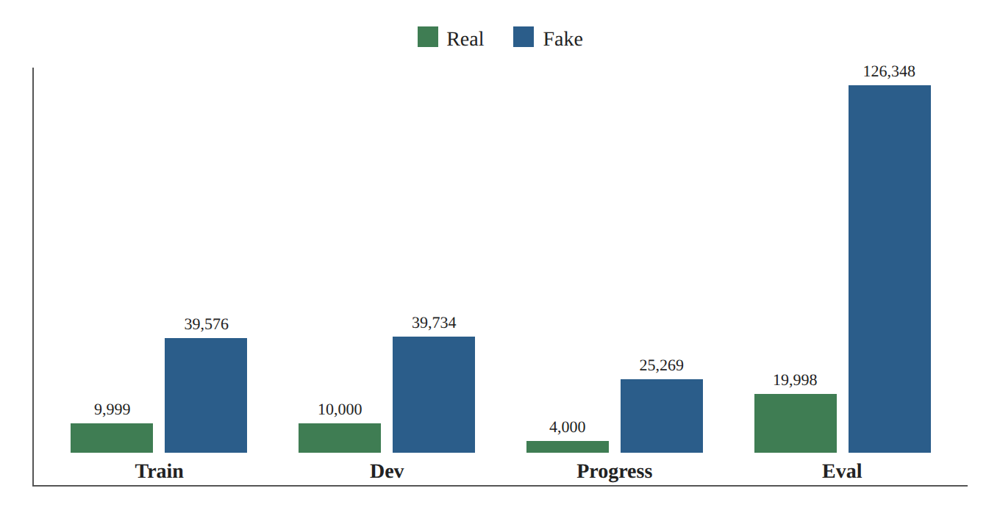
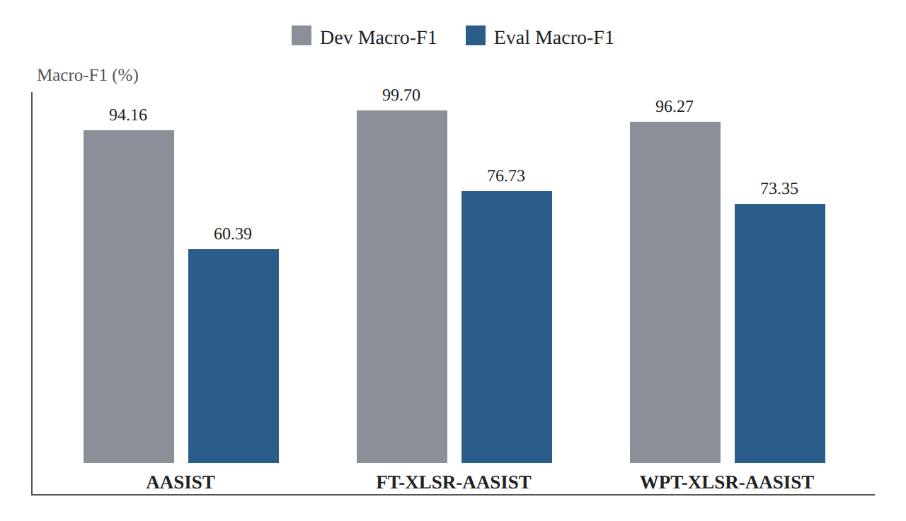
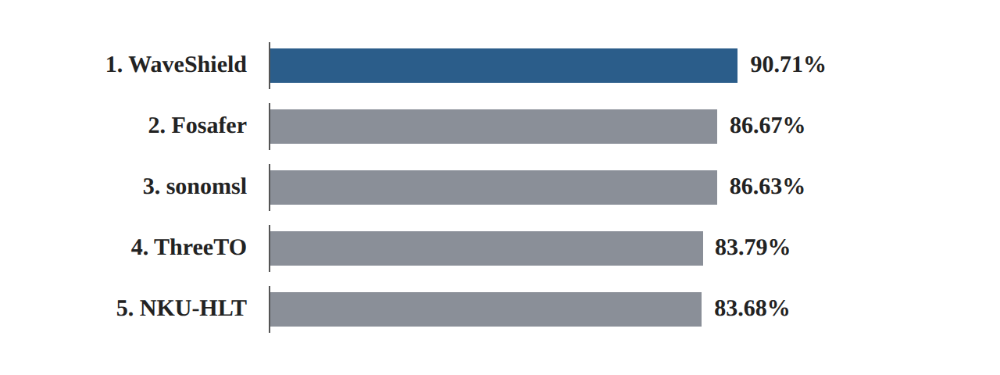

# Research Card 10 — AT-ADD

## AT-ADD: A Benchmark and Challenge for Robust and All-Type Audio Deepfake Detection

**Research category:** Robustness, Generalization, Evaluation Protocols, Audio Deepfake Detection  
**Primary focus:** Track 1 — Robust Speech Deepfake Detection  
**Research status:** Completed — Guided Reading & Critical Analysis  
**Project:** Fake or Real: Voice Deepfake Detection

---

## 1. Bibliographic Information

- **Title:** AT-ADD: A Benchmark and Challenge for Robust and All-Type Audio Deepfake Detection
- **Authors:** Yuankun Xie, Haonan Cheng, Jiayi Zhou, Xiaoxuan Guo, Tao Wang, Changhao Zhang, Jian Liu, Weiqiang Wang, Ruibo Fu, Xiaopeng Wang, Hengyan Huang, Xiaoying Huang, Long Ye, Guangtao Zhai, and Kong Aik Lee.
- **Year:** 2026
- **Research context:** ACM Multimedia 2026 Grand Challenge
- **Reviewed version:** arXiv:2608.23437v2, October 15, 2026
- **Paper:** https://arxiv.org/abs/2608.23437
- **Challenge website:** https://at-add.com
- **Official baseline repository:** https://github.com/xieyuankun/AT-ADD-Baseline
- **Track 1 dataset:** https://huggingface.co/datasets/xieyuankun/AT-ADD-Track1

**Classification within our literature review:** Research Paper 10 — methodological and experimental reference. AT-ADD is not included in the active external-training dataset shortlist.

## 2. Research Problem and Motivation

The paper addresses the limited robustness and generalization of audio deepfake detection (ADD) systems when tested outside relatively controlled benchmark conditions.

Existing detectors may achieve high performance on familiar generators and recording domains while exhibiting substantial degradation when exposed to:

- Previously unseen speech generation methods.
- Different recording devices and acoustic environments.
- Signal perturbations, compression, and resampling.
- Replay effects and re-recorded synthetic speech.
- Multilingual and out-of-distribution speech.

The central research problem is whether detection systems can distinguish authentic from synthetic audio under realistic distribution shifts, rather than relying on generator-specific artifacts or recording-domain shortcuts.

The study also examines whether systems that perform well according to aggregate evaluation metrics remain reliable across individual generators, recording sources, and audio conditions.

## 3. Research Objectives

The study has four principal objectives:

1. Establish an evaluation benchmark for robust speech deepfake detection and broader all-type audio deepfake detection.
2. Examine generalization to unseen generation methods and heterogeneous recording conditions.
3. Compare conventional, self-supervised learning (SSL), and audio large language model detection approaches under a common challenge protocol.
4. Analyze submission-level failures, cross-system error complementarity, and the statistical stability of model rankings.

For the current project, the most relevant objective is the second, followed by the fourth.

## 4. Main Contributions

The paper introduces:

**A. AT-ADD Benchmark:** Two complementary detection tracks covering robust speech detection and detection across multiple audio types.

**B. Reproducible Baselines:** Official implementations of conventional, SSL-based, and audio LLM-based countermeasures.

**C. Challenge Results:** A comparison of participating systems under a closed-setting evaluation protocol.

**D. Detailed Error Analysis:** Generator-level fake recall, real-source recall, language-level results, error-set overlap, ensemble analysis, and bootstrap-based ranking stability.

An important contribution is the separation between high aggregate benchmark performance and reliability under specific challenging conditions.

## 5. Task Definitions

### Track 1 — Robust Speech Deepfake Detection

A binary classification task:

- **Real:** Non-deepfake speech.
- **Fake:** Speech generated using deep neural network-based methods.

The original authenticity label is preserved after compression, resampling, speed changes, pitch shifting, and replay-related processing.

Consequently, re-recorded synthetic speech remains Fake, while re-recorded authentic speech remains Real.

The task emphasizes unseen speech generators and realistic recording conditions.

### Track 2 — All-Type Audio Deepfake Detection

A broader binary classification task involving:

- Speech.
- Environmental sounds.
- Singing voice.
- Music.

The audio type is not supplied to the detector at test time.

**Project relevance:** Track 1 is directly aligned with the current speech-only detection task. Track 2 is retained as secondary context for cross-type generalization but is not an experimental priority.

## 6. Benchmark Scale and Composition

### Track 1 overview

| Property | Reported value |
|---|---:|
| Total unique clips | 245,655 |
| Train clips | 49,575 |
| Dev clips | 49,734 |
| Progress clips | 29,269 |
| Eval clips | 146,346 |
| Speech generation conditions | 47 |
| Identified speakers | 11,299 |
| Base languages | 96 |

The Progress subset is sampled from Eval and is not an additional independent partition. Therefore, Progress must not be added again when calculating the total number of unique clips.

### Class composition

Derived from Tables III and IV:

| Split | Real | Fake | Total |
|---|---:|---:|---:|
| Train | 9,999 | 39,576 | 49,575 |
| Dev | 10,000 | 39,734 | 49,734 |
| Progress | 4,000 | 25,269 | 29,269 |
| Eval | 19,998 | 126,348 | 146,346 |

*Figure 1. Illustration of the class-composition table (Section 6): Real and Fake clips in each split.*

The benchmark is notably imbalanced in favor of Fake samples. This is relevant to the choice of Macro-F1 rather than Accuracy as the official scoring metric.

## 7. Dataset Construction — Authentic Speech

The Train and Dev real-speech subsets combine recordings from:

- Internal recordings.
- AISHELL-3.
- LibriTTS-R.
- LJSpeech.
- Common Voice.

The evaluation set introduces additional real-speech sources, including 3D-Speaker and EchoFake, alongside selected sources already represented in development.

The internally collected recordings cover devices and contexts such as smartphones, smart glasses, and in-vehicle systems.

The resulting benchmark evaluates whether a detector can recognize authentic speech when recording sources and acoustic characteristics differ from those encountered during training.

**Critical consideration:** The paper describes recording-domain diversity, but does not provide an exhaustive, balanced per-device and per-environment evaluation protocol. Accordingly, domain-specific conclusions require care.

## 8. Dataset Construction — Synthetic Speech

The benchmark includes synthetic speech produced using several generation paradigms:

- Text-to-Speech (TTS).
- Voice Conversion (VC).
- Vocoder-based resynthesis.
- Diffusion-based generation.
- Neural codec-based and newer speech-generation approaches.

For training and development, the fake conditions are identified as T1F1–T1F20.

The evaluation conditions are identified as T1F21–T1F47.

### Representative Train/Dev generators

- FastSpeech2.
- MeloTTS.
- CosyVoice.
- StarGANv2-VC.
- Llasa1B.

### Representative Eval generators and conditions

- BigVGAN.
- SeedVC1.
- StyleTTS2.
- CosyVoice2 and CosyVoice3.
- EchoFake AIGC Replay.
- Internal AIGC Replay.

The reported 27 evaluation conditions include two synthetic-speech replay conditions and should not be interpreted as 27 entirely independent synthesis architectures.

## 9. Evaluation Split and Generalization Protocol

The benchmark deliberately places different generation conditions in Train/Dev and Progress/Eval.

This establishes a form of **Generator-Disjoint Evaluation**, intended to test transfer to synthesis methods not observed during detector training.

However, generator-level separation does not automatically imply:

- Speaker-disjoint evaluation.
- Source-utterance-disjoint evaluation.
- Recording-device-disjoint evaluation.
- Fully isolated causal effects of generator architecture.

The benchmark combines multiple forms of distribution shift, meaning that an aggregate performance decrease cannot be attributed uniquely to generator novelty without additional controlled experiments.

### Speaker identity separation

For reference-conditioned TTS and VC, the researchers use distinct reference-speaker pools across development and evaluation and require reference and source speakers to differ.

The paper additionally reports 18 overlapping Common Voice speaker identities between the selected train/dev and evaluation source subsets.

Thus, complete speaker-disjointness must not be claimed.

### Methodological implication

A correct description of the protocol is:

*The benchmark primarily evaluates generalization to unseen synthesis conditions under additional source, speaker, and recording-domain variability, with a documented exception to complete speaker separation.*

## 10. Recording Conditions and Perturbations

The benchmark includes realistic signal and channel variation.

Reported transformations include:

- Volume scaling.
- Speed perturbation.
- Resampling to 8 kHz.
- Combinations of these transformations.
- Recording-device changes.
- Replay-related effects.

For evaluation, the paper reports that approximately 20% of authentic utterances and 23% of synthetic utterances undergo the specified secondary transformations.

Reported parameter ranges include:

- Volume scale: 0.2–0.9.
- Speed factor: 0.5–2.5.
- Resampling target: 8 kHz.

These manipulations preserve the underlying authenticity label.

**Methodological concern:** Transformation distributions differ somewhat between Real and Fake samples. Therefore, class–transformation associations should be audited before interpreting robustness results causally.

In addition, the effects of generator novelty, data source, and recording-domain changes are not fully isolated.

## 11. Official Evaluation Metrics

### Track 1

The official metric is binary Macro-F1:

MacroF1_T1 = (F1_real + F1_fake) / 2

Each class contributes equally to the reported score.

This reduces the dominance of the majority class relative to Accuracy, although Macro-F1 can still depend on class prevalence through Precision.

### Track 2

Macro-F1 is computed within each audio type and then averaged across four audio types, with equal weight per type.

### Relationship to EER

Macro-F1 evaluates classification decisions at a selected operating threshold.

EER uses continuous model scores and identifies the operating point where the relevant false-acceptance and false-rejection rates are equal or approximately equal.

Consequently:

- Macro-F1 and EER cannot be compared numerically as equivalent metrics.
- A strong Macro-F1 score does not establish a specific EER.
- Continuous prediction scores are necessary for threshold-independent and calibration-oriented analyses.

The paper notes that final participant submissions contained hard binary decisions, preventing reconstruction of EER and ROC analyses from those submissions.

## 12. Challenge Rules and Leakage Prevention

Both tracks follow a Closed Setting.

The rules permit:

- Training and model selection using official Train/Dev data.
- General-purpose pretrained models meeting challenge requirements.
- Signal augmentation of permitted data.
- MUSAN and RIR resources for augmentation only.
- Feature-, score-, and decision-level fusion of up to five compliant subsystems.

The rules prohibit:

- External audio for ordinary detector training.
- Models pretrained on related authenticity detection tasks where disallowed.
- Progress/Eval adaptation and pseudo-labeling.
- Manual intervention and irreproducible inference procedures.

Progress and Eval must not be treated as independent validation sources.

**Project interpretation:** The current academic project is not an official AT-ADD challenge submission. However, its experiments should adopt the underlying principle that all model and threshold selection occurs before the final independent evaluation.

If external training data are used, comparisons must explicitly disclose this and must not be presented as official closed-setting challenge results.

## 13. Official Baseline Architectures

The paper compares six official baselines.

| Family | Model | Main characteristic |
|---|---|---|
| Conventional | Spec-ResNet | STFT spectrogram + ResNet |
| Conventional | AASIST | Raw-waveform spectro-temporal graph attention |
| SSL | FT-XLSR-AASIST | XLSR features + AASIST; full fine-tuning |
| SSL | WPT-XLSR-AASIST | Wavelet Prompt Tuning with XLSR/AASIST |
| Audio LLM | Qwen2.5-Omni-3B | Supervised adaptation for binary audio detection |
| Audio LLM | Qwen2.5-Omni-7B | Larger multimodal audio model |

### Track 1 Eval baseline results

| Model | Macro-F1 |
|---|---:|
| Spec-ResNet | 47.41% |
| AASIST | 60.39% |
| FT-XLSR-AASIST | **76.73%** |
| WPT-XLSR-AASIST | 73.35% |
| Qwen2.5-Omni-3B | 68.02% |
| Qwen2.5-Omni-7B | 68.64% |

FT-XLSR-AASIST is the strongest official baseline.

Its advantage over AASIST is 16.34 percentage points in Macro-F1.

This supports the effectiveness of the complete SSL-based system under the tested protocol, but does not isolate the causal contribution of SSL pretraining from all other implementation and training choices.

## 14. Development-to-Evaluation Performance Gap

The benchmark reveals substantial performance reductions under evaluation distribution shifts.

| Model | Dev Macro-F1 | Eval Macro-F1 |
|---|---:|---:|
| AASIST | 94.16% | 60.39% |
| FT-XLSR-AASIST | 99.70% | 76.73% |
| WPT-XLSR-AASIST | 96.27% | 73.35% |

*Figure 2. Illustration of the table in Section 14: Dev versus Eval Macro-F1 for three official baselines.*

Even the strongest baseline experiences a considerable reduction.

This is evidence that strong in-domain validation performance does not guarantee equivalent performance on unseen generators and realistic capture conditions.

However, because evaluation conditions change along multiple dimensions simultaneously, the precise causal source of each decrease remains unresolved.

## 15. Top Track 1 Challenge Systems

### Final leaderboard

| Rank | Team | Eval Macro-F1 |
|---|---|---:|
| 1 | WaveShield | **90.71%** |
| 2 | Fosafer | 86.67% |
| 3 | sonomsl | 86.63% |
| 4 | ThreeTO | 83.79% |
| 5 | NKU-HLT | 83.68% |

*Figure 3. Illustration of the final leaderboard (Section 15): Eval Macro-F1 of the top five Track 1 systems.*

### WaveShield

The winning system combines three W2V-BERT 2.0-based subsystems, including AASIST variants and an Adapter-MFA branch.

Its training strategy includes:

- Initially frozen encoders with adapter/back-end optimization.
- Subsequent joint fine-tuning.
- Diversity-balanced sampling across synthesis and channel conditions.
- Noise, reverberation, codec, replay, and segment-related augmentation.
- Held-out threshold selection.

Inference combines subsystem logits and applies a fixed threshold.

### Fosafer

Combines four XLSR-based detectors at multiple model scales, including a GFCC-enhanced branch.

Uses full fine-tuning, focal loss, and online augmentation involving noise, reverberation, filtering, level, silence, and speed/pitch changes.

### sonomsl

Combines three WPT-XLSR-AASIST models.

Uses channel simulation, generator-adversarial learning, and GroupDRO-related training approaches.

Inference applies overlapping 4.04-second windows, median aggregation of window scores, and regularized logistic-regression fusion.

### ThreeTO

Combines XLSR-AASIST models with selected XLSR layers and CQCC-enhanced branches using cross-attention.

This provides an example of combining traditional cepstral features with pretrained speech representations, without proving that CQCC alone is responsible for the system's performance.

### NKU-HLT

Uses one XLSR-AASIST model instead of an ensemble.

The system incorporates clean/reverberated paired views and a score-consistency objective after an earlier fine-tuning phase.

This offers an example of robustness-oriented training that does not require multiple inference models.

## 16. Generator-Level Error Analysis

The researchers analyze Fake Recall for each evaluation generation condition.

The three most difficult Track 1 conditions according to average Fake Recall across the top five submissions are:

| Condition | Identifier | Mean Fake Recall |
|---|---|---:|
| BigVGAN | T1F24 | 72.84% |
| EchoFake AIGC Replay | T1F46 | 83.18% |
| Internal AIGC Replay | T1F47 | 86.69% |

BigVGAN is the only Track 1 generator for which all five leading systems obtain Fake Recall below 90%.

These findings demonstrate that aggregate success can conceal concentrated vulnerabilities.

However, the analysis does not establish whether the difficulty results specifically from generator architecture, training-source characteristics, acoustic degradation, or interactions among these factors.

## 17. Real-Speech Error Analysis

The paper also computes recall separately for authentic recordings from different sources.

The 3D-Speaker evaluation condition proves difficult for several systems.

| System | 3D-Speaker Real Recall |
|---|---:|
| WaveShield | 73.1% |
| Fosafer | 80.0% |
| sonomsl | 79.7% |
| ThreeTO | 36.2% |
| NKU-HLT | 16.7% |

The low Real Recall of NKU-HLT implies that the system misclassifies a large proportion of authentic 3D-Speaker recordings as Fake.

This shows why evaluation must consider both spoof detection and bona fide preservation.

A model may perform well on many synthetic generators while producing excessive false alarms on unfamiliar authentic speech.

## 18. Language-Level Robustness

Track 1 includes 96 base languages across the data splits, with 94 represented in Eval.

The language-specific analysis retains 58 languages with at least 20 Real and 20 Fake evaluation samples each.

The reported Spearman correlation between language support in Train/Dev and performance is:

ρ = 0.21

The relationship is positive but weak.

Average language-level Macro-F1 across the top five systems increases from 81.66% in low-resource languages to 86.83% in high-resource languages.

However, language frequency alone does not explain performance: source composition, generators, and recording conditions remain potential confounding factors.

## 19. Error Complementarity and Ensemble Analysis

The paper uses Jaccard similarity to compare error sets:

J(E_i, E_j) = |E_i ∩ E_j| / |E_i ∪ E_j|

Track 1 pairwise error overlap ranges from 23.73% to 46.22%.

This indicates that the leading systems frequently make different errors.

Nevertheless, simple hard-decision majority voting does not improve on the strongest individual submission:

| Method | Track 1 Macro-F1 |
|---|---:|
| WaveShield | 90.71% |
| Top-3 majority vote | 89.89% |
| Top-5 majority vote | 88.94% |
| Top-3 oracle | 96.25% |
| Top-5 oracle | 97.39% |

The oracle scores are non-deployable upper bounds because they rely on ground-truth knowledge when selecting a correct model prediction.

**Key insight:** Complementary errors create potential for fusion, but performance improvement depends on the fusion strategy and cannot be assumed from disagreement alone.

## 20. Statistical Reliability

The paper evaluates ranking stability using 5,000 nonparametric bootstrap resamples.

WaveShield achieves a reported 95% confidence interval of 90.49%–90.91% Macro-F1 and ranks first in every resample.

The adjacent second and third positions are considerably less stable:

- Fosafer ranks second in 62.62% of resamples.
- sonomsl ranks second in 37.38%.

Their original difference of 0.04 percentage points should therefore not be interpreted as a clearly established performance advantage.

**Project implication:** Small metric differences should be accompanied by uncertainty analysis where feasible.

When multiple clips share speakers or underlying sources, group-aware resampling may be more appropriate than treating all clips as statistically independent.

## 21. Critical Methodological Assessment

### Strengths

1. Clearly defined challenge tasks and split-specific generator conditions.
2. Explicit emphasis on unseen generation methods and realistic acoustic variability.
3. Comparisons across multiple modeling families.
4. Detailed analysis beyond aggregate leaderboard scores.
5. Transparent reporting of a documented speaker-overlap exception.
6. Quantitative evaluation of error complementarity and ranking stability.
7. Publicly described baseline implementations and evaluation procedures.

### Limitations

**Confounded evaluation shifts:** Generator, source, language, and acoustic-condition changes can coincide, limiting causal attribution.

**Incomplete speaker separation:** The reported Common Voice overlap prevents a claim of perfect speaker-disjoint evaluation.

**Limited continuous-score analysis:** Hard-decision submissions prevent retrospective ROC, EER, and calibration analysis for winning systems.

**Lack of common ablation protocol:** Differences among winning submissions do not isolate the contribution of individual architectural or training components.

**Potential source and transformation shortcuts:** Source-specific recording characteristics or class-dependent transformations may contribute to model decisions.

**Computational comparability:** Models differ substantially in scale, training requirements, and inference complexity; a uniform cost-adjusted comparison is not provided.

**Limited direct experimental accessibility:** Access to the released Track 1 audio has not been confirmed for our project.

**External validity:** Strong benchmark results do not establish performance on every future generator, device, or language.

## 22. Dataset Accessibility and Licensing Assessment

Although AT-ADD describes a released research benchmark, its Hugging Face Track 1 distribution has been presented as access-restricted following the challenge, with new access requests unavailable and a future public release anticipated.

For the current project:

- **Paper:** Available and reviewed.
- **Baseline code:** Public repository identified.
- **Track 1 audio:** No confirmed usable access.
- **Track 1 metadata:** Paper describes generator, source, task, and transformation annotations; complete usable access has not been established.
- **Dataset license and reuse permissions:** Not independently verified for the complete distribution.
- **Underlying-source licenses:** Must be reviewed individually if the data later become accessible.

The challenge's Closed Setting rules do not by themselves establish a general-purpose license for redistribution or reuse.

**Current decision:** AT-ADD is not an active training or external-test dataset in the project.

Access and licensing must be re-evaluated before any future integration.

## 23. Comparison with Previously Reviewed Research

### ASVspoof 5

Both benchmarks emphasize modern speech deepfake detection and generalization.

AT-ADD adds a particularly explicit focus on heterogeneous recording domains, replay effects, class-wise error analysis, and statistical leaderboard stability.

Its Macro-F1 evaluation must be distinguished from the EER-oriented evaluation used in the current project.

### AASIST

AT-ADD uses AASIST both as a conventional baseline and as part of stronger SSL-based architectures.

The reported evaluation gaps highlight that a strong architecture on one benchmark does not guarantee equally strong performance on another.

### wav2vec 2.0 and WavLM

The importance of pretrained speech representations is consistent with the broader role of SSL models in speech analysis.

AT-ADD provides empirical motivation to examine SSL-based detection under distribution shift, but does not demonstrate that one specific pretrained encoder is universally optimal.

### CQCC

The ThreeTO system illustrates the possible combination of CQCC and SSL representations.

This motivates an optional feature-fusion experiment, not a proven universal advantage.

### MLAAD and PhonemeDF

Unlike these external-data candidates, AT-ADD currently contributes mainly evaluation methodology rather than usable additional training examples.

MLAAD and PhonemeDF may support controlled studies of data diversity, while AT-ADD informs how such studies should define generalization and analyze their results.

## 24. Relevance to the Course Dataset

The course dataset contains 1,520 speech recordings:

- ASVspoof 5: 300 Real and 300 Fake.
- CodecFake: 300 Real and 300 Fake.
- M-AILABS: 320 Real.

Total:

- 920 Real.
- 600 Fake.

These sources do not automatically provide the same controlled unseen-generator, speaker-disjoint, or recording-domain conditions as AT-ADD.

Consequently, applying AT-ADD's methodological principles requires an explicit audit of available source identities, generator labels, and recording metadata.

Any claim about unseen-generator generalization must be limited to what the available splits actually establish.

## 25. Implications for Experimental Design

The following principles are recommended for the project.

### Core experimental priorities

**P1 — Define and audit the data splits.**
Check speaker, source, generator, and derivative-utterance overlap wherever metadata permit.

**P2 — Establish a reproducible baseline.**
Compare a simple classical approach with an SSL-based detector before introducing substantial model complexity.

**P3 — Separate model selection from final evaluation.**
Use Validation for checkpoints, hyperparameters, and thresholds; freeze the selected protocol before Test evaluation.

**P4 — Report complementary evaluation metrics.**
Use EER as a central metric, with Macro-F1 and class-wise recall at a Validation-selected threshold when useful.

**P5 — Analyze errors by available conditions.**
Report performance separately by dataset and, when possible, generator, recording source, and transformation.

**P6 — Test controlled extensions.**
Evaluate augmentation and external training data in experiments that hold other relevant variables constant as far as practical.

### Optional extensions

- Score-consistency training with clean and perturbed audio.
- CQCC + SSL feature fusion.
- Multi-model error-overlap analysis.
- Group-aware bootstrap confidence intervals.
- Multi-crop inference for longer recordings.
- Ensemble score fusion following controlled validation.

These extensions should not displace the primary goal of building a reliable, reproducible detector.

## 26. Candidate Research Hypotheses

**H1 — SSL Generalization:** A detector built on pretrained SSL representations will outperform a conventional baseline under at least some held-out source or generation conditions.

**H2 — Robustness Augmentation:** Targeted augmentation can improve stability under matched signal transformations compared with otherwise comparable training without augmentation.

**H3 — External Data Diversity:** Adding suitable, leakage-controlled external training examples may improve performance on previously unseen evaluation conditions, but any improvement must be separated from effects of dataset size and source composition.

**H4 — Error Heterogeneity:** Models with similar overall EER can exhibit materially different generator-level and real-source failure patterns.

**H5 — Fusion Limitations:** Error diversity alone will not guarantee improved performance from a simple ensemble.

These are hypotheses inspired by AT-ADD; they have not yet been tested in our project.

## 27. Methodological Rules — What Not to Do

1. Do not select model architecture, checkpoint, or threshold based on the final Test results and then present that Test score as independent validation.
2. Do not claim generator-generalization when generator separation has not been established.
3. Do not equate speaker-disjointness, generator-disjointness, and source-disjointness.
4. Do not compare Macro-F1 with EER as though they were interchangeable.
5. Do not infer causation from comparisons of complex winning systems without controlled experiments.
6. Do not assume that additional augmentation or ensemble members necessarily improve performance.
7. Do not report a single aggregate metric as evidence of uniform robustness.
8. Do not treat Progress as an independent addition to Eval.
9. Do not assume the AT-ADD audio is available or legally reusable without verifying access and licensing.
10. Do not use AT-ADD leaderboard results as direct expected performance targets for our substantially smaller course dataset.

## 28. Research Integration Decision

**Decision: INCLUDE — Methodological Research Reference**

**Research role:** Evaluation protocol, robustness analysis, unseen-generator generalization, and error diagnostics.

**Dataset integration status:** Not included in active training or external testing because usable data access and licensing have not been confirmed.

**Recommended experimental use:** Apply the principles of controlled evaluation, transparent data separation, class-wise error analysis, and statistical uncertainty to our available datasets.

**Priority:** High for experimental methodology; low for immediate direct dataset integration.

## 29. Final Research Takeaway

AT-ADD demonstrates that strong detection performance on familiar development data does not necessarily transfer to unseen generation systems and realistic recording conditions. Its results suggest that pretrained speech representations, training diversity, augmentation, and decision strategies collectively matter for practical robustness.

However, the paper's most important contribution to the present project is methodological: a credible evaluation should examine not only aggregate detection performance, but also how errors vary across generators, authentic recording sources, and distribution shifts. Moreover, improvements must be assessed using independent evaluation data and interpreted with appropriate statistical and causal caution.

**Final classification: Research Paper 10 — Robustness, Generalization, and Evaluation Methodology.**

### Primary Source

Xie, Y., et al. (2026). *AT-ADD: A Benchmark and Challenge for Robust and All-Type Audio Deepfake Detection*. arXiv:2608.23437v2.

https://arxiv.org/abs/2608.23437
