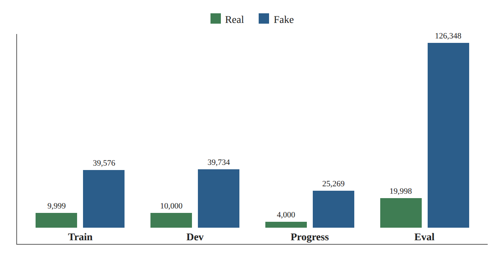
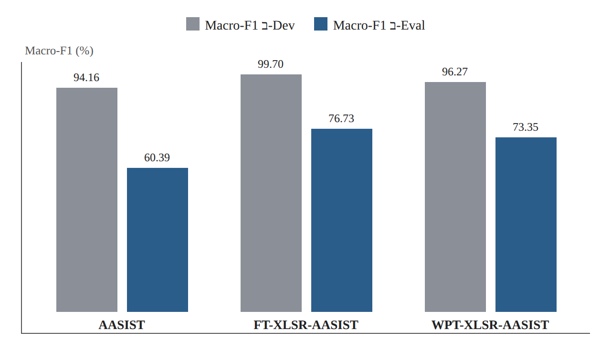
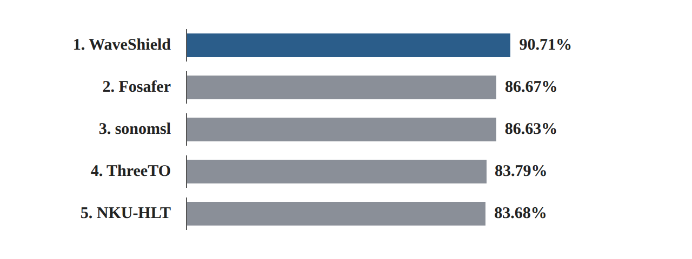

# Research Card 10 — AT-ADD

## AT-ADD: A Benchmark and Challenge for Robust and All-Type Audio Deepfake Detection

**קטגוריית מחקר:** עמידות, הכללה, פרוטוקולי הערכה, זיהוי זיופי אודיו  
**מיקוד ראשי:** Track 1 — זיהוי זיופי דיבור עמיד  
**סטטוס המחקר:** הושלם — קריאה מודרכת וניתוח ביקורתי  
**פרויקט:** Fake or Real: Voice Deepfake Detection

---

## 1. פרטים ביבליוגרפיים

- **כותרת:** AT-ADD: A Benchmark and Challenge for Robust and All-Type Audio Deepfake Detection
- **מחברים:** Yuankun Xie, Haonan Cheng, Jiayi Zhou, Xiaoxuan Guo, Tao Wang, Changhao Zhang, Jian Liu, Weiqiang Wang, Ruibo Fu, Xiaopeng Wang, Hengyan Huang, Xiaoying Huang, Long Ye, Guangtao Zhai ו-Kong Aik Lee.
- **שנה:** 2026
- **הקשר מחקרי:** ACM Multimedia 2026 Grand Challenge
- **הגרסה שנסקרה:** arXiv:2608.23437v2, 15 באוקטובר 2026
- **המאמר:** https://arxiv.org/abs/2608.23437
- **אתר התחרות:** https://at-add.com
- **מאגר ה-Baseline הרשמי:** https://github.com/xieyuankun/AT-ADD-Baseline
- **מאגר הנתונים של Track 1:** https://huggingface.co/datasets/xieyuankun/AT-ADD-Track1

**סיווג בסקירת הספרות שלנו:** Research Paper 10 — מקור ייחוס מתודולוגי וניסויי. AT-ADD אינו נכלל ברשימת המועמדים הפעילים של מאגרי אימון חיצוניים.

## 2. בעיית המחקר והמוטיבציה

המאמר עוסק בעמידות ובהכללה המוגבלות של מערכות לזיהוי זיופי אודיו (ADD) כאשר הן נבחנות מחוץ לתנאי Benchmark מבוקרים יחסית.

גלאים קיימים עשויים להשיג ביצועים גבוהים על מערכות יצירה ותחומי הקלטה מוכרים, ובה בעת להציג ירידה משמעותית כאשר הם נחשפים ל:

- שיטות יצירת דיבור שלא נראו קודם.
- מכשירי הקלטה וסביבות אקוסטיות שונים.
- הפרעות באות, דחיסה ושינוי קצב דגימה.
- אפקטים של Replay ודיבור סינתטי שהוקלט מחדש.
- דיבור רב-לשוני ודיבור מחוץ להתפלגות.

בעיית המחקר המרכזית היא האם מערכות זיהוי מסוגלות להבחין בין אודיו אותנטי לסינתטי תחת שינויי התפלגות מציאותיים, ולא להסתמך על ארטיפקטים ייחודיים למערכת יצירה או על קיצורי דרך הקשורים לתחום ההקלטה.

המחקר בוחן גם האם מערכות המצליחות לפי מדדי הערכה מצרפיים נותרות אמינות ברמת מערכות יצירה בודדות, מקורות הקלטה ותנאי אודיו.

## 3. מטרות המחקר

למחקר ארבע מטרות עיקריות:

1. לבסס Benchmark להערכה של זיהוי זיופי דיבור עמיד ושל זיהוי זיופי אודיו מכל הסוגים באופן רחב יותר.
2. לבחון הכללה לשיטות יצירה שלא נראו ולתנאי הקלטה הטרוגניים.
3. להשוות גישות זיהוי קונבנציונליות, מבוססות Self-Supervised Learning (SSL) ומבוססות מודלי שפה גדולים לאודיו, תחת פרוטוקול תחרות משותף.
4. לנתח כשלים ברמת ההגשות, משלימות שגיאות בין מערכות והיציבות הסטטיסטית של דירוג המודלים.

עבור הפרויקט הנוכחי, המטרה הרלוונטית ביותר היא השנייה, ולאחריה הרביעית.

## 4. התרומות המרכזיות

המאמר מציג:

**א. AT-ADD Benchmark:** שני מסלולי זיהוי משלימים, המכסים זיהוי דיבור עמיד וזיהוי על פני מספר סוגי אודיו.

**ב. Baselines הניתנים לשחזור:** מימושים רשמיים של אמצעי נגד קונבנציונליים, מבוססי SSL ומבוססי Audio LLM.

**ג. תוצאות התחרות:** השוואה בין המערכות המשתתפות תחת פרוטוקול הערכה במסגרת Closed Setting.

**ד. ניתוח שגיאות מפורט:** Fake Recall ברמת מערכת היצירה, Real Recall ברמת מקור, תוצאות ברמת שפה, חפיפת קבוצות שגיאות, ניתוח אנסמבלים ויציבות דירוג מבוססת Bootstrap.

תרומה חשובה היא ההפרדה בין ביצועים מצרפיים גבוהים ב-Benchmark לבין אמינות בתנאים מאתגרים ספציפיים.

## 5. הגדרות המשימות

### Track 1 — זיהוי זיופי דיבור עמיד

משימת סיווג בינארית:

- **Real:** דיבור שאינו Deepfake.
- **Fake:** דיבור שנוצר באמצעות שיטות מבוססות רשתות נוירונים עמוקות.

תווית האותנטיות המקורית נשמרת לאחר דחיסה, שינוי קצב דגימה, שינויי מהירות, שינוי גובה צליל ועיבודים הקשורים ל-Replay.

כתוצאה מכך, דיבור סינתטי שהוקלט מחדש נשאר Fake, ואילו דיבור אותנטי שהוקלט מחדש נשאר Real.

המשימה מדגישה מערכות יצירת דיבור שלא נראו ותנאי הקלטה מציאותיים.

### Track 2 — זיהוי זיופי אודיו מכל הסוגים

משימת סיווג בינארית רחבה יותר, הכוללת:

- דיבור.
- צלילי סביבה.
- קול שירה.
- מוזיקה.

סוג האודיו אינו מסופק לגלאי בזמן הבדיקה.

**רלוונטיות לפרויקט:** Track 1 מתיישר ישירות עם משימת זיהוי הדיבור בלבד של הפרויקט הנוכחי. Track 2 נשמר כהקשר משני להכללה בין סוגי אודיו, אך אינו עדיפות ניסויית.

## 6. היקף ה-Benchmark והרכבו

### סקירת Track 1

| מאפיין | ערך מדווח |
|---|---:|
| סך הקליפים הייחודיים | 245,655 |
| קליפי Train | 49,575 |
| קליפי Dev | 49,734 |
| קליפי Progress | 29,269 |
| קליפי Eval | 146,346 |
| תנאי יצירת דיבור | 47 |
| דוברים מזוהים | 11,299 |
| שפות בסיס | 96 |

תת-הקבוצה Progress נדגמת מתוך Eval ואינה חלוקה עצמאית נוספת. לפיכך אין להוסיף את Progress פעם נוספת בעת חישוב מספר הקליפים הייחודיים הכולל.

### הרכב המחלקות

נגזר מ-Tables III ו-IV:

| חלוקה | Real | Fake | סה"כ |
|---|---:|---:|---:|
| Train | 9,999 | 39,576 | 49,575 |
| Dev | 10,000 | 39,734 | 49,734 |
| Progress | 4,000 | 25,269 | 29,269 |
| Eval | 19,998 | 126,348 | 146,346 |

*איור 1. המחשה לטבלת הרכב המחלקות (סעיף 6): קליפי Real ו-Fake בכל חלוקה.*

ה-Benchmark אינו מאוזן בעליל לטובת דוגמאות Fake. הדבר רלוונטי לבחירה ב-Macro-F1 ולא ב-Accuracy כמדד הניקוד הרשמי.

## 7. בניית הנתונים — דיבור אותנטי

תת-הקבוצות של דיבור אמיתי ב-Train וב-Dev משלבות הקלטות מ:

- הקלטות פנימיות.
- AISHELL-3.
- LibriTTS-R.
- LJSpeech.
- Common Voice.

קבוצת ההערכה מוסיפה מקורות דיבור אמיתי נוספים, ובהם 3D-Speaker ו-EchoFake, לצד מקורות נבחרים שכבר מיוצגים בפיתוח.

ההקלטות שנאספו פנימית מכסות מכשירים והקשרים כגון סמארטפונים, משקפיים חכמים ומערכות בתוך רכב.

ה-Benchmark המתקבל בוחן האם גלאי מסוגל לזהות דיבור אותנטי כאשר מקורות ההקלטה והמאפיינים האקוסטיים שונים מאלה שפגש באימון.

**שיקול ביקורתי:** המאמר מתאר מגוון בתחומי הקלטה, אך אינו מספק פרוטוקול הערכה ממצה ומאוזן לפי מכשיר וסביבה. לפיכך, מסקנות ספציפיות לתחום מחייבות זהירות.

## 8. בניית הנתונים — דיבור סינתטי

ה-Benchmark כולל דיבור סינתטי שנוצר באמצעות מספר פרדיגמות יצירה:

- Text-to-Speech (TTS).
- Voice Conversion (VC).
- סינתזה מחדש מבוססת Vocoder.
- יצירה מבוססת Diffusion.
- גישות יצירת דיבור מבוססות Neural Codec וגישות חדשות יותר.

לצורכי אימון ופיתוח, תנאי הזיוף מזוהים כ-T1F1–T1F20.

תנאי ההערכה מזוהים כ-T1F21–T1F47.

### מערכות יצירה מייצגות ב-Train/Dev

- FastSpeech2.
- MeloTTS.
- CosyVoice.
- StarGANv2-VC.
- Llasa1B.

### מערכות יצירה ותנאים מייצגים ב-Eval

- BigVGAN.
- SeedVC1.
- StyleTTS2.
- CosyVoice2 ו-CosyVoice3.
- EchoFake AIGC Replay.
- Internal AIGC Replay.

27 תנאי ההערכה המדווחים כוללים שני תנאי Replay של דיבור סינתטי, ואין לפרשם כ-27 ארכיטקטורות סינתזה עצמאיות לחלוטין.

## 9. חלוקת ההערכה ופרוטוקול ההכללה

ה-Benchmark ממקם במכוון תנאי יצירה שונים ב-Train/Dev וב-Progress/Eval.

הדבר מבסס סוג של **Generator-Disjoint Evaluation**, שנועד לבחון העברה לשיטות סינתזה שלא נצפו במהלך אימון הגלאי.

עם זאת, הפרדה ברמת מערכת היצירה אינה גוררת אוטומטית:

- הערכה מופרדת לפי דוברים (Speaker-Disjoint).
- הערכה מופרדת לפי הקלטת מקור (Source-Utterance-Disjoint).
- הערכה מופרדת לפי מכשיר הקלטה (Recording-Device-Disjoint).
- השפעות סיבתיות מבודדות לחלוטין של ארכיטקטורת מערכת היצירה.

ה-Benchmark משלב מספר צורות של שינוי התפלגות, כך שאין אפשרות לייחס ירידה מצרפית בביצועים באופן ייחודי לחידושה של מערכת היצירה ללא ניסויים מבוקרים נוספים.

### הפרדת זהות דוברים

עבור TTS ו-VC מותנים בהתייחסות (Reference), החוקרים משתמשים במאגרי דוברי ייחוס נפרדים בין פיתוח להערכה, ודורשים שדוברי הייחוס והמקור יהיו שונים.

המאמר מדווח בנוסף על 18 זהויות דוברים חופפות מ-Common Voice בין תתי-הקבוצות הנבחרות של train/dev לבין תתי-הקבוצות של ההערכה.

לפיכך אין לטעון להפרדה מלאה ברמת הדובר.

### השלכה מתודולוגית

תיאור נכון של הפרוטוקול הוא:

*ה-Benchmark בוחן בעיקר הכללה לתנאי סינתזה שלא נראו, תחת שונות נוספת של מקור, דובר ותחום הקלטה, עם חריגה מתועדת מהפרדה מלאה של דוברים.*

## 10. תנאי הקלטה והפרעות

ה-Benchmark כולל שונות מציאותית של אות וערוץ.

טרנספורמציות מדווחות כוללות:

- שינוי עוצמה.
- שינוי מהירות.
- שינוי קצב דגימה ל-8 kHz.
- שילובים של טרנספורמציות אלה.
- שינויי מכשיר הקלטה.
- אפקטים הקשורים ל-Replay.

להערכה, המאמר מדווח שכ-20% מהאמירות האותנטיות וכ-23% מהאמירות הסינתטיות עוברות את הטרנספורמציות המשניות שצוינו.

טווחי פרמטרים מדווחים כוללים:

- קנה מידה של עוצמה: 0.2–0.9.
- גורם מהירות: 0.5–2.5.
- יעד שינוי קצב דגימה: 8 kHz.

מניפולציות אלה משמרות את תווית האותנטיות הבסיסית.

**חשש מתודולוגי:** התפלגויות הטרנספורמציות שונות במידה מסוימת בין דוגמאות Real לדוגמאות Fake. לפיכך יש לבקר את הקשרים בין מחלקה לטרנספורמציה לפני פרשנות סיבתית של תוצאות העמידות.

בנוסף, השפעות החידוש של מערכת היצירה, מקור הנתונים ושינויי תחום ההקלטה אינן מבודדות לחלוטין.

## 11. מדדי ההערכה הרשמיים

### Track 1

המדד הרשמי הוא Macro-F1 בינארי:

MacroF1_T1 = (F1_real + F1_fake) / 2

כל מחלקה תורמת במידה שווה לציון המדווח.

הדבר מפחית את הדומיננטיות של מחלקת הרוב ביחס ל-Accuracy, אף ש-Macro-F1 עשוי עדיין להיות תלוי בשכיחות המחלקות באמצעות Precision.

### Track 2

Macro-F1 מחושב בתוך כל סוג אודיו ולאחר מכן נלקח ממוצע על פני ארבעת סוגי האודיו, במשקל שווה לכל סוג.

### הקשר ל-EER

Macro-F1 מעריך החלטות סיווג בסף הפעלה נבחר.

EER משתמש בציוני מודל רציפים ומזהה את נקודת הפעולה שבה שיעורי הקבלה השגויה והדחייה השגויה הרלוונטיים שווים או כמעט שווים.

כתוצאה מכך:

- אין להשוות באופן מספרי בין Macro-F1 ל-EER כאילו היו מדדים שקולים.
- ציון Macro-F1 חזק אינו קובע EER מסוים.
- ציוני חיזוי רציפים נחוצים לניתוחים בלתי תלויי סף ולניתוחים ממוקדי כיול.

המאמר מציין שההגשות הסופיות של המשתתפים הכילו החלטות בינאריות קשות, דבר שמונע שחזור של ניתוחי EER ו-ROC מתוך אותן הגשות.

## 12. כללי התחרות ומניעת דליפה

שני המסלולים פועלים ב-Closed Setting.

הכללים מתירים:

- אימון ובחירת מודל באמצעות נתוני Train/Dev הרשמיים.
- מודלים מאומנים מראש לשימוש כללי העומדים בדרישות התחרות.
- הרחבת אותות (Augmentation) של נתונים מותרים.
- משאבי MUSAN ו-RIR לצורכי Augmentation בלבד.
- מיזוג ברמת מאפיינים, ציונים והחלטות של עד חמש תתי-מערכות תואמות.

הכללים אוסרים:

- אודיו חיצוני לאימון גלאי רגיל.
- מודלים שאומנו מראש על משימות זיהוי אותנטיות קשורות, במקום שהדבר אסור.
- התאמה ל-Progress/Eval ו-Pseudo-Labeling.
- התערבות ידנית ותהליכי הסקה שאינם ניתנים לשחזור.

אין להתייחס ל-Progress ול-Eval כמקורות Validation עצמאיים.

**פרשנות לפרויקט:** הפרויקט האקדמי הנוכחי אינו הגשה רשמית לתחרות AT-ADD. עם זאת, הניסויים בו צריכים לאמץ את העיקרון הבסיסי שלפיו כל בחירת מודל וסף מתבצעת לפני ההערכה העצמאית הסופית.

אם נעשה שימוש בנתוני אימון חיצוניים, ההשוואות חייבות לחשוף זאת במפורש ואסור להציגן כתוצאות רשמיות של התחרות במסגרת Closed Setting.

## 13. ארכיטקטורות ה-Baseline הרשמיות

המאמר משווה שישה Baselines רשמיים.

| משפחה | מודל | מאפיין עיקרי |
|---|---|---|
| קונבנציונלית | Spec-ResNet | ספקטרוגרמת STFT + ResNet |
| קונבנציונלית | AASIST | Graph Attention ספקטרו-זמני על גל גולמי |
| SSL | FT-XLSR-AASIST | מאפייני XLSR + AASIST; Fine-Tuning מלא |
| SSL | WPT-XLSR-AASIST | Wavelet Prompt Tuning עם XLSR/AASIST |
| Audio LLM | Qwen2.5-Omni-3B | התאמה מפוקחת לזיהוי אודיו בינארי |
| Audio LLM | Qwen2.5-Omni-7B | מודל אודיו רב-מודלי גדול יותר |

### תוצאות Baseline ב-Eval של Track 1

| מודל | Macro-F1 |
|---|---:|
| Spec-ResNet | 47.41% |
| AASIST | 60.39% |
| FT-XLSR-AASIST | **76.73%** |
| WPT-XLSR-AASIST | 73.35% |
| Qwen2.5-Omni-3B | 68.02% |
| Qwen2.5-Omni-7B | 68.64% |

FT-XLSR-AASIST הוא ה-Baseline הרשמי החזק ביותר.

יתרונו על AASIST הוא 16.34 נקודות אחוז ב-Macro-F1.

הדבר תומך ביעילותה של המערכת המבוססת SSL השלמה תחת הפרוטוקול שנבדק, אך אינו מבודד את התרומה הסיבתית של אימון מוקדם ב-SSL מכל שאר בחירות המימוש והאימון.

## 14. פער הביצועים בין פיתוח להערכה

ה-Benchmark חושף ירידות משמעותיות בביצועים תחת שינויי התפלגות בהערכה.

| מודל | Macro-F1 ב-Dev | Macro-F1 ב-Eval |
|---|---:|---:|
| AASIST | 94.16% | 60.39% |
| FT-XLSR-AASIST | 99.70% | 76.73% |
| WPT-XLSR-AASIST | 96.27% | 73.35% |

*איור 2. המחשה לטבלה בסעיף 14: Macro-F1 ב-Dev לעומת Eval עבור שלושה Baselines רשמיים.*

גם ה-Baseline החזק ביותר חווה ירידה ניכרת.

זו ראיה לכך שביצועי Validation חזקים בתוך התחום אינם מבטיחים ביצועים שקולים על מערכות יצירה שלא נראו ותנאי הקלטה מציאותיים.

עם זאת, מכיוון שתנאי ההערכה משתנים במספר ממדים בו-זמנית, המקור הסיבתי המדויק של כל ירידה נותר בלתי פתור.

## 15. מערכות התחרות המובילות ב-Track 1

### טבלת הדירוג הסופית

| דירוג | קבוצה | Macro-F1 ב-Eval |
|---|---|---:|
| 1 | WaveShield | **90.71%** |
| 2 | Fosafer | 86.67% |
| 3 | sonomsl | 86.63% |
| 4 | ThreeTO | 83.79% |
| 5 | NKU-HLT | 83.68% |

*איור 3. המחשה לטבלת הדירוג הסופית (סעיף 15): Macro-F1 ב-Eval של חמש המערכות המובילות ב-Track 1.*

### WaveShield

המערכת הזוכה משלבת שלוש תתי-מערכות מבוססות W2V-BERT 2.0, ובהן וריאנטים של AASIST וענף Adapter-MFA.

אסטרטגיית האימון שלה כוללת:

- Encoders קפואים בתחילה עם אופטימיזציה של Adapter/Back-End.
- Fine-Tuning משותף לאחר מכן.
- דגימה מאוזנת-מגוון על פני תנאי סינתזה וערוץ.
- Augmentation של רעש, הדהוד, Codec, Replay ומקטעים.
- בחירת סף על קבוצה שמורה (Held-Out).

ההסקה משלבת Logits של תתי-המערכות ומחילה סף קבוע.

### Fosafer

משלבת ארבעה גלאים מבוססי XLSR במספר סקאלות מודל, ובהם ענף מועשר ב-GFCC.

משתמשת ב-Fine-Tuning מלא, ב-Focal Loss וב-Augmentation מקוון הכולל רעש, הדהוד, סינון, עוצמה, שקט ושינויי מהירות/גובה צליל.

### sonomsl

משלבת שלושה מודלי WPT-XLSR-AASIST.

משתמשת בסימולציית ערוץ, בלמידה יריבה מול מערכת היצירה (Generator-Adversarial) ובגישות אימון הקשורות ל-GroupDRO.

ההסקה מחילה חלונות חופפים של 4.04 שניות, אגרגציית חציון של ציוני החלונות ומיזוג באמצעות Logistic Regression מוסדר (Regularized).

### ThreeTO

משלבת מודלי XLSR-AASIST עם שכבות XLSR נבחרות וענפים מועשרים ב-CQCC באמצעות Cross-Attention.

זו דוגמה לשילוב מאפיינים קפסטרליים מסורתיים עם ייצוגי דיבור מאומנים מראש, מבלי להוכיח ש-CQCC לבדו אחראי לביצועי המערכת.

### NKU-HLT

משתמשת במודל XLSR-AASIST יחיד במקום באנסמבל.

המערכת משלבת זוגות תצוגות נקי/מוהדהד ויעד עקביות-ציון לאחר שלב Fine-Tuning מוקדם יותר.

זו דוגמה לאימון ממוקד עמידות שאינו דורש מספר מודלים בהסקה.

## 16. ניתוח שגיאות ברמת מערכת היצירה

החוקרים מנתחים Fake Recall לכל תנאי יצירה בהערכה.

שלושת התנאים הקשים ביותר ב-Track 1 לפי Fake Recall ממוצע על פני חמש ההגשות המובילות הם:

| תנאי | מזהה | Fake Recall ממוצע |
|---|---|---:|
| BigVGAN | T1F24 | 72.84% |
| EchoFake AIGC Replay | T1F46 | 83.18% |
| Internal AIGC Replay | T1F47 | 86.69% |

BigVGAN היא מערכת היצירה היחידה ב-Track 1 שעבורה כל חמש המערכות המובילות משיגות Fake Recall מתחת ל-90%.

ממצאים אלה מדגימים שהצלחה מצרפית עשויה להסתיר פגיעויות מרוכזות.

עם זאת, הניתוח אינו קובע האם הקושי נובע דווקא מארכיטקטורת מערכת היצירה, ממאפייני מקור האימון, מפגיעה אקוסטית או מאינטראקציות בין גורמים אלה.

## 17. ניתוח שגיאות בדיבור אמיתי

המאמר מחשב גם Recall בנפרד עבור הקלטות אותנטיות ממקורות שונים.

תנאי ההערכה 3D-Speaker מתגלה כקשה עבור כמה מערכות.

| מערכת | Real Recall ב-3D-Speaker |
|---|---:|
| WaveShield | 73.1% |
| Fosafer | 80.0% |
| sonomsl | 79.7% |
| ThreeTO | 36.2% |
| NKU-HLT | 16.7% |

ה-Real Recall הנמוך של NKU-HLT מרמז שהמערכת מסווגת בטעות כ-Fake חלק גדול מהקלטות 3D-Speaker האותנטיות.

הדבר מראה מדוע הערכה חייבת להתייחס הן לזיהוי זיוף והן לשימור זיהוי של דיבור אמיתי (Bona Fide).

מודל עשוי להציג ביצועים טובים על מערכות יצירה סינתטיות רבות ובה בעת לייצר אזעקות שווא מופרזות על דיבור אותנטי שאינו מוכר.

## 18. עמידות ברמת שפה

Track 1 כולל 96 שפות בסיס על פני חלוקות הנתונים, ו-94 מהן מיוצגות ב-Eval.

הניתוח לפי שפה משמר 58 שפות עם לפחות 20 דוגמאות Real ו-20 דוגמאות Fake בהערכה לכל אחת.

מתאם Spearman המדווח בין תמיכת השפה ב-Train/Dev לבין הביצועים הוא:

ρ = 0.21

הקשר חיובי אך חלש.

Macro-F1 ממוצע ברמת שפה, על פני חמש המערכות המובילות, עולה מ-81.66% בשפות דלות משאבים ל-86.83% בשפות עתירות משאבים.

עם זאת, שכיחות השפה לבדה אינה מסבירה את הביצועים: הרכב המקורות, מערכות היצירה ותנאי ההקלטה נותרים גורמים מבלבלים (Confounding) אפשריים.

## 19. משלימות שגיאות וניתוח אנסמבלים

המאמר משתמש בדמיון Jaccard להשוואת קבוצות שגיאות:

J(E_i, E_j) = |E_i ∩ E_j| / |E_i ∪ E_j|

חפיפת השגיאות הזוגית ב-Track 1 נעה בין 23.73% ל-46.22%.

הדבר מצביע על כך שהמערכות המובילות טועות לעיתים קרובות בדוגמאות שונות.

עם זאת, הצבעת רוב פשוטה על החלטות קשות אינה משפרת את ההגשה הבודדת החזקה ביותר:

| שיטה | Macro-F1 ב-Track 1 |
|---|---:|
| WaveShield | 90.71% |
| הצבעת רוב Top-3 | 89.89% |
| הצבעת רוב Top-5 | 88.94% |
| Oracle Top-3 | 96.25% |
| Oracle Top-5 | 97.39% |

ציוני ה-Oracle הם חסמים עליונים שאינם ניתנים לפריסה, משום שהם נשענים על ידיעת תווית האמת בעת בחירת חיזוי מודל נכון.

**תובנה מרכזית:** שגיאות משלימות יוצרות פוטנציאל למיזוג, אך שיפור הביצועים תלוי באסטרטגיית המיזוג ואין להניחו מתוך חוסר הסכמה בלבד.

## 20. אמינות סטטיסטית

המאמר מעריך את יציבות הדירוג באמצעות 5,000 דגימות חוזרות של Bootstrap לא-פרמטרי.

WaveShield משיגה רווח סמך מדווח של 95% בטווח 90.49%–90.91% Macro-F1 ומדורגת ראשונה בכל דגימה חוזרת.

המקומות השני והשלישי הסמוכים יציבים הרבה פחות:

- Fosafer מדורגת שנייה ב-62.62% מהדגימות החוזרות.
- sonomsl מדורגת שנייה ב-37.38%.

הפער המקורי ביניהן, 0.04 נקודות אחוז, אינו צריך להתפרש כיתרון ביצועים מבוסס בבירור.

**השלכה לפרויקט:** יש ללוות פערים קטנים במדדים בניתוח אי-ודאות, כאשר הדבר ישים.

כאשר מספר קליפים חולקים דוברים או מקורות בסיס, דגימה חוזרת מודעת-קבוצות (Group-Aware) עשויה להתאים יותר מאשר התייחסות לכל הקליפים כבלתי תלויים סטטיסטית.

## 21. הערכה מתודולוגית ביקורתית

### חוזקות

1. משימות תחרות מוגדרות בבירור ותנאי יצירה ייעודיים לכל חלוקה.
2. דגש מפורש על שיטות יצירה שלא נראו ועל שונות אקוסטית מציאותית.
3. השוואות בין מספר משפחות מודלים.
4. ניתוח מפורט מעבר לציוני טבלת הדירוג המצרפיים.
5. דיווח שקוף על חריגה מתועדת של חפיפת דוברים.
6. הערכה כמותית של משלימות שגיאות ושל יציבות הדירוג.
7. מימושי Baseline ונהלי הערכה המתוארים בפומבי.

### מגבלות

**שינויי הערכה מתערבבים:** שינויים במערכת היצירה, במקור, בשפה ובתנאים האקוסטיים עשויים להתרחש בו-זמנית ובכך מגבילים ייחוס סיבתי.

**הפרדת דוברים חלקית:** חפיפת Common Voice המדווחת מונעת טענה להערכה מופרדת לחלוטין ברמת הדובר.

**ניתוח ציונים רציפים מוגבל:** הגשות של החלטות קשות מונעות ניתוח רטרוספקטיבי של ROC, EER וכיול עבור המערכות הזוכות.

**היעדר פרוטוקול Ablation משותף:** ההבדלים בין ההגשות הזוכות אינם מבודדים את תרומתם של רכיבים ארכיטקטוניים או רכיבי אימון בודדים.

**קיצורי דרך אפשריים של מקור וטרנספורמציה:** מאפייני הקלטה ייחודיים למקור או טרנספורמציות התלויות במחלקה עשויים לתרום להחלטות המודל.

**אי-השוואתיות חישובית:** המודלים נבדלים משמעותית בסקאלה, בדרישות האימון ובמורכבות ההסקה; לא מסופקת השוואה אחידה המתחשבת בעלות.

**נגישות ניסויית ישירה מוגבלת:** הגישה לאודיו של Track 1 שפורסם לא אומתה עבור הפרויקט שלנו.

**תוקף חיצוני:** תוצאות Benchmark חזקות אינן קובעות ביצועים על כל מערכת יצירה, מכשיר או שפה עתידיים.

## 22. הערכת נגישות ורישוי של המאגר

אף ש-AT-ADD מתאר Benchmark מחקרי שפורסם, ההפצה שלו ב-Hugging Face עבור Track 1 הוצגה כמוגבלת בגישה לאחר התחרות, כאשר בקשות גישה חדשות אינן זמינות ופרסום ציבורי עתידי צפוי.

עבור הפרויקט הנוכחי:

- **המאמר:** זמין ונסקר.
- **קוד ה-Baseline:** זוהה מאגר ציבורי.
- **אודיו של Track 1:** אין גישה שימושית מאומתת.
- **Metadata של Track 1:** המאמר מתאר הערות לפי מערכת יצירה, מקור, משימה וטרנספורמציה; גישה שימושית מלאה לא נקבעה.
- **רישיון המאגר והרשאות שימוש חוזר:** לא אומתו באופן עצמאי עבור ההפצה המלאה.
- **רישיונות מקורות הבסיס:** יש לבחון אותם בנפרד אם הנתונים יהפכו נגישים בהמשך.

כללי ה-Closed Setting של התחרות אינם מבססים בעצמם רישיון כללי להפצה מחדש או לשימוש חוזר.

**ההחלטה הנוכחית:** AT-ADD אינו מאגר אימון פעיל או מאגר בדיקה חיצוני בפרויקט.

יש להעריך מחדש גישה ורישוי לפני כל אינטגרציה עתידית.

## 23. השוואה למחקרים שנסקרו קודם

### ASVspoof 5

שני ה-Benchmarks מדגישים זיהוי זיופי דיבור מודרני והכללה.

AT-ADD מוסיף מיקוד מפורש במיוחד בתחומי הקלטה הטרוגניים, באפקטי Replay, בניתוח שגיאות לפי מחלקה וביציבות סטטיסטית של טבלת הדירוג.

יש להבחין בין הערכת ה-Macro-F1 שלו לבין ההערכה ממוקדת ה-EER שבה משתמש הפרויקט הנוכחי.

### AASIST

AT-ADD משתמש ב-AASIST הן כ-Baseline קונבנציונלי והן כחלק מארכיטקטורות חזקות יותר מבוססות SSL.

פערי ההערכה המדווחים מדגישים שארכיטקטורה חזקה ב-Benchmark אחד אינה מבטיחה ביצועים חזקים באותה מידה באחר.

### wav2vec 2.0 ו-WavLM

חשיבותם של ייצוגי דיבור מאומנים מראש עולה בקנה אחד עם תפקידם הרחב יותר של מודלי SSL בניתוח דיבור.

AT-ADD מספק מוטיבציה אמפירית לבחון זיהוי מבוסס SSL תחת שינוי התפלגות, אך אינו מדגים ש-Encoder מאומן מראש מסוים הוא אופטימלי באופן אוניברסלי.

### CQCC

מערכת ThreeTO ממחישה שילוב אפשרי של CQCC וייצוגי SSL.

הדבר מצדיק ניסוי אופציונלי של מיזוג מאפיינים, ואינו יתרון אוניברסלי מוכח.

### MLAAD ו-PhonemeDF

בניגוד למועמדי הנתונים החיצוניים הללו, AT-ADD תורם כרגע בעיקר מתודולוגיית הערכה ולא דוגמאות אימון נוספות שימושיות.

MLAAD ו-PhonemeDF עשויים לתמוך במחקרים מבוקרים של מגוון נתונים, ואילו AT-ADD מכוון כיצד מחקרים כאלה צריכים להגדיר הכללה ולנתח את תוצאותיהם.

## 24. רלוונטיות למאגר הקורס

מאגר הקורס מכיל 1,520 הקלטות דיבור:

- ASVspoof 5: ‏300 Real ו-300 Fake.
- CodecFake: ‏300 Real ו-300 Fake.
- M-AILABS: ‏320 Real.

סה"כ:

- 920 Real.
- 600 Fake.

מקורות אלה אינם מספקים אוטומטית את אותם תנאי Unseen-Generator, Speaker-Disjoint או תחום הקלטה מבוקרים כמו ב-AT-ADD.

לפיכך, יישום העקרונות המתודולוגיים של AT-ADD מחייב ביקורת מפורשת של זהויות המקורות הזמינות, תוויות מערכות היצירה ו-Metadata של ההקלטה.

כל טענה על הכללה ל-Unseen Generators חייבת להצטמצם למה שהחלוקות הזמינות מבססות בפועל.

## 25. השלכות לתכנון הניסוי

העקרונות הבאים מומלצים לפרויקט.

### עדיפויות ניסויות מרכזיות

**P1 — להגדיר ולבקר את חלוקות הנתונים.**
לבדוק חפיפה של דובר, מקור, מערכת יצירה ואמירות נגזרות ככל שה-Metadata מאפשר.

**P2 — לבסס Baseline הניתן לשחזור.**
להשוות גישה קלאסית פשוטה לגלאי מבוסס SSL לפני הכנסת מורכבות מודל משמעותית.

**P3 — להפריד בין בחירת מודל להערכה סופית.**
להשתמש ב-Validation עבור Checkpoints, היפר-פרמטרים וספים; להקפיא את הפרוטוקול הנבחר לפני הערכת Test.

**P4 — לדווח על מדדי הערכה משלימים.**
להשתמש ב-EER כמדד מרכזי, עם Macro-F1 ו-Recall לפי מחלקה בסף שנבחר ב-Validation כאשר הדבר מועיל.

**P5 — לנתח שגיאות לפי התנאים הזמינים.**
לדווח על ביצועים בנפרד לפי מאגר ו, כאשר אפשר, לפי מערכת יצירה, מקור הקלטה וטרנספורמציה.

**P6 — לבחון הרחבות מבוקרות.**
להעריך Augmentation ונתוני אימון חיצוניים בניסויים ששומרים על שאר המשתנים הרלוונטיים קבועים ככל שניתן בפועל.

### הרחבות אופציונליות

- אימון עקביות-ציון עם אודיו נקי ומופרע.
- מיזוג מאפיינים CQCC + SSL.
- ניתוח חפיפת שגיאות בין מספר מודלים.
- רווחי סמך Bootstrap מודעי-קבוצות.
- הסקה Multi-Crop להקלטות ארוכות יותר.
- מיזוג ציונים באנסמבל לאחר Validation מבוקר.

הרחבות אלה לא צריכות להחליף את המטרה העיקרית של בניית גלאי אמין וניתן לשחזור.

## 26. השערות מחקר מועמדות

**H1 — SSL Generalization:** גלאי הבנוי על ייצוגי SSL מאומנים מראש יעלה על Baseline קונבנציונלי לפחות בחלק מתנאי מקור או יצירה מוחזקים בצד.

**H2 — Robustness Augmentation:** Augmentation ממוקד יכול לשפר יציבות תחת טרנספורמציות אות תואמות, בהשוואה לאימון דומה אחרת ללא Augmentation.

**H3 — External Data Diversity:** הוספת דוגמאות אימון חיצוניות מתאימות עם בקרת דליפה עשויה לשפר ביצועים על תנאי הערכה שלא נראו קודם, אך כל שיפור חייב להיות מופרד מהשפעות גודל המאגר והרכב המקורות.

**H4 — Error Heterogeneity:** מודלים בעלי EER כולל דומה יכולים להציג דפוסי כשל שונים מהותית ברמת מערכת היצירה ומקור הדיבור האמיתי.

**H5 — Fusion Limitations:** גיוון שגיאות לבדו לא יבטיח ביצועים משופרים מאנסמבל פשוט.

אלה השערות בהשראת AT-ADD; הן טרם נבדקו בפרויקט שלנו.

## 27. כללים מתודולוגיים — מה אסור לעשות

1. אין לבחור ארכיטקטורת מודל, Checkpoint או סף על סמך תוצאות Test סופיות ואז להציג את ציון ה-Test כאימות עצמאי.
2. אין לטעון להכללה בין מערכות יצירה כאשר ההפרדה בין מערכות היצירה לא נקבעה.
3. אין להשוות בין Speaker-Disjointness, Generator-Disjointness ו-Source-Disjointness כאילו הם שקולים.
4. אין להשוות Macro-F1 ל-EER כאילו היו ניתנים להחלפה.
5. אין להסיק סיבתיות מהשוואות בין מערכות זוכות מורכבות ללא ניסויים מבוקרים.
6. אין להניח ש-Augmentation נוסף או חברי אנסמבל נוספים בהכרח משפרים ביצועים.
7. אין לדווח על מדד מצרפי יחיד כראיה לעמידות אחידה.
8. אין להתייחס ל-Progress כתוספת עצמאית ל-Eval.
9. אין להניח שהאודיו של AT-ADD זמין או ניתן לשימוש חוזר מבחינה משפטית ללא אימות גישה ורישוי.
10. אין להשתמש בתוצאות טבלת הדירוג של AT-ADD כיעדי ביצוע ישירים צפויים עבור מאגר הקורס שלנו, הקטן בהרבה.

## 28. החלטת שילוב מחקרית

**החלטה: INCLUDE — מקור ייחוס מחקרי מתודולוגי**

**תפקיד מחקרי:** פרוטוקול הערכה, ניתוח עמידות, הכללה ל-Unseen Generators ואבחון שגיאות.

**סטטוס שילוב המאגר:** לא נכלל באימון פעיל או בבדיקה חיצונית משום שגישה שימושית לנתונים ורישוי לא אומתו.

**שימוש ניסויי מומלץ:** יישום העקרונות של הערכה מבוקרת, הפרדת נתונים שקופה, ניתוח שגיאות לפי מחלקה ואי-ודאות סטטיסטית על המאגרים הזמינים לנו.

**עדיפות:** גבוהה למתודולוגיה ניסויית; נמוכה לשילוב ישיר ומיידי של המאגר.

## 29. תובנה מחקרית סופית

AT-ADD מדגים שביצועי זיהוי חזקים על נתוני פיתוח מוכרים אינם בהכרח עוברים למערכות יצירה שלא נראו ולתנאי הקלטה מציאותיים. תוצאותיו מצביעות על כך שייצוגי דיבור מאומנים מראש, מגוון אימון, Augmentation ואסטרטגיות החלטה חשובים יחד לעמידות מעשית.

עם זאת, התרומה החשובה ביותר של המאמר לפרויקט הנוכחי היא מתודולוגית: הערכה אמינה צריכה לבחון לא רק ביצועי זיהוי מצרפיים, אלא גם כיצד שגיאות משתנות בין מערכות יצירה, מקורות הקלטה אותנטיים ושינויי התפלגות. יתר על כן, יש להעריך שיפורים באמצעות נתוני הערכה עצמאיים ולפרש אותם בזהירות סטטיסטית וסיבתית מתאימה.

**סיווג סופי: Research Paper 10 — עמידות, הכללה ומתודולוגיית הערכה.**

### מקור ראשי

Xie, Y., et al. (2026). *AT-ADD: A Benchmark and Challenge for Robust and All-Type Audio Deepfake Detection*. arXiv:2608.23437v2.

https://arxiv.org/abs/2608.23437
