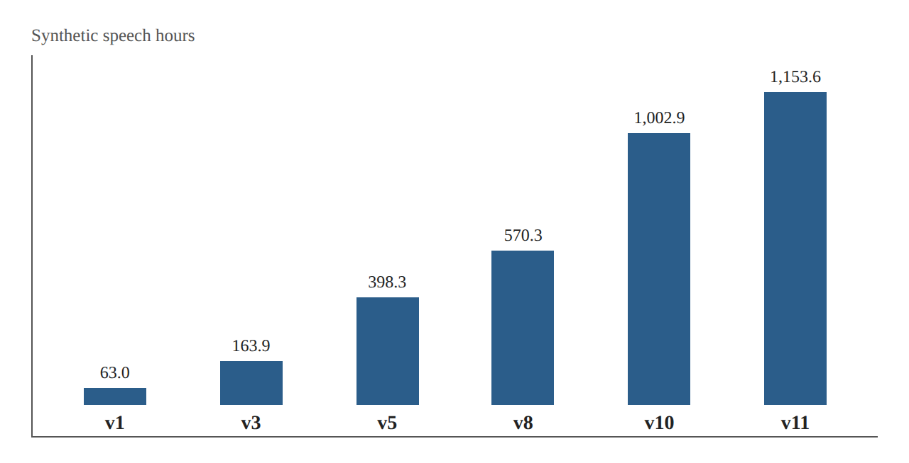
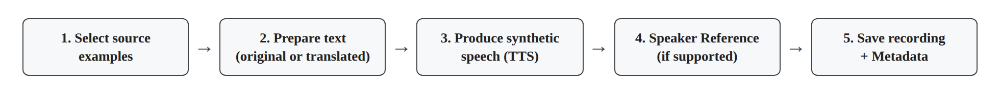
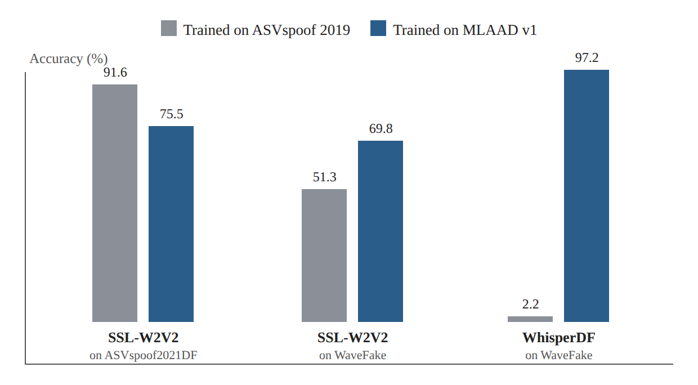

# Dataset Research Card 01 — MLAAD

## MLAAD: The Multi-Language Audio Anti-Spoofing Dataset

## 1. Bibliographic Details

**Paper title:** MLAAD: The Multi-Language Audio Anti-Spoofing Dataset.

**Authors:** Nicolas M. Müller, Piotr Kawa, Wei Herng Choong, Edresson Casanova, Eren Gölge, Thorsten Müller, Piotr Syga, Philip Sperl, Konstantin Böttinger.

**Research institutions:** Fraunhofer AISEC, Resemble AI, Wrocław University of Science and Technology, Coqui.ai, and Thorsten-Voice.

**Original year of publication:** 2024.

**Conference:** International Joint Conference on Neural Networks — IJCNN 2024.

**Source version read:** arXiv:2401.09512v11, dated August 28, 2026.

**Link to the paper:** https://arxiv.org/abs/2401.09512

**The full dataset:** https://huggingface.co/datasets/mueller91/MLAAD

**MLAAD-tiny:** https://huggingface.co/datasets/mueller91/MLAAD-tiny

**Research fields:** Audio Deepfake Detection, Speech Anti-Spoofing, Dataset Design, Multilingual Speech Synthesis, Cross-Dataset Generalization, Domain Shift, Shortcut Learning.

**Keywords:** MLAAD, M-AILABS, Text-to-Speech, TTS, Multilingual Data, Synthetic Speech, Cross-Dataset Evaluation, Data Diversity, Provenance, Accuracy, EER.

**Classification in the literature review:** Research Card 10 — Dataset / Benchmark Paper.

**Relevance to the project:** Very high. The paper presents a possible data source for expanding training, examines the effect of the training dataset on cross-dataset generalization, and is directly connected to M-AILABS, which is already included in the course project's data.

---

## 2. Comprehensive Summary of the Paper

The paper presents MLAAD, a multilingual synthetic-speech dataset intended for training and evaluating voice forgery detection systems.

The authors focus on the generalization problem of voice forgery detectors, and in particular on the harm to performance when a model is exposed to generation systems, languages, or data sources that did not appear in training.

According to the researchers, a considerable portion of existing Anti-Spoofing datasets focuses on English and Chinese, a situation that limits the ability to investigate the robustness of detectors to a variety of languages and synthesis systems.

The proposed solution is not a new detection architecture, but building a large and diverse dataset, based on source recordings from M-AILABS and on creating synthetic speech by means of various Text-to-Speech systems.

The dataset has expanded over the years. Version 11, described in the version of the file read, includes 1,153.6 hours of synthetic speech, 205 TTS models, 127 architectures, and 54 languages.

For the purpose of evaluating the dataset, the researchers used three detection systems: RawGAT-ST, SSL-W2V2, and WhisperDF. The models were trained separately on several training datasets, and subsequently tested in Cross-Dataset scenarios.

The results indicate that there is no single training dataset that yields the best performance in every scenario. In particular, MLAAD and ASVspoof 2019 showed complementary advantages across different evaluation datasets.

However, the central comparison experiments used MLAAD v1 only, and not version 11. Therefore the experimental results should not be attributed directly to the scope of the updated dataset.

**The central conclusion:** The diversity of the training data and its source affect the generalization patterns of voice forgery detectors, but the results do not make it possible to determine causally which component of the data diversity is responsible for the improvement.

**Source:** Abstract; Sections I–V; Tables I and VI.

---

## 3. The Research Problem and Motivation

### 3.1 The Central Problem

Voice forgery detection systems may achieve high performance on data similar to the training data, but fail when they are tested on recordings from a different source.

The change may be expressed in a new TTS system, a different language, different recording conditions, or acoustic features not represented in the training data.

### 3.2 The Linguistic Bias

The authors emphasize that many datasets focus on a small number of languages.

This situation limits the ability to evaluate detection systems in multilingual scenarios.

### 3.3 The Limitation of Homogeneous Training Datasets

A dataset including few generation systems may encourage the classifier to learn artifacts characteristic of those same systems.

When a new synthesis method appears, these signs may be less relevant.

### 3.4 The Goal of the Study

To propose a broad and diverse synthetic-speech dataset, and to examine whether it serves as an effective training source for detectors tested on other datasets.

### 3.5 The Implied Research Question

Does training by means of a multilingual synthetic-speech dataset containing diverse TTS systems improve the generalization ability of voice forgery detectors to other data sources?

This is a research formulation derived from the authors' goals, and not necessarily a formal question appearing in these words in the paper.

**Source:** Section I, p. 1.

---

## 4. The Connection to Our Previous Papers

**ASVspoof 5:** Presents a challenging Benchmark with a variety of attacks and recording conditions. MLAAD emphasizes how the choice of training dataset affects Cross-Dataset performance.

**CQCC:** Proposes an acoustic representation for artifact detection. MLAAD focuses on the composition of the data and not on a new feature-extraction method.

**AASIST:** Proposes a Graph Attention architecture. The MLAAD study shows that the source on which a deep detector is trained may be important for generalization, even when the architecture does not change.

**wav2vec 2.0:** Constitutes the conceptual basis for the SSL-W2V2 model examined in the MLAAD experiments.

**WavLM:** Constitutes an additional candidate for using SSL representations in our study, but was not used as one of the three models in the reported MLAAD experiments.

**CodecFake:** Examines generalization to families of Neural Audio Codecs. MLAAD focuses mainly on the diversity of TTS systems and languages. Therefore the two datasets may add different types of diversity to the training data.

**Enhanced Forensic Trace Generation:** Focuses on improving the representation passed to the classifier. MLAAD offers a complementary direction: changing the features of the training data.

**Intelligent Voice Fraud Detection:** Proposes combining features and models. MLAAD sharpens the need to separate the contribution of the model from the contribution of the data source.

**One-Class Learning + wav2vec 2.0:** Proposes coping with unknown attacks by means of modeling real speech. MLAAD emphasizes that the distribution of real speech itself depends on the source and diversity of the data.

---

## 5. The Main Contributions

1. Building a multilingual synthetic-speech dataset.
2. Expanding the diversity of TTS systems for the purpose of Anti-Spoofing research.
3. Using the recordings and texts of M-AILABS as a basis for data creation.
4. Publishing Metadata describing the speech sources and the generation systems.
5. Presenting a Cross-Dataset comparison between several training sources.
6. Examining three detection architectures.
7. Using Augmentation to reduce sensitivity to noise and coding artifacts.
8. Demonstrating the fact that a single training source is not necessarily best in every scenario.
9. Publishing the dataset for the purpose of academic research.
10. Expanding the dataset across several versions while adding languages and TTS systems.

One must distinguish between the contribution of building the dataset and the scope of the empirical evaluation. Enlarging the dataset in later versions is not equivalent to experimental proof of a performance improvement.

---

## 6. MLAAD Versions and the Development of the Dataset

| Version | Publication date | Synthetic hours | TTS models | Languages |
|---|---|---:|---:|---:|
| v1 | 17.01.2024 | 63.0 | 21 | 22 |
| v3 | 16.04.2024 | 163.9 | 54 | 23 |
| v5 | 02.11.2024 | 398.3 | 87 | 38 |
| v8 | 01.10.2025 | 570.3 | 119 | 40 |
| v10 | 18.05.2026 | 1,002.9 | 175 | 54 |
| v11 | 01.09.2026 | 1,153.6 | 205 | 54 |

*Figure 1. Illustration of the Table I data (Section 6): the growth of synthetic speech hours across versions v1–v11.*

**A necessary distinction:** The updated version of the paper describes v11, but the central Cross-Dataset results are based on training by means of v1.

The authors note that they did not repeat the evaluation for the later versions.

It follows that it should not be concluded that v11 was empirically verified to be better than v1 in the same evaluation scenarios.

**Source:** Table I, p. 1; Section IV-B, pp. 3–4.

---

## 7. The Source of Real Speech — M-AILABS

### 7.1 The Data Source

MLAAD is built on the basis of the M-AILABS Speech Dataset, which includes recordings of human speech.

The sources mainly include audiobook recordings, and in part also speeches and interviews.

### 7.2 Eight Source Languages

The authors note eight source languages in M-AILABS:

English, French, German, Italian, Polish, Russian, Spanish, Ukrainian.

### 7.3 Use of Texts

The source recordings provide texts matching the human speech.

These texts are used to create synthetic versions by means of TTS systems.

### 7.4 Research Significance

Since several synthetic examples may be based on the same text or on the same source recording, there is a possible association between examples created by means of different systems.

This association is especially important when building training and evaluation splits.

### 7.5 The Connection to the Course Data

Our course data includes 320 real recordings from M-AILABS.

Therefore, using MLAAD requires checking a possible overlap at the level of the recording, speaker, book, or content.

**Source:** Section III-A, p. 2; the official M-AILABS documentation.

---

## 8. The Synthetic Data-Creation Process

The authors describe a creation process including several stages.

**First stage — selecting source examples.** For each combination of language and TTS model, examples are chosen from the source dataset.

**Second stage — text preparation.** When the target language exists in M-AILABS, texts in the original language are used. Otherwise, the texts are translated by means of Neural Machine Translation.

**Third stage — producing synthetic speech.** A TTS model produces a speech recording based on the text.

**Fourth stage — Speaker Reference.** Models supporting voice reference may additionally receive a reference-speaker recording.

**Fifth stage — saving the outputs.** The recordings and the Metadata are saved in a folder structure by language and model.

*Figure 2. Illustration of the five stages described in Section 8.*

The authors note that the synthetic examples are saved as WAV files at 22,050Hz and 16-bit depth.

**Source:** Section III-A, Figure 1, pp. 2–3.

---

## 9. The Difference between the Text Source and the Speaker Source

One of the important distinctions in the process is the difference between the text source and the voice source.

`original_file` refers to the recording from which the text used for synthesis originated.

`reference_speaker` refers to the voice-reference source when the model supports this.

The two fields do not necessarily refer to the same recording or the same speaker.

In addition, some of the TTS systems use a fixed voice not based on a Reference Speaker from M-AILABS.

**Implication:** a split by `original_file` is not necessarily sufficient to guarantee a Speaker-Disjoint Evaluation.

---

## 10. The Metadata Structure in the Full Dataset

| Field | Meaning | Possible use in the project |
|---|---|---|
| `path` | Path of the synthesis file | File identification |
| `original_file` | Path of the original recording in M-AILABS | Checking source associations |
| `language` | The recording's language | Language control |
| `is_original_language` | Original versus translated language | Checking the effect of translation |
| `duration` | The recording's length | Matching input durations |
| `training_data` | The TTS model's training data | Documenting the synthesis source |
| `model_name` | The model that created the speech | Leave-One-Model-Out |
| `architecture` | The generation architecture | Analyzing TTS families |
| `transcript` | The speech content | Checking text overlap |
| `reference_speaker` | The voice-reference source, if it exists | Identifying speaker associations |

The `reference_speaker` field was added starting from version 8, and is therefore not guaranteed in earlier versions.

**Note:** the `training_data` field does not refer to the training split of our forgery detector, but to information about the data used to train the generation system.

**Source:** Table III; Section III-B, p. 3.

---

## 11. The Class Labels

The full MLAAD mainly distributes synthetic recordings, which constitute the Spoof class.

The researchers refer to M-AILABS for Bona Fide recordings.

Accordingly, the full dataset is not necessarily a balanced binary dataset in itself. In order to use it for a supervised classification task, real examples must also be provided.

This is significant because the source of the real examples may affect what the classifier learns.

When real examples from one source and fake examples from another source are used, some of the differences between the classes may stem from source features and not from the synthesis.

---

## 12. MLAAD-tiny — The Purpose of the Subset

MLAAD-tiny is a subset published for teaching, initial development, and testing purposes.

Its purpose is to make part of MLAAD's diversity accessible in a work environment with storage and computational limitations.

It is in principle suited to Pilot experiments, but is not an automatic substitute for the full dataset when rich Metadata or a complex evaluation protocol is required.

According to the distribution documentation:

- About 6,000 Bona Fide examples.
- About 6,400 Spoof examples.
- 64 TTS systems.
- About 100 examples per TTS system.
- About 4.2GB according to the volume estimates in the documentation.

The Hugging Face page shows 15,290 records, while the described counts total about 12,400 examples.

**Status:** the gap was not resolved by means of a local check of the files, and therefore neither number should be used as a verified dataset size until the File Inventory is completed.

**External source:** https://huggingface.co/datasets/mueller91/MLAAD-tiny

---

## 13. Data Splits in MLAAD-tiny

The documentation describes using English for training and German for testing for some of the fake examples.

However, the Hugging Face Dataset Viewer shows a single Split named `train`.

It follows that one cannot assume there are official, verified Train/Validation/Test splits that directly fit our project.

The following must be checked:

1. Which English and German examples actually exist.
2. How the labels are distributed between the languages.
3. Whether there are Bona Fide recordings suitable for each language in the experiment.
4. Whether speaker identifiers or source paths exist.
5. Whether the subset includes duplicates or related recordings.

We will not carry out an EER evaluation in which one class is effectively identified with one language and another class with another language.

---

## 14. The Availability of Metadata in MLAAD-tiny

The paper and the documentation of the full MLAAD describe rich Metadata including `original_file` and `reference_speaker`.

However, the presence of all these fields has not yet been verified for all the MLAAD-tiny examples.

The implication is that an integration check can be planned, but it cannot yet be confirmed that a full split by speakers and sources will be possible.

If it turns out that essential Metadata is missing, three alternatives will be examined:

1. Reconstructing associations from the file paths and from the Metadata of the full dataset, where this is possible and permitted.
2. Choosing a subset from the full dataset with suitable Metadata.
3. Using the data under a more limited protocol, with explicit noting of the generalization limitations.

Missing Metadata should not be presented as if it were proof of leakage. It is a limitation on our ability to rule it out.

---

## 15. The Three Forgery Detectors Examined in the Paper

| Model | Central feature | Input length |
|---|---|---|
| RawGAT-ST | Learning spectral and temporal graph relations | 5 seconds |
| SSL-W2V2 | Using wav2vec 2.0 representations | 5 seconds |
| WhisperDF | Detecting forgeries by means of Whisper features | 30 seconds |

The models were chosen in order to evaluate the usefulness of the training datasets across different approaches.

The paper should not be seen as providing a general ranking of the three architectures on every possible dataset.

**Source:** Section IV-A, p. 3.

---

## 16. The Training Protocol

The authors describe training by means of several data sources.

The models were trained separately on MLAAD v1, ASVspoof 2019, FakeOrReal, and InTheWild.

Each configuration was run five times.

In addition, Random Undersampling was used at each Epoch in order to create balance between the training classes.

The systems were trained for up to 100 Epochs, using Early Stopping based on Training Accuracy.

**A methodological critique:** Training Accuracy is not a direct measure of generalization. In our study we will carry out model selection and Early Stopping on a separate Validation set, in accordance with a protocol determined in advance.

**Source:** Section IV-A, p. 3.

---

## 17. Data Augmentation

The researchers used two central mechanisms:

**Noise and Music:** with a probability of 5% per example, noise or music from external sources was added.

**Codec Augmentation:** with a probability of 20%, an example underwent encoding by means of a Codec such as MP3, AAC, Opus, and others.

The goal was to diversify the training conditions and reduce the possibility that the model would learn coding or noise patterns related to a particular class.

However, the mere performance of Augmentation does not prove the absence of Shortcut Learning.

**Implication for the project:** we can examine Augmentation as an optional component, but not include it automatically without checking its effect on the course data and on Cross-Dataset EER.

**Source:** Section IV-A, p. 3.

---

## 18. The Cross-Dataset Evaluation Protocol

The researchers evaluated models trained on different datasets against eight evaluation datasets.

Among the datasets examined are ASVspoof 2019, ASVspoof 2021 DF/LA, FakeOrReal, InTheWild, MLAAD v1, Voc.v, and WaveFake.

The authors avoided some of the comparisons between ASVspoof 2019 and ASVspoof 2021 LA due to the significant similarity between them.

The study demonstrates that there is a significant association between the choice of training dataset and the model's performance when the evaluation source changes.

**A central distinction:** Cross-Dataset Evaluation may include a simultaneous change in attacks, speakers, languages, and channel. It does not automatically isolate generalization to a new attack.

**Source:** Section IV-B, pp. 3–4.

---

## 19. The Evaluation Metric

The authors chose to use Accuracy and not EER.

The reason is that some of the evaluation datasets include fake examples only, and therefore do not allow computing EER.

When an evaluation set includes only fake examples, Accuracy at the model's decision threshold describes the rate of forgeries correctly classified.

It does not describe the rate of wrongful rejection of real speech.

Therefore a high Accuracy on a single-class dataset is not equivalent to a low EER.

**A decision for our study:** EER will be the central metric for sets containing both classes. For single-class sets, we will report the error rate suited to the class and to a fixed, pre-chosen threshold.

**Source:** Section IV-A, p. 3.

---

## 20. Central Results

Examples from Table VI, Accuracy in percent:

| Model | Training source | Evaluation dataset | Mean Accuracy ± standard deviation |
|---|---|---|---:|
| SSL-W2V2 | ASVspoof 2019 | ASVspoof 2021 DF | 91.6 ± 3.8 |
| SSL-W2V2 | MLAAD v1 | ASVspoof 2021 DF | 75.5 ± 15.7 |
| SSL-W2V2 | ASVspoof 2019 | WaveFake | 51.3 ± 28.5 |
| SSL-W2V2 | MLAAD v1 | WaveFake | 69.8 ± 38.4 |
| WhisperDF | ASVspoof 2019 | WaveFake | 2.2 ± 3.5 |
| WhisperDF | MLAAD v1 | WaveFake | 97.2 ± 3.3 |

*Figure 3. Illustration of the Table VI data (Section 20): mean Accuracy by training source and evaluation dataset.*

The values are the means and standard deviations of five runs.

The results demonstrate that the generalization patterns vary considerably according to the training source and the architecture.

In addition, the high standard deviations in some of the experiments indicate instability between runs.

**Source:** Table VI, p. 7.

---

## 21. A Correct Interpretation of the Findings

### 21.1 There Is No Winning Training Dataset in Every Situation

In certain scenarios, training on ASVspoof 2019 yielded better results, and in others MLAAD v1 was better.

### 21.2 Datasets May Be Complementary

The different patterns indicate that the training sources contain information with a different contribution to the evaluation scenarios.

### 21.3 Complementarity Is Not Proof of the Benefit of Combined Training

The paper does not prove that training on MLAAD and ASVspoof together is better than training on each dataset separately.

### 21.4 Language Diversity Is Not a Proven Causal Explanation

The authors did not fully isolate the effect of language diversity from other variables.

### 21.5 Enlarging the Dataset Is Not a Proven Improvement

The study did not present a renewed evaluation of the later MLAAD versions.

---

## 22. Strengths of the Study

1. Direct engagement with the generalization problem between datasets.
2. Use of diverse training and evaluation sources.
3. Evaluation of three different architectures.
4. Reporting the mean and standard deviation of several runs.
5. Documentation of the data-creation process.
6. Publication of Metadata that helps with Provenance analysis.
7. Expansion of the dataset over time.
8. Addressing Shortcut Learning by means of Augmentation.
9. Use of many TTS systems and languages.
10. Distinguishing between the experimental results and the need for further multilingual evaluation.

---

## 23. Limitations of the Study

**Limitation 1 — The experimental version:** the central evaluation is based on v1 only.

**Limitation 2 — Isolating variables:** the relative contribution of the amount of data, the languages, and the TTS systems was not fully isolated.

**Limitation 3 — Evaluation metrics:** Accuracy does not allow a full comparison of discriminative ability in single-class scenarios.

**Limitation 4 — High variance:** some of the results are not stable between runs.

**Limitation 5 — Shortcut Learning:** Augmentation does not guarantee that the model does not learn source features.

**Limitation 6 — Multilingual generalization:** the authors note that a comprehensive evaluation isolating generalization ability between languages was not carried out.

**Limitation 7 — Integration limitations:** using M-AILABS as a basis for the dataset requires an analysis of source associations when combining MLAAD with other datasets.

**Limitation 8 — MLAAD-tiny:** the subset does not have Metadata and splits that we have verified by means of the distribution files themselves.

---

## 24. Licensing and Terms of Use

### 24.1 Fake Speech

The forgery files in MLAAD-tiny are distributed under CC BY-NC 4.0.

Its main significance is that use is subject to an attribution requirement and a restriction on commercial use.

### 24.2 Real Speech

The Bona Fide files in Tiny are distributed under the original M-AILABS terms.

The M-AILABS documentation allows broad use of the data subject to attribution terms and non-use of the creators' name for endorsement or promotion purposes, but the license file attached to the specific distribution and the relevant exceptions must also be checked.

### 24.3 Academic Use

Non-commercial research use within the course appears in principle suited to the distribution terms, subject to verification of the specific files and licenses.

### 24.4 Repo Rules

The audio files themselves or individual data files that may not be shared must not be uploaded to the public repo.

Documentation of the dataset's source, version, license link, download date, and processing performed must be kept.

**External sources:** MLAAD-tiny documentation, the MLAAD license, and the M-AILABS documentation.

---

## 25. Technical Feasibility for Use on the Local Computer

**The work environment:** a MacBook Pro M3 Pro, 18GB Unified Memory, and a 1TB SSD.

### 25.1 MLAAD-tiny

The source volume is relatively small compared with the full MLAAD dataset, and therefore it is in principle suited to local processing.

### 25.2 Staged Processing

There is no need to hold all the recordings in memory simultaneously.

Files can be processed gradually, features extracted, and Embeddings saved in a local Cache.

### 25.3 Classical Models

MFCC, CQCC, and Logistic Regression are not expected to be the central bottleneck at such a Pilot scope.

### 25.4 SSL Models

One can use wav2vec 2.0 or WavLM with a frozen Encoder, a small Batch Size, and processing by means of PyTorch MPS when the operations are supported.

### 25.5 A Planning Limitation

There is no justification for downloading the full MLAAD or carrying out Fine-Tuning of a large model before we know that the Pilot improves the relevant metrics.

---

## 26. Dataset Integration Assessment — Fit with the Course Data

### 26.1 The State of the Course Data

The original dataset contains 1,520 recordings:

| Source | Bona Fide | Spoof |
|---|---:|---:|
| ASVspoof 5 | 300 | 300 |
| CodecFake | 300 | 300 |
| M-AILABS | 320 | 0 |
| Total | 920 | 600 |

### 26.2 The Possible Contribution of MLAAD

Adding examples from a variety of TTS systems may broaden the types of artifacts the classifier encounters during training.

### 26.3 The Overlap Problem

MLAAD is based on M-AILABS, which is already included in the course data.

There may be associations at the level of the speaker, the book, the text, or the original recording.

### 26.4 The Source-versus-Class Problem

If real speech and fake speech consistently differ in their source, their language, or their processing, the model may learn differences not related to forgery.

### 26.5 The Risk of Silence at the Beginning and End of Recordings

The M-AILABS documentation notes that the source recordings include about half a second of silence at the beginning and end.

If this pattern is not preserved in the synthetic examples, it may serve as an artificial sign of the class.

### 26.6 The Risk of a Sample-Rate Shortcut

The paper describes creating synthetic speech at 22,050Hz, while our course data is at 16,000Hz.

Converting to 16kHz does not necessarily remove existing differences in bandwidth and spectral features.

### 26.7 The Risk of Language

One must avoid defining sets in which the language itself almost perfectly predicts the class.

### 26.8 Status

**Conditional GO:** integrating MLAAD is proposed subject to a Data Audit, overlap checks, and a valid evaluation protocol.

---

## 27. Proposed Integration Plan

### Gate 1 — License & Provenance

Checking the licensing, the source of the recordings, the dataset version, and the distribution details.

### Gate 2 — Metadata Inventory

Checking the actual number of files, the labels, the languages, the TTS systems, the recording durations, and the available fields.

### Gate 3 — Overlap Audit

Searching for associations between the MLAAD data and the training data available from the course.

The check will be based on Metadata, source identifiers, and comparison of content or audio when this can be done validly.

### Gate 4 — Split Feasibility

Checking whether separation by speaker, source recording, and forgery system can be carried out in accordance with the type of generalization we want to measure.

### Gate 5 — Source & Label Audit

Analyzing differences between the classes in language, silence, loudness, length, bandwidth, and coding process.

### Gate 6 — Small Pilot

Choosing a controlled subset, preferably in English and across several TTS systems with different architectures.

### Gate 7 — Controlled Evaluation

Comparing a model trained without MLAAD to a model trained with MLAAD, while keeping the same evaluation set.

### Gate 8 — Decision

Making a decision on whether to enlarge the data, change its composition, use MLAAD only as an external evaluation source, or avoid integrating it.

---

## 28. Experiments Proposed Following the Paper

### E0 — Course Data Only

Training on the 1,520 course recordings alone.

### E1 — Course Data + MLAAD

Expanding training by means of a controlled MLAAD subset.

### E2 — Course Data + PhonemeDF

Expanding training by means of a controlled PhonemeDF subset.

### E3 — Combined Training

Combining both external sources, after overlap and compatibility checks.

In all the experiments we will keep the same model and shared evaluation sets.

**An important distinction:** comparing E1 and E2 with the same number of recordings does not fully isolate the effect of the diversity of forgery methods, since the datasets also differ in source, language, and generation conditions.

In order to more directly examine the effect of the diversity of TTS systems, we will consider an experiment within MLAAD in which the number of examples, the language, and the speech sources are kept similar, while the number of generation systems varies.

The experiments are our own proposals, not experiments carried out in the paper.

---

## 29. Research Questions and Hypotheses for the Continuation

**H1 — Training Data Expansion:** expanding the training data may improve generalization, but not necessarily all evaluation scenarios.

**H2 — TTS Diversity:** training on a larger number of TTS architectures may improve the detection of attacks not included in training, given a similar example budget.

**H3 — Source Bias:** adding MLAAD may improve performance on certain sources and harm it on others if the model learns source features.

**H4 — Dataset Complementarity:** combining the course data with MLAAD and PhonemeDF may show an advantage over each extension separately, but this requires a combined experiment.

**H5 — Bona Fide Generalization:** expanding the diversity of real speech may reduce the wrongful rejection of authentic speech from new sources.

**H6 — Controlled Diversity:** diversity of generation systems may be more useful than a quantitative increase alone when the number of training examples is kept constant.

All the hypotheses require empirical testing. Their correctness should not be inferred from the original MLAAD results alone.

---

## 30. Summarizing Conclusion and Reference Map

### 30.1 Research Conclusion

MLAAD presents an approach focusing on the diversity of the training data as a possible factor for improving the generalization ability of voice forgery detection systems.

The study's experiments indicate complementary advantages between different training sources, in particular MLAAD v1 and ASVspoof 2019.

However, no single dataset was proven to be better in every scenario, and the differences cannot be causally attributed to the diversity of languages or the number of TTS systems alone.

### 30.2 The Central Research Insight

**An improvement in generalization may depend on the composition of the training data no less than on the choice of model architecture.**

### 30.3 The Practical Decision for the Project

MLAAD-tiny is a suitable candidate for a training-expansion Pilot, but its use is conditional on checking licensing, Metadata, overlaps, the speech source, and the ability to create valid splits.

If sufficient Metadata is not found, a documented subset from the full dataset or a more limited protocol will be examined.

### 30.4 Reference Map to the Paper

| Topic | Location |
|---|---|
| Abstract and contributions | Abstract, p. 1 |
| MLAAD versions | Table I, p. 1 |
| Motivation and linguistic bias | Section I, p. 1 |
| A review of other datasets | Section II-C, p. 2 |
| The data-creation process | Section III-A, pp. 2–3 |
| The dataset-creation diagram | Figure 1, p. 2 |
| Metadata fields | Table III, p. 3 |
| Folder and recording structure | Section III-B, p. 3 |
| v11 numbers | Section III-C, p. 3 |
| The detection models | Section IV-A, p. 3 |
| Augmentation | Section IV-A, p. 3 |
| The evaluation metrics | Section IV-A, p. 3 |
| Cross-Dataset Evaluation | Section IV-B, pp. 3–4 |
| The researchers' conclusions | Section V, p. 4 |
| TTS architectures | Table IV, p. 6 |
| Language distribution | Table V, p. 7 |
| Cross-Dataset results | Table VI, p. 7 |

### 30.5 Complementary Sources

- MLAAD Full Dataset: https://huggingface.co/datasets/mueller91/MLAAD
- MLAAD-tiny: https://huggingface.co/datasets/mueller91/MLAAD-tiny
- M-AILABS Documentation: https://github.com/i-celeste-aurora/m-ailabs-dataset
- MLAAD-tiny License: https://huggingface.co/datasets/mueller91/MLAAD-tiny/blob/main/LICENSE

**Usage note:** the v11 numbers describe the dataset in its updated version, while the central generalization results are based on MLAAD v1. All the recommendations for integrating MLAAD into the course data and the hypotheses regarding experiments E0–E3 are our own research synthesis, and not results tested in the paper. The data checks themselves have not yet been carried out.
