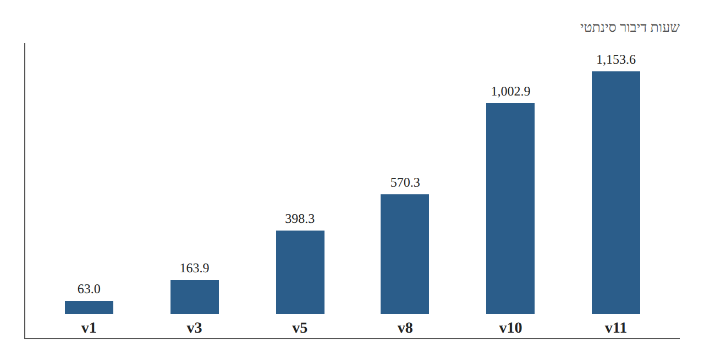
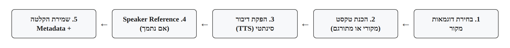
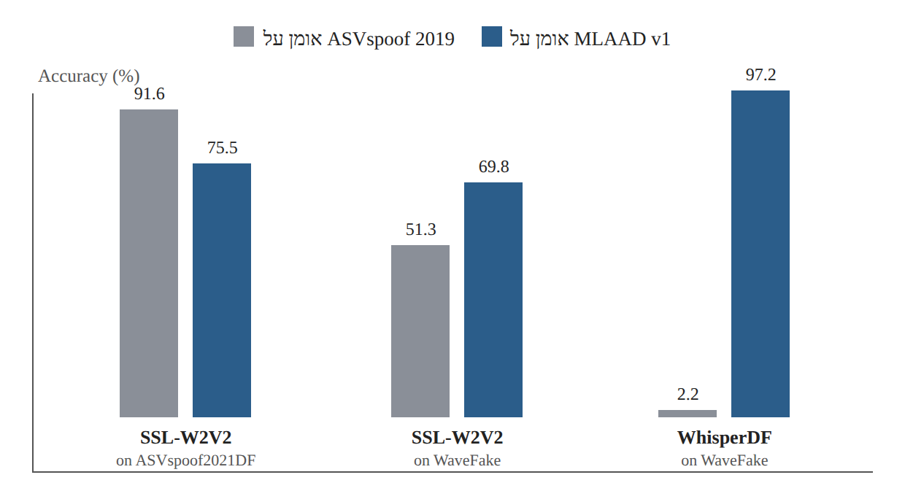

# Dataset Research Card 01 — MLAAD

## MLAAD: The Multi-Language Audio Anti-Spoofing Dataset

## 1. פרטים ביבליוגרפיים

**שם המאמר:** MLAAD: The Multi-Language Audio Anti-Spoofing Dataset.

**מחברים:** Nicolas M. Müller, Piotr Kawa, Wei Herng Choong, Edresson Casanova, Eren Gölge, Thorsten Müller, Piotr Syga, Philip Sperl, Konstantin Böttinger.

**גופים מחקריים:** Fraunhofer AISEC, Resemble AI, Wrocław University of Science and Technology, Coqui.ai ו-Thorsten-Voice.

**שנת הפרסום המקורית:** 2024.

**כנס:** International Joint Conference on Neural Networks — IJCNN 2024.

**גרסת המקור שנקראה:** arXiv:2401.09512v11, מ-28 באוגוסט 2026.

**קישור למאמר:** https://arxiv.org/abs/2401.09512

**המאגר המלא:** https://huggingface.co/datasets/mueller91/MLAAD

**MLAAD-tiny:** https://huggingface.co/datasets/mueller91/MLAAD-tiny

**תחומי מחקר:** Audio Deepfake Detection, Speech Anti-Spoofing, Dataset Design, Multilingual Speech Synthesis, Cross-Dataset Generalization, Domain Shift, Shortcut Learning.

**מילות מפתח:** MLAAD, M-AILABS, Text-to-Speech, TTS, Multilingual Data, Synthetic Speech, Cross-Dataset Evaluation, Data Diversity, Provenance, Accuracy, EER.

**סיווג בסקירת הספרות:** Research Card 10 — Dataset / Benchmark Paper.

**רלוונטיות לפרויקט:** גבוהה מאוד. המאמר מציג מקור נתונים אפשרי להרחבת האימון, בוחן את השפעת מאגר האימון על הכללה בין מאגרים, וקשור ישירות ל-M-AILABS, שכבר נכלל בנתוני פרויקט הקורס.

---

## 2. תקציר מקיף של המאמר

המאמר מציג את MLAAD, מאגר דיבור סינתטי רב-לשוני המיועד לאימון ולהערכה של מערכות לזיהוי זיופים קוליים.

המחברים מתמקדים בבעיית ההכללה של גלאי זיופים קוליים, ובפרט בפגיעה בביצועים כאשר מודל נחשף למערכות יצירה, שפות או מקורות נתונים שלא הופיעו באימון.

לפי החוקרים, חלק ניכר ממאגרי ה-Anti-Spoofing הקיימים מתמקד באנגלית ובסינית, מצב המגביל את האפשרות לחקור עמידות של גלאים למגוון שפות ומערכות סינתזה.

הפתרון המוצע אינו ארכיטקטורת זיהוי חדשה, אלא בניית מאגר נתונים גדול ומגוון, המבוסס על הקלטות מקור מ-M-AILABS ועל יצירת דיבור סינתטי באמצעות מערכות Text-to-Speech שונות.

המאגר התרחב לאורך השנים. גרסה 11, המתוארת בקובץ שנקרא, כוללת 1,153.6 שעות של דיבור סינתטי, 205 מודלי TTS, ‏127 ארכיטקטורות ו-54 שפות.

לצורך הערכת המאגר, החוקרים השתמשו בשלוש מערכות זיהוי: RawGAT-ST, ‏SSL-W2V2 ו-WhisperDF. המודלים אומנו בנפרד על מספר מאגרי אימון, ולאחר מכן נבדקו בתרחישי Cross-Dataset.

התוצאות מצביעות על כך שאין מאגר אימון אחד שמניב את הביצועים הטובים ביותר בכל תרחיש. בפרט, MLAAD ו-ASVspoof 2019 הציגו יתרונות משלימים על פני מאגרי הערכה שונים.

עם זאת, ניסויי ההשוואה המרכזיים השתמשו ב-MLAAD v1 בלבד ולא בגרסה 11. לכן אין לייחס את תוצאות הניסויים ישירות להיקף המאגר המעודכן.

**המסקנה המרכזית:** מגוון נתוני האימון ומקורם משפיעים על דפוסי ההכללה של גלאי זיופים קוליים, אך התוצאות אינן מאפשרות לקבוע באופן סיבתי איזה מרכיב של מגוון הנתונים אחראי לשיפור.

**מקור:** Abstract; Sections I–V; Tables I and VI.

---

## 3. בעיית המחקר והמוטיבציה

### 3.1 הבעיה המרכזית

מערכות לזיהוי זיופים קוליים עשויות להשיג ביצועים גבוהים על נתונים הדומים לנתוני האימון, אך להיכשל כאשר הן נבחנות על הקלטות ממקור אחר.

השינוי עשוי להתבטא במערכת TTS חדשה, בשפה אחרת, בתנאי הקלטה שונים או במאפיינים אקוסטיים שאינם מיוצגים בנתוני האימון.

### 3.2 ההטיה הלשונית

המחברים מדגישים שמאגרים רבים מתמקדים במספר מצומצם של שפות.

מצב זה מגביל את יכולת ההערכה של מערכות זיהוי בתרחישים רב-לשוניים.

### 3.3 המגבלה של מאגרי אימון הומוגניים

מאגר הכולל מעט מערכות יצירה עשוי לעודד את המסווג ללמוד ארטיפקטים האופייניים לאותן מערכות.

כאשר מופיעה שיטת סינתזה חדשה, הסימנים הללו עלולים להיות פחות רלוונטיים.

### 3.4 מטרת המחקר

להציע מאגר דיבור סינתטי רחב ומגוון, ולבחון האם הוא משמש מקור אימון יעיל עבור גלאים הנבדקים על מאגרי נתונים אחרים.

### 3.5 שאלת המחקר המשתמעת

האם אימון באמצעות מאגר דיבור סינתטי רב-לשוני המכיל מערכות TTS מגוונות משפר את יכולת ההכללה של גלאי זיופים קוליים למקורות נתונים אחרים?

זהו ניסוח מחקרי הנגזר ממטרות המחברים, ולא בהכרח שאלה פורמלית המופיעה במילים אלה במאמר.

**מקור:** Section I, עמ' 1.

---

## 4. הקשר למאמרים הקודמים שלנו

**ASVspoof 5:** מציג Benchmark מאתגר בעל מגוון מתקפות ותנאי הקלטה. MLAAD מדגיש כיצד בחירת מאגר האימון משפיעה על ביצועי Cross-Dataset.

**CQCC:** מציע ייצוג אקוסטי לזיהוי ארטיפקטים. MLAAD מתמקד בהרכב הנתונים ולא בחילוץ מאפיינים חדש.

**AASIST:** מציע ארכיטקטורת Graph Attention. מחקר MLAAD מראה שהמקור שעליו מאמנים גלאי עמוק עשוי להיות חשוב להכללה, גם כאשר הארכיטקטורה אינה משתנה.

**wav2vec 2.0:** מהווה בסיס רעיוני למודל SSL-W2V2 שנבחן בניסויי MLAAD.

**WavLM:** מהווה מועמד נוסף לשימוש בייצוגי SSL במחקר שלנו, אך לא שימש כאחד משלושת המודלים בניסויי MLAAD המדווחים.

**CodecFake:** בוחן הכללה למשפחות של Neural Audio Codecs. MLAAD מתמקד בעיקר במגוון מערכות TTS ושפות. לכן שני המאגרים עשויים להוסיף סוגים שונים של מגוון לנתוני האימון.

**Enhanced Forensic Trace Generation:** מתמקד בשיפור הייצוג המועבר למסווג. MLAAD מציע כיוון משלים: שינוי מאפייני נתוני האימון.

**Intelligent Voice Fraud Detection:** מציע שילוב מאפיינים ומודלים. MLAAD מחדד את הצורך להפריד בין תרומת המודל לבין תרומת מקור הנתונים.

**One-Class Learning + wav2vec 2.0:** מציע להתמודד עם מתקפות לא מוכרות באמצעות מידול דיבור אמיתי. MLAAD מדגיש שההתפלגות של הדיבור האמיתי עצמה תלויה במקור ובמגוון הנתונים.

---

## 5. התרומות המרכזיות

1. בניית מאגר דיבור סינתטי רב-לשוני.
2. הרחבת מגוון מערכות ה-TTS לצורך מחקר Anti-Spoofing.
3. שימוש בהקלטות ובטקסטים של M-AILABS כבסיס ליצירת נתונים.
4. פרסום Metadata המתאר את מקורות הדיבור ומערכות היצירה.
5. הצגת השוואת Cross-Dataset בין מספר מקורות אימון.
6. בחינת שלוש ארכיטקטורות זיהוי.
7. שימוש ב-Augmentation לצמצום רגישות לארטיפקטים של רעש וקידוד.
8. הדגמת העובדה שמקור אימון אחד אינו בהכרח עדיף בכל תרחיש.
9. פרסום המאגר לצורך מחקר אקדמי.
10. הרחבת המאגר לאורך מספר גרסאות תוך הוספת שפות ומערכות TTS.

יש להבחין בין תרומת בניית המאגר לבין היקף ההערכה האמפירית. הגדלת המאגר בגרסאות המאוחרות אינה שקולה להוכחה ניסויית לשיפור ביצועים.

---

## 6. גרסאות MLAAD והתפתחות המאגר

| גרסה | תאריך פרסום | שעות סינתטיות | מודלי TTS | שפות |
|---|---|---:|---:|---:|
| v1 | 17.01.2024 | 63.0 | 21 | 22 |
| v3 | 16.04.2024 | 163.9 | 54 | 23 |
| v5 | 02.11.2024 | 398.3 | 87 | 38 |
| v8 | 01.10.2025 | 570.3 | 119 | 40 |
| v10 | 18.05.2026 | 1,002.9 | 175 | 54 |
| v11 | 01.09.2026 | 1,153.6 | 205 | 54 |

*איור 1. המחשה לנתוני Table I (סעיף 6): גידול שעות הדיבור הסינתטי לאורך גרסאות v1–v11.*

**הבחנה מחייבת:** הגרסה המעודכנת של המאמר מתארת את v11, אך תוצאות ה-Cross-Dataset המרכזיות מבוססות על אימון באמצעות v1.

המחברים מציינים שלא חזרו על ההערכה עבור הגרסאות המאוחרות.

מכאן שאין להסיק ש-v11 אומתה אמפירית כעדיפה על v1 באותם תרחישי הערכה.

**מקור:** Table I, עמ' 1; Section IV-B, עמ' 3–4.

---

## 7. מקור הדיבור האמיתי — M-AILABS

### 7.1 מקור הנתונים

MLAAD נבנה על בסיס M-AILABS Speech Dataset, הכולל הקלטות של דיבור אנושי.

המקורות כוללים בעיקר הקלטות ספרי שמע, ובחלקם גם נאומים וראיונות.

### 7.2 שמונה שפות המקור

המחברים מציינים שמונה שפות מקור ב-M-AILABS:

English, French, German, Italian, Polish, Russian, Spanish, Ukrainian.

### 7.3 שימוש בטקסטים

הקלטות המקור מספקות טקסטים המתאימים לדיבור האנושי.

טקסטים אלה משמשים ליצירת גרסאות סינתטיות באמצעות מערכות TTS.

### 7.4 משמעות מחקרית

מאחר שמספר דוגמאות סינתטיות עשויות להיות מבוססות על אותו טקסט או על אותה הקלטת מקור, קיים קשר אפשרי בין דוגמאות שנוצרו באמצעות מערכות שונות.

קשר זה חשוב במיוחד בעת בניית חלוקות אימון והערכה.

### 7.5 הקשר לנתוני הקורס

נתוני הקורס שלנו כוללים 320 הקלטות אמיתיות מתוך M-AILABS.

לכן שימוש ב-MLAAD מחייב לבדוק חפיפה אפשרית ברמת הקלטה, דובר, ספר או תוכן.

**מקור:** Section III-A, עמ' 2; תיעוד M-AILABS הרשמי.

---

## 8. תהליך יצירת הנתונים הסינתטיים

המחברים מתארים תהליך יצירה הכולל מספר שלבים.

**שלב ראשון — בחירת דוגמאות מקור.** לכל שילוב של שפה ומודל TTS נבחרות דוגמאות מתוך מאגר המקור.

**שלב שני — הכנת טקסט.** כאשר שפת היעד קיימת ב-M-AILABS, נעשה שימוש בטקסטים בשפה המקורית. אחרת, הטקסטים מתורגמים באמצעות Neural Machine Translation.

**שלב שלישי — הפקת דיבור סינתטי.** מודל TTS מפיק הקלטת דיבור המבוססת על הטקסט.

**שלב רביעי — Speaker Reference.** מודלים התומכים בייחוס קול עשויים לקבל בנוסף הקלטת דובר ייחוס.

**שלב חמישי — שמירת התוצרים.** ההקלטות וה-Metadata נשמרים במבנה תיקיות לפי שפה ומודל.

*איור 2. המחשה לחמשת השלבים המתוארים בסעיף 8.*

המחברים מציינים שהדוגמאות הסינתטיות נשמרות כקובצי WAV ב-22,050Hz ובעומק 16-bit.

**מקור:** Section III-A, Figure 1, עמ' 2–3.

---

## 9. ההבדל בין Text Source לבין Speaker Source

אחת ההבחנות החשובות בתהליך היא ההבדל בין מקור הטקסט לבין מקור הקול.

`original_file` מתייחס להקלטה שממנה הגיע הטקסט ששימש לסינתזה.

`reference_speaker` מתייחס למקור הייחוס הקולי כאשר המודל תומך בכך.

שני השדות אינם בהכרח מתייחסים לאותה הקלטה או לאותו דובר.

בנוסף, בחלק ממערכות ה-TTS נעשה שימוש בקול קבוע שאינו מבוסס על Reference Speaker מתוך M-AILABS.

**השלכה:** חלוקה לפי `original_file` אינה מספיקה בהכרח כדי להבטיח Speaker-Disjoint Evaluation.

---

## 10. מבנה ה-Metadata במאגר המלא

| שדה | משמעות | שימוש אפשרי בפרויקט |
|---|---|---|
| `path` | נתיב קובץ הסינתזה | זיהוי קובץ |
| `original_file` | נתיב ההקלטה המקורית ב-M-AILABS | בדיקת קשרי מקור |
| `language` | שפת ההקלטה | בקרה על שפות |
| `is_original_language` | שפה מקורית לעומת שפה מתורגמת | בדיקת השפעת תרגום |
| `duration` | אורך ההקלטה | התאמת משכי קלט |
| `training_data` | נתוני האימון של מודל ה-TTS | תיעוד מקור הסינתזה |
| `model_name` | המודל שיצר את הדיבור | Leave-One-Model-Out |
| `architecture` | ארכיטקטורת היצירה | ניתוח משפחות TTS |
| `transcript` | תוכן הדיבור | בדיקת חפיפת טקסטים |
| `reference_speaker` | מקור ייחוס הקול, אם קיים | איתור קשרי דוברים |

השדה `reference_speaker` נוסף החל מגרסה 8, ולכן אינו מובטח בגרסאות מוקדמות.

**שימו לב:** השדה `training_data` אינו מתייחס לחלוקת האימון של גלאי הזיופים שלנו, אלא למידע על הנתונים ששימשו לאימון מערכת היצירה.

**מקור:** Table III; Section III-B, עמ' 3.

---

## 11. תוויות המחלקות

MLAAD המלא מפיץ בעיקר הקלטות סינתטיות, המהוות את מחלקת Spoof.

החוקרים מפנים ל-M-AILABS עבור הקלטות Bona Fide.

לפיכך, המאגר המלא אינו בהכרח מאגר בינארי מאוזן בפני עצמו. כדי להשתמש בו במשימת סיווג מפוקח יש לספק גם דוגמאות אמיתיות.

הדבר משמעותי משום שמקור הדוגמאות האמיתיות עשוי להשפיע על מה שהמסווג לומד.

כאשר משתמשים בדוגמאות אמיתיות ממקור אחד ובדוגמאות מזויפות ממקור אחר, חלק מההבדלים בין המחלקות עלולים לנבוע ממאפייני המקור ולא מהסינתזה.

---

## 12. MLAAD-tiny — מטרת תת-המאגר

MLAAD-tiny הוא תת-מאגר שפורסם לצורך הוראה, פיתוח ראשוני ובדיקות.

מטרתו להנגיש חלק ממגוון MLAAD בסביבת עבודה בעלת מגבלות אחסון וחישוב.

הוא מתאים עקרונית לניסויי Pilot, אך אינו תחליף אוטומטי למאגר המלא כאשר נדרש Metadata עשיר או פרוטוקול הערכה מורכב.

לפי תיעוד ההפצה:

- כ-6,000 דוגמאות Bona Fide.
- כ-6,400 דוגמאות Spoof.
- 64 מערכות TTS.
- כ-100 דוגמאות לכל מערכת TTS.
- כ-4.2GB לפי אומדני הנפח שבתיעוד.

דף Hugging Face מציג 15,290 רשומות, בעוד שהספירות המתוארות מסתכמות בכ-12,400 דוגמאות.

**סטטוס:** הפער לא הוכרע באמצעות בדיקה מקומית של הקבצים, ולכן אין להשתמש באחד המספרים כגודל מאומת של המאגר עד להשלמת File Inventory.

**מקור חיצוני:** https://huggingface.co/datasets/mueller91/MLAAD-tiny

---

## 13. חלוקות נתונים ב-MLAAD-tiny

בתיעוד מתוארים שימוש באנגלית לאימון ובגרמנית לבדיקה עבור חלק מן הדוגמאות המזויפות.

עם זאת, Dataset Viewer של Hugging Face מציג Split יחיד בשם `train`.

מכאן שלא ניתן להניח שקיימות חלוקות Train/Validation/Test רשמיות ומאומתות המתאימות ישירות לפרויקט שלנו.

נדרש לבדוק:

1. אילו דוגמאות אנגליות וגרמניות קיימות בפועל.
2. כיצד מתפלגות התוויות בין השפות.
3. האם קיימות הקלטות Bona Fide המתאימות לכל שפה בניסוי.
4. האם קיימים מזהי דוברים או נתיבי מקור.
5. האם תת-הקבוצה כוללת כפילויות או הקלטות קשורות.

לא נבצע הערכת EER שבה מחלקה אחת מזוהה בפועל עם שפה אחת ומחלקה אחרת עם שפה אחרת.

---

## 14. הזמינות של Metadata ב-MLAAD-tiny

המאמר והתיעוד של MLAAD המלא מתארים Metadata עשיר הכולל `original_file` ו-`reference_speaker`.

אולם לא אומתה עדיין נוכחותם של כל השדות האלה עבור כל דוגמאות MLAAD-tiny.

המשמעות היא שניתן לתכנן בדיקת אינטגרציה, אך עדיין לא ניתן לאשר שחלוקה מלאה לפי דוברים ומקורות תהיה אפשרית.

אם יתברר שחסר Metadata חיוני, ייבחנו שלוש חלופות:

1. שחזור קשרים מתוך נתיבי הקבצים ומ-Metadata של המאגר המלא, כאשר הדבר אפשרי ומותר.
2. בחירת תת-קבוצה מהמאגר המלא בעלת Metadata מתאים.
3. שימוש בנתונים תחת פרוטוקול מוגבל יותר, תוך ציון מפורש של מגבלות ההכללה.

אין להציג Missing Metadata כאילו הוא הוכחה לקיומה של דליפה. מדובר במגבלה על יכולתנו לשלול אותה.

---

## 15. שלושת גלאי הזיופים שנבחנו במאמר

| מודל | מאפיין מרכזי | אורך קלט |
|---|---|---|
| RawGAT-ST | למידת קשרים ספקטרליים וזמניים בגרף | 5 שניות |
| SSL-W2V2 | שימוש בייצוגי wav2vec 2.0 | 5 שניות |
| WhisperDF | זיהוי זיופים באמצעות מאפייני Whisper | 30 שניות |

המודלים נבחרו כדי להעריך את תועלת מאגרי האימון על פני גישות שונות.

אין לראות במאמר דירוג כללי של שלוש הארכיטקטורות על כל מאגר אפשרי.

**מקור:** Section IV-A, עמ' 3.

---

## 16. פרוטוקול האימון

המחברים מתארים אימון באמצעות מספר מקורות נתונים.

המודלים אומנו בנפרד על MLAAD v1, ‏ASVspoof 2019, ‏FakeOrReal ו-InTheWild.

כל תצורה הורצה חמש פעמים.

בנוסף נעשה שימוש ב-Random Undersampling בכל Epoch כדי ליצור איזון בין מחלקות האימון.

המערכות אומנו עד 100 Epochs, תוך שימוש ב-Early Stopping המבוסס על Training Accuracy.

**ביקורת מתודולוגית:** Training Accuracy אינו מדד ישיר להכללה. במחקר שלנו נבצע בחירת מודל ו-Early Stopping על Validation נפרד, בהתאם לפרוטוקול שנקבע מראש.

**מקור:** Section IV-A, עמ' 3.

---

## 17. Data Augmentation

החוקרים השתמשו בשני מנגנונים מרכזיים:

**Noise and Music:** בהסתברות של 5% לדוגמה נוספו רעש או מוזיקה ממקורות חיצוניים.

**Codec Augmentation:** בהסתברות של 20% דוגמה עברה קידוד באמצעות Codec כגון MP3, ‏AAC, ‏Opus ואחרים.

המטרה הייתה לגוון את תנאי האימון ולהקטין את האפשרות שהמודל ילמד תבניות קידוד או רעש הקשורות למחלקה מסוימת.

עם זאת, עצם ביצוע Augmentation אינו מוכיח היעדר Shortcut Learning.

**השלכה לפרויקט:** נוכל לבחון Augmentation כרכיב אופציונלי, אך לא לכלול אותו אוטומטית בלי בדיקת השפעתו על נתוני הקורס ועל Cross-Dataset EER.

**מקור:** Section IV-A, עמ' 3.

---

## 18. פרוטוקול Cross-Dataset Evaluation

החוקרים העריכו מודלים שאומנו על מאגרים שונים מול שמונה מאגרי הערכה.

בין המאגרים הנבדקים נמצאים ASVspoof 2019, ‏ASVspoof 2021 DF/LA, ‏FakeOrReal, ‏InTheWild, ‏MLAAD v1, ‏Voc.v ו-WaveFake.

המחברים נמנעו מחלק מההשוואות בין ASVspoof 2019 לבין ASVspoof 2021 LA בשל הדמיון המשמעותי ביניהם.

המחקר מדגים שקיים קשר משמעותי בין בחירת מאגר האימון לבין ביצועי המודל כאשר משתנה מקור ההערכה.

**הבחנה מרכזית:** Cross-Dataset Evaluation עשוי לכלול שינוי במתקפות, בדוברים, בשפות ובערוץ בו-זמנית. הוא אינו מבודד אוטומטית הכללה למתקפה חדשה.

**מקור:** Section IV-B, עמ' 3–4.

---

## 19. מדד ההערכה

המחברים בחרו להשתמש ב-Accuracy ולא ב-EER.

הסיבה היא שחלק ממאגרי ההערכה כוללים דוגמאות מזויפות בלבד, ולכן אינם מאפשרים חישוב EER.

כאשר קבוצת הערכה כוללת רק דוגמאות מזויפות, Accuracy בסף ההחלטה של המודל מתאר את שיעור הזיופים שסווגו נכון.

הוא אינו מתאר את שיעור הדחייה השגויה של דיבור אמיתי.

לכן Accuracy גבוה על מאגר חד-מחלקתי אינו שקול ל-EER נמוך.

**החלטה למחקר שלנו:** EER יהיה המדד המרכזי עבור קבוצות המכילות שתי מחלקות. בקבוצות חד-מחלקתיות נדווח על שיעור השגיאה המתאים למחלקה ולסף קבוע שנבחר מראש.

**מקור:** Section IV-A, עמ' 3.

---

## 20. תוצאות מרכזיות

דוגמאות מתוך Table VI, Accuracy באחוזים:

| מודל | מקור אימון | מאגר הערכה | Accuracy ממוצע ± סטיית תקן |
|---|---|---|---:|
| SSL-W2V2 | ASVspoof 2019 | ASVspoof 2021 DF | 91.6 ± 3.8 |
| SSL-W2V2 | MLAAD v1 | ASVspoof 2021 DF | 75.5 ± 15.7 |
| SSL-W2V2 | ASVspoof 2019 | WaveFake | 51.3 ± 28.5 |
| SSL-W2V2 | MLAAD v1 | WaveFake | 69.8 ± 38.4 |
| WhisperDF | ASVspoof 2019 | WaveFake | 2.2 ± 3.5 |
| WhisperDF | MLAAD v1 | WaveFake | 97.2 ± 3.3 |

*איור 3. המחשה לנתוני Table VI (סעיף 20): Accuracy ממוצע לפי מקור אימון ומאגר הערכה.*

הערכים הם ממוצעים וסטיות תקן של חמש הרצות.

התוצאות מדגימות שדפוסי ההכללה משתנים באופן ניכר לפי מקור האימון והארכיטקטורה.

נוסף על כך, סטיות התקן הגבוהות בחלק מהניסויים מעידות על חוסר יציבות בין הרצות.

**מקור:** Table VI, עמ' 7.

---

## 21. פירוש נכון של הממצאים

### 21.1 אין מאגר אימון מנצח בכל מצב

בתרחישים מסוימים אימון על ASVspoof 2019 הניב תוצאות טובות יותר, ובאחרים MLAAD v1 היה עדיף.

### 21.2 מאגרים עשויים להיות משלימים

הדפוסים השונים מצביעים על כך שמקורות האימון מכילים מידע בעל תרומה שונה לתרחישי ההערכה.

### 21.3 משלימות אינה הוכחה לתועלת של אימון משולב

המאמר אינו מוכיח שאימון על MLAAD ו-ASVspoof יחד עדיף על אימון על כל מאגר בנפרד.

### 21.4 מגוון שפות אינו הסבר סיבתי מוכח

המחברים לא בודדו באופן מלא את השפעת מגוון השפות ממשתנים אחרים.

### 21.5 הגדלת המאגר אינה שיפור מוכח

המחקר לא הציג הערכה מחודשת של גרסאות MLAAD המאוחרות.

---

## 22. חוזקות המחקר

1. עיסוק ישיר בבעיית הכללה בין מאגרים.
2. שימוש במקורות אימון והערכה מגוונים.
3. הערכת שלוש ארכיטקטורות שונות.
4. דיווח על ממוצע וסטיית תקן של מספר הרצות.
5. תיעוד תהליך יצירת הנתונים.
6. פרסום Metadata המסייע בניתוח Provenance.
7. הרחבת המאגר לאורך זמן.
8. התייחסות ל-Shortcut Learning באמצעות Augmentation.
9. שימוש במערכות TTS ובשפות רבות.
10. הבחנה בין תוצאות ניסוי לבין הצורך בהערכה רב-לשונית נוספת.

---

## 23. מגבלות המחקר

**מגבלה 1 — גרסת הניסוי:** ההערכה המרכזית מבוססת על v1 בלבד.

**מגבלה 2 — בידוד משתנים:** לא בודדה באופן מלא תרומתם היחסית של כמות נתונים, שפות ומערכות TTS.

**מגבלה 3 — מדדי הערכה:** Accuracy אינו מאפשר השוואה מלאה של יכולת הבחנה בתרחישים חד-מחלקתיים.

**מגבלה 4 — שונות גבוהה:** חלק מהתוצאות אינן יציבות בין הרצות.

**מגבלה 5 — Shortcut Learning:** Augmentation אינו מבטיח שהמודל אינו לומד מאפייני מקור.

**מגבלה 6 — הכללה רב-לשונית:** המחברים מציינים שלא בוצעה הערכה מקיפה המבודדת יכולת הכללה בין שפות.

**מגבלה 7 — מגבלות אינטגרציה:** השימוש ב-M-AILABS כבסיס למאגר דורש ניתוח קשרי מקור כאשר משלבים MLAAD עם מאגרים אחרים.

**מגבלה 8 — MLAAD-tiny:** תת-המאגר אינו בעל Metadata וחלוקות שאומתו אצלנו באמצעות קבצי ההפצה עצמם.

---

## 24. רישוי ותנאי שימוש

### 24.1 דיבור מזויף

קובצי הזיוף ב-MLAAD-tiny מופצים תחת CC BY-NC 4.0.

משמעותו העיקרית היא שהשימוש כפוף לחובת ייחוס ולהגבלת שימוש מסחרי.

### 24.2 דיבור אמיתי

קובצי Bona Fide ב-Tiny מופצים תחת תנאי M-AILABS המקוריים.

תיעוד M-AILABS מאפשר שימוש רחב בנתונים בכפוף לתנאי ייחוס ואי-שימוש בשם היוצרים לצורכי אישור או קידום, אך יש לבדוק גם את קובץ הרישיון המצורף להפצה הספציפית ואת החריגים הרלוונטיים.

### 24.3 שימוש אקדמי

שימוש מחקרי לא מסחרי במסגרת הקורס נראה מתאים עקרונית לתנאי ההפצה, בכפוף לאימות הקבצים והרישיונות הספציפיים.

### 24.4 כללי הריפו

אין להעלות לריפו הציבורי את קובצי האודיו עצמם או קובצי נתונים פרטניים שאסור לשתף.

יש לשמור תיעוד של מקור המאגר, גרסתו, קישור הרישיון, תאריך ההורדה ועיבודים שבוצעו.

**מקורות חיצוניים:** תיעוד MLAAD-tiny, רישיון MLAAD ותיעוד M-AILABS.

---

## 25. היתכנות טכנית לשימוש במחשב המקומי

**סביבת העבודה:** MacBook Pro M3 Pro, ‏18GB Unified Memory ו-1TB SSD.

### 25.1 MLAAD-tiny

נפח המקור קטן יחסית למאגר MLAAD המלא, ולכן הוא מתאים עקרונית לעיבוד מקומי.

### 25.2 עיבוד מדורג

אין צורך להחזיק את כל ההקלטות בזיכרון בו-זמנית.

ניתן לעבד קבצים בהדרגה, לחלץ מאפיינים ולשמור Embeddings ב-Cache מקומי.

### 25.3 מודלים קלאסיים

MFCC, ‏CQCC ו-Logistic Regression אינם צפויים להיות צוואר הבקבוק המרכזי בהיקף Pilot כזה.

### 25.4 מודלי SSL

ניתן להשתמש ב-wav2vec 2.0 או ב-WavLM עם Encoder קפוא, Batch Size קטן ועיבוד באמצעות PyTorch MPS כאשר הפעולות נתמכות.

### 25.5 מגבלת תכנון

אין הצדקה להוריד את MLAAD המלא או לבצע Fine-Tuning של מודל גדול לפני שנדע שה-Pilot משפר את המדדים הרלוונטיים.

---

## 26. Dataset Integration Assessment — התאמה לנתוני הקורס

### 26.1 מצב נתוני הקורס

המאגר המקורי מכיל 1,520 הקלטות:

| מקור | Bona Fide | Spoof |
|---|---:|---:|
| ASVspoof 5 | 300 | 300 |
| CodecFake | 300 | 300 |
| M-AILABS | 320 | 0 |
| סה"כ | 920 | 600 |

### 26.2 תרומה אפשרית של MLAAD

הוספת דוגמאות ממגוון מערכות TTS עשויה להרחיב את סוגי הארטיפקטים שהמסווג פוגש במהלך האימון.

### 26.3 בעיית החפיפה

MLAAD מבוסס על M-AILABS, שכבר נכלל בנתוני הקורס.

ייתכנו קשרים ברמת הדובר, הספר, הטקסט או ההקלטה המקורית.

### 26.4 בעיית מקור מול מחלקה

אם דיבור אמיתי ודיבור מזויף נבדלים באופן עקבי במקורם, בשפתם או בתהליך העיבוד שלהם, המודל עלול ללמוד הבדלים שאינם קשורים לזיוף.

### 26.5 סיכון לשקט בתחילת ובסוף הקלטות

בתיעוד M-AILABS מצוין שהקלטות המקור כוללות כחצי שנייה של שקט בתחילה ובסוף.

אם תבנית זו אינה נשמרת בדוגמאות הסינתטיות, היא עשויה לשמש סימן מלאכותי למחלקה.

### 26.6 סיכון ל-Sample-Rate Shortcut

המאמר מתאר יצירת דיבור סינתטי ב-22,050Hz, בעוד שנתוני הקורס שלנו הם ב-16,000Hz.

המרה ל-16kHz אינה בהכרח מסירה הבדלים קיימים ברוחב הפס ובמאפייני הספקטרום.

### 26.7 סיכון לשפה

יש להימנע מהגדרת קבוצות שבהן השפה עצמה מנבאת באופן כמעט מושלם את המחלקה.

### 26.8 סטטוס

**Conditional GO:** שילוב MLAAD מוצע בכפוף ל-Data Audit, לבדיקות חפיפה ולפרוטוקול הערכה תקף.

---

## 27. תוכנית אינטגרציה מוצעת

### Gate 1 — License & Provenance

בדיקת הרישוי, מקור ההקלטות, גרסת המאגר ופרטי ההפצה.

### Gate 2 — Metadata Inventory

בדיקת מספר הקבצים בפועל, התוויות, השפות, מערכות ה-TTS, משכי ההקלטות והשדות הזמינים.

### Gate 3 — Overlap Audit

חיפוש קשרים בין נתוני MLAAD ובין נתוני האימון הזמינים מהקורס.

הבדיקה תתבסס על Metadata, מזהי מקורות והשוואת תוכן או אודיו כאשר ניתן לעשות זאת באופן תקף.

### Gate 4 — Split Feasibility

בדיקה האם ניתן לבצע הפרדה לפי דובר, הקלטת מקור ומערכת זיוף בהתאם לסוג ההכללה שנרצה למדוד.

### Gate 5 — Source & Label Audit

ניתוח הבדלים בין המחלקות בשפה, שקט, עוצמה, אורך, רוחב פס ותהליך קידוד.

### Gate 6 — Small Pilot

בחירת תת-קבוצה מבוקרת, רצוי באנגלית ובמספר מערכות TTS בעלות ארכיטקטורות שונות.

### Gate 7 — Controlled Evaluation

השוואת מודל שאומן ללא MLAAD למודל שאומן עם MLAAD, תוך שמירה על קבוצת הערכה זהה.

### Gate 8 — Decision

קבלת החלטה אם להגדיל את הנתונים, לשנות את הרכבם, להשתמש ב-MLAAD כמקור הערכה חיצוני בלבד או להימנע משילובו.

---

## 28. ניסויים מוצעים בעקבות המאמר

### E0 — Course Data Only

אימון על 1,520 הקלטות הקורס בלבד.

### E1 — Course Data + MLAAD

הרחבת האימון באמצעות תת-קבוצה מבוקרת של MLAAD.

### E2 — Course Data + PhonemeDF

הרחבת האימון באמצעות תת-קבוצה מבוקרת של PhonemeDF.

### E3 — Combined Training

שילוב שני המקורות החיצוניים, לאחר בדיקות החפיפה וההתאמה.

בכל הניסויים נשמור על אותו מודל ועל קבוצות הערכה משותפות.

**הבחנה חשובה:** השוואת E1 ו-E2 עם אותו מספר הקלטות אינה מבודדת לחלוטין את השפעת מגוון שיטות הזיוף, משום שהמאגרים שונים גם במקור, בשפה ובתנאי היצירה.

כדי לבחון באופן ישיר יותר את השפעת מגוון מערכות ה-TTS, נשקול ניסוי בתוך MLAAD שבו מספר הדוגמאות, השפה ומקורות הדיבור נשמרים דומים, בעוד שמספר מערכות היצירה משתנה.

הניסויים הם הצעות שלנו, לא ניסויים שבוצעו במאמר.

---

## 29. שאלות מחקר והשערות להמשך

**H1 — Training Data Expansion:** הרחבת נתוני האימון עשויה לשפר הכללה, אך לא בהכרח את כל תרחישי ההערכה.

**H2 — TTS Diversity:** אימון על מספר גדול יותר של ארכיטקטורות TTS עשוי לשפר זיהוי מתקפות שלא נכללו באימון, בהינתן תקציב דוגמאות דומה.

**H3 — Source Bias:** הוספת MLAAD עלולה לשפר ביצועים על מקורות מסוימים ולפגוע באחרים אם המודל לומד מאפייני מקור.

**H4 — Dataset Complementarity:** שילוב נתוני הקורס עם MLAAD ו-PhonemeDF עשוי להציג יתרון על פני כל הרחבה בנפרד, אך הדבר דורש ניסוי משולב.

**H5 — Bona Fide Generalization:** הרחבת מגוון הדיבור האמיתי עשויה לצמצם דחייה שגויה של דיבור אותנטי ממקורות חדשים.

**H6 — Controlled Diversity:** מגוון מערכות יצירה עשוי להיות מועיל יותר מהגדלה כמותית בלבד כאשר מספר דוגמאות האימון נשמר קבוע.

כל ההשערות דורשות בדיקה אמפירית. אין להסיק את נכונותן מתוצאות MLAAD המקורי בלבד.

---

## 30. מסקנה מסכמת ומפת הפניות

### 30.1 מסקנה מחקרית

MLAAD מציג גישה המתמקדת במגוון נתוני האימון כגורם אפשרי לשיפור יכולת ההכללה של מערכות לזיהוי זיופים קוליים.

ניסויי המחקר מצביעים על יתרונות משלימים בין מקורות אימון שונים, ובפרט MLAAD v1 ו-ASVspoof 2019.

עם זאת, אין מאגר אחד שהוכח כעדיף בכל תרחיש, ולא ניתן לייחס את ההבדלים באופן סיבתי למגוון השפות או למספר מערכות ה-TTS בלבד.

### 30.2 התובנה המחקרית המרכזית

**שיפור הכללה עשוי להיות תלוי בהרכב נתוני האימון לא פחות מבחירת ארכיטקטורת המודל.**

### 30.3 ההחלטה המעשית לפרויקט

MLAAD-tiny הוא מועמד מתאים ל-Pilot של הרחבת אימון, אך השימוש בו מותנה בבדיקת רישוי, Metadata, חפיפות, מקור הדיבור ויכולת יצירת חלוקות תקפות.

אם לא יימצא Metadata מספק, תיבחן תת-קבוצה מתועדת מהמאגר המלא או פרוטוקול מוגבל יותר.

### 30.4 מפת הפניות למאמר

| נושא | מיקום |
|---|---|
| תקציר ותרומות | Abstract, עמ' 1 |
| גרסאות MLAAD | Table I, עמ' 1 |
| מוטיבציה והטיה לשונית | Section I, עמ' 1 |
| סקירת מאגרים אחרים | Section II-C, עמ' 2 |
| תהליך יצירת הנתונים | Section III-A, עמ' 2–3 |
| תרשים יצירת המאגר | Figure 1, עמ' 2 |
| שדות Metadata | Table III, עמ' 3 |
| מבנה תיקיות והקלטות | Section III-B, עמ' 3 |
| מספרי v11 | Section III-C, עמ' 3 |
| מודלי הזיהוי | Section IV-A, עמ' 3 |
| Augmentation | Section IV-A, עמ' 3 |
| מדדי ההערכה | Section IV-A, עמ' 3 |
| Cross-Dataset Evaluation | Section IV-B, עמ' 3–4 |
| מסקנות החוקרים | Section V, עמ' 4 |
| ארכיטקטורות TTS | Table IV, עמ' 6 |
| התפלגות שפות | Table V, עמ' 7 |
| תוצאות Cross-Dataset | Table VI, עמ' 7 |

### 30.5 מקורות משלימים

- MLAAD Full Dataset: https://huggingface.co/datasets/mueller91/MLAAD
- MLAAD-tiny: https://huggingface.co/datasets/mueller91/MLAAD-tiny
- M-AILABS Documentation: https://github.com/i-celeste-aurora/m-ailabs-dataset
- MLAAD-tiny License: https://huggingface.co/datasets/mueller91/MLAAD-tiny/blob/main/LICENSE

**הערת שימוש:** מספרי v11 מתארים את המאגר בגרסה המעודכנת, בעוד שתוצאות ההכללה המרכזיות מבוססות על MLAAD v1. כל ההמלצות לשילוב MLAAD בנתוני הקורס וההשערות על ניסויי E0–E3 הן סינתזה מחקרית שלנו, ולא תוצאות שנבדקו במאמר. בדיקות הדאטה עצמן טרם בוצעו.
