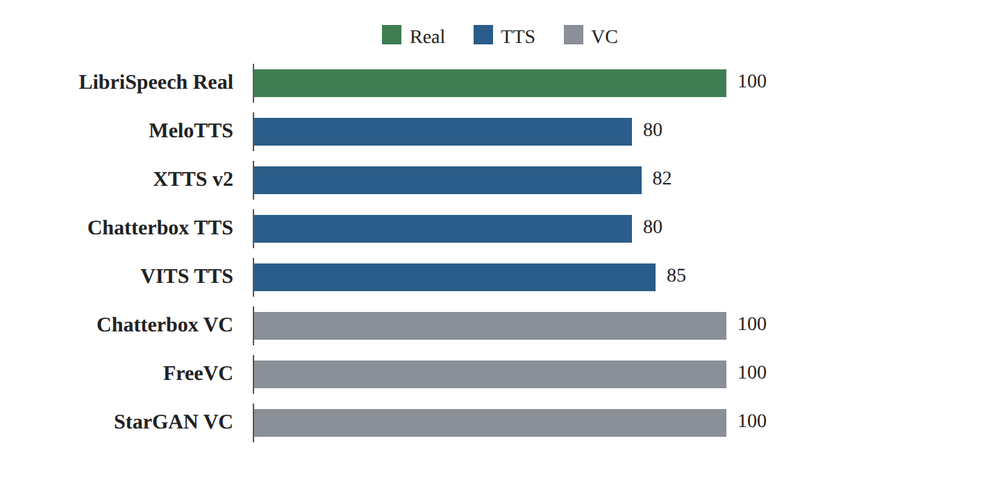
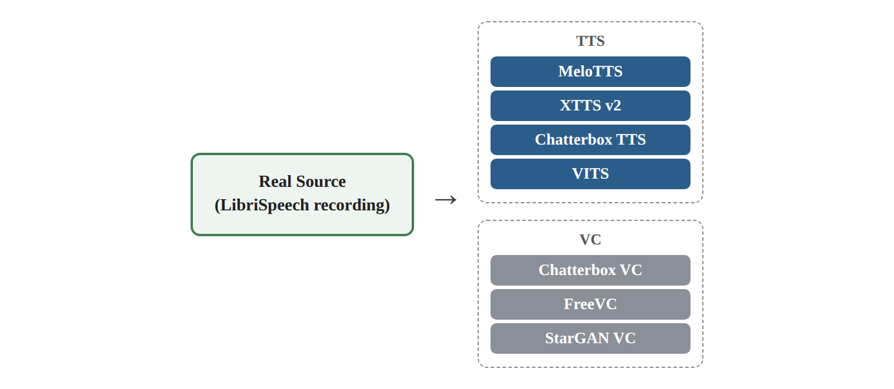
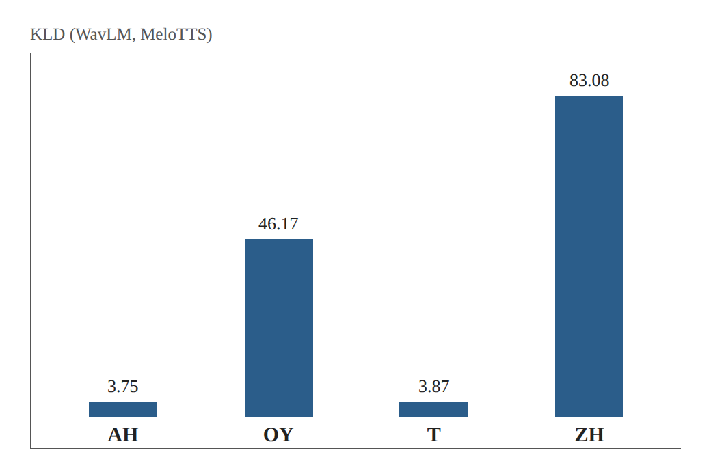

# Dataset Research Card 02 — PhonemeDF

## PhonemeDF: A Synthetic Speech Dataset for Audio Deepfake Detection and Naturalness Evaluation

## 1. Bibliographic Details

**Paper title:** PhonemeDF: A Synthetic Speech Dataset for Audio Deepfake Detection and Naturalness Evaluation.

**Authors:** Vamshi Nallaguntla, Aishwarya Fursule, Shruti Kshirsagar, Anderson R. Avila.

**Research institutions:** Wichita State University, United States; Institut national de la recherche scientifique (INRS), Canada.

**Year of publication:** 2026.

**Conference:** Fifteenth Language Resources and Evaluation Conference — LREC 2026.

**Pages:** 5905–5915.

**Link to the paper:** https://aclanthology.org/2026.lrec-1.469/

**arXiv version:** https://arxiv.org/abs/2603.15037

**The dataset:** https://zenodo.org/records/19522979

**Code and examples:** https://github.com/Vamshi-Nallaguntla/PhonemeDF

**Research fields:** Audio Deepfake Detection, Speech Anti-Spoofing, Synthetic Speech, Naturalness Evaluation, Phoneme-Level Analysis, Text-to-Speech, Voice Conversion.

**Keywords:** PhonemeDF, LibriSpeech, TTS, VC, MFA, TextGrid, ARPAbet, KL Divergence, LFCC, Log-Mel Spectrogram, wav2vec 2.0, WavLM, Logistic Regression, SVM, Data Leakage, Cross-Attack Generalization.

**Classification in the literature review:** Dataset Research Card 02 — External Dataset Sources.

**Relevance to the project:** Very high. The paper proposes an external dataset with parallel real and fake recordings, including four TTS systems and three VC systems. It is relevant for expanding the training data and for examining the effect of the diversity of generation methods on generalization to unknown attacks.

---

## 2. Comprehensive Summary of the Paper

The paper presents PhonemeDF, a real and synthetic speech dataset intended for researching voice forgery detection and evaluating the naturalness features of speech generated by artificial intelligence systems.

The authors seek to address a limitation of many studies in the field of Audio Deepfake Detection: many detection systems focus on distinguishing between whole recordings, without a detailed analysis of the particular acoustic features that distinguish real from synthetic speech.

For this purpose they propose examining speech at the phoneme level, that is, at the level of linguistic sound units. The working assumption is that synthesis systems do not produce all phonemes with the same level of similarity to natural speech, and therefore certain phonemes may expose artifacts that are not prominent in an overall analysis of the recording.

The dataset is based on 28,539 real recordings from LibriSpeech `train-clean-100`. For each source recording, seven synthetic versions were created by means of four Text-to-Speech systems and three Voice Conversion systems. In total, the dataset includes 199,773 fake recordings, with a cumulative scope of about 730 hours of synthetic speech, in addition to about 100 hours of real speech.

The unique feature of PhonemeDF is the addition of TextGrid files, in which the temporal boundaries of phonemes are marked. The files were produced by means of the Montreal Forced Aligner, using the ARPAbet representation.

For the analysis, the researchers extracted LogSpec and LFCC features, alongside Self-Supervised Learning representations of wav2vec 2.0 and WavLM. They used Kullback–Leibler Divergence to measure differences between real and synthetic phoneme distributions, and Logistic Regression and SVM classifiers to examine the actual discriminative ability.

The results indicate significant differences between phonemes and between generation systems. Certain phonemes, including diphthongs and fricatives, show prominent differences between real and synthetic speech. However, the relationship between KLD and Accuracy varies according to the type of representation, and is sometimes even negative.

**The central conclusion:** Phoneme-level analysis makes it possible to identify acoustic patterns related to different synthesis processes, but a large statistical difference does not guarantee better classification ability, and the paper contains no direct proof of an improvement in the EER of whole-recording detectors.

**Source:** Abstract; Sections 1–7; Figures 1–6; Tables 1–9.

---

## 3. The Research Problem and Motivation

### 3.1 The Central Problem

Advanced TTS and Voice Conversion systems are able to produce high-quality synthetic speech, which makes it difficult to distinguish between real and fake recordings.

Voice forgery detection is often based on features of the whole recording or on deep representations learned from audio.

Despite their successes, these methods do not necessarily provide an explanation regarding the acoustic or linguistic units in which the signs of forgery appear.

### 3.2 The Research Gap

According to the authors, there is a relatively limited availability of datasets including documented phoneme boundaries for parallel real and synthetic recordings.

The absence of phoneme alignment makes it difficult to compare local features and to study the naturalness of synthetic speech.

### 3.3 The Working Assumption

Different generation systems may succeed in producing certain phonemes and struggle with producing others.

Therefore the distribution of acoustic features of a synthetic phoneme may differ from that of the same phoneme in real speech.

### 3.4 The Goal of the Study

To create a dataset linking real speech, synthetic versions, and phoneme boundaries, and to examine which phonemes and acoustic features make it possible to distinguish between real and synthetic speech.

### 3.5 The Implied Research Question

Do acoustic features measured at the phoneme level make it possible to identify systematic differences between real and synthetic speech, and is the size of the differences between phoneme distributions related to the success of classifiers in forgery detection?

**Source:** Section 1, pp. 5905–5906.

---

## 4. The Main Contributions

**1. Creating a Parallel Real–Synthetic dataset.** Building synthetic recordings linked to real speech recordings.

**2. Covering two generation families.** Including four TTS systems and three VC systems.

**3. Phoneme-Level Alignment.** Producing TextGrid files by means of MFA for the recordings.

**4. Naturalness analysis at the phoneme level.** A comparison between features of real and synthetic phonemes.

**5. Using a symmetric KLD.** Quantifying the difference between the distributions of the representations.

**6. Comparing Handcrafted and SSL.** Examining LFCC and LogSpec alongside wav2vec 2.0 and WavLM.

**7. Evaluating discriminative ability by means of classifiers.** Using Logistic Regression and SVM.

**8. Identifying prominent phoneme groups.** Analyzing diphthongs, fricatives, and plosives.

**9. Publishing data by generation system.** The ability to download separate archives for controlled experiments.

**10. A basis for future error analysis.** The possibility of investigating in which speech segments artifacts related to synthesis appear.

**Source:** Section 1; Sections 3–6.

---

## 5. The Connection to the Existing Literature Review

### 5.1 ASVspoof 5

ASVspoof 5 emphasizes the importance of generalization to new attacks and to diverse speech conditions. PhonemeDF provides an additional data source that makes it possible to examine the effect of TTS and VC families on generalization ability.

### 5.2 CQCC

CQCC proposes cepstral features for forgery detection. PhonemeDF examines cepstral features of the LFCC type at the phoneme level, alongside other representations.

### 5.3 AASIST

AASIST focuses on learning spectral and temporal relations. PhonemeDF may enable a local analysis of a deep model's errors, but the paper does not present a direct evaluation of AASIST on the dataset.

### 5.4 wav2vec 2.0

PhonemeDF uses wav2vec 2.0 representations in order to compare real and synthetic phonemes.

### 5.5 WavLM

PhonemeDF uses WavLM for representing phonemes, and demonstrates that the relationship between statistical distance and classification ability is not necessarily similar to that obtained with classical spectral features.

### 5.6 CodecFake

CodecFake focuses on attacks based on Neural Audio Codecs. PhonemeDF provides a complementary variety of TTS and VC, but does not prove that combining it with CodecFake will improve the detection of Codec-based attacks.

### 5.7 Enhanced Forensic Trace Generation

Both studies deal with detecting information related to the forgery-creation process. PhonemeDF focuses on local phonetic and acoustic differences.

### 5.8 Intelligent Voice Fraud Detection

PhonemeDF uses classical classifiers for the purpose of evaluating discriminative ability, but its central goal is phoneme analysis and not building a complete hybrid system.

### 5.9 One-Class Learning + wav2vec 2.0

One-class learning models the distribution of real speech. PhonemeDF demonstrates that the distribution varies by phoneme and by representation type, and therefore may provide background for understanding the limitations of modeling real speech as a single distribution.

### 5.10 MLAAD — Dataset Research Card 01

MLAAD adds a wide variety of TTS systems and languages, while PhonemeDF provides parallel TTS and VC data at the level of linguistic content, with phoneme boundaries.

The two sources may be complementary in terms of data composition, but the benefit of combined training must be proven by means of an experiment.

---

## 6. The Data Source — LibriSpeech

### 6.1 The Subset

The dataset is based on LibriSpeech `train-clean-100`.

### 6.2 Features

- 28,539 real speech recordings.
- 251 source speakers.
- About 100 hours of speech.
- Speech in English.
- Transcripts matched to the recordings.

### 6.3 The Preparation Process

The researchers converted the source files to WAV and separated the transcripts, while maintaining a match between the file names.

### 6.4 A Source Limitation

LibriSpeech is based on audiobooks, and therefore does not fully represent spontaneous speech, telephone conversations, or recordings under diverse environmental conditions.

### 6.5 Significance for the Project

Adding data from LibriSpeech may change the speaker distribution, speaking style, and recording conditions of the training set.

These effects should be examined separately from the effect of the synthesis systems.

**Source:** Section 3.1; Table 1, pp. 5907–5908.

---

## 7. The Synthesis Systems

### 7.1 TTS Systems

- MeloTTS.
- XTTS v2.
- Chatterbox TTS.
- VITS TTS.

These systems use the source texts to produce synthetic speech.

### 7.2 Voice Conversion Systems

- Chatterbox VC.
- FreeVC.
- StarGAN VC.

These systems use the original audio to produce a converted version.

### 7.3 The Difference between the Generation Families

In TTS the speech is created from the transcript, and therefore the recording's duration and prosody do not have to match the original performance.

In VC there is an original speech signal serving as input to the conversion system. Therefore certain features of the original performance may be preserved.

### 7.4 Reference Speakers

The researchers used ten VCTK speakers for voice reference in the systems that required it, and built-in voices in the systems where they are available.

The authors note that they did not try to clone the original LibriSpeech speakers.

### 7.5 Significance for Data Splitting

One must distinguish between the source speaker in LibriSpeech, the reference speaker, and the synthetic voice heard in the output.

**Source:** Section 3.1, pp. 5907–5908.

---

## 8. Dataset Size and the Distribution of Examples

| Source | Number of recordings | Mean duration in seconds | Hours |
|---|---:|---:|---:|
| LibriSpeech Real | 28,539 | 12.69 | 100 |
| MeloTTS | 28,539 | 10.15 | 80 |
| XTTS v2 | 28,539 | 10.47 | 82 |
| Chatterbox TTS | 28,539 | 10.15 | 80 |
| VITS TTS | 28,539 | 10.77 | 85 |
| Chatterbox VC | 28,539 | 12.70 | 100 |
| FreeVC | 28,539 | 12.68 | 100 |
| StarGAN VC | 28,539 | 12.68 | 100 |
| **Total synthetic speech** | **199,773** | **11.37** | **about 730** |

*Figure 1. Illustration of the Table 1 data (Section 8): speech hours by source and generation system.*

**Total number of recordings, including real:** 228,312.

**Approximate total speech duration, including real:** 830 hours.

The figure of 730 hours refers to the synthetic speech, and does not include the 100 hours of real speech.

**Source:** Table 1, p. 5908.

---

## 9. The Structure of the Parallel Pairs

For each original LibriSpeech recording there are synthetic versions linked to it.

In a typical case:

Real Source → MeloTTS, XTTS v2, Chatterbox TTS, VITS, Chatterbox VC, FreeVC, StarGAN VC.

*Figure 2. Illustration of the structure of the parallel pairs in Section 9: one source recording and seven linked synthetic versions.*

The linking makes it possible to compare generation systems with better control over the linguistic content.

However, it should not be assumed that the recordings share the same speaker identity or the same duration.

### 9.1 Research Advantage

Changes related to the generation family can be examined while using matching texts.

### 9.2 Research Risk

A random split by file may place versions of the same source in both training and evaluation.

### 9.3 A Binding Rule

All the versions related to a single source recording will remain in the same split group. For the purpose of speaker separation, grouping by source speaker must also be added and the reference voices must be examined separately.

---

## 10. Phoneme-Level Segmentation

### 10.1 The Goal of the Alignment

To enable identifying the time boundaries at which each phoneme appears in the recording.

### 10.2 The Tool

Montreal Forced Aligner — MFA.

### 10.3 Input

An audio file and a transcript matching it.

### 10.4 Output

A TextGrid file including phoneme boundaries and labels along the time axis.

### 10.5 Phoneme Representation

The researchers used ARPAbet and the `english_us_arpa` model.

### 10.6 Removing Stress Markings

The markings `AA0`, `AA1`, and `AA2` were merged into the category `AA`, similar to other phonemes with stress markings.

### 10.7 Number of Categories

The experiment examined 39 phoneme categories.

### 10.8 Limitations

MFA performs automatic alignment and does not guarantee fully accurate boundaries.

The authors note that they manually checked a small number of TextGrid files, and do not report full verification of all the phoneme boundaries.

**Source:** Section 3.2; Figure 3, pp. 5908–5909.

---

## 11. The Metadata Structure Required for the Project

The paper does not define a full Manifest directly matching the needs of our project.

Therefore we will propose a unified Metadata schema.

| Proposed field | Meaning |
|---|---|
| `audio_path` | Audio file path |
| `label` | Bona Fide / Spoof |
| `source_dataset` | PhonemeDF / LibriSpeech |
| `source_utterance_id` | Source recording identifier |
| `source_speaker_id` | Source speaker identifier |
| `generator_id` | Generation system identifier |
| `attack_family` | TTS / VC |
| `reference_voice_id` | Reference voice identifier, if it can be reconstructed |
| `duration` | Audio duration |
| `sample_rate` | Sampling rate |
| `transcript_id` | Linguistic content identifier |
| `split` | Training / validation / test set |
| `parent_group_id` | Source group for all sub-windows |

These are fields proposed for our implementation; they are not a list of fields actually verified in the distribution files.

According to the README of the examples repository, the example file names include a source recording identifier and a system suffix, such as `19-198-0003-MeloTTS.wav`.

This helps in planning the reconstruction of source associations, but does not prove that all the full distribution archives include an identical naming structure.

---

## 12. The Original Experimental Protocol

### 12.1 The Scope of the Experiment

The researchers chose a subset of 1,000 real recordings and the synthetic versions matching them.

The choice was intended to represent all 251 speakers in the original subset.

### 12.2 The Unit of Analysis

A phoneme instance from a recording.

### 12.3 The Goal of the Experiment

To analyze the ability to distinguish between real and synthetic phonemes.

### 12.4 A Distinction Relative to the Full Dataset

The number of recordings published in the dataset is much larger than the number of recordings included in the central empirical analysis.

### 12.5 A Reproduction Limitation

The paper does not sufficiently detail in this section all the training and testing splits at the speaker and source-recording level for the classifier experiments.

It should not be concluded from this that information leakage occurred, but it cannot be verified from the description alone that all source associations were separated.

**Source:** Section 4.1, p. 5908.

---

## 13. The Speech Features Examined

### 13.1 LogSpec

Log-Mel Spectrogram.

Reported parameters:
- 80 Mel bins.
- FFT of size 512.
- A Hop of 10 milliseconds.

### 13.2 LFCC

Linear-Frequency Cepstral Coefficients.

Reported parameters:
- 20 coefficients.
- The same FFT and Hop parameters.

### 13.3 wav2vec 2.0

Using SSL representations produced from a pre-trained speech model.

### 13.4 WavLM

Using SSL representations from a model focusing on learning speech features.

### 13.5 Pooling

Features computed over time undergo Mean Pooling within the phoneme boundaries.

### 13.6 Embedding Size

According to the paper's description, the SSL representations are of size 1,024 per Frame.

### 13.7 A Reproduction Limitation

The paper does not detail in the same section all the Checkpoint settings, the layers, and the Covariance handling. Therefore reviewing the code or additional documentation is required before attempting a full reproduction.

**Source:** Section 4.1, p. 5909.

---

## 14. Kullback–Leibler Divergence

### 14.1 The Idea

To measure the difference between the distribution of real-phoneme representations and the distribution of representations of the same phonemes in synthetic speech.

### 14.2 The Distribution Assumption

The researchers model the Embeddings by means of multivariate Gaussian distributions.

### 14.3 KLD

KLD measures the difference between two probability distributions, but is generally not symmetric.

### 14.4 Symmetric KLD

The researchers compute:

D_sym = ½ · [ D_KL(P_R ‖ P_S) + D_KL(P_S ‖ P_R) ]

### 14.5 Interpretation

A high KLD indicates a larger statistical difference between the distributions of the representations, according to the model estimated.

### 14.6 A Fundamental Limitation

KLD does not guarantee a high Accuracy, a low EER, or a low similarity in the eyes of human listeners.

### 14.7 A Numerical Limitation

Estimating multivariate Covariance matrices may be sensitive to the sample size and to the dependence between features.

The paper does not provide full detail of all the numerical-stabilization mechanisms, and therefore reproducing the experiment will require additional checking.

**Source:** Section 4.2, Equations 1–2, p. 5909.

---

## 15. The Detection Classifiers

### 15.1 Logistic Regression

A binary classifier that learns to distinguish between real and synthetic phoneme representations.

### 15.2 Support Vector Machine

A classifier that learns a decision boundary between the classes.

### 15.3 The Scope of the Experiments

39 phonemes times two classifiers = 78 classifiers for each combination of representation and generation system.

### 15.4 Metric

Classification Accuracy at the phoneme level.

### 15.5 Significance

The experiment examines which phonemes contain discriminative information that can be exploited by means of certain classifiers.

It does not constitute a direct evaluation of a detection system at the level of a whole recording.

**Source:** Section 4.3, p. 5909.

---

## 16. Pearson Correlation

### 16.1 Goal

To examine the relationship between KLD values and Accuracy across phonemes.

### 16.2 The Null Hypothesis

H₀: r = 0

That is, there is no linear relationship between KLD and Accuracy.

### 16.3 A Positive Correlation

Phonemes with a high KLD tend to show a higher Accuracy.

### 16.4 A Negative Correlation

Phonemes with a high KLD tend to show a lower Accuracy.

### 16.5 p-Values

Used to examine the evidence against the null hypothesis, in accordance with the test's assumptions.

### 16.6 Limitations

A correlation does not prove a causal relationship. Even a high correlation does not guarantee an improvement of a complete detector.

---

## 17. KLD Results for Handcrafted Features

### 17.1 LFCC

The researchers found relatively large differences in consonants for some of the VC systems.

Examples:

- StarGAN VC — a KLD of 32.9 for consonants.
- FreeVC — a KLD of 29.6 for consonants.
- VITS — a KLD of 1.1 for vowels and 1.8 for consonants.

### 17.2 LogSpec

Certain systems show large differences in vowels and consonants.

For example, MeloTTS shows a KLD of 31.6 in vowels.

### 17.3 Interpretation

The spectral representations emphasize differences related to the spectral envelope, to energy, and to acoustic components that change over time.

### 17.4 A Limitation

A lower KLD does not prove that the synthesis system is more natural in the eyes of human listeners.

**Source:** Section 5.1; Figure 4, p. 5910.

---

## 18. KLD Results for SSL

### 18.1 wav2vec 2.0

The KLD values in the wav2vec 2.0 representation space differ significantly from those obtained by means of LFCC and LogSpec.

### 18.2 WavLM

With WavLM too, differences were observed between generation systems and between phoneme groups.

### 18.3 Significance

The type of representation affects the features the statistical distance emphasizes.

### 18.4 A Limitation

A lower KLD value in an SSL space should not be interpreted as evidence that the representation is less suited to forgery detection.

The KLD of different representations is not a direct metric for comparing the quality of the detectors.

**Source:** Section 5.1; Figure 5, p. 5910.

---

## 19. Prominent Phonemes

### 19.1 Diphthongs

Two-sound vowels, including `OY`, `EY`, `AW`, and `AY`.

They are characterized by dynamic transitions of the resonance frequencies throughout the articulation.

### 19.2 Fricatives

Fricative consonants, including `SH`, `S`, and `ZH`.

They include friction energy with complex spectral features.

### 19.3 Plosives

Plosive consonants, including `P`, `B`, and `T`.

They are characterized by short acoustic events and sharp temporal transitions.

### 19.4 An Example: WavLM and MeloTTS

- `AH` — a KLD of 3.75.
- `OY` — a KLD of 46.17.
- `T` — a KLD of 3.87.
- `ZH` — a KLD of 83.08.

*Figure 3. Illustration of the Section 19.4 data: KLD values of selected phonemes in WavLM for MeloTTS.*

### 19.5 Conclusion

There are significant differences between phonemes, but no single phoneme was proven to be better in every generation system and every representation.

**Source:** Figures 6; Sections 5.1 and 5.3, pp. 5911–5913.

---

## 20. The Relationship between KLD and Accuracy

### 20.1 LFCC

The researchers report significant positive correlations in many cases, especially for consonants.

Example: for StarGAN VC and consonants with Logistic Regression, r = 0.82 is obtained.

### 20.2 LogSpec

Positive correlations are found in many systems, alongside exceptions.

### 20.3 wav2vec 2.0

The correlations vary between systems and phonemes, and are sometimes weak or negative.

### 20.4 WavLM

In consonants, prominent negative correlations are observed in many systems.

Example: for StarGAN VC and consonants with Logistic Regression, r = −0.80 is obtained.

### 20.5 Interpretation

In certain spectral features, a large statistical difference tends to be associated with a higher discriminative ability.

In SSL representations the relationship is not necessarily similar, and is sometimes even reversed.

### 20.6 Conclusion

**KLD is not a substitute for an empirical evaluation of a classifier.**

**Source:** Tables 2–9, p. 5912.

---

## 21. Central Results — Summary

| Finding | The significance |
|---|---|
| Differences between phonemes | Generation systems do not reproduce all speech units in the same way |
| Differences between TTS and VC systems | The generation mechanism affects the audio features |
| Diphthongs and fricatives are prominent in some of the experiments | There are candidates for phonetic error analysis |
| Handcrafted and SSL emphasize different features | The choice of representation affects the interpretation of the findings |
| KLD–Accuracy is not a uniform relationship | One should not rely on KLD alone for selecting features |
| Evaluation at the phoneme level | There is no direct proof of an EER improvement at the recording level |

---

## 22. Strengths of the Study

1. A relatively large dataset including parallel real and synthetic recordings.
2. A combination of four TTS systems and three VC systems.
3. Shared transcripts that allow a more controlled comparison.
4. Phoneme boundaries by means of TextGrid.
5. Combining linguistic and acoustic information.
6. Comparing classical features to SSL representations.
7. Statistical analysis of differences between phonemes.
8. Examining the relationship between distance metrics and classifier performance.
9. Publishing separate archives by generation system.
10. The possibility of researching artifacts and of local error analysis.

---

## 23. Limitations of the Study

**Limitation 1 — English only:** the findings do not prove generalization to other languages.

**Limitation 2 — Speech source:** all the real speech is based on LibriSpeech.

**Limitation 3 — Limited diversity of systems:** only seven generation systems were examined.

**Limitation 4 — Alignment quality:** the phoneme boundaries were produced automatically and verified manually only to a limited extent.

**Limitation 5 — Speakers and reference voices:** the source speaker is not necessarily the speaker heard in the synthetic recording.

**Limitation 6 — Evaluation metrics:** the central metrics are KLD, Accuracy, and Pearson correlation, and not EER at the recording level.

**Limitation 7 — Splitting protocol:** the description is not sufficient for full verification of all the speaker and source-recording splits in the classification experiments.

**Limitation 8 — Naturalness:** no broad perceptual evaluation by human listeners was carried out.

**Limitation 9 — Statistical estimation:** computing KLD on multidimensional Embeddings depends on the estimation of distributions and on the stability of the Covariance.

**Limitation 10 — Generalization:** it was not proven that using PhonemeDF data improves EER on ASVspoof 5, CodecFake, or the course dataset.

**Source:** Sections 4–7.

---

## 24. Dataset Availability and Download

The dataset was published on Zenodo with separate archives for the sources and the generation systems.

| Archive | Approximate source size |
|---|---:|
| Real | 9.4GB |
| MeloTTS | 7.7GB |
| XTTS v2 | 8.2GB |
| Chatterbox TTS | 7.8GB |
| VITS | 8.3GB |
| Chatterbox VC | 9.6GB |
| FreeVC | 21.6GB |
| StarGAN VC | 9.9GB |
| TextGrids | 386.1MB |
| References | 9.2MB |
| Documentation | 77.5KB |

**Total size of the distribution files:** about 82.9GB.

The sizes refer to the distribution files and not necessarily to the space required after extraction.

**Source:** Zenodo, version 1.0.1, the file list.

---

## 25. Licensing and Terms of Use

### 25.1 LibriSpeech

The source of the real speech, LibriSpeech, is distributed under a CC BY 4.0 license according to the official OpenSLR documentation.

### 25.2 PhonemeDF

On the Zenodo page that was examined, the license field does not show an explicit value. Therefore it cannot be determined what license applies to all of the synthetic recordings.

### 25.3 Licenses of the Generation Systems

Using different TTS and VC models may be subject to different terms. The distribution and use rights derived from the specific distribution must be checked, and it should not be assumed that all the recordings are automatically subject to the LibriSpeech license.

### 25.4 Status

**License Verification — Pending.**

### 25.5 Practical Decision

Before training on a significant scope of the data, we will check the attached documentation file and the terms of use. If the rights are unclear, we will request clarification from the dataset's distributors.

### 25.6 GitHub Policy

We will not upload external audio files to the public repo.

We will keep in the code only loading mechanisms, settings, experiment documentation, and information that can be published according to the dataset's terms.

---

## 26. Dataset Integration Assessment — Fit with the Project

### 26.1 The Project Data

The course dataset includes 1,520 recordings:

| Source | Real | Fake |
|---|---:|---:|
| ASVspoof 5 | 300 | 300 |
| CodecFake | 300 | 300 |
| M-AILABS | 320 | 0 |
| Total | 920 | 600 |

### 26.2 The Possible Contribution of PhonemeDF

The dataset can add TTS and VC examples originating from LibriSpeech, and provide a comparison between generation families on the basis of parallel source recordings.

### 26.3 Technical Fit

The recordings are standardized to 16kHz, in accordance with the sampling rate of the course data.

However, the recording lengths differ from the four seconds of the course data.

### 26.4 Source Risk

PhonemeDF is based on LibriSpeech, while the ASVspoof 5 data is based on MLS English.

There is no proof of a direct overlap between our subsets, but possible source associations should be checked.

### 26.5 Speaker Risk

The LibriSpeech speakers are not necessarily the speakers heard in the synthetic versions.

### 26.6 Text Risk

There are different synthetic versions based on the same Transcript.

### 26.7 Processing Risk

Differences in duration, rate, bandwidth, silence, and Resampling artifacts may be related to the class.

### 26.8 Principled Recommendation

**Conditional GO — suited to a controlled training-expansion experiment after the checks are completed.**

---

## 27. Choosing the Recommended Subset

### 27.1 A Preliminary Stage

We will first check the documentation files, the naming structure, and the existence of source and speaker identifiers.

### 27.2 First Pilot

Real + MeloTTS.

Goal: to verify loading, processing, file matching, labels, licensing, and splits.

### 27.3 Second Pilot

Adding Chatterbox VC.

Goal: comparing TTS versus VC while using a similar example budget.

### 27.4 A Possible Extension

VITS or StarGAN VC, according to the Pilot results and the need for diversifying architectures.

### 27.5 FreeVC

Not in the initial download priority due to the archive size, but this is not a claim of lower research importance.

### 27.6 A Controlled Sample

We will choose examples by source groups and speakers, with class balancing and an orderly distribution of generation systems.

### 27.7 A Planning Limitation

Choosing MeloTTS and Chatterbox VC is an operational starting point, and not a final decision on the systems optimal for training.

---

## 28. The Data Audit Plan

**Gate 1 — Rights:** verifying licensing and academic use.

**Gate 2 — File Inventory:** counting files, checking their integrity, and verifying names.

**Gate 3 — Metadata:** identifying the source recording, source speaker, generation system, and reference voice.

**Gate 4 — Pair Integrity:** checking that the Real–TTS–VC associations are correct.

**Gate 5 — Overlap Audit:** checking overlaps against the training data available from the course.

**Gate 6 — Signal Audit:** analyzing duration, silence, Sample Rate, bandwidth, loudness, and Clipping.

**Gate 7 — Split Feasibility:** checking that valid splits can be created in accordance with the generalization question.

**Gate 8 — License Decision:** approving the data use after the checks are completed.

**Gate 9 — Small Pilot:** extracting features and training a simple model.

**Gate 10 — Evaluation:** comparison against the Baseline while keeping a fixed evaluation protocol.

One should not proceed to extensive training if essential licensing or separation conditions remain unresolved.

---

## 29. The Data-Splitting Protocol

### 29.1 The Source Unit

Each original LibriSpeech recording and its synthetic versions are defined as a single family.

### 29.2 Preventing Source Overlaps

Source families will not be divided between Training and Validation or Test.

### 29.3 Speaker-Disjoint

We will use the source-speaker identifiers when they are available and reliable.

### 29.4 Synthetic Voice Overlap

We will separately examine built-in voices and reference speakers that may appear in a large number of examples.

### 29.5 Leave-One-Generator-Out

In a generalization experiment to a generation system not seen in training, we will keep all the examples of a particular system out of the training set.

### 29.6 Grouped Windows

If we cut a recording into several windows, all of them will remain in the same split group.

### 29.7 Held-Out Test

We will not use Test data for improving Hyperparameters, choosing generation systems, choosing phonemes, or setting a decision threshold.

---

## 30. Preprocessing

### 30.1 Sample Rate

16kHz.

### 30.2 Duration

We will define a uniform cropping policy of four seconds in accordance with the project's requirements.

### 30.3 Cropping

We will use a policy that does not create systematic differences between Real and Fake.

### 30.4 Padding

If Padding is required, we will apply it consistently and check that there is no difference between the classes in the Padding rate.

### 30.5 Silence

We will check silence at the beginning and end of the recordings.

### 30.6 Bandwidth

We will check whether there are bandwidth differences stemming from the source or from the generation system.

### 30.7 Normalization

Every normalization operation will be documented and checked so that it does not remove relevant artifacts or create artificial differences.

### 30.8 Augmentation

We will consider data augmentation only within an experiment in which its effect can be measured.

---

## 31. Proposed Experiments

### E0 — Course Data Only

Training on the course data alone.

### E1 — Course + MLAAD

Expanding training by means of a controlled MLAAD subset.

### E2 — Course + PhonemeDF

Expanding training by means of a controlled PhonemeDF subset.

### E3 — Course + MLAAD + PhonemeDF

Examining the joint effect of the two expansion sources.

### Complementary Experiment A — TTS vs. VC

Comparing subsets from within PhonemeDF.

### Complementary Experiment B — Diversity vs. Quantity

Comparing sets in which the number of examples is similar, but the number of generation systems differs.

### Complementary Experiment C — Unseen Generator

Holding a particular generation system out of training and evaluating on it.

### Complementary Experiment D — Phoneme-Aware Error Analysis

Analyzing errors by phonemes, when there are models and results that justify it.

The complementary experiments are not mandatory requirements at the first stage.

---

## 32. Proposed Research Hypotheses

**H1 — Data Expansion:** adding external data may improve generalization, but the improvement is not guaranteed.

**H2 — TTS/VC Diversity:** combining different generation families may improve the detection of attacks not seen in training relative to homogeneous subsets.

**H3 — Quantity Control:** even when the number of examples is fixed, the composition of generation systems may affect EER.

**H4 — Dataset Complementarity:** combining MLAAD and PhonemeDF may provide an advantage over using each of them separately.

**H5 — Source Confounding:** an improvement in certain metrics may stem from learning source features and not general forgery artifacts.

**H6 — Phoneme Sensitivity:** the model's errors may be related to certain phonemes, but the relationship is expected to vary between generation systems and representations.

These are hypotheses for the present study; they are not proven conclusions of the paper.

---

## 33. What Must Not Be Done Methodologically?

1. Performing a Random Split at the file level without taking source associations into account.
2. Assuming that all versions of the recording share an identical speaker.
3. Presenting a Speaker-Disjoint Split without checking the speaker identifiers.
4. Using Test for choosing generation systems or phonemes.
5. Attributing an EER improvement to diversity alone when the number of examples changed.
6. Performing a systematically different cropping or Padding between the classes.
7. Treating KLD as if it were EER or Accuracy.
8. Presenting Accuracy at the phoneme level as detection performance at the recording level.
9. Concluding that recordings with a low KLD are more perceptually natural.
10. Assuming that the absence of an exact audio duplicate rules out any source overlap.
11. Uploading external audio files to the public repo without explicit permission.
12. Using the secret competition set to tune the choice of external examples.

---

## 34. Computational Feasibility

**Computer:** a MacBook Pro M3 Pro, 18GB Unified Memory, and a 1TB SSD.

### 34.1 Baselines

MFCC/LFCC and Logistic Regression are suited to local processing.

### 34.2 SSL Feature Extraction

Embeddings can be extracted by means of wav2vec 2.0 or WavLM with a frozen Encoder and staged processing.

### 34.3 Memory Management

We will use staged data loading and Batch Sizes suited to the memory measurements.

### 34.4 Storage

There is no need to download all 82.9GB for a Pilot.

### 34.5 Checkpoints

We will save Embeddings, results, and settings, while avoiding uploading large files or protected data to the repo.

### 34.6 Cloud GPU

We will consider using the cloud only if significant Fine-Tuning or impractical computation time justify it.

---

## 35. Final Recommendation — Dataset Integration Assessment

**Status:** Conditional GO.

**Recommendation:** PhonemeDF is a leading candidate for a training-expansion experiment, especially thanks to the combined variety of TTS and VC and the relationship between real and synthetic examples.

**Recommended initial subset:** Real + MeloTTS for integration checks, and afterwards adding Chatterbox VC for comparison between generation families. The choice will be re-examined after a Metadata Audit.

**Manner of integration:** creating a unified Manifest, splitting by source groups and speakers, matching recording durations, balancing the data, and evaluating on held-out sets.

**Threshold conditions:** verified licensing, source associations that can be reconstructed, and the absence of unhandled overlaps with the evaluation data.

**Role in the central experiment:** E2 and E3.

**Additional research role:** Phoneme-Aware Error Analysis, as an optional extension.

**What has not yet been done:** downloading the full data, File Inventory, final licensing checks, overlap checks, and model training.

---

## 36. Open Questions for the Continuation

1. Do the file names in the full archives preserve the LibriSpeech identifiers?
2. Can all the reference voices used for generation be identified?
3. Does the PhonemeDF data overlap with the recordings available in the course?
4. Can a split by source speaker be created without harming the scope of the sample?
5. Is there a possibility of separating synthetic voices between sets?
6. How does cropping to four seconds affect the detection results?
7. Does adding TTS and VC improve generalization also on Codec-based attacks?
8. Does combining MLAAD and PhonemeDF help beyond adding the same number of examples from a single source?
9. Does the diversity of generation systems contribute more than a quantitative increase alone?
10. Can part of the model's errors be explained by means of phonemes?
11. Are the signs of forgery preserved after Codec Augmentation?
12. Do certain generation systems cause a more prominent Source Shortcut?
13. Is PhonemeDF also suited to one-class learning on the real speech?
14. Can the stability of the results be evaluated across several Seeds without exceeding the computation budget?
15. Does the planned subset allow a reliable measurement of EER by attack family?

---

## 37. Summarizing Conclusion

PhonemeDF offers a unique infrastructure for researching voice forgeries by means of parallel real and synthetic recordings and documented phoneme boundaries.

The paper demonstrates that the ability of synthesis systems to reproduce phonemes varies according to the phoneme type, the generation system, and the feature representation. In particular, certain diphthongs and consonants show prominent acoustic differences between real and synthetic speech.

However, the size of the statistical difference does not necessarily guarantee a high classification ability, and the paper contains no direct proof of an improvement in the EER of whole-recording detectors.

**The central research insight:** The features of forgery are not uniform throughout the speech, and analysis at the phoneme level may provide information complementary to global representations and to existing detection models.

**The practical decision:** We will examine PhonemeDF as a source for training expansion within E2 and E3, while controlling for the number of examples, the generation systems, and the source and speaker associations. Phoneme analysis will remain a possible research extension after we obtain Baselines and reliable evaluation results.

---

## 38. Reference Map to the Paper

| Topic | Location |
|---|---|
| Abstract and contributions | Abstract, p. 5905 |
| Motivation | Section 1, pp. 5905–5906 |
| Naturalness background | Section 2.1, p. 5906 |
| A review of forgery datasets | Section 2.2, p. 5906 |
| The dataset-creation process | Figure 1, p. 5907 |
| TTS and VC systems | Section 3.1, p. 5907 |
| Reference speakers | Section 3.1, pp. 5907–5908 |
| Phoneme division | Section 3.2, p. 5908 |
| Dataset statistics | Table 1, p. 5908 |
| A TextGrid example | Figure 3, p. 5909 |
| The evaluation protocol | Section 4.1, pp. 5908–5909 |
| LogSpec, LFCC, and SSL | Section 4.1, p. 5909 |
| KLD | Section 4.2, p. 5909 |
| Classifiers and Pearson correlation | Section 4.3, p. 5909 |
| Handcrafted results | Figure 4, p. 5910 |
| SSL results | Figure 5, p. 5910 |
| Prominent phonemes | Figure 6, p. 5911 |
| KLD–Accuracy correlations | Tables 2–9, p. 5912 |
| Phoneme rankings | Section 5.3, pp. 5911–5913 |
| Conclusions | Section 6, p. 5913 |
| Limitations and ethics | Section 7, p. 5913 |

## 39. Complementary Sources

- LREC 2026 publication: https://aclanthology.org/2026.lrec-1.469/
- arXiv: https://arxiv.org/abs/2603.15037
- Zenodo: https://zenodo.org/records/19522979
- GitHub: https://github.com/Vamshi-Nallaguntla/PhonemeDF
- LibriSpeech / OpenSLR: https://www.openslr.org/12
- Montreal Forced Aligner: https://montreal-forced-aligner.readthedocs.io/

**Usage note:** the statistical and numerical results in the card are based on the PhonemeDF paper as published at LREC 2026. The download recommendations, the data-splitting, and the E0–E3 experiments are our own research proposals, and not experiments carried out in the paper. The licensing of the synthetic distribution, the Metadata of the full archives, and the overlaps with the course data have not yet been fully verified.
