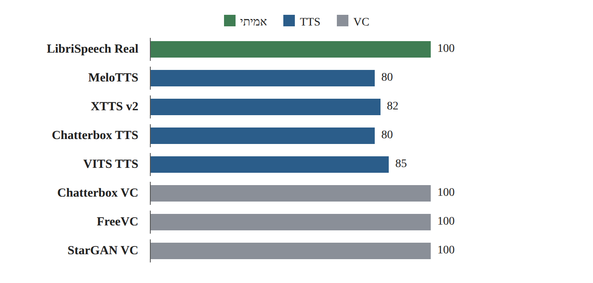
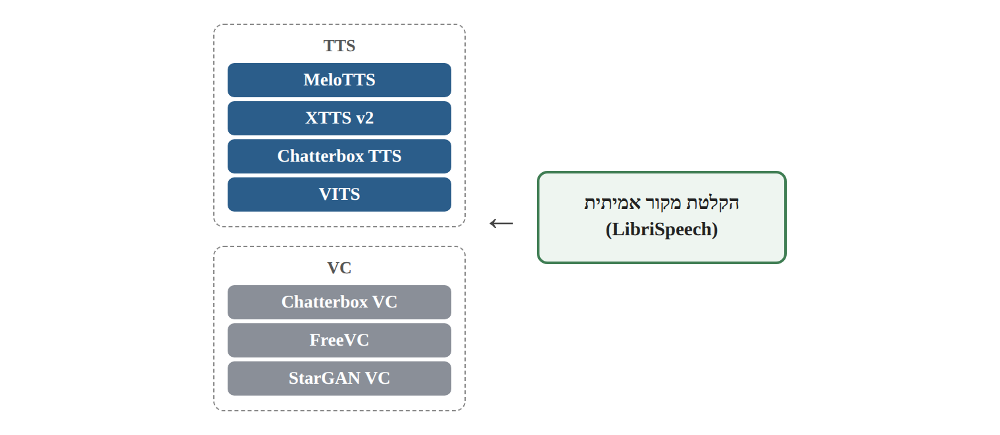
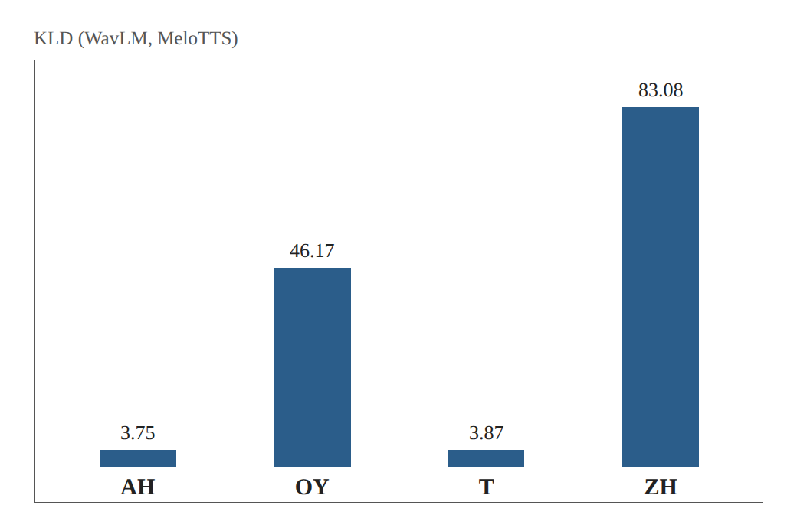

# Dataset Research Card 02 — PhonemeDF

## PhonemeDF: A Synthetic Speech Dataset for Audio Deepfake Detection and Naturalness Evaluation

## 1. פרטים ביבליוגרפיים

**שם המאמר:** PhonemeDF: A Synthetic Speech Dataset for Audio Deepfake Detection and Naturalness Evaluation.

**מחברים:** Vamshi Nallaguntla, Aishwarya Fursule, Shruti Kshirsagar, Anderson R. Avila.

**מוסדות מחקר:** Wichita State University, ארצות הברית; Institut national de la recherche scientifique ‏(INRS), קנדה.

**שנת פרסום:** 2026.

**כנס:** Fifteenth Language Resources and Evaluation Conference — LREC 2026.

**עמודים:** 5905–5915.

**קישור למאמר:** https://aclanthology.org/2026.lrec-1.469/

**גרסת arXiv:** https://arxiv.org/abs/2603.15037

**מאגר הנתונים:** https://zenodo.org/records/19522979

**קוד ודוגמאות:** https://github.com/Vamshi-Nallaguntla/PhonemeDF

**תחומי מחקר:** Audio Deepfake Detection, Speech Anti-Spoofing, Synthetic Speech, Naturalness Evaluation, Phoneme-Level Analysis, Text-to-Speech, Voice Conversion.

**מילות מפתח:** PhonemeDF, LibriSpeech, TTS, VC, MFA, TextGrid, ARPAbet, KL Divergence, LFCC, Log-Mel Spectrogram, wav2vec 2.0, WavLM, Logistic Regression, SVM, Data Leakage, Cross-Attack Generalization.

**סיווג בסקירת הספרות:** Dataset Research Card 02 — External Dataset Sources.

**רלוונטיות לפרויקט:** גבוהה מאוד. המאמר מציע מאגר חיצוני בעל הקלטות אמיתיות ומזויפות מקבילות, הכולל ארבע מערכות TTS ושלוש מערכות VC. הוא רלוונטי להרחבת נתוני האימון ולבחינת השפעת מגוון שיטות היצירה על ההכללה למתקפות לא מוכרות.

---

## 2. תקציר מקיף של המאמר

המאמר מציג את PhonemeDF, מאגר דיבור אמיתי וסינתטי המיועד לחקר זיהוי זיופים קוליים ולהערכת מאפייני הטבעיות של דיבור שנוצר באמצעות מערכות בינה מלאכותית.

המחברים מבקשים להתמודד עם מגבלה של מחקרים רבים בתחום Audio Deepfake Detection: מערכות זיהוי רבות מתמקדות בהבחנה בין הקלטות שלמות, ללא ניתוח מפורט של המאפיינים האקוסטיים המסוימים המבדילים בין דיבור אמיתי לסינתטי.

לשם כך הם מציעים לבחון את הדיבור ברמת הפונמה, כלומר ברמת יחידות צליל לשוניות. הנחת העבודה היא שמערכות סינתזה אינן מפיקות את כל הפונמות באותה רמת דמיון לדיבור טבעי, ולכן פונמות מסוימות עשויות לחשוף ארטיפקטים שאינם בולטים בניתוח כולל של ההקלטה.

המאגר מבוסס על 28,539 הקלטות אמיתיות מתוך LibriSpeech `train-clean-100`. עבור כל הקלטת מקור נוצרו שבע גרסאות סינתטיות באמצעות ארבע מערכות Text-to-Speech ושלוש מערכות Voice Conversion. בסך הכול כולל המאגר 199,773 הקלטות מזויפות, בהיקף מצטבר של כ-730 שעות דיבור סינתטי, נוסף לכ-100 שעות דיבור אמיתי.

המאפיין הייחודי של PhonemeDF הוא צירוף קובצי TextGrid, שבהם מסומנים גבולות זמניים של פונמות. הקבצים הופקו באמצעות Montreal Forced Aligner, תוך שימוש בייצוג ARPAbet.

לצורך הניתוח החוקרים חילצו מאפיינים מסוג LogSpec ו-LFCC, לצד ייצוגי Self-Supervised Learning של wav2vec 2.0 ו-WavLM. הם השתמשו ב-Kullback–Leibler Divergence כדי למדוד הבדלים בין התפלגויות פונמות אמיתיות לסינתטיות, ובמסווגי Logistic Regression ו-SVM כדי לבחון את יכולת ההבחנה בפועל.

התוצאות מצביעות על הבדלים משמעותיים בין פונמות ובין מערכות היצירה. פונמות מסוימות, ובהן דיפתונגים ועיצורים חוככים, מציגות הבדלים בולטים בין דיבור אמיתי לסינתטי. עם זאת, הקשר בין KLD לבין Accuracy משתנה לפי סוג הייצוג, ולעיתים הוא אף שלילי.

**המסקנה המרכזית:** ניתוח ברמת הפונמה מאפשר לזהות דפוסים אקוסטיים הקשורים לתהליכי סינתזה שונים, אך הבדל סטטיסטי גדול אינו מבטיח יכולת סיווג טובה יותר, ואין במאמר הוכחה ישירה לשיפור EER של גלאי הקלטות שלמות.

**מקור:** Abstract; Sections 1–7; Figures 1–6; Tables 1–9.

---

## 3. בעיית המחקר והמוטיבציה

### 3.1 הבעיה המרכזית

מערכות TTS ו-Voice Conversion מתקדמות מסוגלות להפיק דיבור סינתטי באיכות גבוהה, המקשה על הבחנה בין הקלטות אמיתיות למזויפות.

זיהוי זיופים קוליים מתבסס לעיתים קרובות על מאפיינים של ההקלטה השלמה או על ייצוגים עמוקים שנלמדו מתוך אודיו.

למרות הצלחותיהן, שיטות אלה אינן מספקות בהכרח הסבר לגבי היחידות האקוסטיות או הלשוניות שבהן מופיעים סימני הזיוף.

### 3.2 הפער המחקרי

לפי המחברים, קיימת זמינות מוגבלת יחסית של מאגרים הכוללים גבולות פונמות מתועדים עבור הקלטות אמיתיות וסינתטיות מקבילות.

היעדר יישור פונמות מקשה על השוואת מאפיינים מקומיים ועל חקר הטבעיות של דיבור סינתטי.

### 3.3 הנחת העבודה

מערכות יצירה שונות עשויות להצליח בהפקת פונמות מסוימות ולהתקשות בהפקת אחרות.

לכן התפלגות המאפיינים האקוסטיים של פונמה סינתטית עשויה להיות שונה מזו של אותה פונמה בדיבור אמיתי.

### 3.4 מטרת המחקר

ליצור מאגר המקשר בין דיבור אמיתי, גרסאות סינתטיות וגבולות פונמות, ולבחון אילו פונמות ומאפיינים אקוסטיים מאפשרים להבחין בין דיבור אמיתי לדיבור סינתטי.

### 3.5 שאלת המחקר המשתמעת

האם מאפיינים אקוסטיים הנמדדים ברמת הפונמה מאפשרים לזהות הבדלים שיטתיים בין דיבור אמיתי לסינתטי, והאם גודל ההבדלים בין התפלגויות הפונמות קשור להצלחת מסווגים בזיהוי זיופים?

**מקור:** Section 1, עמ' 5905–5906.

---

## 4. התרומות המרכזיות

**1. יצירת מאגר Parallel Real–Synthetic.** בניית הקלטות סינתטיות המקושרות להקלטות דיבור אמיתי.

**2. כיסוי שתי משפחות יצירה.** הכללת ארבע מערכות TTS ושלוש מערכות VC.

**3. Phoneme-Level Alignment.** הפקת קובצי TextGrid באמצעות MFA עבור ההקלטות.

**4. ניתוח טבעיות ברמת פונמה.** השוואה בין מאפייני פונמות אמיתיות לסינתטיות.

**5. שימוש ב-KLD סימטרי.** כימות השוני בין התפלגויות הייצוגים.

**6. השוואת Handcrafted ו-SSL.** בדיקת LFCC ו-LogSpec לצד wav2vec 2.0 ו-WavLM.

**7. הערכת יכולת הבחנה באמצעות מסווגים.** שימוש ב-Logistic Regression ו-SVM.

**8. זיהוי קבוצות פונמות בולטות.** ניתוח דיפתונגים, עיצורים חוככים ועיצורים סותמים.

**9. פרסום נתונים לפי מערכות יצירה.** אפשרות להוריד ארכיונים נפרדים לצורך ניסויים מבוקרים.

**10. בסיס לניתוח שגיאות עתידי.** האפשרות לחקור באילו מקטעי דיבור מופיעים ארטיפקטים הקשורים לסינתזה.

**מקור:** Section 1; Sections 3–6.

---

## 5. הקשר לסקירת הספרות הקיימת

### 5.1 ASVspoof 5

ASVspoof 5 מדגיש את חשיבות ההכללה למתקפות חדשות ולתנאי דיבור מגוונים. PhonemeDF מספק מקור נתונים נוסף המאפשר לבחון את השפעת משפחות TTS ו-VC על יכולת ההכללה.

### 5.2 CQCC

CQCC מציע מאפיינים קפסטרליים לזיהוי זיופים. PhonemeDF בוחן מאפיינים קפסטרליים מסוג LFCC ברמת הפונמה, לצד ייצוגים אחרים.

### 5.3 AASIST

AASIST מתמקד בלמידת קשרים ספקטרליים וזמניים. PhonemeDF עשוי לאפשר ניתוח מקומי של שגיאות מודל עמוק, אך המאמר אינו מציג הערכה ישירה של AASIST על המאגר.

### 5.4 wav2vec 2.0

PhonemeDF משתמש בייצוגי wav2vec 2.0 כדי להשוות פונמות אמיתיות וסינתטיות.

### 5.5 WavLM

PhonemeDF משתמש ב-WavLM לייצוג פונמות, ומדגים שהיחס בין מרחק סטטיסטי לבין יכולת סיווג אינו בהכרח דומה לזה המתקבל במאפיינים ספקטרליים קלאסיים.

### 5.6 CodecFake

CodecFake מתמקד במתקפות המבוססות על Neural Audio Codecs. PhonemeDF מספק מגוון משלים של TTS ו-VC, אך אינו מוכיח שהשילוב עם CodecFake ישפר זיהוי מתקפות מבוססות Codec.

### 5.7 Enhanced Forensic Trace Generation

שני המחקרים עוסקים באיתור מידע הקשור לתהליך יצירת הזיוף. PhonemeDF מתמקד בהבדלים פונטיים ואקוסטיים מקומיים.

### 5.8 Intelligent Voice Fraud Detection

PhonemeDF משתמש במסווגים קלאסיים לצורך הערכת יכולת הבחנה, אך מטרתו המרכזית היא ניתוח פונמות ולא בניית מערכת היברידית שלמה.

### 5.9 One-Class Learning + wav2vec 2.0

למידה חד-מחלקתית ממדלת את התפלגות הדיבור האמיתי. PhonemeDF מדגים שההתפלגות משתנה לפי הפונמה וסוג הייצוג, ולכן עשוי לספק רקע להבנת מגבלות של מידול דיבור אמיתי כהתפלגות אחת.

### 5.10 MLAAD — Dataset Research Card 01

MLAAD מוסיף מגוון רחב של מערכות TTS ושפות, בעוד PhonemeDF מספק נתוני TTS ו-VC מקבילים ברמת תוכן לשוני, עם גבולות פונמות.

שני המקורות עשויים להיות משלימים מבחינת הרכב הנתונים, אך יש להוכיח את התועלת של אימון משולב באמצעות ניסוי.

---

## 6. מקור הנתונים — LibriSpeech

### 6.1 התת-קבוצה

המאגר מבוסס על LibriSpeech `train-clean-100`.

### 6.2 מאפיינים

- 28,539 הקלטות דיבור אמיתי.
- 251 דוברי מקור.
- כ-100 שעות דיבור.
- דיבור באנגלית.
- תמלילים המותאמים להקלטות.

### 6.3 תהליך ההכנה

החוקרים המירו את קובצי המקור ל-WAV והפרידו את התמלילים, תוך שמירה על התאמה בין שמות הקבצים.

### 6.4 מגבלת מקור

LibriSpeech מבוסס על ספרי שמע, ולכן אינו מייצג באופן מלא דיבור ספונטני, שיחות טלפון או הקלטות בתנאי סביבה מגוונים.

### 6.5 משמעות לפרויקט

הוספת נתונים מ-LibriSpeech עשויה לשנות את התפלגות הדוברים, סגנון הדיבור ותנאי ההקלטה של קבוצת האימון.

יש לבחון את ההשפעות הללו בנפרד מהשפעת מערכות הסינתזה.

**מקור:** Section 3.1; Table 1, עמ' 5907–5908.

---

## 7. מערכות הסינתזה

### 7.1 מערכות TTS

- MeloTTS.
- XTTS v2.
- Chatterbox TTS.
- VITS TTS.

מערכות אלה משתמשות בטקסטי המקור כדי להפיק דיבור סינתטי.

### 7.2 מערכות Voice Conversion

- Chatterbox VC.
- FreeVC.
- StarGAN VC.

מערכות אלה משתמשות באודיו המקורי לצורך הפקת גרסה מומרת.

### 7.3 ההבדל בין משפחות היצירה

ב-TTS הדיבור נוצר מהתמליל, ולכן משך ההקלטה והפרוזודיה אינם חייבים להתאים לביצוע המקורי.

ב-VC קיים אות דיבור מקורי המשמש קלט למערכת ההמרה. לכן עשויים להישמר מאפיינים מסוימים של הביצוע המקורי.

### 7.4 דוברי ייחוס

החוקרים השתמשו בעשרה דוברי VCTK לצורך ייחוס קולי במערכות שדרשו זאת, ובקולות מובנים במערכות שבהן הם זמינים.

המחברים מציינים שלא ניסו לשכפל את דוברי LibriSpeech המקוריים.

### 7.5 משמעות לחלוקת נתונים

יש להבחין בין דובר המקור ב-LibriSpeech, דובר הייחוס, והקול הסינתטי שנשמע בפלט.

**מקור:** Section 3.1, עמ' 5907–5908.

---

## 8. גודל המאגר והתפלגות הדוגמאות

| מקור | מספר הקלטות | משך ממוצע בשניות | שעות |
|---|---:|---:|---:|
| LibriSpeech Real | 28,539 | 12.69 | 100 |
| MeloTTS | 28,539 | 10.15 | 80 |
| XTTS v2 | 28,539 | 10.47 | 82 |
| Chatterbox TTS | 28,539 | 10.15 | 80 |
| VITS TTS | 28,539 | 10.77 | 85 |
| Chatterbox VC | 28,539 | 12.70 | 100 |
| FreeVC | 28,539 | 12.68 | 100 |
| StarGAN VC | 28,539 | 12.68 | 100 |
| **סך דיבור סינתטי** | **199,773** | **11.37** | **כ-730** |

*איור 1. המחשה לנתוני Table 1 (סעיף 8): שעות הדיבור לפי מקור ומערכת יצירה.*

**סך כל ההקלטות, כולל אמיתיות:** 228,312.

**סך משך הדיבור בקירוב, כולל אמיתי:** 830 שעות.

המספר 730 שעות מתייחס לדיבור הסינתטי, ואינו כולל את 100 שעות הדיבור האמיתי.

**מקור:** Table 1, עמ' 5908.

---

## 9. מבנה הזוגות המקבילים

לכל הקלטת LibriSpeech מקורית קיימות גרסאות סינתטיות המקושרות אליה.

במקרה טיפוסי:

Real Source → MeloTTS, XTTS v2, Chatterbox TTS, VITS, Chatterbox VC, FreeVC, StarGAN VC.

*איור 2. המחשה למבנה הזוגות המקבילים בסעיף 9: הקלטת מקור אחת ושבע גרסאות סינתטיות מקושרות.*

הקישור מאפשר להשוות מערכות יצירה תוך בקרה טובה יותר על התוכן הלשוני.

עם זאת, אין להניח שההקלטות חולקות זהות דובר או משך זהה.

### 9.1 יתרון מחקרי

ניתן לבחון שינויים הקשורים למשפחת היצירה תוך שימוש בטקסטים תואמים.

### 9.2 סיכון מחקרי

פיצול אקראי לפי קובץ עלול להכניס גרסאות של אותו מקור גם לאימון וגם להערכה.

### 9.3 כלל מחייב

כל הגרסאות הקשורות להקלטת מקור אחת יישארו באותה קבוצת חלוקה. לצורך הפרדת דוברים, יש להוסיף גם קיבוץ לפי דובר מקור ולבחון את קולות הייחוס בנפרד.

---

## 10. Phoneme-Level Segmentation

### 10.1 מטרת היישור

לאפשר זיהוי של גבולות הזמן שבהם מופיעה כל פונמה בהקלטה.

### 10.2 הכלי

Montreal Forced Aligner — MFA.

### 10.3 קלט

קובץ אודיו ותמליל המתאים לו.

### 10.4 פלט

קובץ TextGrid הכולל גבולות ותוויות פונמות לאורך ציר הזמן.

### 10.5 ייצוג פונמות

החוקרים השתמשו ב-ARPAbet ובמודל `english_us_arpa`.

### 10.6 הסרת סימוני הטעמה

הסימונים `AA0`, ‏`AA1` ו-`AA2` אוחדו לקטגוריה `AA`, בדומה לפונמות נוספות בעלות סימוני הטעמה.

### 10.7 מספר קטגוריות

הניסוי בחן 39 קטגוריות פונמות.

### 10.8 מגבלות

MFA מבצע יישור אוטומטי ואינו מבטיח גבולות מדויקים לחלוטין.

המחברים מציינים שבדקו ידנית מספר קטן של קובצי TextGrid, ולא מדווחים על אימות מלא של כל גבולות הפונמות.

**מקור:** Section 3.2; Figure 3, עמ' 5908–5909.

---

## 11. מבנה ה-Metadata הנדרש לפרויקט

המאמר אינו מגדיר Manifest מלא התואם ישירות לצורכי הפרויקט שלנו.

לכן נציע סכמת Metadata מאוחדת.

| שדה מוצע | משמעות |
|---|---|
| `audio_path` | נתיב קובץ אודיו |
| `label` | Bona Fide / Spoof |
| `source_dataset` | PhonemeDF / LibriSpeech |
| `source_utterance_id` | מזהה הקלטת המקור |
| `source_speaker_id` | מזהה דובר המקור |
| `generator_id` | מזהה מערכת היצירה |
| `attack_family` | TTS / VC |
| `reference_voice_id` | מזהה קול הייחוס, אם ניתן לשחזור |
| `duration` | משך האודיו |
| `sample_rate` | תדר דגימה |
| `transcript_id` | מזהה תוכן לשוני |
| `split` | קבוצת אימון / אימות / בדיקה |
| `parent_group_id` | קבוצת מקור לכל חלונות המשנה |

אלה שדות המוצעים למימוש שלנו; הם אינם רשימת שדות שאומתה בפועל בקובצי ההפצה.

לפי README של מאגר הדוגמאות, שמות קובצי הדוגמה כוללים מזהה הקלטת מקור וסיומת מערכת, כגון `19-198-0003-MeloTTS.wav`.

זה מסייע בתכנון השחזור של קשרי מקור, אך אינו מוכיח שכל ארכיוני ההפצה המלאים כוללים מבנה שמות זהה.

---

## 12. פרוטוקול הניסויים המקורי

### 12.1 היקף הניסוי

החוקרים בחרו תת-קבוצה של 1,000 הקלטות אמיתיות והגרסאות הסינתטיות המתאימות להן.

הבחירה נועדה לייצג את כל 251 הדוברים בתת-הקבוצה המקורית.

### 12.2 יחידת הניתוח

מופע פונמה מתוך הקלטה.

### 12.3 מטרת הניסוי

לנתח את יכולת ההבחנה בין פונמות אמיתיות לסינתטיות.

### 12.4 הבחנה ביחס למאגר המלא

מספר ההקלטות שפורסמו במאגר גדול בהרבה ממספר ההקלטות שנכללו בניתוח האמפירי המרכזי.

### 12.5 מגבלת שחזור

המאמר אינו מפרט במידה מספקת בסעיף זה את כלל חלוקות האימון והבדיקה ברמת דובר והקלטת מקור עבור ניסויי המסווגים.

אין להסיק מכך שהתקיימה דליפת מידע, אך אי אפשר לאמת מהתיאור בלבד שכל קשרי המקור הופרדו.

**מקור:** Section 4.1, עמ' 5908.

---

## 13. מאפייני הדיבור שנבחנו

### 13.1 LogSpec

Log-Mel Spectrogram.

פרמטרים מדווחים:
- 80 Mel bins.
- FFT בגודל 512.
- Hop של 10 מילישניות.

### 13.2 LFCC

Linear-Frequency Cepstral Coefficients.

פרמטרים מדווחים:
- 20 מקדמים.
- אותם פרמטרי FFT ו-Hop.

### 13.3 wav2vec 2.0

שימוש בייצוגי SSL המופקים ממודל דיבור מאומן מראש.

### 13.4 WavLM

שימוש בייצוגי SSL ממודל המתמקד בלמידת מאפייני דיבור.

### 13.5 Pooling

מאפיינים המחושבים לאורך זמן עוברים Mean Pooling בתחום גבולות הפונמה.

### 13.6 גודל Embeddings

לפי תיאור המאמר, ייצוגי ה-SSL הם בגודל 1,024 לכל Frame.

### 13.7 מגבלת שחזור

המאמר אינו מפרט באותו סעיף את כל הגדרות ה-Checkpoints, השכבות והטיפול ב-Covariance. לכן נדרש עיון בקוד או בתיעוד נוסף לפני ניסיון שחזור מלא.

**מקור:** Section 4.1, עמ' 5909.

---

## 14. Kullback–Leibler Divergence

### 14.1 הרעיון

למדוד את ההבדל בין התפלגות ייצוגי פונמות אמיתיות לבין התפלגות ייצוגי אותן פונמות בדיבור סינתטי.

### 14.2 הנחת ההתפלגות

החוקרים ממדלים את ה-Embeddings באמצעות התפלגויות גאוסיאניות רב-ממדיות.

### 14.3 KLD

KLD מודד הבדל בין שתי התפלגויות הסתברות, אך אינו סימטרי בדרך כלל.

### 14.4 KLD סימטרי

החוקרים מחשבים:

D_sym = ½ · [ D_KL(P_R ‖ P_S) + D_KL(P_S ‖ P_R) ]

### 14.5 פירוש

KLD גבוה מעיד על הבדל סטטיסטי גדול יותר בין התפלגויות הייצוגים בהתאם למודל שנאמד.

### 14.6 מגבלה עקרונית

KLD אינו מבטיח Accuracy גבוה, EER נמוך או דמיון נמוך בעיני מאזינים אנושיים.

### 14.7 מגבלה נומרית

אמידת מטריצות Covariance רב-ממדיות עשויה להיות רגישה לגודל המדגם ולתלות בין מאפיינים.

המאמר אינו מספק פירוט מלא של כל מנגנוני הייצוב הנומרי, ולכן שחזור הניסוי ידרוש בדיקה נוספת.

**מקור:** Section 4.2, Equations 1–2, עמ' 5909.

---

## 15. מסווגי הזיהוי

### 15.1 Logistic Regression

מסווג בינארי הלומד להבחין בין ייצוגי פונמות אמיתיות וסינתטיות.

### 15.2 Support Vector Machine

מסווג הלומד גבול החלטה בין המחלקות.

### 15.3 היקף הניסויים

39 פונמות כפול שני מסווגים = 78 מסווגים לכל שילוב של ייצוג ומערכת יצירה.

### 15.4 מדד

Classification Accuracy ברמת הפונמה.

### 15.5 משמעות

הניסוי בוחן אילו פונמות מכילות מידע מבחין שניתן לנצל באמצעות מסווגים מסוימים.

הוא אינו מהווה הערכה ישירה של מערכת זיהוי ברמת הקלטה שלמה.

**מקור:** Section 4.3, עמ' 5909.

---

## 16. Pearson Correlation

### 16.1 מטרה

לבחון את הקשר בין ערכי KLD לבין Accuracy על פני פונמות.

### 16.2 השערת האפס

H₀: r = 0

כלומר, אין קשר ליניארי בין KLD לבין Accuracy.

### 16.3 מתאם חיובי

פונמות בעלות KLD גבוה נוטות להציג Accuracy גבוה יותר.

### 16.4 מתאם שלילי

פונמות בעלות KLD גבוה נוטות להציג Accuracy נמוך יותר.

### 16.5 ערכי p

משמשים לבחינת הראיות נגד השערת האפס, בהתאם להנחות הבדיקה.

### 16.6 מגבלות

מתאם אינו מוכיח קשר סיבתי. גם מתאם גבוה אינו מבטיח שיפור של גלאי שלם.

---

## 17. תוצאות KLD עבור Handcrafted Features

### 17.1 LFCC

החוקרים מצאו הבדלים גדולים יחסית בעיצורים של חלק ממערכות ה-VC.

דוגמאות:

- StarGAN VC — KLD של 32.9 עבור עיצורים.
- FreeVC — KLD של 29.6 עבור עיצורים.
- VITS — KLD של 1.1 עבור תנועות ו-1.8 עבור עיצורים.

### 17.2 LogSpec

מערכות מסוימות מציגות הבדלים גדולים בתנועות ובעיצורים.

לדוגמה, MeloTTS מציגה KLD של 31.6 בתנועות.

### 17.3 פרשנות

הייצוגים הספקטרליים מדגישים הבדלים הקשורים למעטפת הספקטרלית, לאנרגיה ולרכיבים אקוסטיים המשתנים לאורך הזמן.

### 17.4 מגבלה

KLD נמוך יותר אינו מוכיח שמערכת הסינתזה טבעית יותר בעיני מאזינים אנושיים.

**מקור:** Section 5.1; Figure 4, עמ' 5910.

---

## 18. תוצאות KLD עבור SSL

### 18.1 wav2vec 2.0

ערכי ה-KLD במרחב הייצוגים של wav2vec 2.0 שונים באופן משמעותי מאלה שהתקבלו באמצעות LFCC ו-LogSpec.

### 18.2 WavLM

גם ב-WavLM נצפו הבדלים בין מערכות יצירה ובין קבוצות פונמות.

### 18.3 משמעות

סוג הייצוג משפיע על המאפיינים שהמרחק הסטטיסטי מדגיש.

### 18.4 מגבלה

אין לפרש ערך KLD נמוך יותר במרחב SSL כראיה לכך שהייצוג פחות מתאים לזיהוי זיופים.

KLD של ייצוגים שונים אינו מדד ישיר להשוואת איכות הגלאים.

**מקור:** Section 5.1; Figure 5, עמ' 5910.

---

## 19. פונמות בולטות

### 19.1 Diphthongs

תנועות דו-צליליות, ובהן `OY`, ‏`EY`, ‏`AW` ו-`AY`.

הן מאופיינות במעברים דינמיים של תדרי התהודה לאורך ההגייה.

### 19.2 Fricatives

עיצורים חוככים, ובהם `SH`, ‏`S` ו-`ZH`.

הם כוללים אנרגיית חיכוך בעלת מאפיינים ספקטרליים מורכבים.

### 19.3 Plosives

עיצורים סותמים, ובהם `P`, ‏`B` ו-`T`.

הם מאופיינים באירועים אקוסטיים קצרים ובמעברי זמן חדים.

### 19.4 דוגמה: WavLM ו-MeloTTS

- `AH` — KLD של 3.75.
- `OY` — KLD של 46.17.
- `T` — KLD של 3.87.
- `ZH` — KLD של 83.08.

*איור 3. המחשה לנתוני סעיף 19.4: ערכי KLD של פונמות נבחרות ב-WavLM עבור MeloTTS.*

### 19.5 מסקנה

קיימים הבדלים משמעותיים בין פונמות, אך אין פונמה יחידה שהוכחה כעדיפה בכל מערכת יצירה ובכל ייצוג.

**מקור:** Figures 6; Sections 5.1 ו-5.3, עמ' 5911–5913.

---

## 20. הקשר בין KLD ל-Accuracy

### 20.1 LFCC

החוקרים מדווחים על מתאמים חיוביים משמעותיים במקרים רבים, במיוחד עבור עיצורים.

דוגמה: עבור StarGAN VC ועיצורים עם Logistic Regression מתקבל r = 0.82.

### 20.2 LogSpec

נמצאים מתאמים חיוביים במערכות רבות, לצד חריגים.

### 20.3 wav2vec 2.0

המתאמים משתנים בין מערכות ופונמות, ולעיתים הם חלשים או שליליים.

### 20.4 WavLM

בעיצורים נצפים מתאמים שליליים בולטים במערכות רבות.

דוגמה: עבור StarGAN VC ועיצורים עם Logistic Regression מתקבל r = −0.80.

### 20.5 פירוש

במאפיינים ספקטרליים מסוימים, הבדל סטטיסטי גדול נוטה להיות קשור ליכולת הבחנה גבוהה יותר.

בייצוגי SSL הקשר אינו בהכרח דומה, ולעיתים אף הפוך.

### 20.6 מסקנה

**KLD אינו תחליף להערכה אמפירית של מסווג.**

**מקור:** Tables 2–9, עמ' 5912.

---

## 21. תוצאות מרכזיות — סיכום

| ממצא | המשמעות |
|---|---|
| הבדלים בין פונמות | מערכות יצירה אינן משחזרות את כל יחידות הדיבור באותה צורה |
| הבדלים בין מערכות TTS ו-VC | מנגנון היצירה משפיע על מאפייני האודיו |
| דיפתונגים וחוככים בולטים בחלק מהניסויים | קיימים מועמדים לניתוח שגיאות פונטי |
| Handcrafted ו-SSL מדגישים מאפיינים שונים | בחירת הייצוג משפיעה על פרשנות הממצאים |
| KLD–Accuracy אינו קשר אחיד | אין להסתמך על KLD לבדו לבחירת מאפיינים |
| הערכה ברמת פונמה | אין הוכחה ישירה לשיפור EER ברמת הקלטה |

---

## 22. חוזקות המחקר

1. מאגר גדול יחסית הכולל הקלטות אמיתיות וסינתטיות מקבילות.
2. שילוב של ארבע מערכות TTS ושלוש מערכות VC.
3. תמלילים משותפים המאפשרים השוואה מבוקרת יותר.
4. גבולות פונמות באמצעות TextGrid.
5. שילוב מידע לשוני ואקוסטי.
6. השוואת מאפיינים קלאסיים לייצוגי SSL.
7. ניתוח סטטיסטי של הבדלים בין פונמות.
8. בחינת הקשר בין מדדי מרחק לביצועי מסווגים.
9. פרסום ארכיונים נפרדים לפי מערכת יצירה.
10. אפשרות לחקר ארטיפקטים ולניתוח שגיאות מקומי.

---

## 23. מגבלות המחקר

**מגבלה 1 — אנגלית בלבד:** הממצאים אינם מוכיחים הכללה לשפות אחרות.

**מגבלה 2 — מקור דיבור:** כל הדיבור האמיתי מבוסס על LibriSpeech.

**מגבלה 3 — מגוון מוגבל של מערכות:** נבחנו שבע מערכות יצירה בלבד.

**מגבלה 4 — איכות יישור:** גבולות הפונמות הופקו באופן אוטומטי ואומתו ידנית רק באופן מוגבל.

**מגבלה 5 — דוברים וקולות ייחוס:** דובר המקור אינו בהכרח הדובר המושמע בהקלטה הסינתטית.

**מגבלה 6 — מדדי הערכה:** המדדים המרכזיים הם KLD, Accuracy ומתאם Pearson, ולא EER ברמת הקלטה.

**מגבלה 7 — פרוטוקול חלוקה:** התיאור אינו מספיק לאימות מלא של כל חלוקות הדוברים והקלטות המקור בניסויי הסיווג.

**מגבלה 8 — Naturalness:** לא בוצעה הערכה תפיסתית רחבה של מאזינים אנושיים.

**מגבלה 9 — אומדן סטטיסטי:** חישוב KLD על Embeddings רב-ממדיים תלוי באמידת התפלגויות וביציבות Covariance.

**מגבלה 10 — הכללה:** לא הוכח ששימוש בנתוני PhonemeDF משפר EER על ASVspoof 5, CodecFake או מאגר הקורס.

**מקור:** Sections 4–7.

---

## 24. זמינות המאגר והורדה

המאגר פורסם ב-Zenodo עם ארכיונים נפרדים למקורות ולמערכות יצירה.

| ארכיון | נפח מקור בקירוב |
|---|---:|
| Real | 9.4GB |
| MeloTTS | 7.7GB |
| XTTS v2 | 8.2GB |
| Chatterbox TTS | 7.8GB |
| VITS | 8.3GB |
| Chatterbox VC | 9.6GB |
| FreeVC | 21.6GB |
| StarGAN VC | 9.9GB |
| TextGrids | 386.1MB |
| References | 9.2MB |
| Documentation | 77.5KB |

**נפח כולל של קובצי ההפצה:** כ-82.9GB.

הנפחים מתייחסים לקובצי ההפצה ולא בהכרח לשטח הדרוש לאחר חילוץ.

**מקור:** Zenodo, גרסה 1.0.1, רשימת הקבצים.

---

## 25. רישוי ותנאי שימוש

### 25.1 LibriSpeech

מקור הדיבור האמיתי, LibriSpeech, מופץ תחת רישיון CC BY 4.0 לפי התיעוד הרשמי של OpenSLR.

### 25.2 PhonemeDF

בדף Zenodo שנבדק, שדה הרישיון אינו מציג ערך מפורש. לכן לא ניתן לקבוע מהו הרישיון החל על כלל ההקלטות הסינתטיות.

### 25.3 רישיונות מערכות היצירה

שימוש במודלי TTS ו-VC שונים עשוי להיות כפוף לתנאים שונים. יש לבדוק את זכויות ההפצה והשימוש הנגזרות מההפצה הספציפית, ולא להניח שכל ההקלטות כפופות אוטומטית לרישיון LibriSpeech.

### 25.4 סטטוס

**License Verification — Pending.**

### 25.5 החלטה מעשית

לפני אימון על היקף משמעותי של הנתונים נבדוק את מסמך התיעוד המצורף ואת תנאי השימוש. אם הזכויות אינן ברורות, נבקש הבהרה ממפיצי המאגר.

### 25.6 מדיניות GitHub

לא נעלה קובצי אודיו חיצוניים לריפו הציבורי.

נשמור בקוד רק מנגנוני טעינה, הגדרות, תיעוד ניסויים ומידע שניתן לפרסום לפי תנאי המאגר.

---

## 26. Dataset Integration Assessment — התאמה לפרויקט

### 26.1 נתוני הפרויקט

מאגר הקורס כולל 1,520 הקלטות:

| מקור | אמיתי | מזויף |
|---|---:|---:|
| ASVspoof 5 | 300 | 300 |
| CodecFake | 300 | 300 |
| M-AILABS | 320 | 0 |
| סך הכול | 920 | 600 |

### 26.2 התרומה האפשרית של PhonemeDF

המאגר יכול להוסיף דוגמאות TTS ו-VC שמקורן ב-LibriSpeech, ולספק השוואה בין משפחות יצירה על בסיס הקלטות מקור מקבילות.

### 26.3 התאמה טכנית

ההקלטות מתוקננות ל-16kHz, בהתאם לתדר הדגימה של נתוני הקורס.

עם זאת, אורכי ההקלטות שונים מארבע השניות של נתוני הקורס.

### 26.4 סיכון מקור

PhonemeDF מבוסס על LibriSpeech, בעוד שנתוני ASVspoof 5 מבוססים על MLS English.

אין הוכחה לחפיפה ישירה בין תתי-הקבוצות שלנו, אך יש לבדוק קשרי מקור אפשריים.

### 26.5 סיכון דובר

דוברי LibriSpeech אינם בהכרח הדוברים הנשמעים בגרסאות הסינתטיות.

### 26.6 סיכון טקסט

קיימות גרסאות סינתטיות שונות המבוססות על אותו Transcript.

### 26.7 סיכון עיבוד

הבדלי משך, קצב, רוחב פס, שקט וארטיפקטים של Resampling עשויים להיות קשורים למחלקה.

### 26.8 המלצה עקרונית

**Conditional GO — מתאים לניסוי הרחבת אימון מבוקר לאחר השלמת הבדיקות.**

---

## 27. בחירת תת-הקבוצה המומלצת

### 27.1 שלב מקדים

נבדוק תחילה את קובצי התיעוד, מבנה השמות וקיומם של מזהי מקור ודוברים.

### 27.2 Pilot ראשון

Real + MeloTTS.

מטרה: לוודא טעינה, עיבוד, התאמת קבצים, תוויות, רישוי וחלוקות.

### 27.3 Pilot שני

הוספת Chatterbox VC.

מטרה: השוואת TTS לעומת VC תוך שימוש בתקציב דוגמאות דומה.

### 27.4 הרחבה אפשרית

VITS או StarGAN VC, לפי תוצאות ה-Pilot והצורך בגיוון ארכיטקטורות.

### 27.5 FreeVC

לא בעדיפות ההורדה הראשונית בשל נפח הארכיון, אך אין בכך טענה לחשיבות מחקרית נמוכה יותר.

### 27.6 מדגם מבוקר

נבחר דוגמאות לפי קבוצות מקור ודוברים, עם איזון מחלקות והתפלגות מסודרת של מערכות יצירה.

### 27.7 מגבלת תכנון

בחירת MeloTTS ו-Chatterbox VC היא נקודת התחלה תפעולית, ולא החלטה סופית על המערכות האופטימליות לאימון.

---

## 28. תוכנית Data Audit

**Gate 1 — Rights:** אימות רישוי ושימוש אקדמי.

**Gate 2 — File Inventory:** ספירת קבצים, בדיקת תקינותם ואימות שמות.

**Gate 3 — Metadata:** זיהוי הקלטת מקור, דובר מקור, מערכת יצירה וקול ייחוס.

**Gate 4 — Pair Integrity:** בדיקה שקשרי Real–TTS–VC נכונים.

**Gate 5 — Overlap Audit:** בדיקת חפיפות מול נתוני האימון הזמינים מהקורס.

**Gate 6 — Signal Audit:** ניתוח משך, שקט, Sample Rate, רוחב פס, עוצמה ו-Clipping.

**Gate 7 — Split Feasibility:** בדיקה שניתן ליצור חלוקות תקפות בהתאם לשאלת ההכללה.

**Gate 8 — License Decision:** אישור השימוש הנתוני לאחר השלמת הבדיקות.

**Gate 9 — Small Pilot:** חילוץ מאפיינים ואימון מודל פשוט.

**Gate 10 — Evaluation:** השוואה מול Baseline תוך שמירה על פרוטוקול הערכה קבוע.

אין להתקדם לאימון נרחב אם תנאי רישוי או הפרדה מהותיים נותרו בלתי פתורים.

---

## 29. פרוטוקול חלוקת הנתונים

### 29.1 יחידת מקור

כל הקלטת LibriSpeech מקורית וגרסאותיה הסינתטיות מוגדרות כמשפחה אחת.

### 29.2 מניעת חפיפות מקור

משפחות מקור לא יחולקו בין Training ל-Validation או Test.

### 29.3 Speaker-Disjoint

נשתמש במזהי דוברי המקור כאשר הם זמינים ואמינים.

### 29.4 Synthetic Voice Overlap

נבחן בנפרד קולות מובנים ודוברי ייחוס שעלולים להופיע במספר רב של דוגמאות.

### 29.5 Leave-One-Generator-Out

בניסוי הכללה למערכת יצירה שלא נראתה באימון, נשאיר את כל הדוגמאות של מערכת מסוימת מחוץ לקבוצת האימון.

### 29.6 Grouped Windows

אם נחתוך הקלטה למספר חלונות, כולם יישארו באותה קבוצת חלוקה.

### 29.7 Held-Out Test

לא נשתמש בנתוני Test לשיפור ה-Hyperparameters, בחירת מערכות יצירה, בחירת פונמות או קביעת סף החלטה.

---

## 30. עיבוד מוקדם

### 30.1 Sample Rate

16kHz.

### 30.2 Duration

נגדיר מדיניות חיתוך אחידה של ארבע שניות בהתאם לדרישות הפרויקט.

### 30.3 Cropping

נשתמש במדיניות שאינה יוצרת הבדלים שיטתיים בין Real ל-Fake.

### 30.4 Padding

אם נדרש Padding, ניישם אותו באופן עקבי ונבדוק שאין הבדל בין המחלקות בשיעור ה-Padding.

### 30.5 Silence

נבדוק שקט בתחילת ובסוף ההקלטות.

### 30.6 Bandwidth

נבדוק האם יש הבדלי רוחב פס הנובעים מהמקור או ממערכת היצירה.

### 30.7 Normalization

כל פעולת נרמול תתועד ותיבדק כדי שלא תסיר ארטיפקטים רלוונטיים או תיצור הבדלים מלאכותיים.

### 30.8 Augmentation

נשקול הרחבת נתונים רק במסגרת ניסוי שבו ניתן למדוד את השפעתה.

---

## 31. ניסויים מוצעים

### E0 — Course Data Only

אימון על נתוני הקורס בלבד.

### E1 — Course + MLAAD

הרחבת האימון באמצעות תת-קבוצה מבוקרת של MLAAD.

### E2 — Course + PhonemeDF

הרחבת האימון באמצעות תת-קבוצה מבוקרת של PhonemeDF.

### E3 — Course + MLAAD + PhonemeDF

בחינת ההשפעה המשותפת של שני מקורות ההרחבה.

### ניסוי משלים A — TTS vs. VC

השוואת תתי-קבוצות מתוך PhonemeDF.

### ניסוי משלים B — Diversity vs. Quantity

השוואת קבוצות שבהן מספר הדוגמאות דומה, אך מספר מערכות היצירה שונה.

### ניסוי משלים C — Unseen Generator

החזקת מערכת יצירה מסוימת מחוץ לאימון והערכה עליה.

### ניסוי משלים D — Phoneme-Aware Error Analysis

ניתוח שגיאות לפי פונמות, כאשר קיימים מודלים ותוצאות שמצדיקים זאת.

הניסויים המשלימים אינם דרישות חובה בשלב הראשון.

---

## 32. השערות מחקר מוצעות

**H1 — Data Expansion:** תוספת נתונים חיצוניים עשויה לשפר הכללה, אך השיפור אינו מובטח.

**H2 — TTS/VC Diversity:** שילוב משפחות יצירה שונות עשוי לשפר זיהוי מתקפות שלא נראו באימון ביחס לתתי-קבוצות הומוגניות.

**H3 — Quantity Control:** גם כאשר מספר הדוגמאות קבוע, הרכב מערכות היצירה עשוי להשפיע על EER.

**H4 — Dataset Complementarity:** שילוב MLAAD ו-PhonemeDF עשוי לספק יתרון על פני שימוש בכל אחד מהם בנפרד.

**H5 — Source Confounding:** שיפור במדדים מסוימים עלול לנבוע מלמידת מאפייני מקור ולא מארטיפקטים כלליים של זיוף.

**H6 — Phoneme Sensitivity:** שגיאות המודל עשויות להיות קשורות לפונמות מסוימות, אך הקשר צפוי להשתנות בין מערכות יצירה וייצוגים.

אלה השערות למחקר הנוכחי; הן אינן מסקנות מוכחות של המאמר.

---

## 33. מה אסור לעשות מבחינה מתודולוגית?

1. לבצע Random Split ברמת קובץ בלי להתחשב בקשרי מקור.
2. להניח שכל גרסאות ההקלטה חולקות דובר זהה.
3. להציג Speaker-Disjoint Split בלי בדיקה של מזהי הדוברים.
4. להשתמש ב-Test לצורך בחירת מערכות יצירה או פונמות.
5. לייחס שיפור EER למגוון בלבד כאשר מספר הדוגמאות השתנה.
6. לבצע חיתוך או Padding שונה באופן שיטתי בין המחלקות.
7. להתייחס ל-KLD כאילו הוא EER או Accuracy.
8. להציג Accuracy ברמת פונמה כביצועי זיהוי ברמת הקלטה.
9. להסיק שהקלטות עם KLD נמוך טבעיות יותר מבחינה תפיסתית.
10. להניח שהיעדר כפילות אודיו מדויקת שולל כל חפיפת מקור.
11. להעלות קובצי אודיו חיצוניים לריפו הציבורי ללא הרשאה מפורשת.
12. להשתמש בקבוצת התחרות הסודית כדי לכוון את בחירת הדוגמאות החיצוניות.

---

## 34. היתכנות חישובית

**מחשב:** MacBook Pro M3 Pro, ‏18GB Unified Memory ו-SSD בנפח 1TB.

### 34.1 Baselines

MFCC/LFCC ו-Logistic Regression מתאימים לעיבוד מקומי.

### 34.2 SSL Feature Extraction

אפשר לבצע חילוץ Embeddings באמצעות wav2vec 2.0 או WavLM עם Encoder קפוא ועיבוד מדורג.

### 34.3 Memory Management

נשתמש בטעינת נתונים מדורגת וב-Batch Sizes המתאימים למדידות הזיכרון.

### 34.4 Storage

אין צורך להוריד את כל 82.9GB לצורך Pilot.

### 34.5 Checkpoints

נשמור Embeddings, תוצאות והגדרות, תוך הימנעות מהעלאת קבצים גדולים או נתונים מוגנים לריפו.

### 34.6 GPU בענן

נשקול שימוש בענן רק אם Fine-Tuning משמעותי או זמן חישוב בלתי מעשי יצדיקו זאת.

---

## 35. המלצה סופית — Dataset Integration Assessment

**סטטוס:** Conditional GO.

**ההמלצה:** PhonemeDF הוא מועמד מוביל לניסוי הרחבת אימון, במיוחד בזכות המגוון המשולב של TTS ו-VC והקשר בין דוגמאות אמיתיות לסינתטיות.

**תת-קבוצה ראשונית מומלצת:** Real + MeloTTS לצורך בדיקות אינטגרציה, ולאחר מכן תוספת Chatterbox VC לצורך השוואה בין משפחות יצירה. הבחירה תיבחן מחדש לאחר Metadata Audit.

**אופן השילוב:** יצירת Manifest מאוחד, חלוקה לפי קבוצות מקור ודוברים, התאמת משך ההקלטות, איזון נתונים והערכה על קבוצות שמורות.

**תנאי סף:** רישוי מאומת, קשרי מקור הניתנים לשחזור והיעדר חפיפות בלתי מטופלות עם נתוני ההערכה.

**תפקיד בניסוי המרכזי:** E2 ו-E3.

**תפקיד מחקרי נוסף:** Phoneme-Aware Error Analysis, כהרחבה אופציונלית.

**מה עדיין לא בוצע:** הורדת הנתונים המלאים, File Inventory, בדיקות רישוי סופיות, בדיקות חפיפה ואימון מודלים.

---

## 36. שאלות פתוחות להמשך

1. האם שמות הקבצים בארכיונים המלאים שומרים על מזהי LibriSpeech?
2. האם ניתן לזהות את כל קולות הייחוס ששימשו ליצירה?
3. האם נתוני PhonemeDF חופפים להקלטות הזמינות בקורס?
4. האם ניתן ליצור חלוקה לפי דובר מקור בלי לפגוע בהיקף המדגם?
5. האם קיימת אפשרות להפרדת קולות סינתטיים בין קבוצות?
6. כיצד חיתוך לארבע שניות משפיע על תוצאות הזיהוי?
7. האם תוספת TTS ו-VC משפרת הכללה גם על מתקפות מבוססות Codec?
8. האם שילוב MLAAD ו-PhonemeDF מועיל מעבר להוספת אותו מספר דוגמאות ממקור אחד?
9. האם מגוון מערכות יצירה תורם יותר מגידול כמותי בלבד?
10. האם ניתן להסביר חלק משגיאות המודל באמצעות פונמות?
11. האם סימני הזיוף נשמרים לאחר Codec Augmentation?
12. האם מערכות יצירה מסוימות גורמות ל-Source Shortcut בולט יותר?
13. האם PhonemeDF מתאים גם ללמידה חד-מחלקתית על הדיבור האמיתי?
14. האם ניתן להעריך יציבות תוצאות על מספר Seeds בלי לחרוג מתקציב החישוב?
15. האם תת-הקבוצה המתוכננת מאפשרת מדידה אמינה של EER לפי משפחת מתקפה?

---

## 37. מסקנה מסכמת

PhonemeDF מציע תשתית ייחודית לחקר זיופים קוליים באמצעות הקלטות אמיתיות וסינתטיות מקבילות וגבולות פונמות מתועדים.

המאמר מדגים כי יכולתן של מערכות סינתזה לשחזר פונמות משתנה לפי סוג הפונמה, מערכת היצירה וייצוג המאפיינים. בפרט, דיפתונגים ועיצורים מסוימים מציגים הבדלים אקוסטיים בולטים בין דיבור אמיתי לסינתטי.

עם זאת, גודל ההבדל הסטטיסטי אינו מבטיח בהכרח יכולת סיווג גבוהה, ואין במאמר הוכחה ישירה לשיפור EER של גלאי הקלטות שלמות.

**התובנה המחקרית המרכזית:** מאפייני הזיוף אינם אחידים לאורך הדיבור, וניתוח ברמת הפונמה עשוי לספק מידע משלים לייצוגים גלובליים ולמודלי זיהוי קיימים.

**ההחלטה המעשית:** נבחן את PhonemeDF כמקור להרחבת אימון במסגרת E2 ו-E3, תוך בקרה על מספר הדוגמאות, מערכות היצירה, קשרי המקור והדוברים. ניתוח פונמות יישאר הרחבה מחקרית אפשרית לאחר שנשיג Baselines ותוצאות הערכה אמינות.

---

## 38. מפת הפניות למאמר

| נושא | מיקום |
|---|---|
| תקציר ותרומות | Abstract, עמ' 5905 |
| מוטיבציה | Section 1, עמ' 5905–5906 |
| רקע Naturalness | Section 2.1, עמ' 5906 |
| סקירת מאגרי זיופים | Section 2.2, עמ' 5906 |
| תהליך יצירת המאגר | Figure 1, עמ' 5907 |
| מערכות TTS ו-VC | Section 3.1, עמ' 5907 |
| דוברי ייחוס | Section 3.1, עמ' 5907–5908 |
| חלוקת פונמות | Section 3.2, עמ' 5908 |
| סטטיסטיקות המאגר | Table 1, עמ' 5908 |
| דוגמת TextGrid | Figure 3, עמ' 5909 |
| פרוטוקול ההערכה | Section 4.1, עמ' 5908–5909 |
| LogSpec, LFCC ו-SSL | Section 4.1, עמ' 5909 |
| KLD | Section 4.2, עמ' 5909 |
| מסווגים ומתאם Pearson | Section 4.3, עמ' 5909 |
| תוצאות Handcrafted | Figure 4, עמ' 5910 |
| תוצאות SSL | Figure 5, עמ' 5910 |
| פונמות בולטות | Figure 6, עמ' 5911 |
| מתאמי KLD–Accuracy | Tables 2–9, עמ' 5912 |
| דירוגי פונמות | Section 5.3, עמ' 5911–5913 |
| מסקנות | Section 6, עמ' 5913 |
| מגבלות ואתיקה | Section 7, עמ' 5913 |

## 39. מקורות משלימים

- פרסום LREC 2026: https://aclanthology.org/2026.lrec-1.469/
- arXiv: https://arxiv.org/abs/2603.15037
- Zenodo: https://zenodo.org/records/19522979
- GitHub: https://github.com/Vamshi-Nallaguntla/PhonemeDF
- LibriSpeech / OpenSLR: https://www.openslr.org/12
- Montreal Forced Aligner: https://montreal-forced-aligner.readthedocs.io/

**הערת שימוש:** התוצאות הסטטיסטיות והמספריות בכרטיס מבוססות על מאמר PhonemeDF כפי שפורסם ב-LREC 2026. המלצות ההורדה, חלוקת הנתונים וניסויי E0–E3 הן הצעות מחקריות שלנו, ולא ניסויים שבוצעו במאמר. רישוי ההפצה הסינתטית, ה-Metadata של הארכיונים המלאים והחפיפות מול נתוני הקורס טרם אומתו במלואם.
